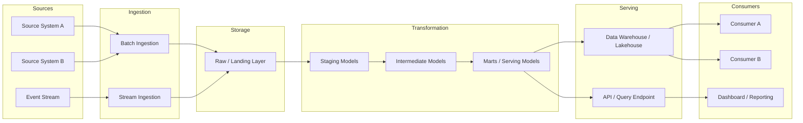

# Architecture Diagram

> **When is this required?** This artifact is required only when the data product introduces a
> new architectural pattern. Products that follow an existing approved pattern should reference
> that pattern and document only deviations.

---

## 1. Overview

| Field | Value |
|-------|-------|
| Product Name | [Product name] |
| Pattern Type | [New / Extension of existing pattern] |
| Existing Pattern Reference | [If extending, reference the approved pattern] |
| Classification | Sensitivity: [e.g., General / Restricted] |
|                | Criticality: [e.g., Medium / High] |

### Summary

[2-3 sentences describing the end-to-end data flow: what data comes in, how it is processed, and how it is served to consumers.]

---

## 2. End-to-End Architecture

> Replace or supplement the placeholder below with your architecture diagram.

---

## 3. Component Descriptions

| Component | Technology / Service | Purpose | Owner |
|-----------|---------------------|---------|-------|
| Source System A | [e.g., Operational database, third-party API] | [What data it provides] | [Source team] |
| Batch Ingestion | [e.g., Platform ingestion service, custom connector] | [How data is extracted and landed] | [Team] |
| Stream Ingestion | [e.g., Event streaming platform] | [How real-time events are captured] | [Team] |
| Raw Layer | [e.g., Object storage, raw schema] | [Immutable landing zone for source data] | [Data platform team] |
| Transformation | [e.g., SQL-based transformation framework] | [Business logic, cleaning, modeling] | [Data product team] |
| Serving Layer | [e.g., Data warehouse, lakehouse, API gateway] | [Query-optimized access for consumers] | [Data platform team] |

---

## 4. Infrastructure Requirements

| Requirement | Specification | Notes |
|-------------|---------------|-------|
| Compute | [e.g., Warehouse size, cluster configuration] | [Scaling considerations] |
| Storage | [e.g., Estimated volume, growth rate] | [Retention and lifecycle policies] |
| Networking | [e.g., VPC peering, private endpoints] | [Cross-environment access requirements] |
| Secrets / Credentials | [e.g., Service accounts, API keys needed] | [How they are managed] |
| Environments | [e.g., Dev, Staging, Production] | [Parity requirements between environments] |

---

## 5. Failure Modes & Recovery

| Failure Scenario | Impact | Detection Method | Recovery Strategy | RTO |
|-----------------|--------|------------------|-------------------|-----|
| Source system unavailable | Ingestion stalls, data freshness degrades | Ingestion job failure alert | Retry with backoff; backfill on recovery | [X] hours |
| Transformation job failure | Stale data in serving layer | Job orchestrator alert | Fix and re-run from last successful checkpoint | [X] hours |
| Serving layer outage | Consumers cannot query data | Platform health monitoring | Failover to replica or cached layer (if available) | [X] hours |
| Data corruption in source | Bad data propagates downstream | Data quality checks in transformation | Halt pipeline, revert to last known-good state, reprocess | [X] hours |
| Schema drift in source | Ingestion or transformation breaks | Schema validation on ingestion | Alert, pause ingestion, coordinate with source team | [X] hours |

---

## 6. Deviations from Existing Patterns

> If this product extends an existing approved pattern, document only the deviations here.

| Area | Approved Pattern | This Product's Deviation | Justification |
|------|-----------------|-------------------------|---------------|
| [e.g., Ingestion] | [Standard batch ingestion] | [Added streaming ingestion] | [Real-time freshness requirement from Consumer A] |
| | | | |

---

## Appendix: Revision History

| Version | Date | Author | Summary of Changes |
|---------|------|--------|--------------------|
| 0.1 | | | Initial draft |
| | | | |
