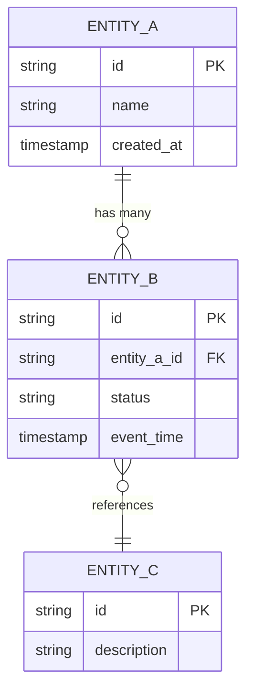

# Data Model

---

## 1. Overview

| Field | Value |
|-------|-------|
| Product Name | [Product name] |
| Grain | [e.g., One row per customer per day] |
| Update Pattern | [e.g., Full refresh, incremental append, incremental merge] |
| Primary Source(s) | [List upstream sources] |
| Target Platform | [e.g., Cloud data warehouse, lakehouse — specify platform as applicable] |
| Classification | Sensitivity: [e.g., General / Restricted] |
|                | Criticality: [e.g., Medium / High] |

---

## 2. Logical Data Model

### 2.1 Entity-Relationship Diagram

> Replace or supplement the placeholder below with your ER diagram.

### 2.2 Entity Descriptions

| Entity | Description | Grain | Approximate Volume |
|--------|-------------|-------|--------------------|
| ENTITY_A | [What this entity represents] | [One row per ...] | [e.g., ~1M rows, growing ~10K/day] |
| ENTITY_B | [What this entity represents] | [One row per ...] | [e.g., ~50M rows, growing ~200K/day] |
| ENTITY_C | [What this entity represents] | [One row per ...] | [e.g., ~5K rows, slow growth] |

---

## 3. Physical Table Definitions

### 3.1 `[schema].[table_name_a]`

| Column | Type | Nullable | PK/FK | Description | Business Rule |
|--------|------|----------|-------|-------------|---------------|
| `id` | `STRING` | No | PK | Unique identifier | Generated by source system |
| `name` | `STRING` | No | | Display name | Trimmed, title-cased |
| `created_at` | `TIMESTAMP` | No | | Record creation time | Source system timestamp, UTC |
| | | | | | |

**Partitioning:** [e.g., Partitioned by `created_at` (daily)]
**Clustering / Sort Key:** [e.g., Clustered by `id`]
**Indexes:** [If applicable]

### 3.2 `[schema].[table_name_b]`

| Column | Type | Nullable | PK/FK | Description | Business Rule |
|--------|------|----------|-------|-------------|---------------|
| `id` | `STRING` | No | PK | Unique identifier | |
| `entity_a_id` | `STRING` | No | FK -> table_a.id | Reference to parent entity | Must exist in table_a |
| `status` | `STRING` | No | | Current status | One of: `active`, `inactive`, `archived` |
| `event_time` | `TIMESTAMP` | No | | Time of the event | Source event timestamp, UTC |
| | | | | | |

**Partitioning:** [e.g., Partitioned by `event_time` (daily)]
**Clustering / Sort Key:** [e.g., Clustered by `entity_a_id`]

> Repeat this section for each table in the product.

---

> **Where source-to-target lineage lives:** field-level transformations are
> implemented in dbt SQL during Phase 4 Build (owned by `write-dbt-model`).
> Target schema (types, constraints, quality rules) is declared in the data
> contract (`contract/contract.yaml`, RFD 0009). This template captures the
> conceptual model only.

---

## 4. Slowly Changing Dimensions (SCD)

> Complete this section if any entities track historical changes. Remove if not applicable.

| Entity / Table | SCD Type | Tracking Columns | Effective Date Column | End Date Column | Current Flag |
|---------------|----------|------------------|-----------------------|-----------------|--------------|
| [table_name] | [Type 1 / Type 2 / Type 3] | [Columns tracked for changes] | `effective_from` | `effective_to` | `is_current` |
| | | | | | |

### SCD Processing Logic

- **Type 1 (Overwrite):** [Describe which attributes are overwritten in place]
- **Type 2 (History):** [Describe how new rows are inserted with date ranges, how `is_current` flag is managed]
- **Type 3 (Previous Value):** [Describe which attributes retain previous value columns]

---

## 5. Known Limitations

| Limitation | Impact | Mitigation |
|------------|--------|------------|
| [e.g., Source system does not emit deletes] | [e.g., Deleted records remain in product] | [e.g., Soft-delete reconciliation job runs weekly] |
| [e.g., Late-arriving data up to 48 hours] | [e.g., Recent partitions may be incomplete] | [e.g., Re-process last 3 days on each run] |
| | | |

---

## Appendix: Revision History

| Version | Date | Author | Summary of Changes |
|---------|------|--------|--------------------|
| 0.1 | | | Initial draft |
| | | | |
