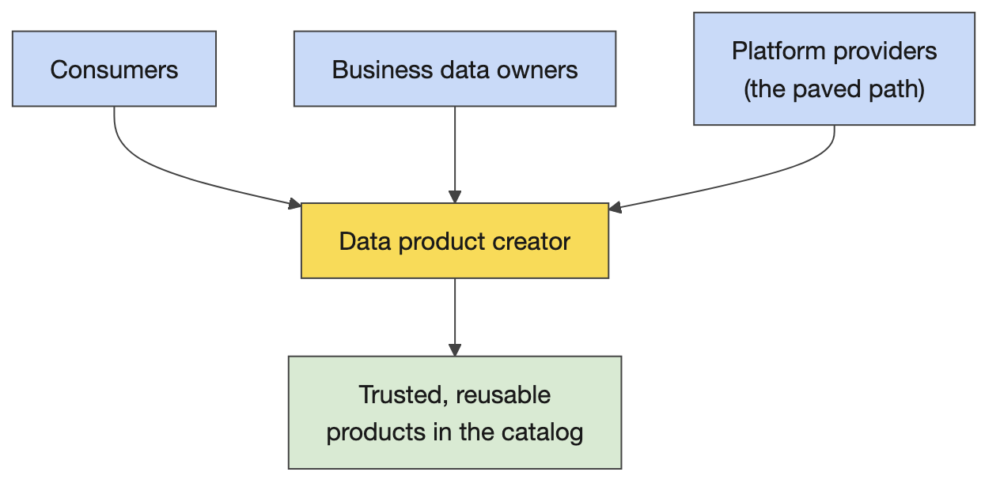
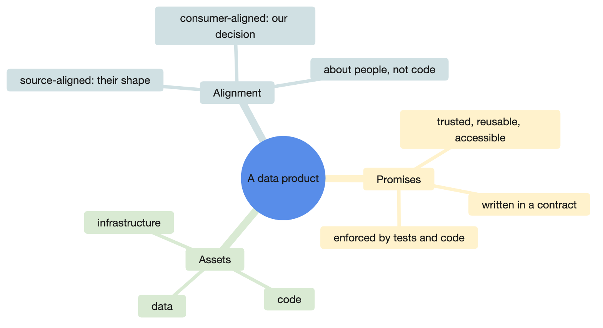
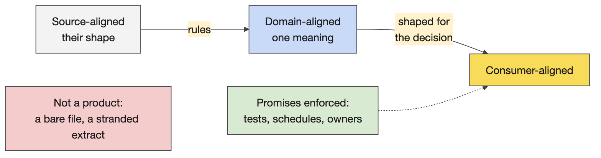
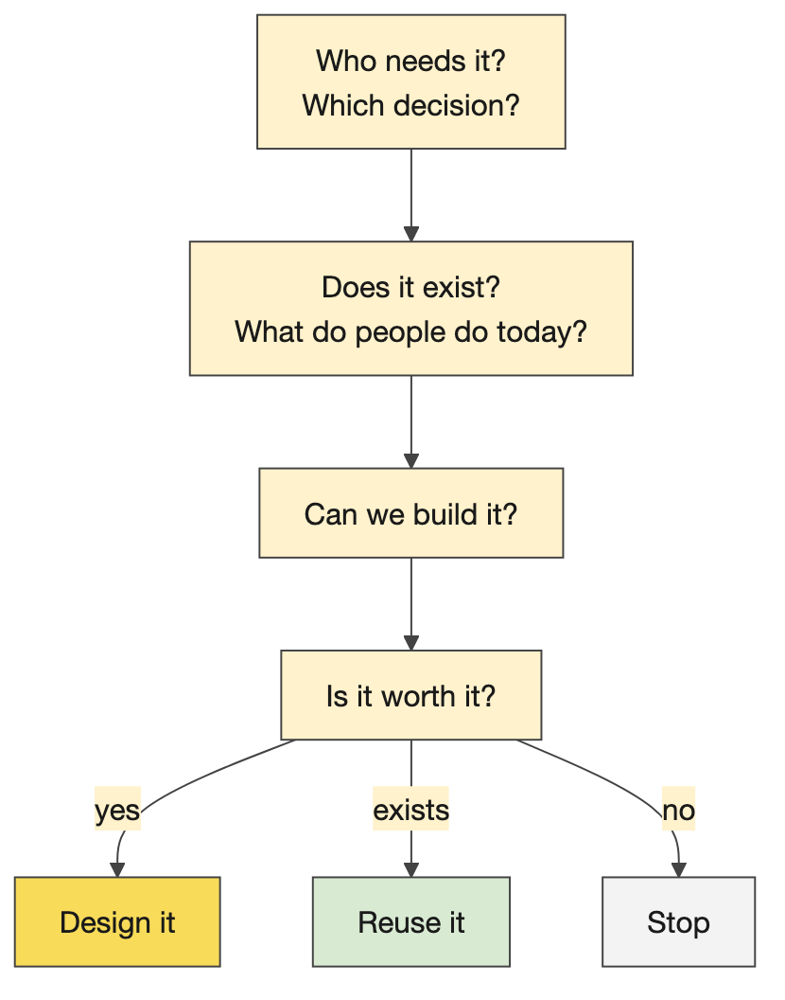
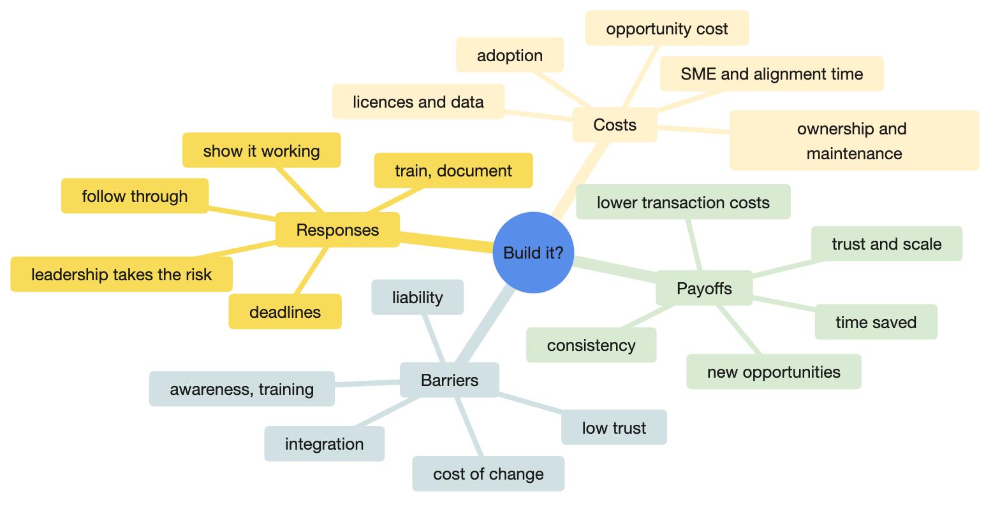
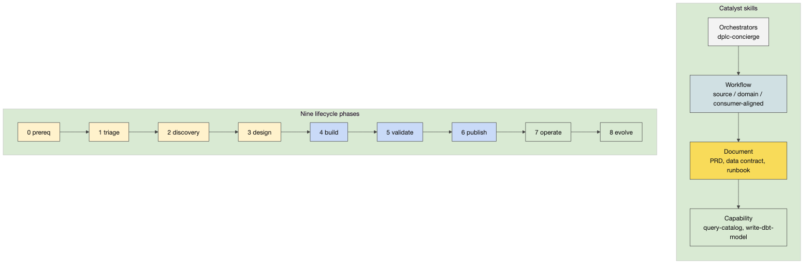
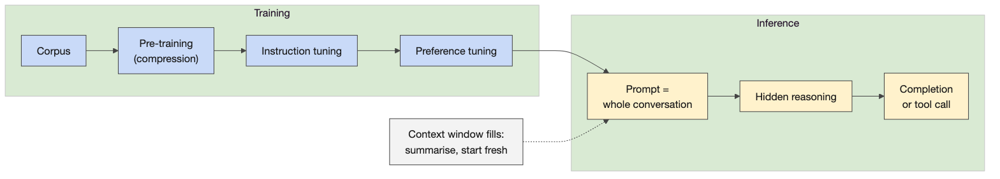
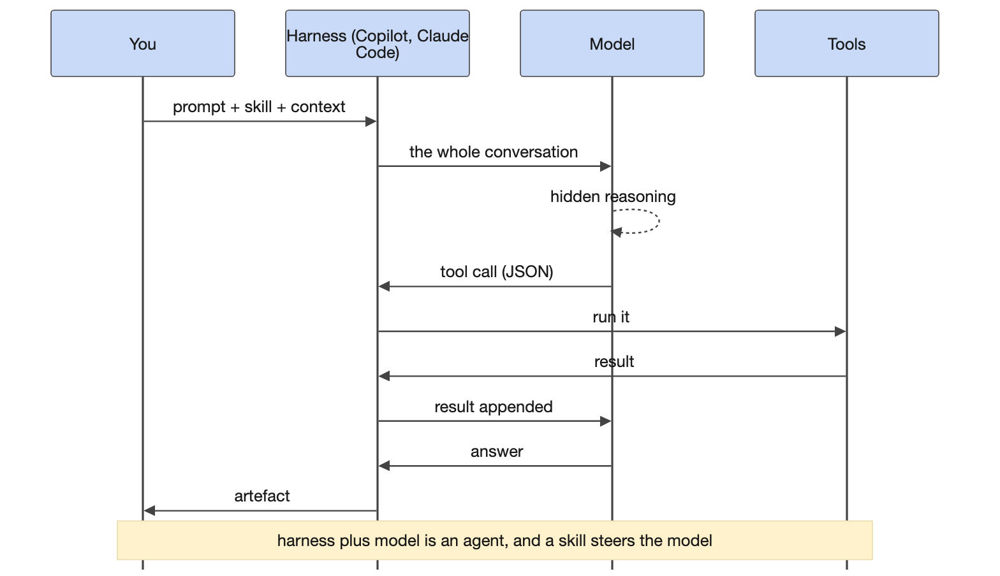
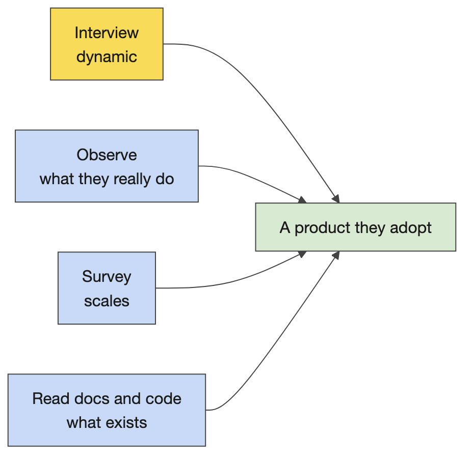
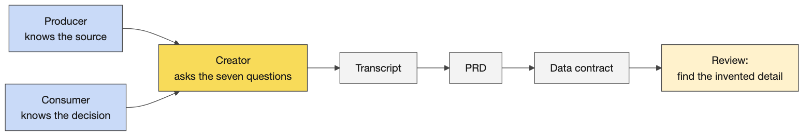

# Day 1 instructor prep guide — Product discovery and effective AI use

[Data Creators › Day 1 — instructor prep guide]{.breadcrumb}

An hour's reading to be workshop-ready for Monday. The sections mirror the anchor notebook's four numbered sections. Each one gives the concepts in depth (more than the notebook says, because the room will ask), teaching notes (how to explain it, what to whiteboard, the questions rooms ask and the answers), and the mechanics of the demos and activities (what runs, what comes out, what goes wrong). The self-test at the end is the quickest way to find the gaps; the evening-before checklist is what to run.

The run sheet beside this file carries the timings, the lines to say and the whiteboard scripts; this guide is the understanding behind them.

## The day in one page

Day 1 is a design day with no code. Learners arrive with the products they already work on and leave with a justified product idea, an interview transcript, a reviewed PRD and a reviewed data contract, and the vocabulary of the data product lifecycle. The through-line to repeat all week: **design conversations, transcripts and reviewed contracts produce most of the code**; the practicals from Day 2 on exist so learners can check what Catalyst generated.

| # | Section | What happens | You must be able to |
|---|---|---|---|
| 1 | Welcome, the room and the operating model | Introductions, products and pain points on paper, the sponsor's view (or its fallback), what a data product is | State the four personas and the three views of a data product without notes |
| 2 | Discovery, justification and Catalyst | The triage questions, Activity 2, lifetime value and adoption, the Catalyst demo, independent PRDs | Explain why a product is worth building in costs and payoffs; show what a skill is and how to tell it ran |
| 3 | AI foundations and effective practice | The seven ideas, the interface side by side | Explain training, inference, tool calls and the harness in plain words; choose a model and an effort level |
| 4 | Interview, generate and the lifecycle | Voice Memos, the interview in threes, transcript to PRD to contract, the planted errors, the lifecycle | Run the interview activity and lead a debrief that finds the invented detail |

Three things that go wrong on Day 1: Catalyst is not installed or the repository is not visible for some learners (an access request, not a settings problem); the live generation runs without the plugin (plain Copilot, no "reading skill file" line); the first share-out has nothing written down. The pre-flight checklist covers the first; the fallback artefacts cover the second; "write it on the paper in front of you" covers the third.

## 1. Welcome, the room and the operating model

### Concepts

#### The DXP operating model

**What it is.** Capital Group's Data Excellence programme (DXP) reorganises who does what with data around four personas. *Consumers* are everyone, including the people in the room: anyone who makes a decision with data, through a dashboard, an API, a model or a spreadsheet. *Platform providers* are the enterprise data office (EDO) platform team, who now offer one paved path (policies, standards, tooling, catalogs, metadata) where until recently a team chose between several platforms. *Business data owners* are senior business people accountable for a domain (client, results, positions, attribution, trades, research); the DXP site lists owners and stewards. *Data product creators* are the people being trained this week: they sit at the intersection of the platform, the owners' priorities and the consumers' needs, and build for reuse, scale and resilience.

**Why CG does it this way.** For years technologists made the data calls (which table, which key, which join) without the business context or the policy knowledge, which made them accountable for decisions that were not theirs. AI raises the expectations on data further, and AI without solid data is worse than no AI. The test the sponsor gives: can you find the portfolio positions of a given fund, with confidence it is the right table, in three seconds? Could a new associate do it in five minutes? Could an AI? Today the answer is no; the target is self-service on trusted data across the firm, governed (entitlements, aggregation policies, PII protected), usable by people and by AI.

**On the paved path.** Publishing to the right catalog with metadata and access controls replaces "ask a person for the data". The creator's job is the most important one in the model because nothing reaches a consumer without it. Entry and intermediate level: everyone is expected to pass and apply it to a real use case straight after.

#### What a data product is

**What it is.** A data set with promises: trusted, reusable, business-ready, accessible. Promises of what? Of a data set that stays correct, timely and available. Enforced how? By contracts and design documents, by data quality checks, and by code running on infrastructure. Three views of the same thing, for three audiences: the creator and product manager see a *data set plus promises*; the platform and engineering view sees *data plus code plus infrastructure*; the design view sees *a transformation from source-aligned to consumer-aligned data*.

**Alignment** is the word the week turns on. Source-aligned data keeps the producer's shape; consumer-aligned data is shaped for the decision a consumer makes. Alignment is relative to people's goals, not a technical property: the people over there built it for their interests, we realign it for ours. Day 5 adds the middle layer, domain-aligned, where one definition of a client, a trade or a position is agreed for every consumer.

**What it is not.** A bare source data set is not a data product (a vendor file dropped in a folder is the vendor's product, not CG's). A consumer-aligned data set stranded without processes, code and infrastructure is a one-off extract. Code and infrastructure without realignment is a pipeline, not a product.

### Teaching notes

- **Elicit, do not lecture.** Ask the question on the whiteboard part of the anchor, take the first answer and write it, ask a table rather than the room when it goes quiet, and add what is missing from the run sheet's script. The room produces most of the definition itself; your job is the order and the missing words.
- **Name the groups fast** by the first thing that happens at the table, and keep a visible list of the room's own products and pain points. Every later activity reuses it: Activity 2 picks a product from it, Day 2 picks a contract from it.
- **Analogies that land.** A promise is a contract you can be held to; "trusted" means someone can be blamed, which is why ownership matters. Alignment: a vendor's file is shaped for the vendor's billing, not your portfolio view.
- **Likely questions and answers.**
  - *Is a dashboard a data product?* It is a consumer of one. The product is the data set with its promises; a dashboard with no contract behind it is a stranded consumer-aligned data set.
  - *Who owns a data product?* The business data owner is accountable for the domain; the creator builds and operates the product; the platform team provides the path. Three people, three jobs.
  - *Isn't this a data warehouse team by another name?* The difference is product thinking (a named consumer, promises, a lifecycle, reuse), ownership distributed by domain, and a self-service platform instead of a central queue.
  - *Why "alignment" rather than bronze, silver, gold?* Medallion names describe how far data has been cleaned; alignment describes whose shape it is built for. CG uses both; the course teaches alignment and recognises the older names.
- **Misconceptions to catch.** "Trusted" meaning someone checked it once (promises are enforced continuously by contracts, tests and infrastructure). "Reusable" meaning one wide table (reuse comes from conformed definitions, not width). "Our source data is the product" (it is the input).

### Mechanics

- **Activity 1 (15 minutes).** Two parts: who you are, your team, a shared hobby; then, on paper, the data products you work on and what is annoying about them. Say explicitly that they will reuse the list. Share-out at the stated time: one product and one pain point per table; you type them into the notebook's shareback cell.
- **Prompts if a table is stuck.** Previous rooms brought: aligning teams that own different client domains; sourcing positions and transactions from the accounting book of record per product type; website behaviour data whose curated extracts depend on one team's bandwidth; marketing engagement data where one person has several profiles; attribution data de-duplicated ahead of a target state; reference data where "all the data all the time" and many lineages are supported at once; mastered client profiles where "is 50 billion right or is it 50 million?"; advisor data with rigid contracts that frustrate consumers with different lenses; North-America-centric standards meeting less mature regions.
- **The sponsor slot and its fallback.** If a sponsor comes, send them the slot's agenda line (the three-second test, the four personas, the publishing promise, questions). If not, give the five-minute version from the anchor's Guest part yourself and log every access or policy question in the Q&A table for the platform team.
- **Table rotation.** Count off after lunch so people meet other teams; it also re-mixes the interview threes.

## 2. Discovery, justification and Catalyst

### Concepts

#### Triage and discovery

**What it is.** The questions asked before any design, in order. Who needs it, and what is the business purpose? Does it already exist? What do people do now (the workarounds are the real requirements)? Do we still need it? Then feasibility: can we build it, and how (does the data exist; sources; transformations; platform; sensitivity and PII; delivery; update frequency; grain; by when)? Then the decision: is it worth it, is it viable, what does it cost, does it deserve this priority now, what is its lifetime value?

**Why CG does it this way.** The lifecycle's first phases (define, triage, discovery) exist because most expensive failures are products nobody needed, products that already existed, or products built to the wrong grain. The questions are cheap; the code is not.

#### Lifetime value and adoption

**Costs.** Total cost of ownership and maintenance (teams, not just build), opportunity cost, licensing and data acquisition, development time, prioritisation, alignment and subject-matter-expert time (an auction market for people's time would price it exactly), and adoption cost: being in this room is part of the cost of adopting the paved path.

**Payoffs.** Consistency (price it by the alignment meetings it removes), consumer time saved (easy to price close to revenue, which is why finance teams look good: they sit where value is observable), new business opportunities, trust and reduced churn, less friction, operational scale, lower transaction costs (that is what the paved path is), AI workflows and process efficiency, focus ("one way, let's go"). Leadership must make judgement calls on the value that cannot be priced.

**Adoption.** Barriers: integration difficulty, low trust, liability (nobody wants to be blamed), lack of training, awareness, competing priorities, resistance and the cost of relearning, safety, a product that does not support the use case, planning overhead. Responses: leadership that absorbs liability and evangelises, showing the value (a recorded demo beats an abstract pitch), training, communication campaigns, deadlines that force prioritisation, documentation, reliable follow-through.

**The aside worth having ready.** Firms exist to reduce transaction (alignment) costs; past a certain size those costs return as bureaucracy, and alignment becomes the dominant cost as the business scales. It answers "why so much process?" without defending the process.

#### Catalyst

**What it is.** A GitHub repository of AI skills aligned to CG policy, installed into VS Code as a Copilot plugin from the `cg-open-itg/catalyst` marketplace and invoked in Copilot Chat as `/ai-catalyst <skill-name>`. A skill is a saved prompt: a Markdown instruction file, usually with a template and quality checks, sometimes with Python (the capability skills that search the Marketplace, query a catalog or table, profile columns, run dbt on Databricks). Skills sit in four tiers that compose downwards: orchestrators (the lifecycle concierge), workflow skills (one per lifecycle phase, such as `dplc-design`, which runs `requirements-acceptance-criteria`, `feasibility-report`, `consumer-use-case-map` and `data-model` in sequence), document skills (`product-requirements-document`, `data-contract`, `transformation-spec`, `runbook`), and capability skills.

**The lifecycle.** Nine phases, numbered 0 to 8: define (prerequisites), triage, discovery, design, build, validate, publish, operate, evolve. The build phase requires a PRD, a data contract, a data model and a transformation specification, each with a skill. The concierge routes you to the right phase but is slow ("start it on Friday and you may have a product on Monday"); prefer the specific skill.

**The data contract template.** Eight numbered sections plus an appendix: 1 identity, 2 schema, 3 service level agreements (targets and breach response), 4 data quality rules, 5 access and security, 6 change management (breaking changes, non-breaking changes, versioning policy), 7 consumer registry, 8 approvals, then the revision history. The PRD's sections: executive summary, use case, problem and value, consumers, solution overview, what this is not, requirements, roles, success criteria, technical design, version.

**How you know it ran.** When Catalyst is really on, Copilot shows that it is reading the skill file before it answers. Without that line it is plain Copilot with a general prompt, which still produces a document, which is the point of the next sentence. It always generates something; it cannot not generate. The skill's quality checks do not stop invention; the review does.

### Teaching notes

- **The debrief of Activity 2 is the teaching.** Each table reports the most interesting, surprising or difficult question, not their whole worksheet. Typical surprises: nobody could name the consumer's decision; the product already exists in two places; the grain was never discussed; the "when by" was a quarter away and nobody knew why.
- **Lifetime value is a whiteboard, not a lecture.** Ask for costs first (rooms list them readily), then payoffs (rooms stall; add consistency and consumer time), then adoption barriers (rooms are fluent) and responses (add leadership absorbing liability).
- **Likely questions and answers.**
  - *Can Catalyst read our real data?* The document skills work only from what you give them. The capability skills reach Databricks with your own credentials, so they see what you can see and nothing more.
  - *Is the PRD skill better than just asking Copilot?* Same model. The skill adds CG's template, section order and checks, so you get consistency and completeness, not intelligence.
  - *Why does the PRD look so good and the contract so shaky?* PRDs look better because they are vaguer. A contract needs numbers, owners and dates, which is exactly where a model invents.
  - *Why Markdown?* Plain text that models read and write well, version-controlled, reviewable in a pull request, and rendered anywhere.
- **Misconceptions to catch.** Catalyst is a model (it is prompts and templates). The concierge does everything (it is slow and generic; prefer the specific skill). Generated means done (generated means ready to review).

### Mechanics

- **Activity 2 (20 minutes, then a 25-minute debrief).** Tables pick a product from the morning's list or propose a new one and answer the non-technical questions; paper and a note taker; the output is the most interesting question. The debrief whiteboard in the run sheet lists what rooms usually say.
- **The Catalyst demo.** Open the skill files in `courseware/.claude/skills/` (the same files learners see in the Catalyst repository): `data-contract/SKILL.md` and its template, `dplc-design/SKILL.md` to show skills calling skills, `dplc-concierge/SKILL.md` for the warning about speed. Then generate: learners' form in Copilot Chat, instructor's form in Claude Code opened on `courseware/`, with the running example's transcript pasted into `/product-requirements-document`. Point at the moment the skill file is read.
- **If the generation stalls or Catalyst is missing on the laptop**, open `courseware/common/running-example/prd.md`, the reviewed output with the corrections in brackets, and walk the key product information, problem and value, and consumers sections. The lesson survives without the generation.
- **Activity 3 (10 minutes, straight before lunch).** Each learner runs the PRD skill alone from the same one-paragraph brief; the table compares after lunch if the debrief slot allows. Expect several learners to hit "repository not found" here: that is the lunchtime setup slot.

## 3. AI foundations and effective practice

### Concepts

#### The seven ideas, in order

1. **Definitions.** AI is a project to automate tasks that need intelligence, where intelligence is the strategy an animal uses when there is no known solution; computer science defines it by the solved problem. Generative AI is a proxy model operating in the text domain: it describes the future, it cannot simulate it.
2. **Discriminative versus generative.** A discriminative model separates (spam or not); a generative model produces the next token given the previous ones. Everything a chat model does is the second.
3. **Training.** Pre-training on an internet-scale corpus (and e-books); vendors now harvest their own chat traffic as human signal, because training on model output collapses quality (the compression analogy: a copy of a copy). Instruction fine-tuning with paid annotators; reinforcement learning from human feedback with experts. Code is the one domain where preference can be automated, because the code either runs or it does not, which is why models are so good at code and why "it runs" is a weak quality signal.
4. **Costs.** Of the order of tens of millions of dollars to train a frontier model and hundreds of millions a month to run it; inference is the moat now, which is why vendors sell context and speed.
5. **Inference and reasoning.** "Thinking" is hidden intermediate tokens you pay for; domains with written-out reasoning in the corpus (maths, cybersecurity, code) do well. The traces are hidden because competitors distilled them.
6. **Tool calls and the harness.** A model emits JSON describing a call; a harness (VS Code with Copilot, Claude Code) executes it and feeds the result back. The model is the engine, the harness is the car. An agent is a harness plus a model in a loop.
7. **Skills.** Prompts that trigger tool calls; that is what Catalyst is.

#### The interface

**Model picker.** Within a family the least compressed model is the most capable and the most expensive; the names change month to month, so name this week's. With more context in the prompt the choice matters less; the choice is empirical, so start fast and escalate. **Thinking effort** is a hidden token budget; maximum can be worse on simple questions; medium or high is the sensible default. **Context window**: hundreds of thousands of tokens that include the hidden reasoning and every tool result; performance degrades as it fills; compaction is lossy, so summarise to a file and start a new conversation yourself. **Modes**: Copilot's Ask, Edit and Agent, with approvals or autopilot; Claude Code is agentic by default and asks before edits unless auto-approved.

### Teaching notes

- **Keep the lecture to the seven ideas**, one line and one analogy each, then show the interface. Rooms remember the car and the engine, the copy of a copy, and "it always generates something".
- **Likely questions and answers.**
  - *Does the model remember our data?* Not across conversations unless the vendor trains on the traffic, which enterprise agreements exclude. Never paste a secret or a client record; the running example is synthetic for that reason.
  - *Why is the reasoning hidden?* Competitors trained on the traces; vendors stopped showing them.
  - *Which model for dbt work?* Start with a fast model at low effort and escalate when the output is wrong; the compiled SQL is the check, not the model's confidence.
  - *Is the output deterministic?* No. The same prompt gives different outputs, which is why every line is reviewed.
  - *Will a skill hallucinate less?* It invents where the input is silent. Fill the input (the transcript, the contract) rather than fixing the output by hand.
- **Misconceptions to catch.** Bigger is always better (slower and sometimes worse on simple tasks). "Thinking" is reasoning like a person (it is more tokens). The context window is memory (it is a budget that fills and degrades).

### Mechanics

- **The side-by-side demo.** Copilot Chat on one half (what learners see), Claude Code on the other. Show the model picker and name the models; ask the same question at low and at maximum effort and compare; show the conversation length, then `/clear` or a new chat. Then the task: "Add realistic SLAs to this contract" with `courseware/common/running-example/data-contract.md` attached, followed by "List every number in the SLA section and where it came from". The point lands when the model admits the numbers were invented.
- **Timing.** Forty minutes for the block including the demo; the break follows.

## 4. Interview, generate and the lifecycle

### Concepts

#### Requirements discovery

**Four methods.** Interview (dynamic follow-up; people lie or are confused, so ask about last Tuesday rather than "usually"); observe (revealed behaviour: design from purgatory, not from technical heaven); survey (scale, no depth); read their documents and code (the queries people already run are requirements). The interview activity uses three roles: the producer knows the upstream source, the consumer knows the decision and the desired result, the creator interviews both.

**The seven questions.** What decision do you make with the data? How do you make it today? Who uses the result directly? How is the source generated? What do these terms mean in your work? How do you recognise a usable result? When do you read the result? Learners add their own and stay in role until it breaks down.

#### From transcript to PRD to contract

The recording becomes a transcript (Voice Memos on a Mac; the Teams or Zoom transcript does the same), the transcript goes into the PRD skill, the PRD goes into the data contract skill. The contract carries the glossary because upstream vendors define their own terms, and the change management section because version 0 already needs a versioning policy. The hallucination pattern to name in the debrief: identifiers, dates, versions, approvals and confident numbers are where a model fills gaps. Previous rooms found fees computed from generic internet knowledge until the skill was pointed at the internal source; "universal attributes" that came back as CUSIP, ticker and ISIN but incomplete; a scope so broad the model proposed one wide table instead of a normalised model; a revision history that never happened.

#### The lifecycle, explored

Activity 5 has learners interview Catalyst about itself: the phases of the lifecycle, what the build phase requires, which requirements have a skill. The answers are in the anchor's folded block. The habit it builds: ask Catalyst what it needs before using a skill.

### Teaching notes

- **Thirty to thirty-five minutes including generation** is what the activity takes; threes re-mixed by counting off; one laptop records, one drives Copilot.
- **The debrief finds the invented detail.** Ask each table what the generated documents got wrong, then name the pattern. Then the four discovery methods, then the PRD and contract sections, then why the glossary lives in the contract.
- **Likely questions and answers.**
  - *Why not write the PRD ourselves?* The transcript is the raw material and the skill structures it; the review is faster than the writing, and the structure is the same for every product.
  - *What if the subject-matter expert is not available?* Observe and read first; interview when you can; say in the PRD which questions are still open rather than inventing answers.
  - *How much detail in the contract on day one?* Enough that someone else could implement a rule without asking what it means. Day 2 adds the source-to-target mapping and the service levels.
- **Misconceptions to catch.** A longer transcript gives a better PRD (a focused one does). The model knows CG's terms (it knows the internet's; the glossary fixes that). The contract is finished when generated (it is finished when reviewed and signed in the approvals section).

### Mechanics

- **Voice Memos demo.** Record thirty seconds, pause, Done; the Transcript button; click off and on again, then Copy transcript. Closing the laptop lid stops a recording, which matters for the course transcript too.
- **Activity 4 (30 minutes).** Roles, the seven questions, the prompt in the anchor (the transcript pasted into the PRD skill, then the contract skill with the PRD in context). Outputs: a transcript, a PRD, a contract, and the list of what the documents got wrong.
- **The planted-errors reflect.** `courseware/common/running-example/data-contract-planted-errors.md` holds five invented details with the answer key at the end of the file; three minutes for the room to find them before the key.
- **Activity 5 (15 minutes).** Individually, then tables: the lifecycle questions; the expected answers are in the anchor.
- **Artefacts to keep.** One PRD and one contract per table; Day 2's Activity 6 extends a Day 1 contract and the review demo opens a submitted one.

## Readiness self-test

Answer without notes; the answers follow.

1. Name the four personas of the operating model and say which one the room is being trained to be.
2. What are the three views of a data product, and who holds each?
3. Give three things that are not data products and say why.
4. What is the difference between source-aligned and consumer-aligned, and what makes alignment relative?
5. List five triage questions in the order you would ask them.
6. Give three costs and three payoffs of a data product that a room rarely names itself.
7. What is a Catalyst skill, technically, and how do you know one actually ran?
8. Name the nine lifecycle phases and the four documents the build phase requires.
9. Why are models so good at code, and why is "it runs" a weak quality signal?
10. What is a harness, and what is an agent?
11. Where does a model invent, and what do you fix first when it does?
12. What are the three interview roles and four of the seven questions?

### Answers

1. Consumers, platform providers, business data owners, data product creators; the room is creators, at the intersection of platform, owners and consumers.
2. Data set plus promises (creator and product manager); data plus code plus infrastructure (platform and engineering); a transformation from source-aligned to consumer-aligned data (design).
3. A vendor file in a folder (the vendor's product, not CG's); a consumer-aligned extract with no process, code or infrastructure behind it (a one-off); a pipeline with no realignment (plumbing).
4. Source-aligned keeps the producer's shape; consumer-aligned is shaped for a decision; alignment is relative to people's goals, not a property of the data.
5. Who needs it and for what purpose; does it exist; what do people do now; do we still need it; can we build it and how; is it worth it and does it deserve this priority now.
6. Costs: alignment and expert time, adoption cost, opportunity cost. Payoffs: consistency priced by meetings removed, consumer time saved, lower transaction costs.
7. A saved prompt: a Markdown instruction file with a template and checks, sometimes with Python, loaded by the Copilot plugin; Copilot shows it reading the skill file.
8. Define, triage, discovery, design, build, validate, publish, operate, evolve; PRD, data contract, data model, transformation specification.
9. Preference can be automated for code (it runs or it does not), so the training signal is abundant; running is not the same as correct, which is why the review reads every line.
10. The program that executes a model's tool calls and feeds results back (VS Code with Copilot, Claude Code); a harness plus a model in a loop.
11. Where the input is silent: identifiers, dates, versions, approvals, confident numbers. Fix the input (transcript, contract, context) before the output.
12. Producer, consumer, creator. What decision do you make; how do you make it today; who uses the result; how is the source generated; what do the terms mean; how do you recognise a usable result; when do you read it.

## The evening before

- [ ] Walk `instructor/00-week/preflight-checklist.md` once more; confirm the platform-support contact for Monday morning.
- [ ] Open `courseware/day1-design/day1_anchor.ipynb` with the `cg-dxp` kernel, run the Setup cell, Run All, save with outputs.
- [ ] In Claude Code opened on `courseware/`, type `/` and confirm `product-requirements-document` and `data-contract` are listed; run the PRD skill once on the running example's transcript so the first live call is not the first ever.
- [ ] Open `courseware/common/running-example/prd.md`, `data-contract.md` and `data-contract-planted-errors.md`; find the five planted errors yourself.
- [ ] Record thirty seconds in Voice Memos and copy the transcript; confirm the course-transcript laptop will not sleep.
- [ ] Print the activity cards in `courseware/day1-design/activities/`, one per table, and this day's run sheet.
- [ ] Paper, pens and name cards on every table; the whiteboard visible from everywhere; the projector at 16-point.

## Go deeper

- The Catalyst skills as installed for Claude Code: `courseware/.claude/skills/` (the originals are in the training repository under `ai-skills/catalyst/skills/`, with a README on the four tiers and the lifecycle).
- The running example end to end: `courseware/common/running-example/README.md`.
- The prompt library for every beat of the day: `courseware/common/prompts/README.md`.
- The LLM guide for the interface demo: `instructor/00-week/llm-guide.md`.
- The Open Data Contract Standard (ODCS), which CG's contracts follow: https://bitol-io.github.io/open-data-contract-standard/
- Anthropic's guidance on context windows and prompt design: https://docs.anthropic.com/
