# Day 2 instructor prep guide — Mappings, service levels, the platform and Docker

[Data Creators › Day 2 — instructor prep guide]{.breadcrumb}

An hour's reading to be workshop-ready for Tuesday. The sections mirror the anchor notebook's six numbered sections, the fifth optional (revised on the morning of Day 2 after Day 1 as delivered): for each, the concepts in depth, the teaching notes (how to explain it, what to whiteboard, the questions rooms ask and the answers), and the mechanics of the demos and challenges. The self-test at the end finds the gaps; the evening-before checklist is what to run. The run sheet beside this file has the timings, lines and whiteboard scripts.

## The day in one page

Yesterday's contract is today's input. By the end of the day it has mapping rules and measurable commitments, the room understands what Databricks and Delta actually do with their data, everyone has built and run a container, and everyone knows which Catalyst skill belongs to which phase. If the room is ahead, it has also seen the Git loop and a pull request. No dbt code is generated today: the two musts are the design documents before the first break and Docker done by the end of the day. The platform block is the one to know cold: the previous cohort got a twenty-minute history lecture; this cohort gets diagrams, two demos on the laptop, and a shareback.

| # | Section | What happens | You must be able to |
|---|---|---|---|
| 1 | Day 1 recap and the map of the week | The room reclaims yesterday; source-, domain- and consumer-aligned as the bridge from the contract to the mapping; today's two musts | Give the three alignment one-liners and place yesterday's contract among them |
| 2 | Mappings and service commitments | STTM and SLI/SLO/SLA on the whiteboard, Activity 6 (30 minutes), the review and HTML demo | Name the rule types and the nines table from memory; separate an indicator from an objective from an agreement |
| 3 | Platform architecture | Warehouse, lake, lakehouse; Databricks under the hood; Delta; how the tools fit together; shareback, in thirty minutes | Draw the lakehouse as a relational database split in two; explain a Delta commit |
| 4 | Docker | The six demo cells and the dev container's Dockerfile before lunch; Challenge 7 to PASS after it with a stretch list; a shareback | Explain image versus container, layers and the cache, and why one app per container |
| 5 | Git and GitHub (optional) | Six cells on a scratch repository, the pull request on screen, a fifteen-minute practical or homework; run only if the room is ahead | Explain commit versus push and branch versus main; say why nobody edits main |
| 6 | Catalyst skills, and setting up for tomorrow | The skills by tier and phase, how the plugin loads, an optional design skill on the learners' own product, the Databricks setup everyone needs for Wednesday | Say which skill belongs to which phase, and why no build skill runs today |

Three things that go wrong: the HTML render on a big model at high effort does not finish on stage (run a fast model at low effort first and keep the pre-rendered page); Docker Desktop is not running or a Windows laptop is in the wrong container mode; the Databricks OAuth setup takes minutes per person (it is the last block of the day, and anyone who finishes Docker early starts it then).

## 1. Day 1 recap and the map of the week

### Concepts

#### What Day 1 left behind

A list of the room's own products and pain points; PRDs and data contracts generated from interview transcripts and reviewed for the invented detail; the discovery methods (interviews fastest, follow-up questions the real questions, observation for what people cannot say, surveys for scale with suspect answers); and the vocabulary of the lifecycle. The recording of Day 1 captured only its last ten minutes (`instructor/day1-design/day1_delivery-notes.md`), so reclaim the day from the room rather than from notes: ask what a data product is, what discovery taught, what the generated documents got wrong, and which documents exist now in which order.

#### Source-, domain- and consumer-aligned

The three words say whose shape a table is built for, and they are the bridge from yesterday to today. *Source-aligned*: the producer's shape, kept faithfully as an audit path (the vendor price file as it arrived). *Consumer-aligned*: the shape of a decision, one row per business question (the US price sheet: one row per instrument per business day, in USD, by 07:30 Eastern), which is what yesterday's contract describes. *Domain-aligned*: the firm's one definition of each entity, agreed by the data owner and reused by every consumer (what an instrument, a close and a business date are); the running example borrows it from the instrument master, Friday's product builds it. Today's mapping is the path from source-aligned to consumer-aligned, rule by rule, written in the domain's words. The older names (dbt's staging, intermediate, marts; the medallion bronze, silver, gold) describe a project's structure and a data set's cleanliness; alignment describes purpose, and it is the one a creator decides.

### Teaching notes

- **Ask, write, add.** The recap whiteboard in the run sheet has the answers rooms give; the room produces most of it.
- **Three one-liners, no more**, for alignment: their shape, the firm's shape, your reader's shape. The domain layer gets its full treatment on Friday; today it only needs to exist in the picture.
- **Likely questions.** *Is domain-aligned the same as cleaned staging?* No: staging renames and casts; domain-aligned applies one agreed definition. *Who decides the domain definition?* The domain's business data owner, not the consumer. *Which layer is the contract?* The consumer-aligned target; the mapping describes how to reach it from the sources.
- **Say the two musts** before the day runs: design documents before the first break, Docker at PASS by the end of the day; no dbt generation today.

### Mechanics

- Twenty-five minutes: ten on the recap whiteboard, ten on alignment with the two diagrams, five on the agenda and the musts.
- The alignment diagrams are the Day 1 `d1-alignment` picture and Day 5's `d5-alignment-naming`, so Friday's vocabulary is already familiar.

## 2. Mappings and service commitments

### Concepts

#### Source-to-target mapping

**What it is.** The artefact that says where each target column comes from and how. Sources A and B joined into target T; the core of the artefact is the transformation rules, column by column. The textbook rule types: *direct* (copy), *constant*, *lookup* (a value from a third table), *aggregate* (a mean, a sum), *derive or transform* (an operation on one or more inputs; concatenation is a subtype). Catalyst returns a CG-specific taxonomy that splits "derive" further; say so when learners compare lists. Row rules sit beside column rules: which rows are in scope, how duplicates are resolved, what a late or missing row does.

**Why it matters at design time.** Ambiguity, edge cases, what null means for each column, whether zero is a value or a gap, minimum and maximum values: all cheap to decide in the mapping and expensive to discover in production. The test for a rule is the one the anchor asks: could someone else implement this rule without asking you what it means? In dbt, every STTM rule becomes a line of SQL and most become a test, which is why the mapping is the most valuable page of the contract.

**The design documentation set.** PRD, data contract, glossary or data dictionary, STTM, service levels. The running example has all five in `courseware/common/running-example/`; its STTM has eleven column rules and four row rules for a US end-of-day price sheet.

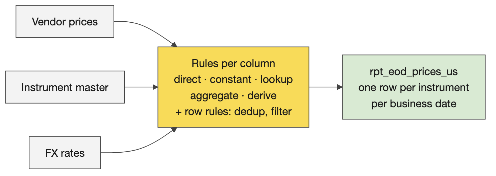

#### Service levels

**Three words.** An *indicator* (SLI) is a number you can measure: delay from the delivery time, latency, throughput, recovery time (service back, data restored, or back to an agreed level), completeness, accuracy, freshness, availability, support turnaround. An *objective* (SLO) is the indicator's ideal value: zero delay. An *agreement* (SLA) is the permissible departure and what happens beyond it: up to an hour late; beyond that the provider owes an explanation and, in a commercial contract, money. Say the time zone every time a delivery time is written down; the running example's 07:30 is Eastern.

**Availability in nines.** 90% is about 36 days of downtime a year (a month); 99% about 3.65 days (a working week); 99.9% about 8.8 hours (a working day); 99.99% about 53 minutes (an hour); 99.999% about 5 minutes. Calibration: serious cloud services offer three to four nines and pay credits when they miss; a chat assistant offers roughly one. Each extra nine costs about ten times more in redundancy: cloned infrastructure, global and local load balancing, a disaster-recovery site that already takes a share of traffic so you know it works. The number of nines tells you about spare capacity, not about care.

**Where they live.** Section 3 of the contract: targets and breach response. The breach response is the part rooms forget and the part consumers read.

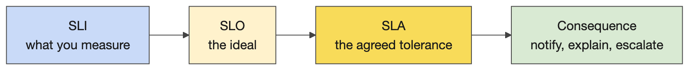

#### Reviewing a contract

The Markdown editor in VS Code (right-click, Open with…) is how learners should read the long READMEs on Wednesday and Thursday; say it on Tuesday. Turning a contract into one self-contained HTML page is a small demo with a large lesson: a fast model at low effort returns a navigable page in a minute; the biggest model at high effort may not finish while you teach. Model and effort trade speed for quality, the choice is empirical, and reasoning traces are hidden because competitors trained on them.

### Teaching notes

- **Whiteboard order.** Ask what an STTM is, then the rule types, then the documentation set; then what SLI, SLO and SLA stand for, then "give me indicators" (rooms are fluent), then the nines (write the mnemonic month, week, day, hour, minutes), then how providers get more nines.
- **Analogies.** An SLI is the thermometer, the SLO is the temperature you want, the SLA is the band you promise the patient before you call a doctor. Nines: the cost of the tenth nine is a second data centre.
- **Likely questions and answers.**
  - *Is latency an indicator or an objective?* The indicator is the measured latency; the objective is the number you aim for; the agreement is the tolerance you promise and the consequence.
  - *Who signs the SLA?* The business data owner for the product and the consumers in the registry; the breach response says who is told and how fast.
  - *How many nines should we promise?* As many as the consumer's decision needs and no more; each nine costs an order of magnitude. A nightly report does not need four.
  - *Where does the STTM live, the contract or a separate document?* Both exist at CG; the contract's schema section carries the target and the transformation specification carries the rules. In dbt they become models and tests.
  - *What does null mean?* Nothing until the mapping says: unknown, not applicable, not yet delivered. Decide per column.
- **Misconceptions to catch.** An SLA is only uptime (it is any indicator with a tolerance). An STTM is a column list (the rules are the content). Null handling is a build-time detail (it is a design decision).

### Mechanics

- **Activity 6 (25 minutes).** Individually, ask Catalyst which transformation types and which service measures exist (`transformation-spec`, `sla-dashboard-spec`); then tables pick a Day 1 contract, name the incoming tables and the outgoing table, write concrete rules (lookups, derivations, null rules) and realistic commitments; transcribe the table's discussion and feed it in, as on Day 1. Collect one revised contract per table for the review.
- **The worked example (five minutes, before Activity 6).** Screen-share the running example's contract (sections 2 to 4), then `04-sttm.md` and `05-service-levels.md`; the anchor renders the last two inline, then shows the first rows of `data/`: the three source files as landed beside the published price sheet, so the room sees that the contract's schema is the consumer's shape and the vendor's columns stop in staging. Say it is what theirs will look like after the activity.
- **The review demo.** Open a submitted contract in the Markdown editor and edit one cell. Run the HTML prompt on a fast model at low effort and open the page in the browser; start the same prompt on the biggest model at high effort and let it run while you teach. If both stall, `courseware/common/running-example/03-data-contract.html` is the pre-rendered page (made with pandoc).
- **The implementability test.** Take two rules from the room's contracts and ask whether someone else could implement them without asking; rooms find their own ambiguity in a minute.

## 3. Platform architecture

### Concepts

#### Warehouse, lake, lakehouse

**The history, in one pass.** File systems (1950s) had no common structure, so every program had to know every file. Databases added structure; relational databases (1970) made a table a set of tuples, which is why primary keys exist. ACID is best explained as linearizability: Alice writes 1, Bob writes 2, Eve writes 3; whatever fails or arrives out of order, a reader sees 1, 2, 3, and a write-ahead log is what makes that possible. Non-relational stores (documents, pre-joined JSON) got speed by dropping that guarantee. The internet made data bigger and faster than one disk, so storage went back to file systems in the cloud (S3), with Hadoop and then Spark (2014) as the query layer, which still had to know the structure of every file: that is why raw PySpark is complicated and not the paved path.

**The three.** A *warehouse*: tables, SQL, transactions, strong consistency, proprietary storage you pay to scale, structured data only. A *lake*: a cloud file system with any format in it (CSV, Parquet, JSON, images), cheap and scalable, no structure guaranteed, and no transactions, so half-written files, duplicates on retry and no history: the data swamp. A *lakehouse*: an open table format on the lake's files (Delta: Parquet plus a log) that gives ACID, versions and schema back; an engine that speaks SQL (Spark); and a catalog for names, permissions and lineage (Unity Catalog). The one-line version for the room: a lakehouse is a relational database split in two, files on S3 and compute on Databricks, with a transaction log in between to get the guarantees back.

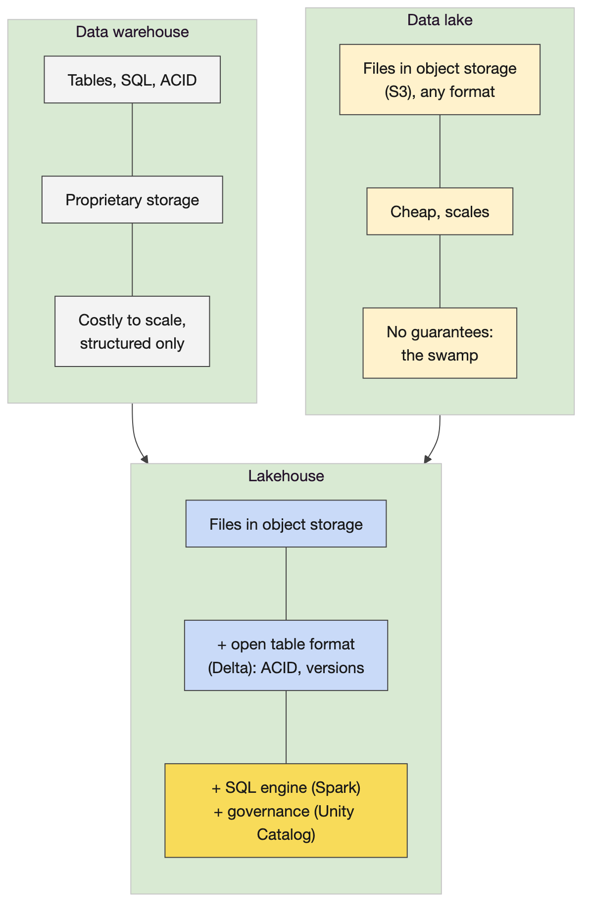

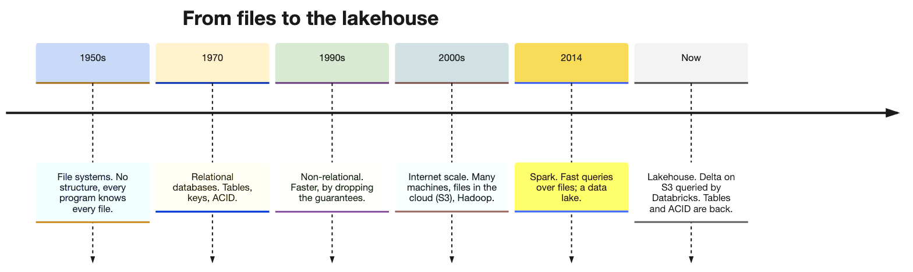

#### Databricks under the hood

**Two planes.** The control plane (the workspace web application, notebooks, jobs, the SQL editor, Unity Catalog's metadata) is run by Databricks. The compute plane is where queries execute: classic clusters start EC2 machines in CG's own cloud account and need warm-up time, serverless compute is run by Databricks and starts in seconds, and CG prefers serverless. The data never moves into Databricks: it stays in S3 as Delta files that compute reads and writes with credentials Unity Catalog grants.

**Unity Catalog.** Every table has a three-part name, `catalog.schema.table`; Unity holds the names, the owners, the permissions, the lineage and the location of the files. Data lives outside any single workspace and is bound to workspaces, one Unity per region. CG's three catalog types (application, source-aligned, domain) and how publishing moves data between them were covered here on Day 2 this week (Wednesday has no platform session); for the practicals it is enough that the learners' tables land in `training_dev.training_‹username›`.

**What runs your SQL.** dbt compiles each model to SQL and sends it to a SQL warehouse or a cluster; Databricks parses it, plans it and runs it as Spark on as many machines as the compute has. On the paved path an Airflow task triggers a Databricks job that runs dbt; nobody writes Spark code for a standard product. Databricks-managed tables are not the paved path; S3-backed Delta tables are.

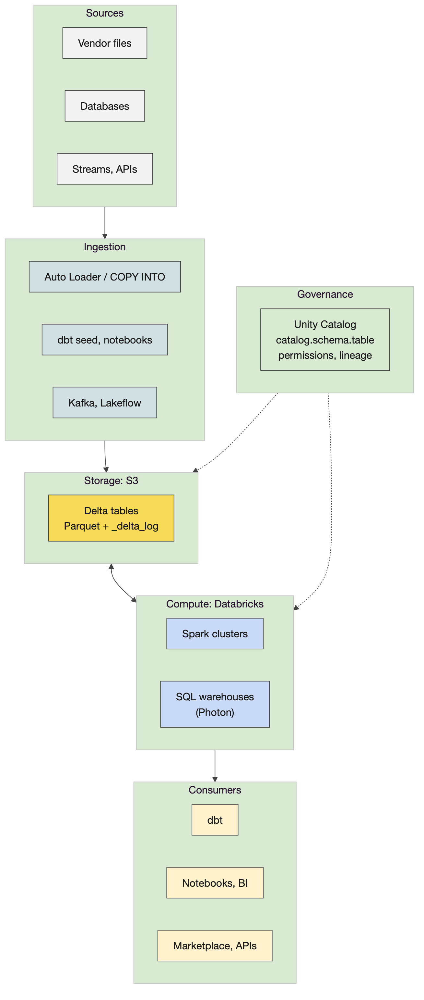

#### The Delta format

**On disk.** A Delta table is a folder of Parquet files plus a `_delta_log/` folder of JSON commits, numbered from zero. Each commit lists the actions that produced it: files added, files removed, metadata and schema, the protocol version. A reader reconstructs the current table by replaying the log (checkpoints every ten commits keep that fast), so two writers cannot corrupt a table: a commit either lands as the next number or is retried. That is ACID on a file system.

**What it gives you.** Time travel (`VERSION AS OF` and `TIMESTAMP AS OF`), because old files are kept until `VACUUM` removes the ones no version needs (seven days by default). `MERGE` for upserts and corrections: the affected files are rewritten and the log records the swap. Schema enforcement on write and controlled schema evolution. `OPTIMIZE` compacts many small files into fewer large ones, and `ZORDER` co-locates rows with similar values so filters read fewer files, which is why the dbt challenge runs it as a post-hook on each mart. Because the format is open (a Linux Foundation project), dbt, Spark, DuckDB, pandas and Trino all read the same table: the laptop demo writes a Delta table with the `deltalake` Python package and reads it back with DuckDB.

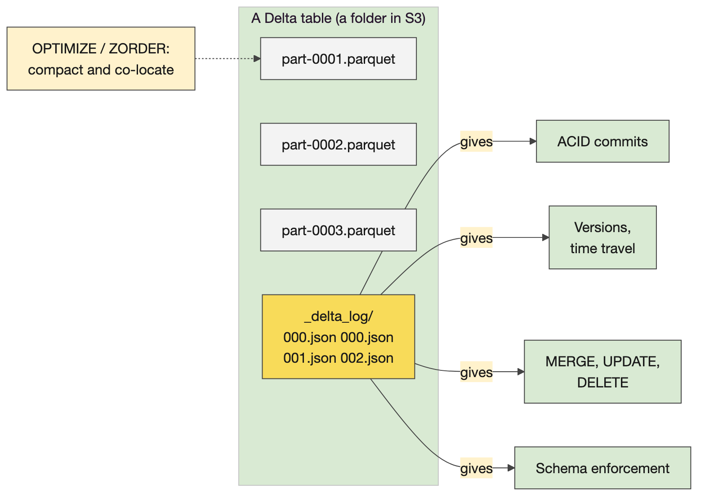

#### The Spark engine

**The parts.** A driver plans and coordinates; executors do the work, each on partitions of the data. Transformations are lazy: they build a plan; an action (collect, write, count) runs it. The optimiser (Spark calls it Catalyst, which is not CG's Catalyst; say so before someone asks) turns the SQL or DataFrame code into a physical plan. The plan is split into stages at every point where data must move between executors, a shuffle, which appears in the plan as `Exchange`: a group by or a join on a key that is not already co-located. Within a stage, one task per partition. The Spark UI (jobs, stages, the SQL tab) shows all of it.

**Why it matters to a creator.** SQL and the DataFrame API compile to the same plan, so dbt's SQL is as fast as anything hand-written. A shuffle is what makes a query slow, which is why partitioning and Z-ordering matter. Databricks is this engine on many machines, with Delta and Unity Catalog around it, and you never configure it; the only Spark a creator usually sees is the plan in a slow query.

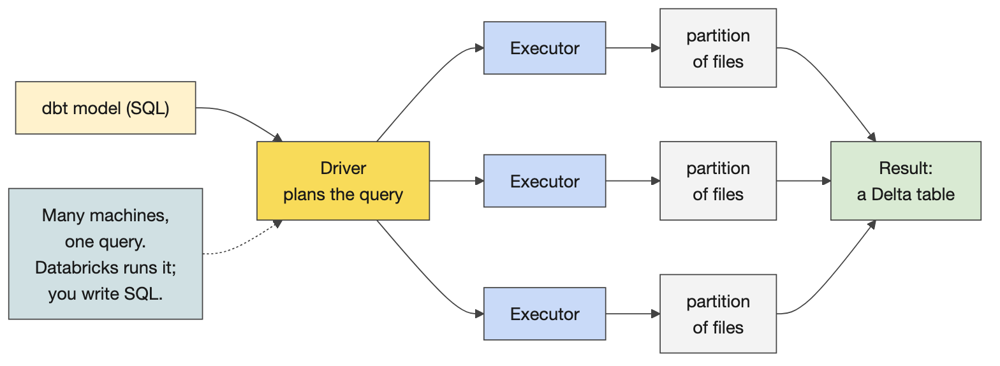

#### How the tools fit together

Databricks is the compute that runs dbt's SQL as Spark; dbt holds the transformation rules and the tests (you write your STTM in dbt and your quality rules as tests); S3 is the storage, a cloud file system of Delta files; Airflow is orchestration, the timing and triggering of dbt runs; Astronomer is managed Airflow, vended per team so teams stop queuing on one central instance; Cosmos renders a dbt project as Airflow tasks; Docker provides the development container and the deployment images; Git and GitHub hold the code, and a pull-request event triggers release through Harness; Datadog watches the runs; Catalyst is the skills; Unity Catalog and the Marketplace give names, permissions and discovery. The scheduled run: a vendor file lands in S3, Airflow triggers at the contract's time, dbt on Databricks copies it stage by stage until a consumer-aligned table exists in a domain catalog, and the Marketplace lists it. Off the path is allowed with a real reason (an API served from S3, a specialist engine), and then you own every problem yourself.

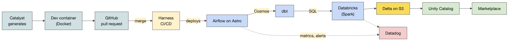

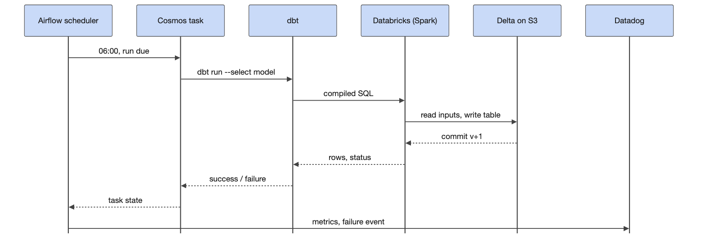

### Teaching notes

- **Elicit each tool's role first**, then show the tools-together diagram; rooms place dbt and Airflow correctly and usually put Databricks in the wrong box (storage) until asked where the files are.
- **The lines that land.** "A lakehouse is a relational database split in two." "Delta is Parquet plus a diary." "A shuffle is the moment the data has to change hands."
- **Likely questions and answers.**
  - *Is Delta a Databricks thing?* Open source under the Linux Foundation; Databricks created it; DuckDB, pandas, Spark, Trino and others read it.
  - *What about Iceberg?* The same idea with a different log layout; CG's path is Delta; Databricks can write Iceberg-readable metadata when a consumer needs it.
  - *Why not Parquet alone?* No transactions and no history: a failed write leaves a half table and nobody knows which files are current.
  - *Where does the data physically live?* In S3 buckets in CG's account; Databricks reads them with credentials Unity Catalog grants per table.
  - *Do we write PySpark?* Not on the path. dbt SQL plus contracts is the standard; PySpark is for the exceptional need.
  - *What does OPTIMIZE cost?* It rewrites files, so run it after loads, not after every small write; the post-hook in the challenge runs it once per mart build.
  - *Does dbt run inside Databricks?* dbt compiles SQL wherever it is installed (the dev container, an Airflow worker, or a Databricks job on the paved path) and sends it; Databricks runs it.
- **Misconceptions to catch.** Databricks stores the data (S3 does). Delta is a database (it is a table format on files). Spark is something creators program (it is what runs their SQL). More nodes always make a query faster (a shuffle on a skewed key does not get faster).

### Mechanics

- **The Delta demo (`courseware/day2-platform/demos/delta-under-the-hood/demo.py`).** Writes the running example's vendor prices as a Delta table (version 0, 12 rows), appends a second day (version 1, 24 rows), merges a corrected re-delivery (version 2, the AAPL price for 3 November replaced), reads version 0 back next to the current table, compacts, and reads the table from DuckDB. The cell after it lists the folder: the Parquet files and `_delta_log/*.json`. Point at the merge: the corrected row replaced, the old file kept, the log naming the files in each version.
- **The Spark demo (`demos/spark-engine/demo.py`).** A local Spark with four executor threads loads the vendor prices multiplied up, runs a SQL aggregate and prints the physical plan; find `Exchange`. Run it again with `--hold 90` and open http://localhost:4040 for jobs, stages and the SQL tab. About thirty seconds; needs Java 17, which `activate.sh` sets.
- **Shareback (one minute per table).** One thing Databricks does that a plain file store cannot; one thing dbt relies on Databricks for; one tool on the diagram you have used and one you have not.
- **If behind**, show the tools-together diagram and the Delta demo only; the Spark demo and the history diagram are the flex.

## 4. Docker

### Concepts

#### Images, containers and the Dockerfile

**What it is.** An image is a layered, read-only template built from a Dockerfile; a container is a running instance of an image, with its own filesystem, processes and network, that lives as long as its command. A Dockerfile is the recipe: `FROM` extends a base image (almost every Dockerfile starts that way); `WORKDIR` sets where the next instructions run; `COPY` brings files from the build context (the `.` you pass to `docker build`) into the image; `RUN` executes a command at build time and creates a layer; `ENV` sets variables; `USER`, `EXPOSE`; `CMD` or `ENTRYPOINT` says what runs when the container starts. Layers are cached: change the app and only the `COPY` layer and everything after it rebuild, which is why a second build is seconds and why the base image goes first.

**Isolation, the production point.** A container shares the host's kernel but has its own view of the filesystem, the process list and the network (namespaces), and can be capped in CPU and memory (control groups). Hence one application per container, controlled ports (a port is an inbox owned by one application), resource limits so a runaway container cannot take the host down, and a limited blast radius. A virtual machine carries a whole operating system and bypasses the host; a container carries only the user space it needs, which is why it starts in a second and why the same image runs on a laptop, a build server and the cloud. Kubernetes runs many containers together; Astronomer runs Airflow's components as containers.

**The dev container.** A Docker container that VS Code launches into: the terminal prompt is inside it, the tools (mise, the Astro CLI, dbt, the Databricks CLI) are there, and the training repository is mounted. Its Dockerfile starts from a flyway stage and CG's Python 3.13 image from the internal registry, installs the Astro CLI, starship and mise with `RUN curl` lines, installs the Databricks CLI through mise, copies the setup scripts and puts a virtualenv at `/opt/venv` on `PATH`. EDO maintains it; learners never will; but they can now read it. Tags and registries are how CG ships its Airflow and dbt images: tag, push, pull elsewhere.

**Several containers together: Compose and the network.** A real system is several containers: on Day 4 `astro dev start` runs Airflow's scheduler, API server, triggerer and Postgres. Compose describes them in one file (`docker-compose.yml`): each `service` is a container, built from a Dockerfile or pulled as an image; `depends_on` with a health condition sets the start order; a `volume` keeps a database's files beyond the container's life. Compose also creates a private network for the project, and on it each service's name is a hostname: the API connects to `db`, Docker's embedded DNS (at 127.0.0.11 inside every container on a user-defined network) turns the name into the container's current address, and no address is written anywhere. `ports:` is the only way in from outside: `127.0.0.1:8000:8000` forwards the laptop's port 8000 to the container's and binds it to the laptop alone; a service without a `ports:` line (the database) can be reached only by its neighbours on the network, not by the laptop and not by a container on Docker's default network, which cannot even resolve the name. Who talks to whom is a line in the file, and so is who cannot. The demo's two services are Postgres seeded with the running example's price sheet and a small HTTP API that queries it by name; the stretch asks learners to add a third, a one-shot `psql` that runs one query and exits, the shape of a dbt run or an Airflow task.

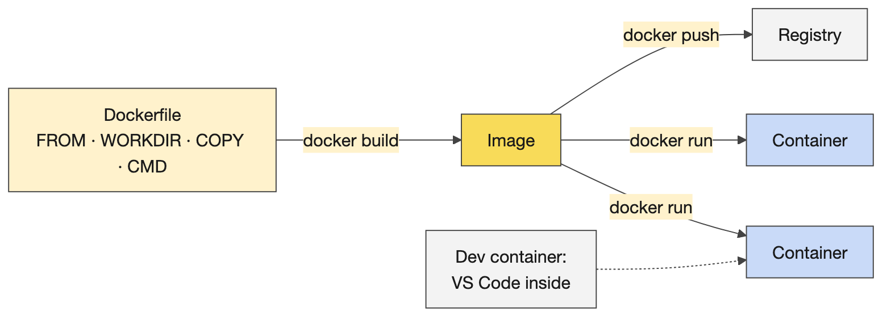

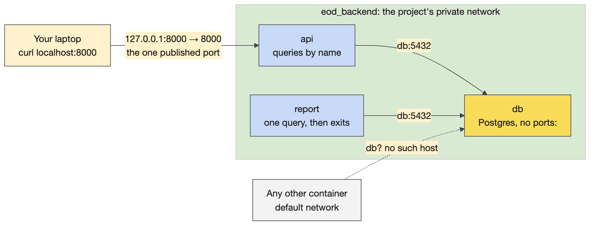

### Teaching notes

- **Why containers at all, if Databricks runs the SQL?** Airflow's workers run in containers, the dev container gives everyone the same tools, and the deployment images are what Harness ships. Learners write dbt files in the container, run dbt from it, and the tables appear on Databricks.
- **Likely questions and answers.**
  - *Container versus virtual machine?* A VM virtualises the hardware and runs its own kernel; a container is a process with a private view of the host, sharing the kernel. Lighter, faster, less isolated.
  - *Why is my VS Code terminal not my laptop's terminal this week?* Because VS Code opened a shell inside the dev container; your laptop's files are not there unless mounted.
  - *Can I install things in the dev container?* Yes, until it is rebuilt; anything permanent goes in the Dockerfile or to EDO.
  - *Windows?* Docker Desktop in Linux-containers mode, and files saved with LF line endings.
  - *How does the API find the database?* By name. Compose puts both on one private network and Docker's DNS resolves the service name to the container's address; the API is told `DB_HOST: db` and nothing else.
  - *Can anything else on my laptop reach that database?* No: it publishes no port. Only containers on the same network can, and only the API publishes a port, bound to 127.0.0.1.
- **Misconceptions to catch.** An image is a small VM. A container keeps its data (it does not, unless a volume is mounted: the demo's second cell proves it). Docker is Kubernetes (Kubernetes runs many Dockers). Containers on one laptop can all talk to each other (only on a shared network; the default network has no name resolution, and nothing reaches a container that publishes no port).

### Mechanics

- **The demo mirrors the challenge's six steps**, same commands and outputs, so nothing in the practical is a first sighting: run an image; look inside (`-it`, `ls /`, `os-release`, the `/tmp` proof); the Dockerfile as a commented sample with the four instructions (the starter leaves three as TODOs); build twice and read `CACHED`; run and the exact two output lines, then the mounted CSV; tag. Then the gate (`mise run challenge:verify 01` prints PASS) and the four stalls. A table in the anchor lists step, command and expected output. Docker Desktop must be running: `docker info`.
- **The Compose demo (optional, six minutes), `demos/docker/compose/`.** Eight cells, the same as `bash demo.sh`: a clean slate and the commented file; `up -d --build` and `ps -a` (db `5432/tcp` with no arrow, api `127.0.0.1:8000->8000`); the API's log; `docker network inspect eod_backend`; name resolution inside api and `resolv.conf`; `curl localhost:8000/health` and `/prices?instrument_id=…`; isolation three ways (`docker port`, a container off the network, one on it); `down -v`. Run it at the end of the morning demo if the room is quick, otherwise in the last six minutes before the shareback. The first `up` pulls Postgres and builds the API image, about a minute: run it the evening before so the cache is warm, and check port 8000 is free. Say the password in the file is a demo value and point at the secure example for the `.env` way.
- **Challenge 7, `challenges/v1/01-docker-intro` (35 minutes).** From `starter/`: 1 run an image; 2 look inside (isolation); 3 write the Dockerfile (`starter/Dockerfile` has one TODO per line; the app under `starter/app/` is complete and not touched); 4 build the image; 5 run it; 6 try it yourself (optional: tags, variations). The finished image prints "Portfolio summary", then "6 holdings, total market value 12,011,626.50". Gate: `mise run challenge:verify 01` prints PASS. Stretch for the experienced: multi-stage builds, resource limits, Kubernetes.
- **Stalls.** "Cannot connect to the Docker daemon": the engine is not running, start Docker Desktop. "permission denied on the socket": on Linux the user is not in the docker group; use the dev container. "exec format error" or script not found: CRLF line endings after editing on Windows; save as LF and rebuild. The first pull of `python:3.11-slim` is slow once. Building from the wrong folder: `.` is the build context and the Dockerfile copies `app/` from it.

## 5. Git and GitHub (optional)

### Concepts

#### Commits, branches and the shared copy

**What it is.** Git is a version control system: it records the history of a folder as commits, each a snapshot of every file with an author, a time and a message, chained on branches. Everything happens on the learner's machine until they push. GitHub holds the shared copy of the repository (the remote, `origin`) and adds what Git alone does not have: the pull request, code review, the checks that run on every push, and the merge button. The loop: edit in the working copy, `git add` to stage, `git commit` to record, on a branch of your own; `git push` to share the branch; open a pull request; a reviewer reads the diff, the checks run, the merge brings the branch into `main`; `git pull` brings `main` back to everyone's working copy. Commit is local and push is what shares it: two verbs, two risks.

**Why it matters this week.** Everything the room makes is a file: the contract, the dbt models and their YAML, the DAG, the Dockerfile. The tools-together diagram puts GitHub between the dev container and Harness: a pull request submitted and approved triggers the deployment pipeline, and what `main` contains is what runs on Astro and Databricks. Day 4 says it directly: a pull request is where acceptance happens, and a deleted test is a block of red lines that is easy to skim past. Nobody edits `main`.

**What never goes in.** Secrets (`.env`, tokens, keys), generated artefacts (`target/`, `dbt_packages/`, logs) and data files stay out of history through `.gitignore`, written before the first commit. A token in a commit is a token to rotate even after the file is deleted, because the commit keeps it; the platform team is the escalation. The training repository's `pre-commit-config.yaml` runs checks before every commit: whitespace and line endings, YAML and TOML syntax, `hadolint` on Dockerfiles, `ruff` on Python, `sqlfluff` on SQL. In dev and higher environments CI generates the migration SQL from the contract and commits it to the branch; the creator commits only the `.odcs.yaml` contract, never the generated SQL.

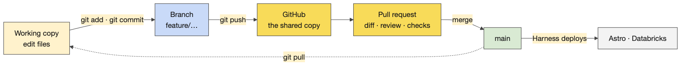

### Teaching notes

- **Why now.** Tomorrow's dbt project lives in files on a branch; a learner who has never branched loses work or edits `main`. Fifteen minutes here saves the first hour tomorrow. It is optional because Docker is the must: if the room is behind, the table of commands in the anchor and the practical as homework are enough.
- **Likely questions and answers.**
  - *Do I need the command line?* No: VS Code's Source Control view stages, commits, branches, pushes and shows the diff with buttons; the commands are what it runs, and the ones to know when a button is greyed out.
  - *Commit or push?* Commit records locally, as often as you like; push shares the branch. Nothing is lost by committing; nothing is seen until you push.
  - *What is a merge conflict?* Two branches changed the same lines; Git asks a human to choose. Small branches merged often avoid most of them.
  - *Can I push to main?* Not in CG's repositories: `main` is protected, and the pull request is the only way in.
  - *GitHub Desktop or the `gh` CLI?* Either; the dev container's guidance prefers whichever authenticates reliably for the room.
- **Misconceptions to catch.** Commit means it is shared (not until pushed). GitHub is Git (GitHub is the shared copy plus review and checks). Deleting a committed secret removes it (the history keeps it; rotate). `main` is where you work (it is where reviewed work lands).

### Mechanics

- **The demo (six cells).** A throwaway repository in `demos/git/sandbox` (gitignored; the first cell recreates it): init and a first commit; an edit with `git status --short` and `git diff`; a branch `feature/sttm-rules` with a commit and `git log --oneline --graph --all`; the merge back into `main` with `--no-ff` so the branch shows in the graph; a `.env` with a fake token appearing in `git status`, then hidden by `.gitignore`; `git restore` for an uncommitted edit and `git revert` for a committed one. Each cell's comment is the one line to say. `demos/git/demo.sh` runs the same six steps in a terminal.
- **The pull request on screen.** From the dev container, on the training repository: `git remote -v`, a branch, the Dockerfile from Challenge 7 added and committed, `git push -u origin`, the pull request page (title, three-line description, Files changed, one review comment, the checks), and the merge button not pressed. Check before the day whether learners can push branches to the training repository; if they cannot, the push and pull request are demo only and the practical stops at the log.
- **The practical (15 minutes, or homework).** The same loop on the learner's own Dockerfile: status, branch, add, commit, log, push, pull request, a neighbour's review comment; no merge. Gate: `git log --oneline --graph -3` shows the commit on the branch, and the pull request exists with a description and a comment. Stalls: identity not set (`git config --global user.name` and `user.email`), the SSL certificate error (the dev container's `TROUBLESHOOTING.md`), and a branch name that already exists (`git switch` without `-c`).
- **When to run it.** Three slots, in order of preference: the fifteen minutes gained if the room reaches PASS by 13:30 and the shareback starts early; 14:30 in place of Activity 8; or the six cells in five minutes at the end of the shareback, with the practical as homework.

## 6. Catalyst skills, and setting up for tomorrow

### Concepts

#### The map of the skills

About a hundred and six skills in the Catalyst repository, in four tiers that compose downwards: orchestrators (11) run a lifecycle phase or stage end to end (`dplc-concierge`, `dplc-triage`, `dplc-design`, `dplc-build`, `dplc-publish`); workflow skills (15) run several steps as one job (`source-aligned`, `domain-aligned`, `consumer-aligned`, `setup-dbt-project`, `data-modeling`); document skills (37) make one artefact from a template (`product-requirements-document`, `data-contract`, `transformation-spec`, `sla-dashboard-spec`, `runbook`); capability skills (42) do one composable action (`connect-databricks`, `query-table`, `profile-columns`, `write-dbt-model`, `generate-dag`, `validate-dag`). Underneath sits deterministic Python (profiling, platform clients) that is not a skill. Each skill is tagged with the phase it serves: build is the largest cluster, then design, then discovery; triage, validate, publish, operate and evolve have a handful each; about fifteen are cross-cutting.

#### Which skill, when

The five the room has used sit in discovery and design: `product-requirements-document`, `data-contract`, `transformation-spec`, `sla-dashboard-spec` and the concierge. Wednesday and Thursday use the build skills (`setup-dbt-project`, `write-dbt-source`, `write-dbt-model`, `validate-dbt`, `adding-dbt-unit-test`, `generate-dag`, `validate-dag`); Thursday's Phase 2 touches publish and operate (`runbook`, `consumer-onboarding-guide`, `release-notes`); Friday's evidence maps to validate. The rule the afternoon teaches: pick the skill for the phase you are in. A build skill run on a design nobody has agreed produces confident code for the wrong product, which is why no dbt is generated today.

#### Loading the plugin

Three VS Code settings (`chat.plugins.enabled`, `chat.useAgentSkills`, `chat.plugins.marketplaces` pointing at the Catalyst repository, or at a local copy), a reload, `/plugins` to enable AI Catalyst, and `/ai-catalyst` listing the skills. A skill is a `SKILL.md` with a template and checks; Copilot shows it reading the file, and without that line it is plain Copilot. On this laptop the same skills run in Claude Code as `/<skill-name>` from `courseware/.claude/skills/`.

### Teaching notes

- **Thirty minutes in total**: ten on the tiers and the phase table, five on loading, fifteen for Activity 8 if the room has time; otherwise Activity 8 is homework and the time goes to the Databricks setup.
- **Likely questions.** *Can I just use the concierge?* It routes you, slowly; prefer the specific skill. *Which skill writes the dbt project?* `setup-dbt-project` and the `write-dbt-*` skills, tomorrow. *Is a design skill's output final?* No; review it for the invented detail exactly as the PRD was reviewed.
- **Misconceptions to catch.** More skills run means a better product (the right skill for the phase does). A generated data model is the data model (the owner agrees it).

### Mechanics

- **Activity 8 (optional, 20 minutes).** Pairs run one design skill on their own PRD and contract (`consumer-use-case-map`, `data-model`, `architecture-diagram`, `data-quality-controls-plan` or `nfr-specification`), review it, and bring one line: what it added and what it invented.
- **Databricks setup (14:45).** Everyone runs `mise run setup:databricks` (browser OAuth, Enter through the prompts, minutes per person) and `dpc-check`, and finds `training_dev.training_‹username›` in the catalog, because tomorrow's first command is `dbt debug`. Anyone blocked gets the platform-support contact tonight.
- **Before learners leave.** Each table's extended contract shared; Challenge 7 at PASS for everyone; Databricks set up; access problems on a separate list from content questions.

## Readiness self-test

1. Name the five rule types of a source-to-target mapping and give one example of each from a price sheet.
2. Define SLI, SLO and SLA in one sentence each, using "delay" as the example.
3. Recite the nines table from 90% to 99.999% in the month, week, day, hour, minutes form.
4. What does a lake lack that a warehouse has, and what does a lakehouse put back, with what?
5. Explain ACID as linearizability in three sentences.
6. What is in a Delta table's folder, and how does a reader know which Parquet files are current?
7. What do `MERGE`, `OPTIMIZE`, `ZORDER` and `VACUUM` each do?
8. What is a shuffle, how do you spot one in a plan, and why does it matter?
9. Which two Catalysts exist in this course, and what is each?
10. Image versus container, in one line; then why only the `COPY` layer rebuilds when the app changes.
11. Name three things in the dev container's Dockerfile and who maintains it.
12. Which contract section becomes the DAG schedule, which becomes the freshness gate, and which becomes the tests?
13. Commit versus push, in one line each; then why a pull request rather than a push to main?
14. A learner pushed a branch with a `.env` holding a Databricks token. What do you tell them to do first?
15. In the Compose demo the database has no `ports:` line. Who can reach it, and how does the API know its address?

### Answers

1. Direct (copy the vendor's ISIN), constant (source system name), lookup (instrument name from the master), aggregate (last price of the day), derive or transform (price times FX rate; concatenation as a subtype).
2. An indicator is the measured quantity (delay from the delivery time). An objective is its ideal value (no delay). An agreement is the permissible departure and the consequence (up to an hour late; beyond that an explanation is owed).
3. 90% a month a year; 99% a working week; 99.9% a working day; 99.99% an hour; 99.999% five minutes.
4. Structure and transactions; the lakehouse puts them back with an open table format (Delta: Parquet plus a log), a SQL engine (Spark) and a catalog (Unity).
5. Writes arrive in some order and some fail. A reader must see them as if they happened one at a time, in order, completely or not at all. A write-ahead log that records each change before it is applied makes that possible.
6. Parquet data files and a `_delta_log/` folder of numbered JSON commits (with periodic checkpoints); the reader replays the log, which lists the files added and removed in each version.
7. `MERGE` upserts or corrects rows by rewriting affected files and logging the swap; `OPTIMIZE` compacts small files; `ZORDER` co-locates similar values so filters read fewer files; `VACUUM` deletes files no retained version needs.
8. Data moving between executors to regroup by a key (a group by or join); `Exchange` in the physical plan; it is the expensive step that bounds a query's speed.
9. Spark's Catalyst is the query optimiser; CG's Catalyst is the repository of AI skills.
10. An image is the layered read-only template, a container is a running instance; layers are cached in order, so a change in `app/` invalidates the `COPY` layer and everything after it, not the base image.
11. Two `FROM` lines (a flyway stage, CG's Python 3.13 image), `RUN curl` installs of the Astro CLI, starship and mise, `mise install databricks-cli`, `ENV VIRTUAL_ENV=/opt/venv` on `PATH`, copied setup scripts; EDO maintains it.
12. The delivery time (service levels) becomes the schedule; the freshness commitment becomes the `dbt source freshness` thresholds the gate checks; the data quality rules become the tests.
13. A commit records a snapshot on your branch, locally; push copies the branch to GitHub. `main` is what Harness deploys, so it is protected and reached only through a reviewed, checked pull request.
14. Rotate the token first: the commit keeps it even after the file is deleted. Then remove the file, add `.env` to `.gitignore`, commit, and tell the platform team; rewriting the branch's history is their call.
15. Only containers on the project's private network (`api`, or one started with `--network eod_backend`); not the laptop, and not a container on the default network, which cannot resolve the name. The API is given the service name `db`, and Docker's embedded DNS on that network resolves it to the container's current address.

## The evening before

- [ ] Docker Desktop running; `docker info` prints engine details.
- [ ] `source courseware/common/env/activate.sh`, then `bash courseware/day2-platform/demos/docker/portfolio-summary/demo.sh` prints the six-holding summary; `python demos/delta-under-the-hood/demo.py` ends at the OPTIMIZE step; `python demos/spark-engine/demo.py --hold 20` prints a plan with `Exchange` and the UI answers at http://localhost:4040.
- [ ] `bash courseware/day2-platform/demos/docker/compose/demo.sh` runs through to `down` (the first run pulls Postgres and builds the API image); nothing else is listening on port 8000.
- [ ] Open the Day 2 anchor, Run All, save with outputs; check the diagrams render.
- [ ] Run the HTML prompt once on a fast model and keep the result; confirm `03-data-contract.html` opens in the browser.
- [ ] Open the dev container's Dockerfile from `reference/DataCreators-client/…/.devcontainer/Dockerfile` and find the lines you will point at.
- [ ] Run the six Git cells once (they recreate `demos/git/sandbox`); ask the platform team whether learners can push branches to the training repository.
- [ ] Print the activity cards for 6, 7 and 8 and this day's run sheet; the Databricks setup commands posted in the Teams channel at 14:45.

## Go deeper

- Delta Lake: the protocol and the transaction log, https://docs.delta.io/ ; Databricks' architecture and Unity Catalog overviews at https://docs.databricks.com/
- Apache Spark: the SQL guide and the web UI, https://spark.apache.org/docs/latest/
- Every Docker command by objective, with the Dockerfile instructions: `courseware/common/glossaries/docker-commands.md` (learners can be given it).
- Every Git and GitHub command by objective, the files Git reads, and the safe-working habits for commits, branches, pull requests and credentials: `courseware/common/glossaries/git-commands.md` (learners can be given it).
- Docker: the Dockerfile reference and the build cache, https://docs.docker.com/ ; the CG Core handbook on containers and CI in the sibling clone, `reference/ts-cg-core/courseware/unit01-software-engineering-with-ai/day02-testing-git-containers-ci/learner/module06-containers-ci/day02_m6_handbook.md`.
- The training repository's troubleshooting guide: `.devcontainer/TROUBLESHOOTING.md`, and the challenge README for Docker.
- dbt: what a model, a source and a test are, https://docs.getdbt.com/ (Day 3 goes deep).
- The running example's STTM and service levels: `courseware/common/running-example/04-sttm.md` and `05-service-levels.md`.
