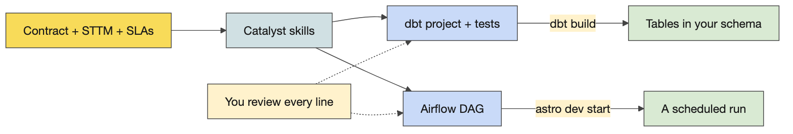
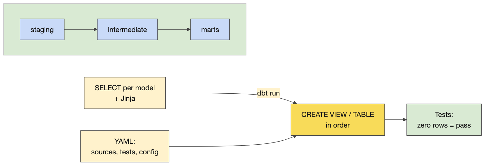

# Day 2 instructor prep guide — Mappings, service levels and implementation foundations

[Data Creators › Day 2 — instructor prep guide]{.breadcrumb}

An hour's reading to be workshop-ready for Tuesday. The sections mirror the anchor notebook's four numbered sections: for each, the concepts in depth, the teaching notes (how to explain it, what to whiteboard, the questions rooms ask and the answers), and the mechanics of the demos and challenges. The self-test at the end finds the gaps; the evening-before checklist is what to run. The run sheet beside this file has the timings, lines and whiteboard scripts.

## The day in one page

Yesterday's contract is today's input. By the end of the day it has mapping rules and measurable commitments, the room understands what Databricks, Delta and Spark actually do with their data, everyone has built and run a container, and pairs have generated dbt and Airflow code from a contract and read it critically. The platform block is the one to know cold: the previous cohort got a twenty-minute history lecture; this cohort gets diagrams, two demos on the laptop, and a shareback.

| # | Section | What happens | You must be able to |
|---|---|---|---|
| 1 | Mappings and service commitments | STTM and SLI/SLO/SLA on the whiteboard, Activity 6, the review and HTML demo | Name the rule types and the nines table from memory; separate an indicator from an objective from an agreement |
| 2 | Platform architecture | Warehouse, lake, lakehouse; Databricks under the hood; Delta; Spark; how the tools fit together; shareback | Draw the lakehouse as a relational database split in two; explain a Delta commit and a Spark shuffle |
| 3 | Docker | The six demo cells, the dev container's Dockerfile, Challenge 7 | Explain image versus container, layers and the cache, and why one app per container |
| 4 | Contract to code | Where output lands, one minute of live generation, Activity 8, the debrief, Activity 8b | Read generated dbt and Airflow code against a contract and find the assumption it did not state |

Three things that go wrong: the HTML render on a big model at high effort does not finish on stage (run a fast model at low effort first and keep the pre-rendered page); Docker Desktop is not running or a Windows laptop is in the wrong container mode; the Databricks OAuth setup takes minutes per person and eats the afternoon (start it during the Docker practical for anyone finished early).

## 1. Mappings and service commitments

### Concepts

#### Source-to-target mapping

**What it is.** The artefact that says where each target column comes from and how. Sources A and B joined into target T; the core of the artefact is the transformation rules, column by column. The textbook rule types: *direct* (copy), *constant*, *lookup* (a value from a third table), *aggregate* (a mean, a sum), *derive or transform* (an operation on one or more inputs; concatenation is a subtype). Catalyst returns a CG-specific taxonomy that splits "derive" further; say so when learners compare lists. Row rules sit beside column rules: which rows are in scope, how duplicates are resolved, what a late or missing row does.

**Why it matters at design time.** Ambiguity, edge cases, what null means for each column, whether zero is a value or a gap, minimum and maximum values: all cheap to decide in the mapping and expensive to discover in production. The test for a rule is the one the anchor asks: could someone else implement this rule without asking you what it means? In dbt, every STTM rule becomes a line of SQL and most become a test, which is why the mapping is the most valuable page of the contract.

**The design documentation set.** PRD, data contract, glossary or data dictionary, STTM, service levels. The running example has all five in `courseware/common/running-example/`; its STTM has eleven column rules and four row rules for a US end-of-day price sheet.

#### Service levels

**Three words.** An *indicator* (SLI) is a number you can measure: delay from the delivery time, latency, throughput, recovery time (service back, data restored, or back to an agreed level), completeness, accuracy, freshness, availability, support turnaround. An *objective* (SLO) is the indicator's ideal value: zero delay. An *agreement* (SLA) is the permissible departure and what happens beyond it: up to an hour late; beyond that the provider owes an explanation and, in a commercial contract, money. Say the time zone every time a delivery time is written down; the running example's 07:30 is Eastern.

**Availability in nines.** 90% is about 36 days of downtime a year (a month); 99% about 3.65 days (a working week); 99.9% about 8.8 hours (a working day); 99.99% about 53 minutes (an hour); 99.999% about 5 minutes. Calibration: serious cloud services offer three to four nines and pay credits when they miss; a chat assistant offers roughly one. Each extra nine costs about ten times more in redundancy: cloned infrastructure, global and local load balancing, a disaster-recovery site that already takes a share of traffic so you know it works. The number of nines tells you about spare capacity, not about care.

**Where they live.** Section 3 of the contract: targets and breach response. The breach response is the part rooms forget and the part consumers read.

#### Reviewing a contract

The Markdown editor in VS Code (right-click, Open with…) is how learners should read the long READMEs on Wednesday and Thursday; say it on Tuesday. Turning a contract into one self-contained HTML page is a small demo with a large lesson: a fast model at low effort returns a navigable page in a minute; the biggest model at high effort may not finish while you teach. Model and effort trade speed for quality, the choice is empirical, and reasoning traces are hidden because competitors trained on them.

### Teaching notes

- **Whiteboard order.** Ask what an STTM is, then the rule types, then the documentation set; then what SLI, SLO and SLA stand for, then "give me indicators" (rooms are fluent), then the nines (write the mnemonic month, week, day, hour, minutes), then how providers get more nines.
- **Analogies.** An SLI is the thermometer, the SLO is the temperature you want, the SLA is the band you promise the patient before you call a doctor. Nines: the cost of the tenth nine is a second data centre.
- **Likely questions and answers.**
  - *Is latency an indicator or an objective?* The indicator is the measured latency; the objective is the number you aim for; the agreement is the tolerance you promise and the consequence.
  - *Who signs the SLA?* The business data owner for the product and the consumers in the registry; the breach response says who is told and how fast.
  - *How many nines should we promise?* As many as the consumer's decision needs and no more; each nine costs an order of magnitude. A nightly report does not need four.
  - *Where does the STTM live, the contract or a separate document?* Both exist at CG; the contract's schema section carries the target and the transformation specification carries the rules. In dbt they become models and tests.
  - *What does null mean?* Nothing until the mapping says: unknown, not applicable, not yet delivered. Decide per column.
- **Misconceptions to catch.** An SLA is only uptime (it is any indicator with a tolerance). An STTM is a column list (the rules are the content). Null handling is a build-time detail (it is a design decision).

### Mechanics

- **Activity 6 (25 minutes).** Individually, ask Catalyst which transformation types and which service measures exist (`transformation-spec`, `sla-dashboard-spec`); then tables pick a Day 1 contract, name the incoming tables and the outgoing table, write concrete rules (lookups, derivations, null rules) and realistic commitments; transcribe the table's discussion and feed it in, as on Day 1. Collect one revised contract per table for the review.
- **The review demo.** Open a submitted contract in the Markdown editor and edit one cell. Run the HTML prompt on a fast model at low effort and open the page in the browser; start the same prompt on the biggest model at high effort and let it run while you teach. If both stall, `courseware/common/running-example/03-data-contract.html` is the pre-rendered page (made with pandoc).
- **The implementability test.** Take two rules from the room's contracts and ask whether someone else could implement them without asking; rooms find their own ambiguity in a minute.

## 2. Platform architecture

### Concepts

#### Warehouse, lake, lakehouse

**The history, in one pass.** File systems (1950s) had no common structure, so every program had to know every file. Databases added structure; relational databases (1970) made a table a set of tuples, which is why primary keys exist. ACID is best explained as linearizability: Alice writes 1, Bob writes 2, Eve writes 3; whatever fails or arrives out of order, a reader sees 1, 2, 3, and a write-ahead log is what makes that possible. Non-relational stores (documents, pre-joined JSON) got speed by dropping that guarantee. The internet made data bigger and faster than one disk, so storage went back to file systems in the cloud (S3), with Hadoop and then Spark (2014) as the query layer, which still had to know the structure of every file: that is why raw PySpark is complicated and not the paved path.

**The three.** A *warehouse*: tables, SQL, transactions, strong consistency, proprietary storage you pay to scale, structured data only. A *lake*: a cloud file system with any format in it (CSV, Parquet, JSON, images), cheap and scalable, no structure guaranteed, and no transactions, so half-written files, duplicates on retry and no history: the data swamp. A *lakehouse*: an open table format on the lake's files (Delta: Parquet plus a log) that gives ACID, versions and schema back; an engine that speaks SQL (Spark); and a catalog for names, permissions and lineage (Unity Catalog). The one-line version for the room: a lakehouse is a relational database split in two, files on S3 and compute on Databricks, with a transaction log in between to get the guarantees back.

#### Databricks under the hood

**Two planes.** The control plane (the workspace web application, notebooks, jobs, the SQL editor, Unity Catalog's metadata) is run by Databricks. The compute plane is where queries execute: classic clusters start EC2 machines in CG's own cloud account and need warm-up time, serverless compute is run by Databricks and starts in seconds, and CG prefers serverless. The data never moves into Databricks: it stays in S3 as Delta files that compute reads and writes with credentials Unity Catalog grants.

**Unity Catalog.** Every table has a three-part name, `catalog.schema.table`; Unity holds the names, the owners, the permissions, the lineage and the location of the files. Data lives outside any single workspace and is bound to workspaces, one Unity per region. CG's three catalog types (application, source-aligned, domain) and how publishing moves data between them is Wednesday's platform session; today it is enough that the learners' tables land in `training_dev.training_‹username›`.

**What runs your SQL.** dbt compiles each model to SQL and sends it to a SQL warehouse or a cluster; Databricks parses it, plans it and runs it as Spark on as many machines as the compute has. On the paved path an Airflow task triggers a Databricks job that runs dbt; nobody writes Spark code for a standard product. Databricks-managed tables are not the paved path; S3-backed Delta tables are.

#### The Delta format

**On disk.** A Delta table is a folder of Parquet files plus a `_delta_log/` folder of JSON commits, numbered from zero. Each commit lists the actions that produced it: files added, files removed, metadata and schema, the protocol version. A reader reconstructs the current table by replaying the log (checkpoints every ten commits keep that fast), so two writers cannot corrupt a table: a commit either lands as the next number or is retried. That is ACID on a file system.

**What it gives you.** Time travel (`VERSION AS OF` and `TIMESTAMP AS OF`), because old files are kept until `VACUUM` removes the ones no version needs (seven days by default). `MERGE` for upserts and corrections: the affected files are rewritten and the log records the swap. Schema enforcement on write and controlled schema evolution. `OPTIMIZE` compacts many small files into fewer large ones, and `ZORDER` co-locates rows with similar values so filters read fewer files, which is why the dbt challenge runs it as a post-hook on each mart. Because the format is open (a Linux Foundation project), dbt, Spark, DuckDB, pandas and Trino all read the same table: the laptop demo writes a Delta table with the `deltalake` Python package and reads it back with DuckDB.

#### The Spark engine

**The parts.** A driver plans and coordinates; executors do the work, each on partitions of the data. Transformations are lazy: they build a plan; an action (collect, write, count) runs it. The optimiser (Spark calls it Catalyst, which is not CG's Catalyst; say so before someone asks) turns the SQL or DataFrame code into a physical plan. The plan is split into stages at every point where data must move between executors, a shuffle, which appears in the plan as `Exchange`: a group by or a join on a key that is not already co-located. Within a stage, one task per partition. The Spark UI (jobs, stages, the SQL tab) shows all of it.

**Why it matters to a creator.** SQL and the DataFrame API compile to the same plan, so dbt's SQL is as fast as anything hand-written. A shuffle is what makes a query slow, which is why partitioning and Z-ordering matter. Databricks is this engine on many machines, with Delta and Unity Catalog around it, and you never configure it; the only Spark a creator usually sees is the plan in a slow query.

#### How the tools fit together

Databricks is the compute that runs dbt's SQL as Spark; dbt holds the transformation rules and the tests (you write your STTM in dbt and your quality rules as tests); S3 is the storage, a cloud file system of Delta files; Airflow is orchestration, the timing and triggering of dbt runs; Astronomer is managed Airflow, vended per team so teams stop queuing on one central instance; Cosmos renders a dbt project as Airflow tasks; Docker provides the development container and the deployment images; Git and GitHub hold the code, and a pull-request event triggers release through Harness; Datadog watches the runs; Catalyst is the skills; Unity Catalog and the Marketplace give names, permissions and discovery. The scheduled run: a vendor file lands in S3, Airflow triggers at the contract's time, dbt on Databricks copies it stage by stage until a consumer-aligned table exists in a domain catalog, and the Marketplace lists it. Off the path is allowed with a real reason (an API served from S3, a specialist engine), and then you own every problem yourself.

### Teaching notes

- **Elicit each tool's role first**, then show the tools-together diagram; rooms place dbt and Airflow correctly and usually put Databricks in the wrong box (storage) until asked where the files are.
- **The lines that land.** "A lakehouse is a relational database split in two." "Delta is Parquet plus a diary." "A shuffle is the moment the data has to change hands."
- **Likely questions and answers.**
  - *Is Delta a Databricks thing?* Open source under the Linux Foundation; Databricks created it; DuckDB, pandas, Spark, Trino and others read it.
  - *What about Iceberg?* The same idea with a different log layout; CG's path is Delta; Databricks can write Iceberg-readable metadata when a consumer needs it.
  - *Why not Parquet alone?* No transactions and no history: a failed write leaves a half table and nobody knows which files are current.
  - *Where does the data physically live?* In S3 buckets in CG's account; Databricks reads them with credentials Unity Catalog grants per table.
  - *Do we write PySpark?* Not on the path. dbt SQL plus contracts is the standard; PySpark is for the exceptional need.
  - *What does OPTIMIZE cost?* It rewrites files, so run it after loads, not after every small write; the post-hook in the challenge runs it once per mart build.
  - *Does dbt run inside Databricks?* dbt compiles SQL wherever it is installed (the dev container, an Airflow worker, or a Databricks job on the paved path) and sends it; Databricks runs it.
- **Misconceptions to catch.** Databricks stores the data (S3 does). Delta is a database (it is a table format on files). Spark is something creators program (it is what runs their SQL). More nodes always make a query faster (a shuffle on a skewed key does not get faster).

### Mechanics

- **The Delta demo (`courseware/day2-platform/demos/delta-under-the-hood/demo.py`).** Writes the running example's vendor prices as a Delta table (version 0, 12 rows), appends a second day (version 1, 24 rows), merges a corrected re-delivery (version 2, the AAPL price for 3 November replaced), reads version 0 back next to the current table, compacts, and reads the table from DuckDB. The cell after it lists the folder: the Parquet files and `_delta_log/*.json`. Point at the merge: the corrected row replaced, the old file kept, the log naming the files in each version.
- **The Spark demo (`demos/spark-engine/demo.py`).** A local Spark with four executor threads loads the vendor prices multiplied up, runs a SQL aggregate and prints the physical plan; find `Exchange`. Run it again with `--hold 90` and open http://localhost:4040 for jobs, stages and the SQL tab. About thirty seconds; needs Java 17, which `activate.sh` sets.
- **Shareback (one minute per table).** One thing Databricks does that a plain file store cannot; one thing dbt relies on Databricks for; one tool on the diagram you have used and one you have not.
- **If behind**, show the tools-together diagram and the Delta demo only; the Spark demo and the history diagram are the flex.

## 3. Docker

### Concepts

#### Images, containers and the Dockerfile

**What it is.** An image is a layered, read-only template built from a Dockerfile; a container is a running instance of an image, with its own filesystem, processes and network, that lives as long as its command. A Dockerfile is the recipe: `FROM` extends a base image (almost every Dockerfile starts that way); `WORKDIR` sets where the next instructions run; `COPY` brings files from the build context (the `.` you pass to `docker build`) into the image; `RUN` executes a command at build time and creates a layer; `ENV` sets variables; `USER`, `EXPOSE`; `CMD` or `ENTRYPOINT` says what runs when the container starts. Layers are cached: change the app and only the `COPY` layer and everything after it rebuild, which is why a second build is seconds and why the base image goes first.

**Isolation, the production point.** A container shares the host's kernel but has its own view of the filesystem, the process list and the network (namespaces), and can be capped in CPU and memory (control groups). Hence one application per container, controlled ports (a port is an inbox owned by one application), resource limits so a runaway container cannot take the host down, and a limited blast radius. A virtual machine carries a whole operating system and bypasses the host; a container carries only the user space it needs, which is why it starts in a second and why the same image runs on a laptop, a build server and the cloud. Kubernetes runs many containers together; Astronomer runs Airflow's components as containers.

**The dev container.** A Docker container that VS Code launches into: the terminal prompt is inside it, the tools (mise, the Astro CLI, dbt, the Databricks CLI) are there, and the training repository is mounted. Its Dockerfile starts from a flyway stage and CG's Python 3.13 image from the internal registry, installs the Astro CLI, starship and mise with `RUN curl` lines, installs the Databricks CLI through mise, copies the setup scripts and puts a virtualenv at `/opt/venv` on `PATH`. EDO maintains it; learners never will; but they can now read it. Tags and registries are how CG ships its Airflow and dbt images: tag, push, pull elsewhere.

### Teaching notes

- **Why containers at all, if Databricks runs the SQL?** Airflow's workers run in containers, the dev container gives everyone the same tools, and the deployment images are what Harness ships. Learners write dbt files in the container, run dbt from it, and the tables appear on Databricks.
- **Likely questions and answers.**
  - *Container versus virtual machine?* A VM virtualises the hardware and runs its own kernel; a container is a process with a private view of the host, sharing the kernel. Lighter, faster, less isolated.
  - *Why is my VS Code terminal not my laptop's terminal this week?* Because VS Code opened a shell inside the dev container; your laptop's files are not there unless mounted.
  - *Can I install things in the dev container?* Yes, until it is rebuilt; anything permanent goes in the Dockerfile or to EDO.
  - *Windows?* Docker Desktop in Linux-containers mode, and files saved with LF line endings.
- **Misconceptions to catch.** An image is a small VM. A container keeps its data (it does not, unless a volume is mounted: the demo's second cell proves it). Docker is Kubernetes (Kubernetes runs many Dockers).

### Mechanics

- **The six demo cells, in order.** Run `python:3.11-slim` and print its Python (the container exits when the command does). Write a file inside one container and list it from another (its own filesystem, gone with the container). Read the app's Dockerfile: `FROM`, `WORKDIR`, `COPY`, `CMD`. Build twice (the second build is all `CACHED`). Run the app, then run it with a mounted holdings file (same image, different data). Tag the image (two names, one ID). After each cell, say what learners will see at the same step. Docker Desktop must be running: `docker info`.
- **Challenge 7, `challenges/v1/01-docker-intro` (35 minutes).** From `starter/`: 1 run an image; 2 look inside (isolation); 3 write the Dockerfile (`starter/Dockerfile` has one TODO per line; the app under `starter/app/` is complete and not touched); 4 build the image; 5 run it; 6 try it yourself (optional: tags, variations). The finished image prints "Portfolio summary", then "6 holdings, total market value 12,011,626.50". Gate: `mise run challenge:verify 01` prints PASS. Stretch for the experienced: multi-stage builds, resource limits, Kubernetes.
- **Stalls.** "Cannot connect to the Docker daemon": the engine is not running, start Docker Desktop. "permission denied on the socket": on Linux the user is not in the docker group; use the dev container. "exec format error" or script not found: CRLF line endings after editing on Windows; save as LF and rebuild. The first pull of `python:3.11-slim` is slow once. Building from the wrong folder: `.` is the build context and the Dockerfile copies `app/` from it.

## 4. Contract to code

### Concepts

#### What a reviewed contract produces

**The skills.** `setup-dbt-project` scaffolds a project with layers and tags; `write-dbt-source` declares the sources with freshness thresholds from the service levels; `write-dbt-model` implements the mart from the STTM, one model per layer, every rule traceable to a line; `generate-dag` writes the Airflow DAG with a freshness gate first, the dbt project as a task group, a publish step, a schedule that meets the delivery time, retries and failure callbacks; `validate-dbt` and `validate-dag` check the result. Copilot without a skill also works, with more review.

**What becomes what.** The schema section becomes models and column definitions; the quality rules become tests; the freshness commitment becomes `dbt source freshness` thresholds; the delivery time becomes the DAG's schedule; each STTM rule becomes a CTE with a comment naming the rule; the consumer registry becomes exposures. What the model still cannot know is the assumption the contract did not state, which is what the review finds, and the fix goes into the contract before the code.

**Where output lands.** Learners run `mise run setup:databricks` (browser OAuth, press Enter through the prompts, minutes per person) and `dpc-check`, then see their tables in the Databricks UI under Catalog, `training_dev`, `training_‹username›`. On the paved path you rarely open that UI: you write dbt in files, run it from the container, and commit. Here the same tables land in a DuckDB file, which is why the demo project runs on this laptop without Databricks.

**The 80/20 message.** If most of the technical job comes from the first pass over a good contract, then the interviews, the transcripts, the iteration and the design review are the job; the remaining part is running, reviewing, testing edge cases. One effective loop: transcribe, generate, print, annotate by hand, feed the corrections back, repeat.

#### A preview of Days 3 and 4

dbt is ELT: load first, transform in the warehouse. A model is a `select` statement in a file whose name is the model's name; `{{ ref() }}` and `{{ source() }}` build the dependency graph; YAML holds tests and materialisation (view or table); the commands are `debug`, `seed`, `run`, `test`, `build`. Airflow's DAG is Python; at CG, YAML blueprints fill placeholders in standard Python; the Cosmos task group renders each dbt model and test as an Airflow task. Both get a full day.

### Teaching notes

- **Debrief in this order** (the whiteboard in the run sheet): what the generated project contains; where each contract section went; what it assumed that the contract never said; what you would change in the contract. Then the dbt flow diagram.
- **Likely questions and answers.**
  - *It generated twenty files; do I need them all?* No. Keep the ones that implement the contract, delete the rest; a smaller project is a reviewable one.
  - *Why did it make a staging layer?* dbt convention: rename and cast once, close to the source, so every later model reads clean columns.
  - *How do I run it?* From the dev container against Databricks: `dbt debug`, `seed`, `run`, `test`, `build`. Tomorrow.
  - *What is the twenty per cent?* Running it, reading every line, the edge cases the contract was silent on, the tests that prove them.
  - *Can it generate the Airflow part too?* Yes, from the same contract; the schedule comes from the SLA and the gate from the freshness commitment, which is why those sections had to be numbers.
- **Misconceptions to catch.** Generated code is correct because it runs. A bigger prompt gives a better project (a better contract does). The DAG is the product (the tables are; the DAG keeps the promises).

### Mechanics

- **Demo: where output lands.** The learners' steps (setup, `dpc-check`, the Databricks catalog view), then the DuckDB equivalent: `bash demos/contract-to-code/eod_prices/run.sh` seeds three feeds (vendor prices, instrument master, FX rates), builds `stg_vendor_prices`, `stg_instruments`, `stg_fx_rates`, `int_prices_usd` and the mart `rpt_eod_prices_us`, and runs the tests, including `assert_us_completeness` and `assert_no_future_prices`. The `sql()` cells list the schema and show the price sheet.
- **Demo: one minute of live generation.** In Claude Code, `/setup-dbt-project` with the contract and the STTM attached; narrate what it reads first; stop after a minute and open the prepared project's models (a CTE per STTM rule, each commented), its tests (they mirror the quality rules), and `eod_prices_daily.py` in the Day 4 Airflow project, whose schedule is the contract's delivery commitment turned into a weekday cron in New York time.
- **Activity 8 (50 minutes).** Pairs generate a dbt project and an Airflow DAG from their contract (simulated data if needed), add comments, ask how to run it and where output lands, run as far as they can. Advanced pairs: a loading strategy the standard macro does not cover, or Airflow logging to Datadog.
- **Activity 8b (20 minutes).** Pairs swap: take STTM rule R3 and the model that implements it; point to the source column, the transformation and the null rule; run the validate skills on the other pair's code. The corrections go into the contract, and the close asks each pair for one correction and why.
- **Before learners leave.** One generated project and one revised contract per pair kept; Databricks setup done for everyone, because tomorrow's first command is `dbt debug`.

## Readiness self-test

1. Name the five rule types of a source-to-target mapping and give one example of each from a price sheet.
2. Define SLI, SLO and SLA in one sentence each, using "delay" as the example.
3. Recite the nines table from 90% to 99.999% in the month, week, day, hour, minutes form.
4. What does a lake lack that a warehouse has, and what does a lakehouse put back, with what?
5. Explain ACID as linearizability in three sentences.
6. What is in a Delta table's folder, and how does a reader know which Parquet files are current?
7. What do `MERGE`, `OPTIMIZE`, `ZORDER` and `VACUUM` each do?
8. What is a shuffle, how do you spot one in a plan, and why does it matter?
9. Which two Catalysts exist in this course, and what is each?
10. Image versus container, in one line; then why only the `COPY` layer rebuilds when the app changes.
11. Name three things in the dev container's Dockerfile and who maintains it.
12. Which contract section becomes the DAG schedule, which becomes the freshness gate, and which becomes the tests?

### Answers

1. Direct (copy the vendor's ISIN), constant (source system name), lookup (instrument name from the master), aggregate (last price of the day), derive or transform (price times FX rate; concatenation as a subtype).
2. An indicator is the measured quantity (delay from the delivery time). An objective is its ideal value (no delay). An agreement is the permissible departure and the consequence (up to an hour late; beyond that an explanation is owed).
3. 90% a month a year; 99% a working week; 99.9% a working day; 99.99% an hour; 99.999% five minutes.
4. Structure and transactions; the lakehouse puts them back with an open table format (Delta: Parquet plus a log), a SQL engine (Spark) and a catalog (Unity).
5. Writes arrive in some order and some fail. A reader must see them as if they happened one at a time, in order, completely or not at all. A write-ahead log that records each change before it is applied makes that possible.
6. Parquet data files and a `_delta_log/` folder of numbered JSON commits (with periodic checkpoints); the reader replays the log, which lists the files added and removed in each version.
7. `MERGE` upserts or corrects rows by rewriting affected files and logging the swap; `OPTIMIZE` compacts small files; `ZORDER` co-locates similar values so filters read fewer files; `VACUUM` deletes files no retained version needs.
8. Data moving between executors to regroup by a key (a group by or join); `Exchange` in the physical plan; it is the expensive step that bounds a query's speed.
9. Spark's Catalyst is the query optimiser; CG's Catalyst is the repository of AI skills.
10. An image is the layered read-only template, a container is a running instance; layers are cached in order, so a change in `app/` invalidates the `COPY` layer and everything after it, not the base image.
11. Two `FROM` lines (a flyway stage, CG's Python 3.13 image), `RUN curl` installs of the Astro CLI, starship and mise, `mise install databricks-cli`, `ENV VIRTUAL_ENV=/opt/venv` on `PATH`, copied setup scripts; EDO maintains it.
12. The delivery time (service levels) becomes the schedule; the freshness commitment becomes the `dbt source freshness` thresholds the gate checks; the data quality rules become the tests.

## The evening before

- [ ] Docker Desktop running; `docker info` prints engine details.
- [ ] `source courseware/common/env/activate.sh`, then `bash courseware/day2-platform/demos/docker/portfolio-summary/demo.sh` prints the six-holding summary; `python demos/delta-under-the-hood/demo.py` ends at the OPTIMIZE step; `python demos/spark-engine/demo.py --hold 20` prints a plan with `Exchange` and the UI answers at http://localhost:4040.
- [ ] `bash courseware/day2-platform/demos/contract-to-code/eod_prices/run.sh` ends with the price sheet.
- [ ] Open the Day 2 anchor, Run All, save with outputs; check the diagrams render.
- [ ] Run the HTML prompt once on a fast model and keep the result; confirm `03-data-contract.html` opens in the browser.
- [ ] Open the dev container's Dockerfile from `reference/DataCreators-client/…/.devcontainer/Dockerfile` and find the lines you will point at.
- [ ] Print the activity cards for 6, 7, 8 and 8b and this day's run sheet; the Databricks setup commands posted in the Teams channel at 13:00.

## Go deeper

- Delta Lake: the protocol and the transaction log, https://docs.delta.io/ ; Databricks' architecture and Unity Catalog overviews at https://docs.databricks.com/
- Apache Spark: the SQL guide and the web UI, https://spark.apache.org/docs/latest/
- Docker: the Dockerfile reference and the build cache, https://docs.docker.com/ ; the CG Core handbook on containers and CI in the sibling clone, `reference/ts-cg-core/courseware/unit01-software-engineering-with-ai/day02-testing-git-containers-ci/learner/module06-containers-ci/day02_m6_handbook.md`.
- The training repository's troubleshooting guide: `.devcontainer/TROUBLESHOOTING.md`, and the challenge README for Docker.
- dbt: what a model, a source and a test are, https://docs.getdbt.com/ (Day 3 goes deep).
- The running example's STTM and service levels: `courseware/common/running-example/04-sttm.md` and `05-service-levels.md`.
