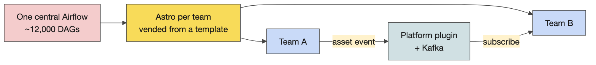
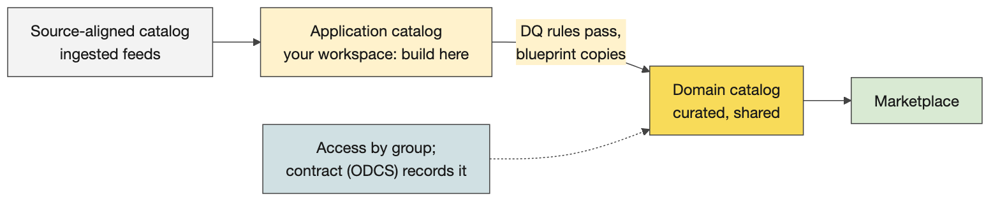

# Day 3 instructor prep guide — dbt practical and consolidation

[Data Creators › Day 3 — instructor prep guide]{.breadcrumb}

An hour's reading to be workshop-ready for Wednesday. The sections mirror the anchor notebook's four numbered sections: the concepts in depth, the teaching notes, and the mechanics of the practical and the walkthrough. Wednesday is mostly unstructured practical time, so the value of this guide is in two places: knowing the pipeline well enough to answer "what should I see?" at any section, and being able to give the platform session yourself if no guest comes. The run sheet beside this file has the timings and the lines.

## The day in one page

Learners build, test and document the Portfolio Analytics pipeline on Databricks from `challenges/v1/02-dbt-pipeline`: Phase 1 (sources and staging, about an hour) then Phase 2 (intermediate, marts, tests, docs, a capstone mart). The instructor's copy of the same project runs on DuckDB in the anchor, one cell per README section. At 11:00 the platform team speaks (or you do); at 14:30 the room consolidates by answering "what did we learn?", then pairs review each other's tests.

| # | Section | What happens | You must be able to |
|---|---|---|---|
| 1 | The dbt practical: launch, Phase 1 and the walkthrough | Launch, Challenge 9, the walkthrough cells, circulating, the break | Say what each of the eleven models does and what a finished Phase 1 looks like |
| 2 | The platform session | The guest, or the instructor-led version | Give twenty-five minutes on Airflow at CG, Unity Catalog, contracts and the vended repository |
| 3 | Complete and extend the practical | Phase 2, then the stretch: macros, snapshots, incremental, unit tests | Explain each stretch piece and when a production project needs it |
| 4 | Consolidation | What did we learn?, Activity 9, the close | Pull the day's facts from the room rather than lecture them |

Three things that go wrong: a learner reaches for `mise run challenge:reset 02` "to start clean" and deletes authored work; a build fails on the connection and someone re-authenticates five times when the token simply did not reach the shell; the day runs out of structure after lunch and the pair test review is skipped. Say the first before anyone types; the auth check is in the LLM guide; the run sheet protects the last.

## 1. The dbt practical: launch, Phase 1 and the walkthrough

### Concepts

#### The dbt mental model

**What dbt is.** A compiler and runner for SQL transformations. ELT: the data is loaded first (seeds or an upstream feed into Delta tables), and every transformation is a `select` statement in a file whose name is the model's name. dbt wraps each select in the `create table` or `create view` the materialisation asks for and runs it against the warehouse in dependency order. `{{ ref('model') }}` and `{{ source('system', 'table') }}` are not just references: they build the dependency graph, which is why dbt knows the order and why you never type a table name in a model.

**Jinja and compilation.** `{{ }}` and `` are Jinja, replaced before the SQL is sent. `dbt compile` writes the result to `target/compiled/`; `dbt run` writes what it actually executed to `target/run/`. When an error is a SQL error, read the compiled file, not the model.

**Commands.** `dbt debug` checks the profile and the connection; `dbt seed` loads CSVs; `dbt run` builds models; `dbt test` runs tests; `dbt build` does seeds, models, tests and snapshots together in graph order and skips everything downstream of a failure; `dbt source freshness` checks the sources' timestamps; `dbt docs generate` and `dbt docs serve` build and show the lineage site. Selection: `--select stg_holdings`, `+agg_fund_exposure` (the model and everything upstream), `stg_holdings+` (and everything downstream), `tag:staging`, `--exclude tag:stretch`.

**Project anatomy.** `dbt_project.yml` names the project, the folders, and folder-level configuration (the challenge sets staging and intermediate to views, marts to tables, with a tag per layer and a post-hook on marts); `profiles.yml` holds the targets (Databricks for learners, a DuckDB file here); `models/sources.yml` declares the raw tables; a `schema.yml` beside the models holds descriptions and tests.

#### Materialisations

A *view* is a stored query: nothing is written, every read recomputes, always fresh and cheap to build; right for staging and most intermediate models. A *table* is written on each run: fast to read, costs a rebuild; right for marts that consumers query. *Incremental* writes only new or changed rows on later runs and needs a `unique_key` and a strategy; *ephemeral* is inlined as a CTE into whatever references it. The rule the room should leave with: an intermediate model becomes a table only when a downstream consumer needs the speed. Configuration lives in `dbt_project.yml` per folder and can be overridden in a model's `config()` block.

#### Sources, freshness and the data

**Sources.** Four systems in `models/sources.yml`: `custodian` (holdings and positions, a daily SFTP drop), `bloomberg` (prices; `refdata_raw` is provisioned for inspection and freshness practice but not consumed), `fx_feed` (daily FX rates to a GBP base) and `product_ref` (the fund master: names, base currency, strategy, active flag). Each pins database and schema to the dbt target, so `source('custodian', 'holdings_raw')` resolves to the seed in the learner's own schema, exactly as it would resolve to a landed feed in production. Freshness is declared per source with a `loaded_at_field` (`_extracted_at`) and thresholds: the custodian warns after four hours and errors after six, which is the gate tomorrow's DAG checks first. The seeds carry an authored May 2026 `_extracted_at`, refreshed to "now" on load by a post-hook so freshness passes on a fresh seed.

**The data is tiny on purpose.** Eight holdings rows and eight cash positions over two position dates (20 and 21 May 2026), four funds, eight prices, six FX rates. Nothing takes long and every number can be checked by hand.

#### The eleven models

Staging (views): `stg_holdings` renames and casts the custodian's `fund_cd, pos_dt, isin, qty, mkt_val_lc, ccy_cd` and coalesces a null ISIN; `stg_positions`, `stg_prices`, `stg_fx_rates`, `stg_funds` do the same for their sources. Intermediate (views): `int_holdings_enriched` joins holdings to prices and FX at the holding's own grain (one row per fund, date, instrument, still eight rows: the join must not multiply); `int_fund_attributes` brings the fund master's strategy and base currency; `int_positions_dated` aligns cash positions by date. Marts (tables): `agg_fund_exposure` aggregates exposure in base currency by fund, date and strategy code with an instrument count and the cash exposure; `fct_portfolio_returns` is the daily-grain fact per fund, date and instrument with `mv_base_ccy`; `agg_fund_daily_exposure` is the capstone mart learners add end to end with its own reconciliation test.

**Tests.** Generic tests in `schema.yml`: `not_null` and `unique` on keys, `accepted_values` on `strategy_code`, `relationships` from the fact's `fund_id` to `stg_funds`. Singular tests as SQL that must return no rows: `assert_nav_within_tolerance` compares the holdings-derived value with the custodian-reported NAV per unit in `seed_custodian_nav`; `reconcile_daily_exposure` ties the capstone mart back to the fact. A finished project in the training environment seeds eight CSVs, builds eleven models and passes seventeen tests.

**Docs and the post-hook.** `dbt docs generate` reads the YAML descriptions and the graph; `dbt docs serve --host 127.0.0.1 --port 8081` because the dev container's `DBT_HOST` is the Databricks host and collides with the default. The marts' post-hook runs `OPTIMIZE … ZORDER BY` on Databricks after each build; on DuckDB the macro is a no-op, which is the only difference between the learners' project and the instructor's copy, apart from one widened decimal cast.

### Teaching notes

- **The launch.** "Yesterday Catalyst generated a dbt project for you. Could you have written it? Today you find out." Then the challenge box: where to work, the first three commands, Phase 1 first, never reset.
- **Circulating questions, three per learner.** Sources and staging: what does one row mean, what is its key, what are the types and units? Joins: is the right-hand side unique on the join key, do dates belong in the join, what happens to unmatched rows? Tests and output: show me a value you checked independently of the model that produced it. The question that exposes most: could this join pass its tests and still double the reported value? (A price table with two rows per instrument and date passes `not_null` and still doubles the exposure; row grain and right-side uniqueness are the check.)
- **Likely questions and answers.**
  - *View or table?* View unless a consumer needs speed or the query is expensive; marts are tables.
  - *Why did `dbt build` stop halfway?* Everything downstream of a failed model or test is skipped; fix the first failure, then rerun with `--select` from there.
  - *Where is the SQL it actually ran?* `target/compiled/` and `target/run/`. Open it when the error is SQL, not dbt.
  - *How do I run one model?* `dbt build --select stg_holdings`; add `+` before for upstream, after for downstream.
  - *Are dbt tests the data quality rules from the contract?* The tests implement them; the contract states the promise; a missing test is a promise nobody checks.
  - *Why seeds?* CSV loads for small reference data and for learning; production feeds are landed by ingestion jobs and declared as sources.
  - *What if two learners build into the same schema?* They do not: each has `training_dev.training_‹username›`.
- **Misconceptions to catch.** dbt moves data (it only sends SQL; the warehouse moves data). Tests passing means the data is right (they check what you declared and nothing else). A model with `select 1 as placeholder` is finished (it parses; it is a stub). `challenge:reset` is "start clean" (it deletes authored work).

### Mechanics

- **Where to work.** `cd challenges/v1/02-dbt-pipeline/dbt`; every `dbt` command from there. `mise run challenge:verify 02` and `challenge:reset 02` run from anywhere. First commands: `dbt debug` (the connection), `dbt seed` (the eight CSVs into the learner's schema), `dbt ls --resource-type model` (ten stubs).
- **Phase 1, about an hour.** S1 inspect the raw data; S2 read the project; S3 declare sources and freshness; S4 `stg_holdings`; S5 the remaining staging models; S6 materialisations; S7 build the whole staging layer (`dbt build --select tag:staging`, five models, PASS=5); S8 a staging test. Each section has concept, authoring task, hint, how to check, a variation, then the folded solution.
- **The walkthrough cells.** The anchor runs the same project on DuckDB from `courseware/day3-dbt/demos/portfolio_analytics/`: seed and query the raw data; `dbt ls`; `dbt source freshness`; the staging model's SQL and its build; the staging layer by tag; the schema tests; then Phase 2 cell by cell. Use a cell when someone asks what they should see; the folder's README maps each cell to its README section.
- **Stalls.** Connection errors: run the three-step auth check from the repository's Copilot instructions before logging in again; a token that did not reach the shell is the usual cause. `dbt docs serve` refusing to bind: the `--host 127.0.0.1 --port 8081` flags. A model that parses but returns the placeholder: the stub was never replaced. A decimal overflow only appears on DuckDB (the instructor's copy widens one cast); Databricks does not need it.
- **The gate.** `mise run challenge:verify 02` seeds, runs and tests; green means solved. Keep a list of commands, configuration changes, questions and discoveries: the recap is built from it.

## 2. The platform session

### Concepts

The guest slot is an hour with the platform team. If nobody comes, the twenty-five-minute instructor-led version in the anchor covers the four topics below, drawn from what the platform team told the previous cohort; say that it is their picture, dated, and that the platform team owns the current answer.

#### Airflow at Capital Group

One open-source Airflow (2.11) ran about twelve thousand live DAGs over an enormous Kubernetes cluster, with noisy-neighbour problems because one DAG can take thousands of Spark executors. Astronomer advised that about two thousand DAGs is the largest sensible instance. The options were many self-managed Airflows (too much management), the AWS managed service (weak scaling, no disaster-recovery story for tier-one data) or Astronomer, which was chosen for its disaster-recovery plugin, its contribution record, its support, a CLI that runs everything locally and quick deployments. Today a team gets an Airflow vended through DevOps templates with an opinionated repository that favours Databricks; the migration is a messy middle over months: net-new jobs go to Astro now, critical pipelines move last. The vended instances run Airflow 3 with the new UI (learners live in the Airflow UI, not the Astro UI, which is for platform operations) and the Astro executor.

**Cross-team dependencies.** Within one Airflow, assets: a DAG publishes an asset and downstream DAGs subscribe. Across many Airflows, a CG plugin reads published assets and pushes them to Kafka through centrally managed secrets, so no API tokens are shared, and a system-lineage view shows which job consumes which asset. The old scheduler still exists and integrates both ways.

**Operations.** Onboarding to operations with a criticality level, a warranty period and knowledge transfer; Datadog dashboards vended per Airflow instance; non-production instances hibernate outside business hours; health-check DAGs available but costed; monthly release notes; a Catalyst skill updates a team's repository from the template, with a pull request to review because teams customise.

#### Databricks and Unity Catalog

Seven years of Databricks, from a workspace-bound metastore that could not share to Unity Catalog, where data lives outside the workspace and is bound to workspaces, one Unity per region. Three catalog types: *application* catalogs (one per workspace; the team's scratch pad and the jump point to publishing), one *source-aligned* catalog (ingestion-like, minimal translation; some teams already publish straight into it), and *domain* catalogs (where curation happens; domain and consumer-aligned data). Access is automated at schema level through directory groups, supported manually at table level, and attribute-based later. Application catalogs cannot be shared: a team writes to its application catalog and a vended blueprint copies to the domain catalog after the data quality rules run, which keeps tiering, quality and access standard. Serverless compute is preferred; classic compute starts machines and needs warm-up. Disaster-recovery rules for data will be the creator's to write.

#### Contracts, the repository and the Marketplace

Contracts follow the Open Data Contract Standard and the product standard, as YAML, including access; a contract is required to publish to a domain catalog, and contracts seed the Marketplace, which is the discovery layer. A check that the contract exists and conforms is coming to CI. The vended repository: dot files (linters, pre-commit, mise), `data_products/` with blueprints such as the DAG execution check and the Databricks run-now blueprint, clusters and pools, shared assets, then infrastructure code, plugins and tests. A data product is a Databricks Asset Bundle plus a dbt project with datasets; inside a dataset folder sit the dbt code, the Airflow YAML that a blueprint turns into a DAG, and the job YAML with the lines that run dbt. An Airflow task only triggers a Databricks job; Databricks runs the SQL.

### Teaching notes

- **With a guest**, agree the agenda in advance, one line per topic: where code goes, how deployment is initiated, where execution is visible, how failures are investigated, how access is granted. Keep the room's questions from the Q&A table ready.
- **Without a guest**, teach from the two diagrams and the three paragraphs above, and be explicit that the numbers are the platform team's from a previous cohort.
- **Likely questions and answers.**
  - *Can I publish from my application catalog directly?* No: the vended blueprint copies to the domain catalog after quality rules, so tiering and access stay standard.
  - *Do I get my own Airflow?* Your team does, vended through the template; you do not run it.
  - *Where does the contract go?* In the repository as YAML; it gates publication and seeds the Marketplace.
  - *Airflow 2 or 3?* Vended instances are Airflow 3; the learners' container runs 3.1 too.

## 3. Complete and extend the practical

### Concepts

#### Phase 2, section by section

C1 the enrichment join (`int_holdings_enriched`: holdings times prices times FX, grain unchanged); C2 the two supporting intermediates; C3 the first mart, `agg_fund_exposure`; C4 the second, `fct_portfolio_returns`; C5 generic tests on the marts; C6 the singular NAV reconciliation within tolerance; C7 the full build; C8 docs and the lineage graph; C9 the Databricks post-hook; C10 the capstone mart `agg_fund_daily_exposure` and its reconciliation test, end to end. The finished build on this laptop shows four strategy codes with exposures that sum by code (EQ-EM, EQ-GC, EQ-LC, FI-IG), two rows each, and a NAV test that returns no rows.

#### The stretch: what a production project adds

**A dispatching macro.** `to_base_ccy(amount, fx_rate)` returns a base-currency amount with a cast that works on Databricks and DuckDB, chosen by `adapter.dispatch` on `target.type`. Macros are Jinja functions; dispatch is how one project runs on several warehouses.

**A custom generic test.** `test_non_negative` in `tests/generic/` becomes a test you can attach to any money column in YAML, like `not_null`.

**A snapshot.** `fund_master_snapshot` keeps the history of the fund master as slowly changing dimension type 2: each change closes the previous row's validity and opens a new one. Strategies: `timestamp` (an updated-at column) or `check` (a list of columns to compare). Snapshots are history of a dimension, not backups.

**An incremental model.** `agg_fund_daily_exposure_incremental` processes only new dates on later runs with the `delete+insert` strategy and a `unique_key`; `is_incremental()` guards the filter; a change of logic needs `--full-refresh`. Incremental is for large facts where rebuilding everything is wasteful, not a default.

**A unit test.** In `stretch.yml`, a `unit_tests` entry runs `stg_holdings` on three made-up rows and compares with expected rows: logic without warehouse data, available since dbt 1.8. A data test checks the real data; a unit test checks the SQL.

**An exposure.** `exposures.yml` names who consumes the marts, which closes the loop to the contract's consumer registry and shows in the lineage site.

### Teaching notes

- **Let the technical people go deep** after Phase 2 rather than holding everyone to the same task: the stretch cells, the bitemporal macro preview for tomorrow, Airflow logging to Datadog.
- **Likely questions and answers.**
  - *Incremental or snapshot?* Incremental processes only new rows of a fact; a snapshot records the changes of a dimension over time.
  - *Unit test or data test?* A unit test fixes the input rows and checks the logic; a data test runs against the real table and checks the data.
  - *When is a post-hook right?* For something that must follow every build of that model, such as compaction; not for business logic.
  - *Does incremental always win?* No: merge cost, duplicate risk, and a full refresh whenever the logic changes. Use it when a rebuild is measurably too slow.
- **Misconceptions to catch.** Snapshots are backups. Macros are models. A unit test replaces data tests.

### Mechanics

- **The stretch cells** print the macro, run the snapshot (`dbt snapshot`), run the incremental model, show the unit test YAML and run it (`dbt test --select stg_holdings,test_type:unit`). `bash demo.sh stretch` runs all of it from a clean warehouse.
- **The prompt in the anchor** (`adding-dbt-unit-test`) lets a learner add the same unit test to their own project in Copilot.

## 4. Consolidation

### Concepts

The facts to pull from the room, in the order rooms tend to give them: dbt pipelines can do most of the work; most of the code can be generated from a good contract; the code lives in the training repository under `data_products/` (the capstone runs in the wrong folder at your own risk); Airflow blueprints are filled with YAML; Databricks only runs Spark, so dbt SQL is translated to Spark; data on S3 is Delta by default, columnar, with logs that give ACID and row-level inserts and deletes; three Unity Catalog types; data quality tests are easy to add; materialisation is configured in the project file and can be overridden in the model.

### Teaching notes

- **Ask, write, add.** "What did we learn?" and write the room's answers up; fill gaps from the list above rather than lecturing it.
- **Activity 9, test review in pairs (10 minutes).** Each pair takes a test another pair wrote: which contract rule does it guard, what wrong data would still slip through, what one extra test would close the gap. The close asks two or three pairs for their example.
- **Before learners leave.** The project built through Phase 2 at least; the list of commands and discoveries kept; tomorrow's volunteers for bitemporal loading and Harness asked for.

## Readiness self-test

1. What do `ref()` and `source()` do beyond pointing at a table?
2. In what order does `dbt build` run things, and what happens downstream of a failure?
3. Where do you look when a model fails with a SQL error?
4. Name the four sources of the pipeline and the one table that is declared but not consumed.
5. Which source carries the freshness gate, with what thresholds, and which column does it read?
6. List the five staging, three intermediate and three mart models.
7. Give the four generic tests the project uses and the two singular tests.
8. Why does `dbt docs serve` need `--host 127.0.0.1 --port 8081` in the dev container?
9. What does the marts' post-hook do on Databricks, and what does it do on DuckDB?
10. Snapshot versus incremental, in one line each; and when does an incremental model need `--full-refresh`?
11. What are CG's three Unity Catalog types, and why can an application catalog not be shared?
12. What is the one thing an Airflow task does on the paved path, and what runs the SQL?

### Answers

1. They build the dependency graph that fixes the build order and the lineage, and they resolve the name to the right database and schema for the target.
2. Seeds, then models, tests and snapshots in graph order; everything downstream of a failed node is skipped.
3. `target/compiled/` for the SQL dbt produced and `target/run/` for what it executed.
4. `custodian` (holdings, positions), `bloomberg` (prices, refdata), `fx_feed` (FX rates), `product_ref` (fund master); `bloomberg.refdata_raw` is declared, not consumed.
5. The custodian source: warn after four hours, error after six, read from `_extracted_at`.
6. Staging: `stg_holdings`, `stg_positions`, `stg_prices`, `stg_fx_rates`, `stg_funds`. Intermediate: `int_holdings_enriched`, `int_fund_attributes`, `int_positions_dated`. Marts: `agg_fund_exposure`, `fct_portfolio_returns`, `agg_fund_daily_exposure`.
7. `not_null`, `unique`, `accepted_values`, `relationships`; `assert_nav_within_tolerance`, `reconcile_daily_exposure`.
8. The container's `DBT_HOST` is the Databricks host and collides with the server's default bind address and port.
9. `OPTIMIZE … ZORDER BY` on the mart after each build; on DuckDB the macro emits nothing.
10. A snapshot records a dimension's changes as validity ranges; an incremental model processes only new rows of a fact; a full refresh is needed when the model's logic changes.
11. Application (per workspace, the team's scratch pad), source-aligned (one, ingestion-like), domain (curated, domain and consumer-aligned); application catalogs are not shareable so that publication goes through the blueprint that runs quality rules and applies standard access.
12. It triggers a Databricks job; Databricks runs dbt's SQL as Spark.

## The evening before

- [ ] `bash courseware/day3-dbt/demos/portfolio_analytics/demo.sh stretch` ends green; open the lineage site once.
- [ ] Open the Day 3 anchor, Run All, save with outputs; the walkthrough cells show the numbers above.
- [ ] Read the challenge README's Phase 1 once more and the solution of S4 (`stg_holdings`), so your first circulating answer is exact.
- [ ] Confirm whether the platform team is coming; if yes, send the five agenda lines; if no, rehearse the twenty-five-minute version from the two diagrams.
- [ ] Ask for Thursday's volunteers (bitemporal loading, Harness) at the end of the day; have the guest brief ready.
- [ ] Print Activity 9's card and this day's run sheet.

## Go deeper

- dbt documentation: models and materialisations, sources and freshness, tests, unit tests, snapshots, incremental models, macros and dispatch, exposures: https://docs.getdbt.com/
- The dbt-databricks adapter and its configuration: https://docs.getdbt.com/reference/resource-configs/databricks-configs
- The challenge README and its folded solutions: `challenges/v1/02-dbt-pipeline/README.md`; the repository's `CHANGES.md` records the verified end-to-end numbers.
- The instructor's copy and its cell-to-section map: `courseware/day3-dbt/demos/portfolio_analytics/README.md`.
- The Open Data Contract Standard: https://bitol-io.github.io/open-data-contract-standard/
- Unity Catalog concepts: https://docs.databricks.com/data-governance/unity-catalog/
