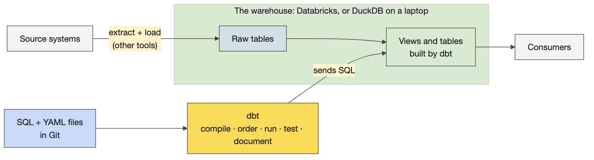
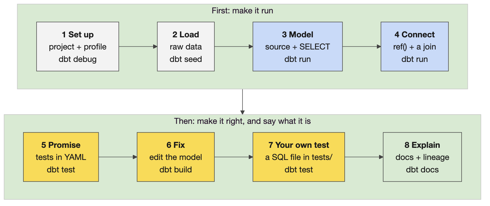
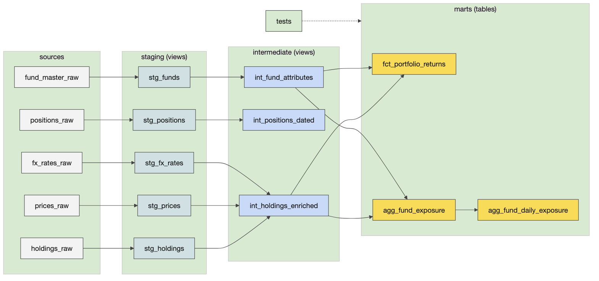
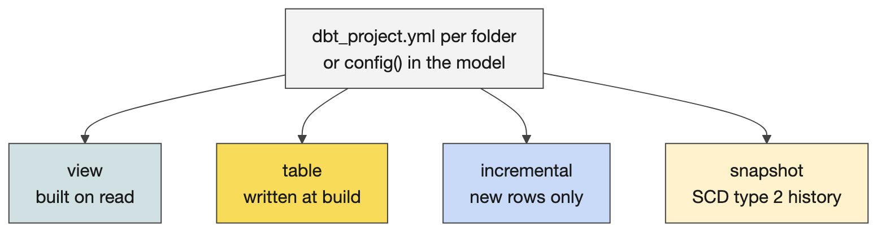
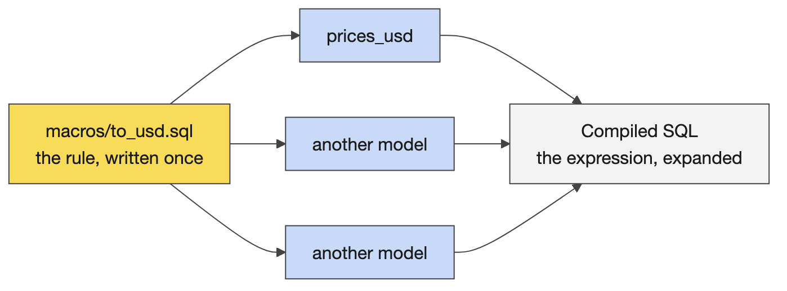

# Day 3 instructor prep guide — dbt practical and consolidation

[Data Creators › Day 3 — instructor prep guide]{.breadcrumb}

An hour's reading to be workshop-ready for Wednesday. The sections mirror the anchor notebook's four numbered sections: the concepts in depth, the teaching notes, and the mechanics of the practical and the walkthrough. Wednesday opens with a ten-minute recap of Tuesday's platform and forty minutes of taught dbt on a small example and is then mostly unstructured practical time, so the value of this guide is in two places: being able to present the small example cell by cell, and knowing the pipeline well enough to answer "what should I see?" at any section. There is no platform session this week: its content was covered on Day 2, and the 11:00 hour goes to the practical. The run sheet beside this file has the timings and the lines.

## The day in one page

The day opens with a ten-minute recap of Day 2's platform in four pictures (warehouse, lake and lakehouse; Databricks under the hood; the Delta format; the tools together), one question per picture, so everyone is on the same page. Then dbt from zero, from 09:10 to 09:50: a small project (`demos/price_sheet`, Day 2's price data on DuckDB) that the anchor writes file by file and runs, presented from the notebook with no whiteboard. Then learners build, test and document the Portfolio Analytics pipeline on Databricks from `challenges/v1/02-dbt-pipeline`: Phase 1 (sources and staging, about an hour) then Phase 2 (intermediate, marts, tests, docs, a capstone mart). The instructor's copy of the same project runs on DuckDB in the anchor, one cell per README section. The practical runs through to lunch; at 13:00 there are twenty-five minutes of advanced dbt (a loop, a macro, a custom test, a snapshot, an incremental model, a unit test), then the practical resumes; at 14:30 the room consolidates by answering "what did we learn?", then pairs review each other's tests.

| # | Section | What happens | You must be able to |
|---|---|---|---|
| 1 | dbt from zero: one transformation through the whole life cycle | The four-picture recap, then eight steps on `demos/price_sheet`, each a file written or a command run | Present every cell, say what each file is for, and explain why two tests fail at Step 5 |
| 2 | The dbt practical: launch, Phase 1 and the walkthrough | Launch, Challenge 9, the walkthrough cells, the break, circulating through Phase 2 to lunch | Say what each of the eleven models does and what a finished Phase 1 looks like |
| 3 | Advanced dbt, then complete and extend the practical | The 13:00 demo (loop, macro, custom test, snapshot, incremental, unit test), then Phase 2 and the stretch | Explain each stretch piece and when a production project needs it |
| 4 | Consolidation | Activity 9b (a second look at yesterday's AI-generated dbt), what did we learn?, Activity 9, the close | Pull the day's facts from the room rather than lecture them; name the order to review generated dbt in |

Three things that go wrong: a learner reaches for `mise run challenge:reset 02` "to start clean" and deletes authored work; a build fails on the connection and someone re-authenticates five times when the token simply did not reach the shell; the day runs out of structure after lunch and the pair test review is skipped. Say the first before anyone types; the auth check is in the LLM guide; the run sheet protects the last.

## 1. dbt from zero: one transformation through the whole life cycle

### Concepts

The section teaches dbt on the smallest useful example before anyone opens the challenge, in the order a newcomer needs: what dbt is for, why use it, then how a project is built.

**What and why (five minutes).** One picture says what dbt is: the transformation step, SELECT statements in files that dbt turns into tables and views in the warehouse, with no data or compute of its own. Then a cell runs the same price-sheet transformation as a hand-written SQL script: it finishes without an error and three HSBC prices are wrong, because `gbp` does not match `GBP` and the script defaults a missing rate to 1. A table sets the script beside dbt on six questions (is it right, what order, what does it mean, reuse, environments, what changed). A path picture then shows the eight steps: first make it run (set up, load, model, connect), then make it right and say what it is (promise, fix, guard, explain).

**The build (thirty minutes).** The project is `courseware/day3-dbt/demos/price_sheet/`: it starts as two raw CSVs from Day 2's running example (36 vendor prices, 9 FX rates) and ends as four models in three layers (`staging/`, `intermediate/`, `marts/`, the challenge's layout and prefixes), five tests and a docs site. The one transformation is a price in US dollars: the close price times that day's FX rate. Every other file exists to show one dbt idea.

| Step | The cell writes or runs | The idea | What the room sees |
|---|---|---|---|
| 1 | `dbt_project.yml`, `profiles.yml`, `dbt debug` | A project is a folder; the profile is the connection, and the only file that differs between DuckDB and Databricks | All checks passed |
| 2 | `dbt seed` | Seeds stand in for landed feeds; dbt starts with the raw data already in the warehouse | HSBC's currency written `gbp`; Apple delivered twice on 4 November |
| 3 | `models/sources.yml`, `models/staging/stg_prices.sql`, `dbt run` | A model is a SELECT in a file; dbt compiles the Jinja, wraps the SELECT in a CREATE and sends it | One view; `source(...)` replaced by the real table name in `target/compiled/` |
| 4 | `staging/stg_fx_rates.sql`, `intermediate/int_prices_usd.sql`, `marts/fct_prices_usd.sql`, `dbt run` | The three layers and their prefixes, as in the challenge; `ref()` builds the graph and the order | Four models in order; HSBC's dollar price empty although the run is green |
| 4, continued | The `models:` block of `dbt_project.yml`; `stg_fx_rates.sql` with `config(materialized='table')`, then without | Materialisation is set per folder and overridden per model: challenge S6 | Three views and one table; the staging model becomes a table, then a view again |
| 5 | `staging/schema.yml`, `marts/schema.yml`, `dbt test` | Tests are queries for the rows that break a rule; descriptions live in the same YAML | Two failures: `accepted_values` on `gbp`, `not_null` on three prices |
| 6 | `staging/stg_prices.sql` again, `dbt build` | The fix goes in the model, two layers upstream of the failing test; build runs seeds, models and tests in graph order | Ten results, all green |
| 7 | A singular test, `stg_prices.sql` again, `dbt build` | Any SQL file in `tests/` is a test; the dedup pattern learners write in S5 | Red on the Apple re-delivery, then green; 35 rows |
| 8 | `dbt docs generate` | Docs and lineage come from the same files | The catalog, and the list of models and tests upstream of `fct_prices_usd` |

**Jinja, early.** Learners use Jinja from the challenge's fourth section, so Step 3 explains it: two curly braces print a value into the SQL (`source()`, `ref()`, `config()`, `this`); a brace and a percent sign run logic (`if`, `for`, `macro`), which the challenge does not need and the 13:00 demo covers. Jinja runs on the laptop at compile time; the warehouse only receives plain SQL, and `target/compiled/` is where to read it.

### Teaching notes

- **Learners work on Databricks; the notebook does not mention DuckDB.** Learners do not run the demo cells; everything they do (the challenge, yesterday's generated project, Activity 9b) runs in their dev container against Databricks. Your demo cells run against a local DuckDB file so each step answers at once, but the learner-facing notebook does not name it: the only trace is `type: duckdb` in the demo's `profiles.yml`, with a comment that theirs says `type: databricks`. If asked, say the demo uses a local warehouse, the SQL and the commands are the same, and only the profile differs.
- **Present the notebook; no whiteboard.** Each `%%writefile` cell is the file itself. Read it aloud, ask what the next command will print, then run it. About four minutes a step.
- **Steps 5 and 6 are the lesson.** The run at Step 4 is green and three prices are missing; the tests at Step 5 catch it twice; one line in staging fixes it. Say: a successful run means the SQL executed, not that the answer is right.
- **The recap (09:00, ten minutes).** Four Day 2 diagrams, each with a question to ask and the two lines to land. Let the room answer; do not re-teach. Finish on the tools picture with the dbt box: dbt holds no data and does no computing, it sends SQL to everything on these pictures.
- **If behind at 09:40**, skip Step 7 and say it is the pattern of C6 (the NAV reconciliation). If ahead, serve the docs site and click through the lineage graph.
- **The mapping table** at the end of the section ties each step to a README section; leave it on screen while launching the challenge.
- **YAML files.** Step 3 has a short box on this because the room asks: `.yml` and `.yaml` are the same format and dbt reads both; only `dbt_project.yml` and `profiles.yml` have fixed names; every other YAML file under `models/` can be called anything, because dbt reads the top-level keys (`sources:`, `models:`, `seeds:`, `unit_tests:`), not the file name. `sources.yml` and `schema.yml` are conventions; Catalyst writes `_staging__sources.yml` and `_staging__models.yml`.
- **Likely questions.** *Why seeds?* Small reference data and demos; real feeds are loaded by other tools and declared as sources. *Where did the CREATE statement come from?* dbt's materialisation wrote it; see `target/run/`. *Why did the join miss?* `gbp` is not `GBP`; string joins are exact. *Is `where rn = 1` the only way to deduplicate?* No; `qualify` is shorter on Databricks and DuckDB, and the challenge's solution uses `row_number()` too.

### Mechanics

- **Before the room arrives**, run section 1 top to bottom once: the first cell runs `reset.sh`, which deletes everything in the folder except `seeds/`, the README and the script, and the cells rebuild it. The folder's README lists every step and its expected result.
- **The 13:00 cells** write `models/marts/agg_prices_by_ccy.sql`, `macros/to_usd.sql` and a new `models/intermediate/int_prices_usd.sql` into the same folder, so run section 1 before them.
- **The docs site**: `cd courseware/day3-dbt/demos/price_sheet && dbt docs serve --host 127.0.0.1 --port 8082`.

## 2. The dbt practical: launch, Phase 1 and the walkthrough

### Concepts

#### The dbt mental model

**What dbt is.** A compiler and runner for SQL transformations. ELT: the data is loaded first (seeds or an upstream feed into Delta tables), and every transformation is a `select` statement in a file whose name is the model's name. dbt wraps each select in the `create table` or `create view` the materialisation asks for and runs it against the warehouse in dependency order. `{{ ref('model') }}` and `{{ source('system', 'table') }}` are not just references: they build the dependency graph, which is why dbt knows the order and why you never type a table name in a model.

**Jinja and compilation.** `{{ }}` and `` are Jinja, replaced before the SQL is sent. `dbt compile` writes the result to `target/compiled/`; `dbt run` writes what it actually executed to `target/run/`. When an error is a SQL error, read the compiled file, not the model.

**Commands.** `dbt debug` checks the profile and the connection; `dbt seed` loads CSVs; `dbt run` builds models; `dbt test` runs tests; `dbt build` does seeds, models, tests and snapshots together in graph order and skips everything downstream of a failure; `dbt source freshness` checks the sources' timestamps; `dbt docs generate` and `dbt docs serve` build and show the lineage site. Selection: `--select stg_holdings`, `+agg_fund_exposure` (the model and everything upstream), `stg_holdings+` (and everything downstream), `tag:staging`, `--exclude tag:stretch`.

**Project anatomy.** `dbt_project.yml` names the project, the folders, and folder-level configuration (the challenge sets staging and intermediate to views, marts to tables, with a tag per layer and a post-hook on marts); `profiles.yml` holds the targets (Databricks for learners, a DuckDB file here); `models/sources.yml` declares the raw tables; a `schema.yml` beside the models holds descriptions and tests.

#### Materialisations

A *view* is a stored query: nothing is written, every read recomputes, always fresh and cheap to build; right for staging and most intermediate models. A *table* is written on each run: fast to read, costs a rebuild; right for marts that consumers query. *Incremental* writes only new or changed rows on later runs and needs a `unique_key` and a strategy; *ephemeral* is inlined as a CTE into whatever references it. The rule the room should leave with: an intermediate model becomes a table only when a downstream consumer needs the speed. Configuration lives in `dbt_project.yml` per folder and can be overridden in a model's `config()` block.

#### Sources, freshness and the data

**Sources.** Four systems in `models/sources.yml`: `custodian` (holdings and positions, a daily SFTP drop), `bloomberg` (prices; `refdata_raw` is provisioned for inspection and freshness practice but not consumed), `fx_feed` (daily FX rates to a GBP base) and `product_ref` (the fund master: names, base currency, strategy, active flag). Each pins database and schema to the dbt target, so `source('custodian', 'holdings_raw')` resolves to the seed in the learner's own schema, exactly as it would resolve to a landed feed in production. Freshness is declared per source with a `loaded_at_field` (`_extracted_at`) and thresholds: the custodian warns after four hours and errors after six, which is the gate tomorrow's DAG checks first. The seeds carry an authored May 2026 `_extracted_at`, refreshed to "now" on load by a post-hook so freshness passes on a fresh seed.

**The data is tiny on purpose.** Eight holdings rows and eight cash positions over two position dates (20 and 21 May 2026), four funds, eight prices, six FX rates. Nothing takes long and every number can be checked by hand.

#### The eleven models

Staging (views): `stg_holdings` renames and casts the custodian's `fund_cd, pos_dt, isin, qty, mkt_val_lc, ccy_cd` and coalesces a null ISIN; `stg_positions`, `stg_prices`, `stg_fx_rates`, `stg_funds` do the same for their sources. Intermediate (views): `int_holdings_enriched` joins holdings to prices and FX at the holding's own grain (one row per fund, date, instrument, still eight rows: the join must not multiply); `int_fund_attributes` brings the fund master's strategy and base currency; `int_positions_dated` aligns cash positions by date. Marts (tables): `agg_fund_exposure` aggregates exposure in base currency by fund, date and strategy code with an instrument count and the cash exposure; `fct_portfolio_returns` is the daily-grain fact per fund, date and instrument with `mv_base_ccy`; `agg_fund_daily_exposure` is the capstone mart learners add end to end with its own reconciliation test.

**Tests.** Generic tests in `schema.yml`: `not_null` and `unique` on keys, `accepted_values` on `strategy_code`, `relationships` from the fact's `fund_id` to `stg_funds`. Singular tests as SQL that must return no rows: `assert_nav_within_tolerance` compares the holdings-derived value with the custodian-reported NAV per unit in `seed_custodian_nav`; `reconcile_daily_exposure` ties the capstone mart back to the fact. A finished project in the training environment seeds eight CSVs, builds eleven models and passes seventeen tests.

**Docs and the post-hook.** `dbt docs generate` reads the YAML descriptions and the graph; `dbt docs serve --host 127.0.0.1 --port 8081` because the dev container's `DBT_HOST` is the Databricks host and collides with the default. The marts' post-hook runs `OPTIMIZE … ZORDER BY` on Databricks after each build; on DuckDB the macro is a no-op, which is the only difference between the learners' project and the instructor's copy, apart from one widened decimal cast.

### Teaching notes

- **The launch.** "Yesterday Catalyst generated a dbt project for you. Could you have written it? Today you find out." Then the challenge box: where to work, the first three commands, Phase 1 first, never reset.
- **Circulating questions, three per learner.** Sources and staging: what does one row mean, what is its key, what are the types and units? Joins: is the right-hand side unique on the join key, do dates belong in the join, what happens to unmatched rows? Tests and output: show me a value you checked independently of the model that produced it. The question that exposes most: could this join pass its tests and still double the reported value? (A price table with two rows per instrument and date passes `not_null` and still doubles the exposure; row grain and right-side uniqueness are the check.)
- **Likely questions and answers.**
  - *View or table?* View unless a consumer needs speed or the query is expensive; marts are tables.
  - *Why did `dbt build` stop halfway?* Everything downstream of a failed model or test is skipped; fix the first failure, then rerun with `--select` from there.
  - *Where is the SQL it actually ran?* `target/compiled/` and `target/run/`. Open it when the error is SQL, not dbt.
  - *How do I run one model?* `dbt build --select stg_holdings`; add `+` before for upstream, after for downstream.
  - *Are dbt tests the data quality rules from the contract?* The tests implement them; the contract states the promise; a missing test is a promise nobody checks.
  - *Why seeds?* CSV loads for small reference data and for learning; production feeds are landed by ingestion jobs and declared as sources.
  - *What if two learners build into the same schema?* They do not: each has `training_dev.training_‹username›`.
- **Misconceptions to catch.** dbt moves data (it only sends SQL; the warehouse moves data). Tests passing means the data is right (they check what you declared and nothing else). A model with `select 1 as placeholder` is finished (it parses; it is a stub). `challenge:reset` is "start clean" (it deletes authored work).

### Mechanics

- **Where to work.** `cd challenges/v1/02-dbt-pipeline/dbt`; every `dbt` command from there. `mise run challenge:verify 02` and `challenge:reset 02` run from anywhere. First commands: `dbt debug` (the connection), `dbt seed` (the eight CSVs into the learner's schema), `dbt ls --resource-type model` (ten stubs).
- **Phase 1, about an hour.** S1 inspect the raw data; S2 read the project; S3 declare sources and freshness; S4 `stg_holdings`; S5 the remaining staging models; S6 materialisations; S7 build the whole staging layer (`dbt build --select tag:staging`, five models, PASS=5); S8 a staging test. Each section has concept, authoring task, hint, how to check, a variation, then the folded solution.
- **The walkthrough cells.** The anchor runs the same project on DuckDB from `courseware/day3-dbt/demos/portfolio_analytics/`: seed and query the raw data; `dbt ls`; `dbt source freshness`; the staging model's SQL and its build; the staging layer by tag; the schema tests; then Phase 2 cell by cell. Use a cell when someone asks what they should see; the folder's README maps each cell to its README section.
- **Stalls.** Connection errors: run the three-step auth check from the repository's Copilot instructions before logging in again; a token that did not reach the shell is the usual cause. `dbt docs serve` refusing to bind: the `--host 127.0.0.1 --port 8081` flags. A model that parses but returns the placeholder: the stub was never replaced. A decimal overflow only appears on DuckDB (the instructor's copy widens one cast); Databricks does not need it.
- **The gate.** `mise run challenge:verify 02` seeds, runs and tests; green means solved. Keep a list of commands, configuration changes, questions and discoveries: the recap is built from it.

## 3. Advanced dbt, then complete and extend the practical

### Concepts

#### Phase 2, section by section

C1 the enrichment join (`int_holdings_enriched`: holdings times prices times FX, grain unchanged); C2 the two supporting intermediates; C3 the first mart, `agg_fund_exposure`; C4 the second, `fct_portfolio_returns`; C5 generic tests on the marts; C6 the singular NAV reconciliation within tolerance; C7 the full build; C8 docs and the lineage graph; C9 the Databricks post-hook; C10 the capstone mart `agg_fund_daily_exposure` and its reconciliation test, end to end. The finished build on this laptop shows four strategy codes with exposures that sum by code (EQ-EM, EQ-GC, EQ-LC, FI-IG), two rows each, and a NAV test that returns no rows.

#### The 13:00 demo: Jinja that writes SQL

Two cells on the morning's price sheet come first. A `for` loop over a list of currencies writes one `count(case when ...)` column per currency in `agg_prices_by_ccy`; the compiled SQL shows the four lines the loop produced. Then a macro, `to_usd(amount, ccy, rate)`, holds the conversion rule once; `int_prices_usd` calls it, the compiled SQL shows the expression expanded, and the tests still pass. A macro is a function that returns SQL text. The remaining cells run on the Portfolio Analytics copy and are described below.

#### The stretch: what a production project adds

**A dispatching macro.** `to_base_ccy(amount, fx_rate)` returns a base-currency amount with a cast that works on Databricks and DuckDB, chosen by `adapter.dispatch` on `target.type`. Macros are Jinja functions; dispatch is how one project runs on several warehouses.

**A custom generic test.** `test_non_negative` in `tests/generic/` becomes a test you can attach to any money column in YAML, like `not_null`.

**A snapshot.** `fund_master_snapshot` keeps the history of the fund master as slowly changing dimension type 2: each change closes the previous row's validity and opens a new one. Strategies: `timestamp` (an updated-at column) or `check` (a list of columns to compare). Snapshots are history of a dimension, not backups.

**An incremental model.** `agg_fund_daily_exposure_incremental` processes only new dates on later runs with the `delete+insert` strategy and a `unique_key`; `is_incremental()` guards the filter; a change of logic needs `--full-refresh`. Incremental is for large facts where rebuilding everything is wasteful, not a default.

**A unit test.** In `stretch.yml`, a `unit_tests` entry runs `stg_holdings` on three made-up rows and compares with expected rows: logic without warehouse data, available since dbt 1.8. A data test checks the real data; a unit test checks the SQL.

**An exposure.** `exposures.yml` names who consumes the marts, which closes the loop to the contract's consumer registry and shows in the lineage site.

### Teaching notes

- **Let the technical people go deep** after Phase 2 rather than holding everyone to the same task: the stretch cells, the bitemporal macro preview for tomorrow, Airflow logging to Datadog.
- **Likely questions and answers.**
  - *Incremental or snapshot?* Incremental processes only new rows of a fact; a snapshot records the changes of a dimension over time.
  - *Unit test or data test?* A unit test fixes the input rows and checks the logic; a data test runs against the real table and checks the data.
  - *When is a post-hook right?* For something that must follow every build of that model, such as compaction; not for business logic.
  - *Does incremental always win?* No: merge cost, duplicate risk, and a full refresh whenever the logic changes. Use it when a rebuild is measurably too slow.
- **Misconceptions to catch.** Snapshots are backups. Macros are models. A unit test replaces data tests.

### Mechanics

- **The stretch cells** print the macro, run the snapshot (`dbt snapshot`), run the incremental model, show the unit test YAML and run it (`dbt test --select stg_holdings,test_type:unit`). `bash demo.sh stretch` runs all of it from a clean warehouse.
- **The prompt in the anchor** (`adding-dbt-unit-test`) lets a learner add the same unit test to their own project in Copilot.

## 4. Consolidation

### Concepts

The facts to pull from the room, in the order rooms tend to give them: dbt pipelines can do most of the work; most of the code can be generated from a good contract; the code lives in the training repository under `data_products/` (the capstone runs in the wrong folder at your own risk); Airflow blueprints are filled with YAML; Databricks only runs Spark, so dbt SQL is translated to Spark; data on S3 is Delta by default, columnar, with logs that give ACID and row-level inserts and deletes; three Unity Catalog types; data quality tests are easy to add; materialisation is configured in the project file and can be overridden in the model.

### Teaching notes

- **Ask, write, add.** "What did we learn?" and write the room's answers up; fill gaps from the list above rather than lecturing it.
- **Activity 9b, a second look at yesterday's AI-generated dbt (14:20, 15 minutes).** On Day 2 the room generated a dbt project with Copilot and Catalyst before knowing dbt, and the shareback asked how to review that much output: trust it, review all of it, or review some of it; one table also noticed that the AI writes more than is needed. The whole activity sits at the end of the day, when learners know dbt. Two minutes: each learner writes down two things in that project they could not judge yesterday. Eight minutes in pairs: reopen the project, assess it in graph order (sources, staging, joins, tests, materialisations, then anything nobody asked for) with the card's table, then pick one thing they caught and prompt Copilot again to fix it, naming the file, what is wrong and the check; read the diff and run the check. Five minutes of shareback: what was caught, the prompt, whether the fix held. The point to land: yesterday's prompt was "build me a project"; today's names a model, a fault and a test. Some projects did not finish generating yesterday; those learners use a partner's, or the Day 2 example in `courseware/day2-platform/demos/contract-to-code/eod_prices`. What is still not judged goes in the Q&A table.
- **Activity 9, test review in pairs (10 minutes).** Each pair takes a test another pair wrote: which contract rule does it guard, what wrong data would still slip through, what one extra test would close the gap. The close asks two or three pairs for their example.
- **Before learners leave.** The project built through Phase 2 at least; the list of commands and discoveries kept; tomorrow's volunteers for bitemporal loading and Harness asked for.

## Readiness self-test

1. What do `ref()` and `source()` do beyond pointing at a table?
2. In what order does `dbt build` run things, and what happens downstream of a failure?
3. Where do you look when a model fails with a SQL error?
4. Name the four sources of the pipeline and the one table that is declared but not consumed.
5. Which source carries the freshness gate, with what thresholds, and which column does it read?
6. List the five staging, three intermediate and three mart models.
7. Give the four generic tests the project uses and the two singular tests.
8. Why does `dbt docs serve` need `--host 127.0.0.1 --port 8081` in the dev container?
9. What does the marts' post-hook do on Databricks, and what does it do on DuckDB?
10. Snapshot versus incremental, in one line each; and when does an incremental model need `--full-refresh`?
11. What are CG's three Unity Catalog types, and why can an application catalog not be shared?
12. What is the one thing an Airflow task does on the paved path, and what runs the SQL?

### Answers

1. They build the dependency graph that fixes the build order and the lineage, and they resolve the name to the right database and schema for the target.
2. Seeds, then models, tests and snapshots in graph order; everything downstream of a failed node is skipped.
3. `target/compiled/` for the SQL dbt produced and `target/run/` for what it executed.
4. `custodian` (holdings, positions), `bloomberg` (prices, refdata), `fx_feed` (FX rates), `product_ref` (fund master); `bloomberg.refdata_raw` is declared, not consumed.
5. The custodian source: warn after four hours, error after six, read from `_extracted_at`.
6. Staging: `stg_holdings`, `stg_positions`, `stg_prices`, `stg_fx_rates`, `stg_funds`. Intermediate: `int_holdings_enriched`, `int_fund_attributes`, `int_positions_dated`. Marts: `agg_fund_exposure`, `fct_portfolio_returns`, `agg_fund_daily_exposure`.
7. `not_null`, `unique`, `accepted_values`, `relationships`; `assert_nav_within_tolerance`, `reconcile_daily_exposure`.
8. The container's `DBT_HOST` is the Databricks host and collides with the server's default bind address and port.
9. `OPTIMIZE … ZORDER BY` on the mart after each build; on DuckDB the macro emits nothing.
10. A snapshot records a dimension's changes as validity ranges; an incremental model processes only new rows of a fact; a full refresh is needed when the model's logic changes.
11. Application (per workspace, the team's scratch pad), source-aligned (one, ingestion-like), domain (curated, domain and consumer-aligned); application catalogs are not shareable so that publication goes through the blueprint that runs quality rules and applies standard access.
12. It triggers a Databricks job; Databricks runs dbt's SQL as Spark.

## The evening before

- [ ] `bash courseware/day3-dbt/demos/portfolio_analytics/demo.sh stretch` ends green; open the lineage site once.
- [ ] Open the Day 3 anchor, Run All, save with outputs; section 1 rebuilds `demos/price_sheet` (Step 5 shows two failing tests on purpose) and the walkthrough cells show the numbers above.
- [ ] Read the challenge README's Phase 1 once more and the solution of S4 (`stg_holdings`), so your first circulating answer is exact.
- [ ] Ask for Thursday's volunteers (bitemporal loading, Harness) at the end of the day; have the guest brief ready.
- [ ] Print the cards for Activities 9 and 9b and this day's run sheet.

## Go deeper

- dbt documentation: models and materialisations, sources and freshness, tests, unit tests, snapshots, incremental models, macros and dispatch, exposures: https://docs.getdbt.com/
- The dbt-databricks adapter and its configuration: https://docs.getdbt.com/reference/resource-configs/databricks-configs
- The challenge README and its folded solutions: `challenges/v1/02-dbt-pipeline/README.md`; the repository's `CHANGES.md` records the verified end-to-end numbers.
- The instructor's copy and its cell-to-section map: `courseware/day3-dbt/demos/portfolio_analytics/README.md`.
- The Open Data Contract Standard: https://bitol-io.github.io/open-data-contract-standard/
- Unity Catalog concepts: https://docs.databricks.com/data-governance/unity-catalog/
- Every dbt command by objective, the `--select` syntax, the files dbt reads and writes, the Jinja forms, materialisations, good habits and a troubleshooting table: `courseware/common/glossaries/dbt-commands.md`.
