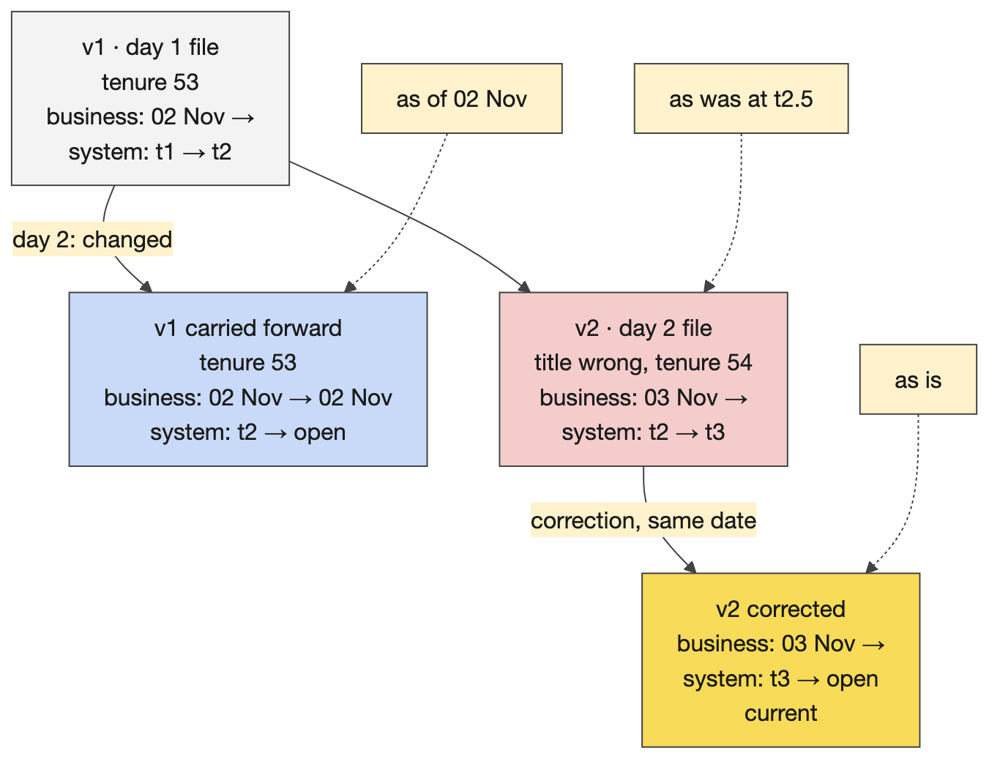
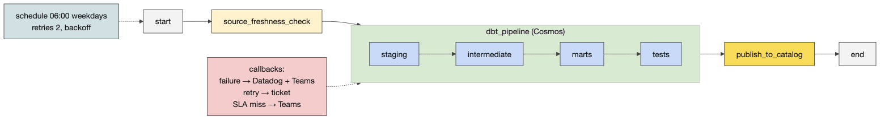
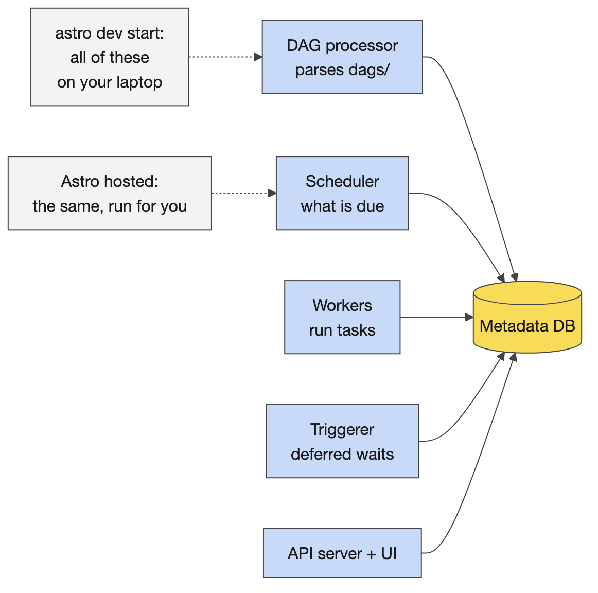
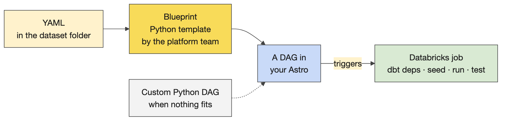
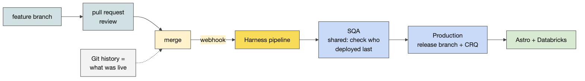

# Day 4 instructor prep guide — Bitemporal loading and Airflow orchestration

[Data Creators › Day 4 — instructor prep guide]{.breadcrumb}

An hour's reading to be workshop-ready for Thursday. The sections mirror the anchor notebook's three numbered sections: the concepts in depth, the teaching notes, and the mechanics of the demos, the Airflow practical and the two afternoon exercises. Thursday has the most moving parts of the week (a local Airflow stack, the learners' Astro environments, a possible guest or volunteer, Harness), so the mechanics sections are longer than usual. The run sheet beside this file has the timings and the lines.

## The day in one page

Morning: history (two clocks on every row) and timing (Airflow), with a long practical in which learners wire, schedule and run the Portfolio Analytics DAG with Cosmos. Afternoon: the deployment picture (CI/CD, Harness, Datadog), then two short exercises that turn a failed run into a decision and a note, and a check of Friday's starting line.

| # | Section | What happens | You must be able to |
|---|---|---|---|
| 1 | Bitemporal loading | The demo on DuckDB, a guest or volunteer's real table, the "which clock?" shareback | Write the as-of and as-was queries from memory and explain what a correction does to the rows |
| 2 | Airflow orchestration | Orientation and Friday's preview, the stack and a run in the UI, a controlled failure, Challenge 10 until 13:30 | Name Airflow 3's components, read a DAG file, diagnose a cold start, and say what the freshness gate proves |
| 3 | CI/CD and release operations | GitOps and Harness, the Datadog monitors, the release decision, the failure note, Friday preparation | Walk a deployment to SQA and production, and lead the release-decision discussion |

Three things that go wrong: a learner starts Astro before `mise run setup:databricks` finished and the Cosmos import error ends in an empty catalog name (the cold start: new terminal, `astro dev restart --wait 5m`); the Airflow UI is looked for at a fixed address when astro prints a per-project one; the instructor stack is started at 09:00 instead of before the day. The stalls table in the anchor covers the first two; the evening-before checklist covers the third.

## 1. Bitemporal loading

### Concepts

#### Loading strategies and the two clocks

**Strategies.** Truncate and reload (the table is only ever the latest file). Insert-overwrite (a partition at a time). Slowly changing dimension type 2 (an effective start and end date keep history, one clock). Bitemporal loading is SCD2 with a second clock: *business time* is when a fact was true in the world (the business date the feed describes); *system time* is when the warehouse loaded or believed it. Separate start and end columns for each clock, plus a current indicator and a row hash that detects change.

**The columns.** In the platform's convention: `dl_business_start_dt` and `dl_business_end_dt`, `dl_system_start_ts` and `dl_system_end_ts`, `dl_current_ind`, `dl_row_hash`. System time is stamped in UTC from the run; the business date comes from the feed or from the run's logical date, so a 03:00 Pacific run for the previous business day shows the previous date. Always say which clock a date column is.

**Load types.** The platform's `bitemporal_load_v2` strategy offers *full* (the source sends the whole book of record each run; expensive, because every record is end-dated and re-inserted daily), *incremental* (a business key; new keys are inserted; a known key with changed content end-dates the previous version and inserts a new one, so a corrected attribute on a trade is answerable historically) and *balance* (monetary balances). Eight strategies exist in the framework and two projects a year still need custom work. dbt provides no bitemporal strategy natively; the platform's is a chain of Jinja macros ending in Python that hashes each change and stamps the versions.

#### Corrections, and the four questions

A correction for an already-loaded business date does not overwrite: it closes the system clock of the defective row and inserts the corrected one with the same business start. Nothing is lost, so four questions stay answerable. *As is* (what is current): both clocks open, `dl_current_ind`. *As of* a date D with today's knowledge: the business clock covers D and the system clock is open. *As was* at time T (what the report said): the system clock covers T. *Which versions did a correction replace*: order by system start within the key. The example that lands: an associate's tenure months change, creating versions; a join defect once produced a wrong job title, and the fix produced a corrected version; the table is an audit of what the code produced at each point. Boolean status flags across snapshots are the trap: a flag cannot say when.

**The demo's macro.** `courseware/day4-airflow/demos/bitemporal/macros/bitemporal_load.sql`, a custom dbt incremental strategy in three steps: close the system clock of superseded rows; carry the superseded business version forward with its business end set to the new start less one day; insert the new or changed rows. Written to be read on one screen; the platform's macro does the same job with more strategies.

### Teaching notes

- **Ask before showing code.** "The source corrects Monday's value on Wednesday. What was true on Monday, and what did we believe on Tuesday?" Use one timeline and one row; every concept is in it.
- **A guest or volunteer** recruited yesterday shows a real table for ten minutes: the columns, one row's history ordered by system start, one change, one correction, which strategy the model uses. The anchor's demo covers the same ground if nobody comes.
- **Likely questions and answers.**
  - *Why not a status flag or an overwrite?* Both destroy the answer to "what did the report say on Tuesday", and the flag cannot say when it changed.
  - *Isn't SCD2 enough?* SCD2 has one clock, business validity. A correction needs system time to separate what was true from what we believed.
  - *Isn't this expensive?* The full strategy re-versions the whole book of record daily; the incremental strategy with a business key touches only changed keys. Choose by feed, not by habit.
  - *What about deletes?* A missing row means nothing until the source's contract says what it means; then either close the clocks or carry a delete indicator.
  - *UTC or local?* System time in UTC, always; the business date is the feed's.
- **Misconceptions to catch.** As-of equals as-was (different clocks). The current indicator means the latest system version (it means current on both clocks). The `dl_` columns are optional decoration (they are the audit).

### Mechanics

- **The demo.** `bash demos/bitemporal/demo.sh` seeds an associate feed with three batches, loads day 1, loads day 2 (one change and one defect), loads the corrected re-delivery, then prints the history and the as-is, as-of and as-was queries. The two `sql()` cells show the audit trail for one associate and the as-of query for 2 November; the next cell prints the macro.
- **The shareback.** Each table takes one question: the associate's title on 2 November; what the dashboard showed on the morning of day 2; when we learned about the correction; which rows an auditor needs. Say the clock, then the filter.
- **Flex.** Over time: skip the macro walk, keep the four queries.

## 2. Airflow orchestration

### Concepts

#### What orchestration is, and the DAG

**Orchestration** decides when the pipeline's parts run, in what order, with retries, logs and alerts: the conductor who plays no instrument. A product's promises about delivery time and freshness are kept by the scheduler, not by the SQL. A **DAG** is a directed acyclic graph of tasks written in Python: operators first (`PythonOperator`, `EmptyOperator`, the Cosmos `DbtTaskGroup`, the Databricks operators; `BashOperator` and friends are blocked by CG's cluster policy), then dependencies with `>>`, read as "and then" (`t1 >> t2 >> [t3, t4]` runs t3 and t4 in parallel after t2). `default_args` are inherited by every task (retries, callbacks); DAG-level configuration carries the schedule, catchup, concurrency, the required `usage-id` and `cost-center` tags, and the DAG-level callbacks.

**The challenge's DAG.** `start >> source_freshness_check >> dbt_pipeline >> publish_to_catalog >> end`. The freshness gate is a `PythonOperator` that runs `dbt source freshness --select source:custodian` and raises on an `error_after` breach, so a stale feed fails the run before any compute is spent and everything downstream is `upstream_failed`. The Cosmos group renders the dbt project as one task per model and test in dbt's own order. `publish_to_catalog` reads the mart and logs the rows; it carries the SLA. Schedule `0 6 * * 1-5` in London time, for the 07:30 UK commitment; `catchup=False`; `retries=2` with a two-minute delay, exponential backoff and a twenty-minute cap; `max_active_runs=1`; `max_active_tasks=4` on Databricks (1 on this laptop, because a DuckDB file takes one writer).

#### Airflow's components

A **DAG processor** parses `dags/` and reports import errors. A **scheduler** decides what is due and queues it. **Workers**, through the executor, run tasks and write their logs. A **triggerer** handles deferred waits. An **API server** serves the UI. A **metadata database** (Postgres) holds state. `astro dev start` runs all of them as containers on the laptop; a hosted Astro deployment is the same thing run for you, vended per team. Knowing the pieces explains the symptoms: an import error is the processor; a task stuck in queued is the scheduler or the executor; a failed task is a worker log. Airflow 3 differences a learner meets: `schedule=` rather than the old `schedule_interval=`, tasks no longer talk to the database directly, assets replace datasets, and a new UI.

#### Cosmos, scheduling, retries, callbacks

**Cosmos** turns a dbt project into Airflow tasks: a project configuration (the project path), a profile configuration (how to connect), an execution configuration (which `dbt` executable; the learners' image keeps one in a virtualenv at `/home/astro/.venv/cosmos`), and a render configuration (what to select, whether tests run after each model or at the end). The group is one node for `>>`.

**Scheduling.** A cron string in a named time zone; `catchup=False` so a paused DAG does not backfill every missed interval; a manual trigger gets a `manual__` run id. The logical date of a run is the start of the interval it covers, which is why a 06:00 Tuesday run "is" Monday's data: say it once, because every learner trips on it.

**Retries** with exponential backoff: two retries at two and then four minutes means a task only reaches `failed` nine or ten minutes after the first error, which is the behaviour the challenge asks learners to observe. Retries presume idempotence: a rerun must be safe, which dbt is by construction and which `publish_to_catalog` must be by design.

**Callbacks** are functions run on an event with a `context` (the DAG, the task instance, the run id, the exception, the log URL): `on_failure_callback` after retries are exhausted (the pipeline is down: a P1 page), `on_retry_callback` (a P2 notification), `on_success_callback`. The challenge routes every alert through one vendor-neutral `send_alert` boundary and tiers them.

**SLAs in Airflow 3.** The learners' DAG sets `sla=timedelta(minutes=90)` on the publish task and `sla_miss_callback` on the DAG, and the 3.1.8 image still accepts both parameters, so the file parses. Airflow 3 retired the 2.x SLA-miss machinery and 3.1 introduced Deadline Alerts (present in the image) as its replacement, so treat the challenge's SLA tier as the design of the alerting taxonomy (slow is not down) and confirm with the platform team which mechanism fires on the vended instances before anyone promises a page.

**The freshness gate as a contract.** Phase 1 wires the task; Phase 2 makes the thresholds deliberate: `warn_after` prints and continues, `error_after` fails, so where you put `error_after` is the promise. Scope it to the source that matters for the SLA.

#### Blueprints, the paved-path variant, monitoring

**Astro blueprints.** Python written once by the platform team with placeholders; a dataset's YAML fills them; the result is a registered DAG. Over ninety per cent of products fit a blueprint; a custom DAG is for the rest and can become a new blueprint. The challenge is Python on purpose: once the Python makes sense, the YAML is just configuration. The vended repository's `data_products/.blueprints/` holds examples such as the DAG execution check and the Databricks run-now blueprint.

**Where dbt runs.** The Cosmos variant runs dbt on the Airflow worker. On the paved path an Airflow task triggers a Databricks job that runs dbt inside Databricks (`DatabricksSubmitRunOperator`, Phase 2's stretch), so compute, credentials and logs stay with the platform.

**Monitoring and runbooks.** Alerting says something just broke; monitoring says something is drifting. The challenge's monitoring config declares six panels, each an SLI with an alert condition and a channel, which is what a Datadog monitor is for: the promises from Day 2, watched. The runbook is the page the on-call engineer opens; the consumer guide is what the mart's users read. Structural tests parse the DAG file and assert tasks and edges without touching Databricks: the cheapest, highest-value Airflow test.

### Teaching notes

- **The UI tour, in order.** The DAGs list (owner, schedule, tags); the graph (five boxes and the dbt task group); the grid (one column per run); a task log (click `publish_to_catalog`: the published rows are in the log); the code tab. Then the line: a green graph is not evidence that the data is right; the publish task's rows are evidence.
- **The controlled failure teaches more than the green run.** Stale feed, trigger, the gate fails, everything downstream is `upstream_failed`, no rows published, the previous run's output stands; read the first useful log line aloud; refresh, trigger, green. It is the same drill as Phase 2 and Friday's extension questions: late input, failed check, repeated run.
- **Likely questions and answers.**
  - *Why not cron?* Dependencies, retries, logs, a UI, alerting, and a record of every run.
  - *Why is my task `up_for_retry` for ten minutes?* Two retries with exponential backoff; that is the configured behaviour, not a hang.
  - *Where does dbt actually run?* On the worker in the Cosmos variant; inside Databricks as a job on the paved path.
  - *What is the logical date?* The start of the interval the run covers; a 06:00 Tuesday run processes Monday.
  - *Why can't I use BashOperator?* The cluster policy blocks arbitrary-shell operators; use a `PythonOperator` that calls a subprocess, as the starter does.
  - *Where is the UI?* At the address astro prints, a per-project hostname and port; the instructor stack is pinned to localhost:8080.
  - *Why YAML blueprints if we learn Python?* Because the Python is written once by the platform and the YAML is what a creator fills; understanding the Python is what makes the YAML safe to write.
- **Misconceptions to catch.** A green DAG means correct data. Airflow moves data (it triggers things that do). A retry fixes a data problem (it fixes a transient one). Starting Astro before the Databricks setup is harmless (it captures the environment at boot).

### Mechanics

- **The instructor stack.** `courseware/day4-airflow/demos/airflow_local/`: `bash run.sh start` before the day (the image is built; starting takes a minute or two), then from the anchor: `seed`, `trigger`, `wait`, `status`; `stale` and `fresh` for the controlled failure; `stop` at the end. Same image family and versions as the learners' container (`astro-runtime:3.1-17-base`, Airflow 3.1.8, Cosmos 1.15.0, dbt 1.11.8). Two products are loaded: the challenge-shaped `portfolio_analytics_daily` over the Day 3 project, and `eod_prices_daily` from Day 2's contract.
- **Challenge 10, `challenges/v1/03-airflow-orchestration`, until 13:30 with lunch.** Prerequisites in order: `mise run setup:databricks` done (a terminal where `echo $DBT_CATALOG` prints a value); `(cd challenges/v1/02-dbt-pipeline/dbt && dbt seed)` so the DAG reads the four feeds freshly; `astro dev start` from the repository root, only after setup finished. Phase 1 (about 1.5 hours): why orchestration; anatomy of a DAG; `dbt debug`; the freshness gate (`astro dev run tasks test portfolio_analytics_daily source_freshness_check 2026-05-04`); the Cosmos group; wire the chain (the one TODO); scheduling; retries; first full run; logs and re-running. Phase 2: the alert transport; tiered alerting; the SLA and retry tiers; wiring callbacks; the freshness gate as a contract; the monitoring config; the runbook and consumer guide; structural tests; the Databricks submit-run variant; a production-ready DAG. Gate: `mise run challenge:verify 03`, a static check of the wiring; the live run is the evidence.
- **Stalls.** Import error ending in an empty catalog name: Astro started before setup; new terminal, `astro dev restart --wait 5m`. The freshness gate failing on a fresh seed: a connection error, not staleness; the task says which. `airflow: command not found`: prefix with `astro dev run`. `astro dev parse` reporting zero DAGs: it does not mount `data_products`; use the README's parse check and `astro dev run dags list-import-errors`. A `BashOperator` DAG rejected: the cluster policy. Tasks running one at a time: `max_active_tasks`. Two Astro environments on one laptop: `docker ps`, stop the stray one.
- **The shareback at 13:30.** One pair shows the current run, a useful log line and the table it produced; keep credential and path errors separate from the intended data-quality failure. Fast finishers answer: what happens if the input is late, if the quality check fails, if the run is repeated, with a log or output check for each.
- **Friday's preview** (the orientation part): the project is `challenges/v1/04-atlas-capstone`, the work happens in `data_products/atlas_elt`, Phase 1 is the certification bar, two to three hours, nobody hands out solutions.

## 3. CI/CD and release operations

### Concepts

#### Continuous integration and deployment

**Definitions.** Continuous integration is merging a feature branch often (daily or hourly, not monthly); continuous deployment is releasing to environments, production included, often. Why: faster feedback that something is broken, a shared understanding of the product across a team, observability of the lifecycle. The downsides are real and rooms respect hearing them: automation without a real human in the loop ("yes, yes, yes"), fragility, correlated failures (when a shared service is down, everything is), and the maintenance, approval and audit burden. CI/CD is not free.

**GitOps, and where CG is.** Data products are dbt and Airflow code in Git, not notebooks. In full GitOps the repository's configuration mirrors the live environment and the Git history is the history of what was live. CG is halfway: a GitHub event (a pull request submitted and approved) triggers integration and deployment through Harness, with an approval step between, which isolates the creator from the deployment machinery.

**Harness.** Environments; pipelines per repository. A deployment to SQA: Run, apply the SQA input set, choose the feature branch, run; a few minutes; first check who deployed last and whether they finished testing, because SQA is shared. Production: the PRD pipeline, fixed values, the release branch, and a change record number before anything runs; not everyone can run it. Logs exist for failed executions. Secrets live in a secrets manager, never in code or a chat; an API token that lets an AI assistant trigger deployments is a risk, not a shortcut: deployments are webhook-triggered on merge.

**Datadog.** Dashboards are vended per Airflow instance; the challenge's monitoring config is the creator's part: six SLIs with alert conditions and channels. A pull request is where acceptance happens, and a deleted test is a block of red lines that is easy to skim past.

#### The two exercises

**The release decision.** A nightly candidate has 500 rows but 497 distinct IDs; the uniqueness check failed and it was not published; yesterday's accepted output is still available. The reasoning to draw out: the candidate stays blocked, because until someone knows why three IDs appear twice, publishing it publishes a lie about uniqueness; whether yesterday's output is acceptable today depends on the consumer's freshness commitment in the contract, not on the engineer; the missing information is which IDs, whether the source re-delivered, whether the rule or the source changed, who owns the source; the consumer update says what is known, what is not, and when the next update comes; who may override a failed gate, and where that is recorded, is a governance question worth leaving open.

**The failure note.** A note another creator could use to locate the run and understand what happened: DAG and run id; the task that failed and the first useful log line; the cause (data quality, credentials, path, code); the action taken; the output check after the repair; what is still unresolved and who owns it. Pairs swap notes and test them: could they find the run from the note alone?

### Teaching notes

- **Say the downsides first** when a room is sceptical of process; then the two benefits that matter to a creator: knowing what is live, and acceptance happening in a pull request.
- **Likely questions and answers.**
  - *Who approves a production deploy?* The PRD pipeline's approvers, with a change record; the creator raises it, the pipeline runs it.
  - *Can I deploy from my laptop?* No; through the pipeline, on merge.
  - *SQA is broken by someone else's deployment; now what?* It is shared: check who deployed last, coordinate, do not deploy over them.
  - *How do I know what is live?* The Git history of the release branch and the pipeline's executions.
  - *Where do alerts go?* Through the alert transport to the channel of their tier; the monitoring config says which.
- **Misconceptions to catch.** CI/CD is just automated tests. GitOps means "it is in Git". A failed quality gate is a pipeline problem (it may be a data problem).

### Mechanics

- **Harness, live or from screenshots.** If someone has access, walk it; else the screenshots collected in the pre-flight. Pick the environment; the repository's pipeline; SQA with the input set and the feature branch; who deployed last; production with the release branch and the change record; a failed execution's logs. Then the secrets line.
- **The monitoring config cell** prints the challenge's `include/monitoring/portfolio_analytics.yml`: six panels, each an SLI with an alert condition and a channel.
- **Activity 10 (20 minutes).** Ten minutes deciding and drafting the two-sentence update, ten discussing; the discussion notes are folded in the anchor.
- **Activity 11 (15 minutes).** The template in the anchor; pairs whose environment was blocked use the prepared failure example (the custodian feed older than its threshold; the gate's log line; `upstream_failed` downstream; the repair published eight rows).
- **Friday preparation.** Every learner opens the capstone README, runs the readiness checks from the repository root and `dbt debug` in `data_products/atlas_elt`, runs `astro dev stop`, and any failure goes on the list with a name and a time.

## Readiness self-test

1. Name the six `dl_` columns and say which clock each belongs to.
2. Write the as-of query for 2 November and the as-was query for 09:00 on 3 November.
3. What does a correction do to the rows, and what does the full load type cost?
4. List Airflow 3's six components and the symptom each one explains.
5. Recite the challenge DAG's chain, its schedule and its retry settings.
6. Why does the freshness gate run first, and what is the difference between `warn_after` and `error_after`?
7. What is a run's logical date for a 06:00 Tuesday schedule?
8. What does Cosmos need to know to render a dbt project, and what does the group look like in the graph?
9. Where does dbt run in the Cosmos variant, and where on the paved path?
10. What is the cold-start symptom and its fix?
11. Give the SQA and production steps in Harness and the one thing production needs that SQA does not.
12. In the release decision, what stays blocked, what may be released, and who decides?

### Answers

1. Business clock: `dl_business_start_dt`, `dl_business_end_dt`. System clock: `dl_system_start_ts`, `dl_system_end_ts`. Both: `dl_current_ind`. Change detection: `dl_row_hash`.
2. As of: business start on or before 2 November, business end null or on or after it, system end null. As was: system start on or before 09:00 on 3 November and system end null or after it.
3. It closes the system clock of the defective row and inserts the corrected row with the same business start; the full type end-dates and re-inserts every record every run.
4. DAG processor (import errors), scheduler (queued, not running), workers via the executor (a failed task's log), triggerer (deferred waits), API server (the UI), metadata database (state).
5. `start >> source_freshness_check >> dbt_pipeline >> publish_to_catalog >> end`; `0 6 * * 1-5` in London time with catchup off; two retries, two-minute delay, exponential backoff, twenty-minute cap.
6. So a stale feed fails the run before any compute is spent; `warn_after` prints and exits zero, `error_after` fails the task and skips everything downstream.
7. The start of the interval the run covers: Monday's.
8. The project path, how to connect (the profile), which dbt executable, and what to select and how to place tests; one node in the chain that expands into a task per model and test.
9. On the Airflow worker; inside Databricks as a job triggered by the Airflow task.
10. A Cosmos import error ending in an empty catalog name because Astro started before the Databricks setup wrote the environment; a new terminal where the catalog variable prints, then `astro dev restart --wait 5m`.
11. SQA: Run, the SQA input set, the feature branch, run, after checking who deployed last. Production: the PRD pipeline, fixed values, the release branch, and a change record number.
12. The failed candidate stays blocked; yesterday's output may stand only if the consumer's freshness commitment allows it; the contract and its owner decide, and the override, if any, is recorded.

## The evening before

- [ ] `bash courseware/day4-airflow/demos/bitemporal/demo.sh` prints the four-row audit trail.
- [ ] Docker Desktop running; `cd courseware/day4-airflow/demos/airflow_local && bash run.sh start`, then `seed`, `trigger`, `wait`, `status` shows a green run; `stale` and `fresh` each produce the expected result; leave the stack running overnight or start it before 08:30.
- [ ] Open http://localhost:8080 once and find the graph, the grid, the publish task's log and the code tab.
- [ ] Open the Day 4 anchor, Run All, save with outputs.
- [ ] Confirm the bitemporal volunteer or guest and the Harness guest; if neither, rehearse the anchor's versions; have the Harness and Datadog screenshots ready.
- [ ] Read the challenge README's prerequisites and Phase 1 section 4 (the freshness gate) once more; know the cold-start fix by heart.
- [ ] Print Activities 10 and 11 and this day's run sheet.

## Go deeper

- Apache Airflow 3 documentation: core concepts, scheduling and the logical date, callbacks, and the release notes on what changed from 2.x: https://airflow.apache.org/docs/
- Astronomer Cosmos: https://astronomer.github.io/astronomer-cosmos/ ; the Astro CLI: https://www.astronomer.io/docs/astro/cli/overview
- The challenge README, especially Phase 2 challenges 4 to 8: `challenges/v1/03-airflow-orchestration/README.md`; the vended repository's blueprints under `data_products/.blueprints/`.
- The instructor stack's README: `courseware/day4-airflow/demos/README.md`; the bitemporal macro beside it.
- dbt incremental strategies and custom strategies: https://docs.getdbt.com/docs/build/incremental-strategy
- Harness pipelines and input sets: https://developer.harness.io/ ; Datadog monitors: https://docs.datadoghq.com/monitors/
