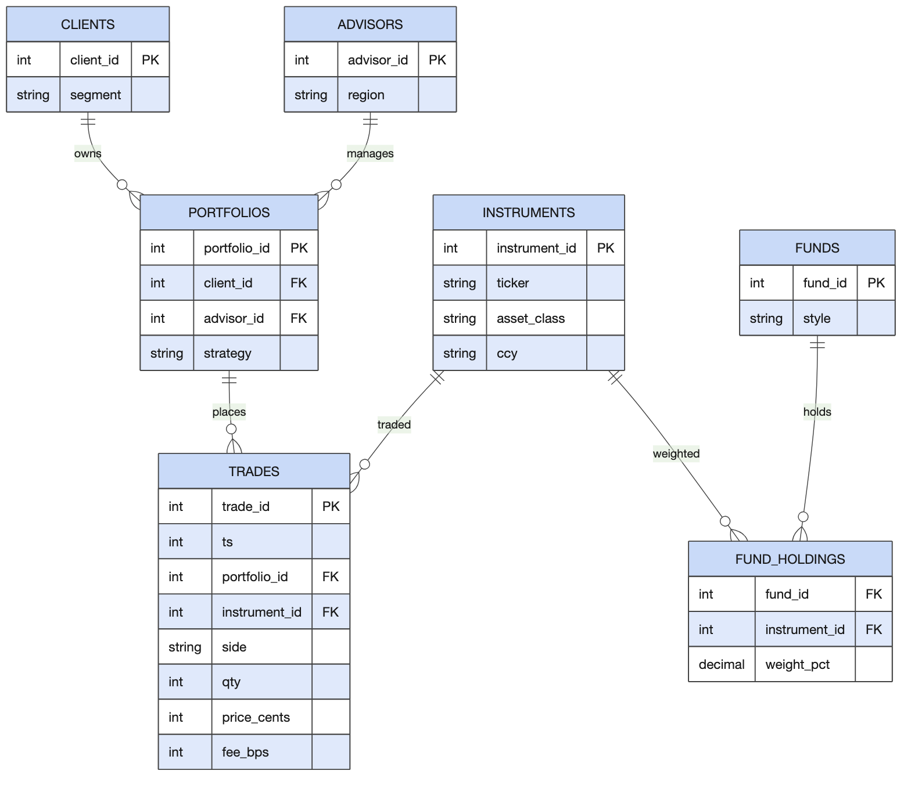
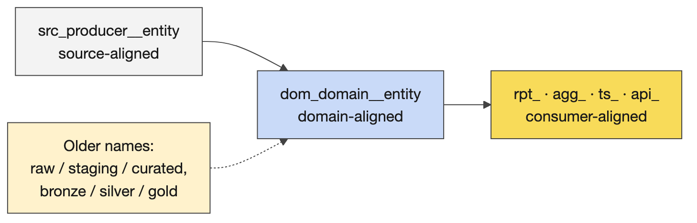
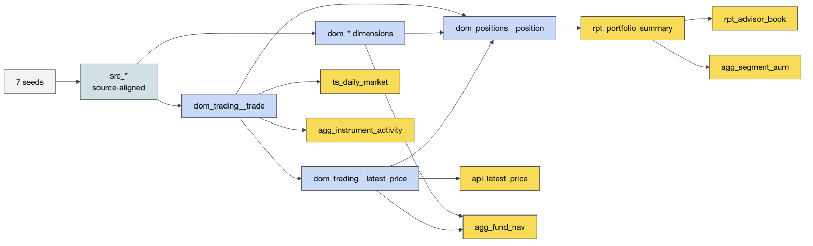
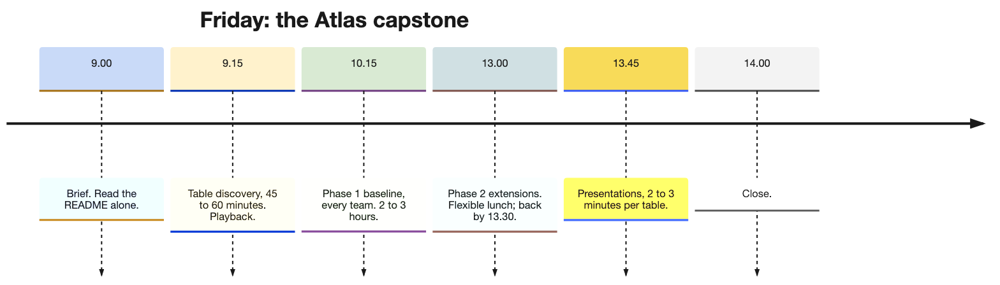

# Day 5 instructor prep guide — The Atlas capstone

[Data Creators › Day 5 — instructor prep guide]{.breadcrumb}

An hour's reading to be workshop-ready for Friday. The sections mirror the anchor notebook's four numbered sections. Friday is the learners' day: the instructor's job is the brief, the discovery hour, circulating with exact answers during Phase 1, and the presentations. So this guide is mostly the Atlas product itself, in enough depth to answer any "what should I see?" and to judge a team's numbers against the solution's. The run sheet beside this file has the timings and the lines.

## The day in one page

Teams reverse-engineer a data product from seven CSV files and the tables they are asked to produce, then build it on the paved path: seeds, a source-aligned layer, a domain-aligned layer, consumer-aligned marts, tests, and an understanding of the orchestration. Phase 1 is the certification bar and takes most teams two to three hours; Phase 2 is fourteen extensions to choose from; the day ends when every table has completed Phase 1 and presented.

| # | Section | What happens | You must be able to |
|---|---|---|---|
| 1 | The brief and discovery | The brief, ten minutes of reading, Activity 12 (the discovery worksheet), playback | Explain the Atlas domain and its units; steer a table from outputs back to sources without giving SQL |
| 2 | Phase 1: the baseline | The readiness checks, sections 1 to 8, circulating with the section notes and expected results, lunch | Say what each section produces and the number it should produce |
| 3 | Phase 2: extensions and presentation prep | The fourteen extensions, technical work stops at 14:30 | Recommend an extension by its value to the consumer |
| 4 | Presentations and close | Activity 13, the tally sheet, the certification evidence, the close | Judge the evidence and run the share-out in thirty minutes |

Three things that go wrong: a team starts writing SQL before it can say who the consumer is (the worksheet exists to stop that); a team runs the project in the challenge folder rather than `data_products/atlas_elt` (say it in the brief and again at 10:15); every table picks the same two outputs (nudge tables to different ones so the playbacks differ).

## 1. The brief and discovery

### Concepts

#### The Atlas domain

A fictional wealth-management platform. A *client* is the person whose money is managed; one client can own several portfolios. An *advisor* is the employee responsible for a client relationship, and their *book* is the total assets under management they look after. A *portfolio* is a container of investments owned by a client, with a strategy (income, balanced, preservation, growth). An *instrument* is something that can be bought or sold (equities, bonds, ETFs, commodities), with a ticker, asset class, sector and currency. A *trade* is a buy or sell event: which portfolio, which instrument, how many units, the price in cents, the fee in basis points, the venue, the currency. A *position* is the net amount of an instrument a portfolio holds after all buys and sells. *AUM* is the value of positions at the latest observed price. *Fees* are in basis points: one basis point is 0.01%, so `fee_bps = 5` is 0.05% of traded value, and the divisor is 10,000, not 1,000.

The data is synthetic and has been through several rounds of generation; a few things look odd, and "portfolio" and "fund" do not mean what they mean in CG's own model. That is deliberate, so the design conversation is real.

#### The seeds and how they relate

One fact table and six dimensions, shipped as dbt seeds in `data_products/atlas_elt/seeds/`: `trades` (10,000 rows: `trade_id, ts, portfolio_id, instrument_id, side, qty, price_cents, fee_bps, venue, ccy`), `instruments` (1,502), `portfolios` (2,501, mapped to clients and advisors), `clients` (2,002, with segment and domicile), `advisors` (120, with region), `funds` (60, with style) and `fund_holdings` (3,205, fund to instrument with target weights). Trades carry identifiers only: follow `portfolio_id` to the portfolio and from there to the client and the advisor; follow `instrument_id` to the security. Three unit conversions to agree before any SQL: cents to currency (divide by 100), basis points to a rate (divide by 10,000), epoch seconds to a date. There is no FX conversion in this data set: money stays in the trade's currency and cross-currency totals are nominal, a simplification to write down, not to hide.

#### Alignment and naming

Source-aligned models (`staging/src_*`) are one faithful pass-through per producing system, keeping the producer's shape for an audit path back to the extract. Domain-aligned models (`integration/dom_*`) are the agreed, conformed view of a business domain: one definition of a client, an instrument, a trade, a position, shared by every consumer; cleaned, typed, filtered. Consumer-aligned models (`prepared/*`) are shaped for how a report is read and named by query pattern: `rpt_` a report, one row per business question; `agg_` a pre-aggregated measure by a dimension; `ts_` a time series, one row per entity per period; `api_` a low-latency single-row lookup. The older layer names (raw, staging, intermediate, curated; bronze, silver, gold) describe how far data has been cleaned, not whose shape it is; recognise them, speak alignment.

#### What Phase 1 builds

Seeds, then source-aligned (seven `src_` models with the seeds' row counts), then domain-aligned: `dom_trading__trade` filters to valid trades (quantity and price positive, side B or S: 9,880 of 10,000) and derives the trade date, the signed quantity, the gross value and the fee; `dom_trading__latest_price` picks the latest trade per instrument by timestamp then trade id (788 instruments have one); `dom_positions__position` nets the signed quantities by portfolio and instrument (3,717 positions); the party, portfolio, instrument and fund dimensions conform the rest. Then consumer-aligned: `rpt_portfolio_summary` (1,028 portfolios with positions: strategy, client, segment, advisor, region, positions, AUM, fees paid, trades), `rpt_advisor_book` (120), `agg_segment_aum` (4), `api_latest_price` (788), `ts_daily_market` (520 trading days from 3 June 2024 to 29 May 2026), `agg_instrument_activity` (788), `agg_fund_nav` (60). Four singular tests tie the marts together: advisor books, segments and regions must each sum to the portfolio summary's AUM, and the position, daily and instrument marts must agree on the trade count.

#### The discovery worksheet

Before anyone builds: roles (facilitator, scribe, quality challenger, playback spokesperson); choose at least two outputs; a producer–creator–consumer map; a consumer-backwards map (consumer need, output, required sources, rules and assumptions); a mini source-to-target mapping for four to six important fields in plain English; a glossary (AUM, position, latest price, gross value, fee, basis point, advisor book, valid trade) and the trust questions (is the latest trade price a fair mark; what is a valid trade; are fees bps of gross value; trades before a portfolio's inception; no FX). Five minutes on roles, ten choosing outputs, fifteen to twenty-five mapping, ten on definitions and checks, then a two-minute playback per table. A PRD or contract from Catalyst in that hour is desirable, not required.

### Teaching notes

- **The brief, in the anchor's words.** The project, the folder rule, reverse-engineer first, the data's oddness, read a third of the README alone, stop discussing by 10:15, Phase 1 is what you must complete, lunch when you like, back by 13:30.
- **Nudge tables to different outputs** (summary and advisor book; instrument activity and segment AUM; daily market and fund NAV), so the playbacks and the presentations differ.
- **Likely questions and answers.**
  - *Is the latest trade price a fair valuation?* It is the only price in the data; use it and say so as an assumption. A real product would take a price feed.
  - *What is a valid trade?* Positive quantity and price, side B or S; 120 rows fail and the domain layer drops them. A team may keep and flag instead if it says why.
  - *Trades dated before the portfolio's inception?* Keep them and flag them to the business rather than guess a rule; a previous team did exactly that and presented it as a finding.
  - *How are fees calculated?* Gross value times basis points over 10,000.
  - *Should we convert currencies?* No FX data; totals across currencies are nominal; write it in the assumptions.
  - *Do we need a PRD first?* Desirable; the Day 1 and Day 2 skills apply; not required for Phase 1.
- **Misconceptions to catch.** Domain-aligned means cleaned staging (it means one agreed definition). AUM is the sum of trades (it is net position times latest price). The advisor book is a separate data set (it is the summary rolled up).

### Mechanics

- **09:00 to 09:15.** Brief; individual reading; name cards and a table for extra attendees.
- **Activity 12 (60 minutes).** The worksheet, the timebox, the hints for circulating in the anchor (the summary needs positions, the latest price and three dimensions; the book and the segment aggregates roll the summary up and must sum to it; three marts must agree on trade counts; the fund NAV weights the latest price by holdings; the API lookup is thin).
- **Playback.** Two to three minutes per table: the consumer, the decision, the sources, one rule, one assumption that could make the result untrustworthy.

### A worked example for circulating: the portfolio summary

Use this when a table is stuck or when a playback is thin; never hand it over whole.

**Consumer and decision.** Advisory leadership and portfolio oversight: which portfolios are large, concentrated or inactive, and which advisors' books are growing. One row per portfolio.

**Consumer-backwards map.**

| Consumer need | Output | Required sources | Rules and assumptions |
|---|---|---|---|
| Which portfolios carry the most money | `rpt_portfolio_summary.aum` | trades, instruments (through the latest price), portfolios | AUM is the sum over positions of net quantity times latest price; the latest price is the last valid trade's; no FX |
| How much each portfolio has paid in fees | `fees_paid` | trades | fee is gross value times `fee_bps` over 10,000; gross value is quantity times `price_cents` over 100 |
| Who looks after it | `client_name`, `segment`, `advisor_name`, `region` | portfolios, clients, advisors | one advisor per portfolio, through the portfolio |
| How active it is | `positions`, `trades` | trades | the count of instruments held and the count of valid trades |

**Mini source-to-target mapping.**

| Target field | Business meaning | Source fields | Transformation, in English | Check |
|---|---|---|---|---|
| `aum` | value of open positions at the latest price | `trades.qty`, `trades.side`, `trades.price_cents` | net the signed quantity per portfolio and instrument, multiply by the instrument's latest price, sum per portfolio | the advisor books sum to the same total |
| `fees_paid` | fees charged on valid trades | `trades.qty`, `price_cents`, `fee_bps` | quantity times price over 100 times basis points over 10,000, summed | never negative; the advisor book agrees |
| `positions` | instruments currently held | `dom_positions__position` | count the instruments whose net quantity is not zero | at most the instruments ever traded |
| `trades` | valid trades | `dom_trading__trade` | count | the three marts agree on 9,880 in total |
| `strategy` | the portfolio's strategy | `portfolios.strategy` | pass-through | one of income, balanced, preservation, growth |

**Glossary lines a table should write.** Valid trade (positive quantity and price, side B or S). Gross value (quantity times price, in the trade's currency). Latest price (the last valid trade's price for the instrument, by timestamp then trade id). Position (net quantity after buys and sells). AUM (positions valued at the latest price). Book (an advisor's total AUM). Basis point (one hundredth of one per cent).

**Trust questions, with the honest answers.** Is the latest trade price a fair mark? No: it is the last traded price and may be stale; the data has no price feed, so state it as an assumption. Can a position go negative? Yes, if sells exceed buys; decide whether to keep it as a short position or flag it. Are fees charged on gross value? Assumed. Currency? No conversion; cross-currency totals are nominal.

**What a strong playback sounds like.** "Our consumer is advisory leadership deciding where to focus; the output is one row per portfolio with AUM and fees; AUM is net position times the last traded price, which we flag as a weak mark; fees are basis points of gross value; we have no FX, so totals are nominal; our check is that the advisor books sum to the summary."

## 2. Phase 1: the baseline

### Concepts and mechanics, section by section

**Readiness, from the repository root.** `test -f .mise.toml && test -d data_products/atlas_elt && echo OK`; `mise exec -- databricks auth describe --profile DEFAULT`; then `cd data_products/atlas_elt && dbt debug`.

| Section | What learners do | What to check when circulating | Expected |
|---|---|---|---|
| 1 Inspect the seeds | Read the CSVs and the keys | Can they name each seed's key and the join columns in trades? | trade_id; portfolio_id to portfolios; instrument_id to instruments |
| 2 Understand the project | `dbt deps`, `dbt ls` | Do they see the tags per folder and that most models are views? | The stub models listed; tags source-, domain-, consumer-aligned |
| 3 Databricks connection | `dbt debug` | A green connection in their own schema | All checks passed |
| 4 Seed | `dbt seed` | Row counts | trades 10,000; instruments 1,502; portfolios 2,501; clients 2,002; advisors 120; funds 60; fund_holdings 3,205 |
| 5 Source-aligned | `dbt run --select tag:source-aligned` | Pass-through only; trades as a table | 7 models, the seeds' counts |
| 6 Domain-aligned | `dbt run --select tag:domain-aligned` | The valid-trade filter; epoch to date; cents and bps; latest price by timestamp then trade id; positions net the signed quantity | 9,880 valid trades; 788 latest prices; 3,717 positions |
| 7 Consumer-aligned and tests | `dbt run --select tag:consumer-aligned`, `dbt test` | The four reconciliations pass; one value checked by hand | The numbers below |
| 8 Orchestration | Read the dataset's YAML | Can they say what the DAG YAML triggers and where dbt runs? | A Databricks job per dataset, triggered by Airflow |

**The numbers that must reconcile.** Summary AUM, advisor-book AUM, segment AUM and region AUM all equal 6,721,818,148.99 in native trade currency; position trades, daily trades and instrument trades all equal 9,880. Segment AUM: Institutional 4,736,807,535.72 (59 clients, 103 portfolios), UHNW 1,697,924,446.95, HNW 236,390,671.74, Retail 50,695,494.58. Region: Zurich 1,978,757,922.56, New York 1,693,714,454.67, London 1,083,797,948.90, Hong Kong 987,836,625.34, Singapore 694,630,664.49, Dubai 283,080,533.03. The top advisor by book is William Vaughan (Zurich) at 551,154,146.77, then Oliver Thorne (New York) at 513,369,922.83. The largest portfolio is 892 (Balanced, Tindall Investment Trust, Institutional) at 133,208,598.49 with twelve positions. The full tables are in `courseware/day5-capstone/support/expected-results.md`, generated from the solution built on DuckDB from the same seeds, so a Databricks build of the same models should match; a different top five usually means a different latest-price rule or an unfiltered trade set.

**The gate.** `mise run challenge:verify 04`, not a bare `verify.sh`, because it needs mise's environment; the verified end-to-end run of the solution reports forty of forty checks green. **The rule.** Edit only under `data_products/atlas_elt/`; the stubs under `challenges/` are reset templates; solutions live with the instructor. Never type in a learner's project; point at the section note.

**Stalls.** `tag:source-aligned` selects nothing: the `models:` block in `dbt_project.yml` was edited; the tags are per layer folder. `dbt deps` fails or a shared macro is missing: run it from `data_products/atlas_elt`. A bare `verify.sh` fails on auth: use mise. `dbt show --inline "select …"` errors: mise word-splits the SQL; use `dbt show --select`. A bundle-validate warning about an expired key is a sandbox artefact and non-fatal. A target path under `/Volumes/...` is not mounted in the dev container: add `--target-path target` for local inspection and clean up afterwards. "Error during request to server" is Databricks being transient: retry.

### Teaching notes

- **Circulate with the section table above**, compare numbers with the expected results, and record each team's progress on the tally sheet. A successful build is a prerequisite; a number checked another way is evidence.
- **Lunch is flexible**; everyone back by 13:30 at the latest. The day ends when Phase 1 is done, so bring presentations forward if that happens early.

## 3. Phase 2: extensions and presentation prep

### Concepts

Fourteen extensions, each a README challenge with a kept solution; the DuckDB build in `courseware/day5-capstone/support/atlas_duckdb/` has all of them for comparing a team's result. Richer consumer marts: 1 an executive report mart; 2 an advisor leaderboard with `dense_rank()` (120 rows); 3 daily activity by asset class with a rolling window (1,789 rows); 14 a reconciling regional report (6 rows), the Phase 2 capstone. Documentation and freshness: 4 source freshness on the extracts; 5 exposures naming who consumes the marts. Reuse and tests: 6 a reusable money macro; 7 a custom generic test for non-negative money; 8 a relationship test; 9 singular reconciliation tests within tolerance. Loading patterns: 10 an incremental market mart (520 rows, the same as its twin); 11 a snapshot for slowly changing portfolios (2,500 rows). Orchestration: 12 understand and extend the orchestration; 13 params-driven orchestration. Choose by value to the consumer, not by difficulty. Advanced learners who finish Phase 2 can take the README's advanced path: a paved-path product of their own.

### Teaching notes

- **Recommend by consumer value.** A team whose consumer is advisory leadership gains most from the leaderboard and the regional report; a team on market activity from the asset-class time series and the incremental mart; every team gains from one test extension because the presentation asks for a trust question answered.
- **Technical work stops at 14:30**, or earlier if every table has Phase 1 done; the last fifteen minutes before presenting are for the two-minute talk, not for one more model.

## 4. Presentations and close

### Concepts

**Activity 13.** One person per table, two to three minutes: what you built and for whom; what was hard and what was easy; one finding in the data; one trust question and how you answered it; what you would do next. If Catalyst or the design documents were used, show one. If senior leaders are in the room, say where the paved path and Catalyst helped.

**Certification evidence, observed not handed in.** The worksheet (consumer, decision, sources, rules, assumptions); the three layers built with the tag selectors; the tests passing, including the reconciliations; one value checked independently of the model that produced it; an explanation of what the orchestration triggers and where dbt runs; a presentation that states a finding and a caveat.

**What previous teams presented**, to recognise good work when you see it: trades dated before a portfolio's inception kept and flagged to the business rather than a guessed rule; a list of risks (is the latest price fair, invalid trades, fee calculation, no currency conversion, trades pointing at unknown instruments dropping out of a join, the same trade counted twice, net buys minus sells for positions, segment labels to be trusted); an entity diagram used to drive the team discussion and the PRD; the basis-point divisor caught as 10,000, not 1,000.

### Teaching notes

- **Thirty minutes for five tables** means a firm two to three minutes each and one question per table; the tally sheet is filled as they speak.
- **The close.** "Do we feel we can create a data product and make it work? Then you are done." Thank the guests and the platform team; prizes if there are any; the open questions for the platform team handed over with names.

## Readiness self-test

1. Define position, AUM and advisor book in Atlas terms.
2. What are the three unit conversions, and what is the fee divisor?
3. Which seed is the fact table, and which two identifiers connect it to everything else?
4. What makes a trade valid, and how many of the 10,000 trades are?
5. How is the latest price chosen, and how many instruments have one?
6. Name the three alignment layers, their prefixes, and the four consumer-aligned naming patterns.
7. What are the four reconciliations, and what totals must they agree on?
8. Give the segment AUM for Institutional and the region AUM for Zurich.
9. Where does the work happen, and what gate certifies Phase 1?
10. What does the orchestration section ask learners to understand?
11. Name three Phase 2 extensions and the consumer each serves.
12. What evidence certifies a team?

### Answers

1. A position is the net quantity of an instrument a portfolio holds after all buys and sells; AUM is the value of positions at the latest observed price; an advisor's book is the total AUM across the portfolios of their clients.
2. Cents to currency (divide by 100), basis points to a rate (divide by 10,000), epoch seconds to a date.
3. `trades`; `portfolio_id` (to the portfolio, then the client and the advisor) and `instrument_id` (to the security).
4. Positive quantity and price, side B or S; 9,880.
5. The latest trade per instrument by timestamp, then trade id as the tie-break; 788.
6. Source-aligned `src_`, domain-aligned `dom_`, consumer-aligned with `rpt_` (a report), `agg_` (an aggregate by a dimension), `ts_` (a time series), `api_` (a single-row lookup).
7. Advisor-book AUM, segment AUM and region AUM must each equal the portfolio summary's AUM, 6,721,818,148.99; the position, daily-market and instrument-activity marts must agree on 9,880 trades.
8. Institutional 4,736,807,535.72; Zurich 1,978,757,922.56.
9. In `data_products/atlas_elt`; `mise run challenge:verify 04`.
10. That the dataset's YAML is what the blueprint turns into a DAG, that the Airflow task triggers a Databricks job, and that dbt runs inside Databricks.
11. The advisor leaderboard (advisory leadership), the daily asset-class time series (market oversight), the regional report (regional management); any test extension serves every consumer by answering a trust question.
12. The worksheet, the three layers built by tag, the tests including the reconciliations passing, one independently checked value, the orchestration explained, and a presentation with a finding and a caveat.

## The evening before

- [ ] `bash courseware/day5-capstone/support/atlas_duckdb/build.sh` ends green and `python courseware/day5-capstone/support/expected-results.py` rewrites the expected numbers; read them once.
- [ ] Open the Day 5 anchor, Run All, save with outputs; the two `sql()` cells show the leaderboard and the reconciliation totals.
- [ ] Read the capstone README's Phase 1 once more, especially sections 6 and 7 and their folded solutions.
- [ ] Confirm every learner ran yesterday's Friday checklist; chase the names on the problem list.
- [ ] Print Activities 12 and 13, the tally sheet (in the anchor) and this day's run sheet; name cards for extra attendees.
- [ ] Decide the table-to-outputs nudges and whether leaders are expected for the presentations.

## Go deeper

- The capstone README with its folded solutions and the fourteen extensions: `challenges/v1/04-atlas-capstone/README.md`.
- The solution on DuckDB and its builder: `courseware/day5-capstone/support/README.md`; the expected results beside it.
- dbt tags and selection syntax: https://docs.getdbt.com/reference/node-selection/syntax
- Databricks Asset Bundles, which package the learners' project with its job: https://docs.databricks.com/dev-tools/bundles/
- The Day 1 and Day 2 guides for the design skills a strong team applies in the discovery hour.
