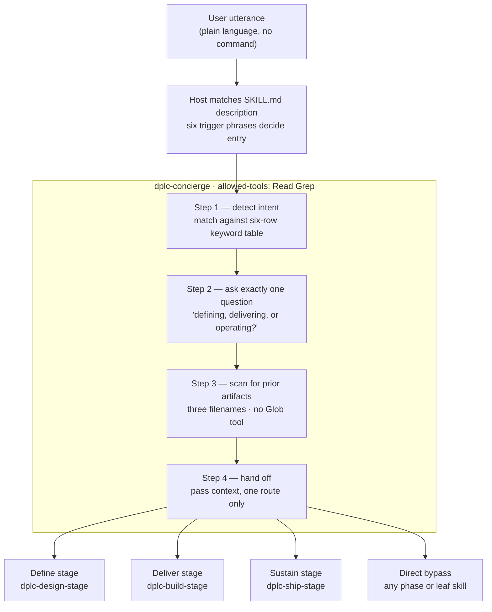
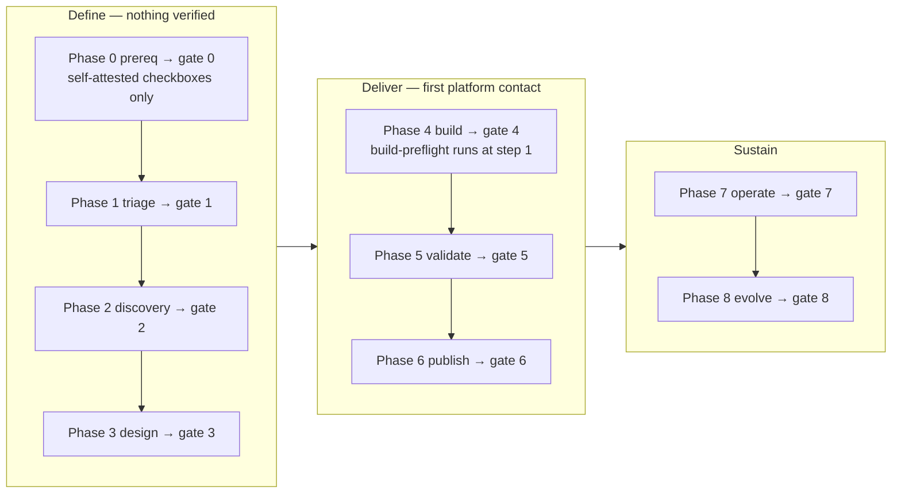

# Concierge Gap Analysis — "Zero-to-One" Onboarding

**Author:** Catalyst dev team · **Date:** 2026-08-12 · **Baseline:** `main` @ v1.12.0 (6aa06e5)

> **Status: largely implemented on this branch.** See the
> [implementation status](#implementation-status) table before reading the findings —
> most are now fixed, and the analysis below is preserved as the rationale record.
> Two items remain open and need a team decision.

A review of the current Concierge, of prior onboarding enhancements, and of the
onboarding and setup guidance gap.

Two themes drove this review. First, the Concierge should be more helpful and more
direct, and should not assume prior knowledge. Second, the "zero-to-one" gap: new
users frequently do not know which Databricks workspace to use, whether they already
have access, or where their data product belongs.

---

## Headline

**The requested capabilities already exist in the repo. The Concierge cannot
reach them, and in two cases cannot physically run them.**

This is not primarily a prompt-wording problem. It is three things:

1. A **capability contract** problem — the Concierge declares `allowed-tools: Read Grep`
   ([SKILL.md:8](../skills/dplc-concierge/SKILL.md:8)). It cannot shell out, so it cannot
   detect a workspace, read an env var, or test access. The request is unimplementable
   as currently scoped.
2. A **wiring** problem — the skills that *can* do it are not referenced by the entry point.
3. A **design-intent conflict** — the Concierge is explicitly specified as
   "a router, not a workflow" ([SKILL.md:85-86](../skills/dplc-concierge/SKILL.md:85)).
   The feedback isn't a bug report; it collides with a deliberate decision.
   Someone has to ratify that the Concierge's job changed. See [Decision needed](#decision-needed).

---

# How it works today

This section is the mechanical baseline for the findings below. It is written so a
reader does not have to open nine `SKILL.md` files to follow the argument.

## Entry — there is no slash command in the normal path

The host (Copilot Chat / Claude Code) selects the skill by matching the user's words
against the `description` frontmatter field. The Concierge's entire reach is therefore
these six phrases ([SKILL.md:3-7](../skills/dplc-concierge/SKILL.md:3)):

> "help me with a data product" · "start a new product" · "I need to create a data
> product" · "where do I start" · "data product lifecycle" · "DPLC"

Miss those and the user never reaches the Concierge — the host routes to whichever leaf
skill description happens to match, or to nothing.

## The routing mechanism is a six-row keyword table

Step 1 classifies intent by literal string signals ([SKILL.md:53-60](../skills/dplc-concierge/SKILL.md:53)):

| Signal words | Route to |
|---|---|
| "new data product", "start from scratch", "define", "I have a request" | `dplc-design-stage` |
| "build", "implement", "code", "deploy", "test", "publish" | `dplc-build-stage` |
| "monitor", "operate", "runbook", "incident", "deprecate", "evolve" | `dplc-ship-stage` |
| Names a phase — "triage", "discovery", "design", "prereq" | that phase orchestrator |
| Names a skill — "data-contract", "feasibility-report" | that skill directly |
| Unclear | ask one clarifying question |

Plus a bypass list for one-off asks ([SKILL.md:95-99](../skills/dplc-concierge/SKILL.md:95)):
"generate a data contract" → `data-contract`, "profile this table" → `data-profiling`,
"search the marketplace" → `marketplace-search`, "build a source-aligned pipeline" →
`source-aligned`, "build a domain-aligned product" → `domain-aligned`.

**Every row requires the user to already speak DPLC.** There is no row for
*"I have a spreadsheet of holdings and I need it in Databricks."*

## The Concierge's four steps



## One question here, twenty downstream

The Concierge is capped at one question by design. It hands off into a chain that
interrogates continuously:

| Where | Question |
|---|---|
| Concierge | "Are you **defining**, **delivering**, or **operating**?" |
| Phase 0 | "What data product are you planning to build?" |
| Phase 0 | 7 self-attested checkboxes — Data Owner, DPC capacity, DPM, Data Stewards, demand tracker, pattern registry, repo access |
| Phase 1 | "What data product are you triaging?" |
| Phase 1 | Classification — Type, Priority, Sensitivity, Criticality |
| Phase 1 | Confirm the Data Owner has reviewed and approved |
| Phase 2 | "Do you want to define measurable outcomes and KPIs? This takes 5–10 minutes." |
| Phase 2 | Confirm team capacity |
| Phase 2 | "Do you need a formal business case?" |
| Phase 3 | "Do you have transformation SQL available?" |
| Phase 3 | Approved pattern? · schedule/backfill known? · NFRs? · support tiers? |
| Phase 4 | "What build mode are you in?" — prototype / production / lift-and-shift |
| Phase 4 | "What type of data product is this?" — SAP / DAP / CAP / Sandbox |
| Phase 4 | "Which business group owns this product?" |

Roughly twenty decision points. **The first two questions with an environmental answer —
build mode and product type, which together determine the target catalog — are asked at
Phase 4**, after gates 0 through 3.

That gap is the substance of the complaint. The Concierge is terse where a newcomer needs
orientation, then the chain is exhaustive where a newcomer has no basis to answer.

## When the environment is actually verified



Phases 0–3 and gates 0–3 verify **nothing** technical. The first Databricks contact in the
entire flow is `build-preflight` at Phase 4 Step 1 — and its access checks import three
functions that do not exist (see [§5](#5--confirmed-defect--build-preflights-readiness-checks-call-functions-that-dont-exist)).

## Four mechanisms worth knowing

**`Skill` tool delegation, with a Read-as-delegation fallback.** Orchestrators call
`Skill(dplc-triage)`. When the runtime returns "Unknown skill" — which
[dplc-build:63](../skills/dplc-build/SKILL.md:63) says happens because "Catalyst skills
aren't always in the runtime registry" — the instruction is to `Read` the sub-skill's
`SKILL.md` once, and *that read is the delegation*. The behavior-test runner counts it as
an invocation. The same file then has to warn, in bold: "Do NOT fabricate sub-skill
outputs… Never invent preflight reports, profiling results, mode determinations." That
warning exists because this has gone wrong.

**Gates pause, they don't auto-advance.** `dplc-design-stage` is explicit: "Between each
phase, present the gate determination and pause for the user. Do not auto-advance." Good
discipline — but a new user hits four confirmation walls before Phase 4.

**Assertion beats filesystem.** [dplc-build-stage:157-159](../skills/dplc-build-stage/SKILL.md:157)
treats a user *saying* "design is signed off" as primary evidence, with the file check as
"a fallback, not a gate." Gate 3 is passable by assertion.

**State is cached once, at Phase 4.** `.catalyst-build.yml` is the only persisted state in
the flow. Everything before it lives in conversation only — which is why nothing can tell
a returning user where they left off.

## Two further defects this tracing surfaced

**Resume detection is implemented twice, with different tables.** The Concierge checks
three filenames ([SKILL.md:75-77](../skills/dplc-concierge/SKILL.md:75)); `dplc-design-stage`
checks four ([SKILL.md:183-186](../skills/dplc-design-stage/SKILL.md:183)) — and its extra
row is `phase-zero-checklist.md → Phase 1`, which the Concierge lacks. A user who
completed Phase 0 and returns is told "starting at Phase 0" by the Concierge, then
"starting at Phase 1" by the stage orchestrator. Same class as [§7](#7-the-concierges-own-resume-detection-is-probably-a-no-op),
and it argues for one detection layer rather than two.

**`dplc-build-stage` has the same tool-contract mismatch as the Concierge.** Line 149
instructs it to check the workspace "via `Glob`/`Read`", but it declares
`allowed-tools: Read Grep`. No `Glob`. Its fallback verification silently cannot run —
which is plausibly *why* the file had to declare conversational assertion the primary signal.

---

# Findings

## 1. The Concierge is blind to the platform

The word **"databricks" appears zero times** in `dplc-concierge/SKILL.md`. So do all of:
`databricks-config`, `connect-databricks`, `build-preflight`, `phase-zero-checklist`.

The routing table ([SKILL.md:53-60](../skills/dplc-concierge/SKILL.md:53)) keys on
DPLC vocabulary — "new data product", "build", "monitor", "triage". A newcomer who
says *"I have a spreadsheet of holdings and I need it in Databricks"* matches nothing,
falls through to "unclear", and gets this clarifying question:

> "Are you **defining** a new data product, **delivering** one that's been designed,
> or **operating** one that's already in production?"

All three options are lifecycle jargon the user doesn't have yet. That single line is
the "assumes prior knowledge" complaint, concretely.

## 2. The requested capabilities are already built — at the wrong altitude

| Requested capability | Already implemented in | Why the user never gets it |
|---|---|---|
| Detect available Databricks workspaces | `databricks-config` — `databricks auth profiles` | Concierge doesn't route to it; only reachable by saying "switch workspace" / "which workspace" |
| Ask whether the detected workspace is right | `databricks-config` — `databricks auth env` | same |
| Validate access / entitlements | `build-preflight` Step 5 (catalog access, grants, UC volume, warehouse) | Gated at **`lifecycle-phase: phase-4-build`** |
| Determine where the product belongs | `build-preflight` Step 2 (SAP/DAP/CAP/Sandbox → catalog + schema naming) | Gated at Phase 4 |

`databricks-config` is `lifecycle-phase: cross-cutting` with `Read Bash Write Edit` —
it is *already* the right shape for pre-flight. It is registered in `plugin.json`.
It is simply invisible from the front door.

`build-preflight` is the most thorough readiness routine in the product (warehouse
reachability, catalog access, grants, tool-version drift, state cached to
`.catalyst-build.yml` so nothing re-asks). **It runs after the user has authored 8+
documents through Phases 0–3.** Environmental truth arrives at the last possible moment.

## 3. Phase 0 "Pre-requisite" verifies nothing technical

The phase literally named *Pre-requisite*, whose gate is *"am I ready to start"*,
delegates to one document skill that emits a markdown table of `[ ]` checkboxes
([template](../skills/phase-zero-checklist/templates/phase-zero-checklist.md)):

- Rows 1–4: are the **people** identified (Data Owner, DPC, DPM, Data Stewards)
- Rows 5–7: does the **process** exist (demand tracker, pattern registry, repo access)

Both `dplc-prereq` and `phase-zero-checklist` are `allowed-tools: Read Grep`. Nothing is
verified — the user self-attests. Row 7 ("the team has access to the Catalyst repo") is
confirmed by typing an X.

There is **no** check for Python, pip/cgrepo, credentials, workspace, catalog, or warehouse.
The reported gap sits precisely inside the skill that owns its name.

Structurally it's also unreachable as a front door: `dplc-prereq` is a *sub-orchestrator of
`dplc-design-stage`*, so it lives inside the Define funnel and is skipped entirely for
users routed to Deliver or Sustain.

## 4. 🔴 Confirmed defect — the documented install path is refused by the auth skill

A three-way contradiction on the single most important onboarding step:

| Source | Says |
|---|---|
| [`docs/install.md:63`](install.md:63) | Fill `DATABRICKS_HOST`, `DATABRICKS_TOKEN` to unlock live integration |
| [`.env.example:80-82`](../.env.example:80) | Provides `DATABRICKS_HOST=`, `DATABRICKS_TOKEN=` |
| [`connect-databricks/scripts/oauth_connect.py:20-28`](../skills/connect-databricks/scripts/oauth_connect.py:20) | **Hard-exits (code 3) if `DATABRICKS_TOKEN` is set**, citing DBX-SEC-002; demands `DATABRICKS_CLIENT_ID` + `DATABRICKS_CLIENT_SECRET` |
| [`databricks-config:100-104`](../skills/databricks-config/SKILL.md:100) | Documents pasting a PAT into `~/.databrickscfg` as supported |

**A new DPC who follows the official install guide exactly lands in a state the canonical
connection skill refuses to run in.** The stated remediation requires a *service principal*
client ID and secret — which an individual new user generally cannot self-provision.

This is the highest-severity item here: reproducible, mechanical, and it stops
zero-to-one dead. It needs one coherent auth story (likely: `databricks auth login`
OAuth for humans, SP OAuth M2M for CI) applied across all four files at once.

## 5. 🔴 Confirmed defect — build-preflight's readiness checks call functions that don't exist

[`build-preflight` Step 5](../skills/build-preflight/SKILL.md:397) instructs the agent to run:

```python
from skills.clients.databricks_tools_core.unity_catalog import (
    check_catalog_access, check_schema_grants, check_volume_exists,
)
```

**None of those three exist.** The module's actual exports are `list_catalogs`,
`get_catalog`, `list_schemas`, `get_grants`, `get_effective_grants`, `list_volumes`,
`get_volume`. Only `list_warehouses` (in `sql/warehouse.py`) resolves.

So the most detailed "verify your environment" routine in the product hands the agent
imports that raise `ImportError`, after which it improvises. That is a plausible root
cause for access verification feeling unreliable. Separate, small, self-contained ticket.

## 6. Prior onboarding work is stranded on two unmerged branches

| Branch | Commits | Last commit | Merged to main? |
|---|---|---|---|
| `origin/feature/concierge-guided-onboarding` | 608067c, 6234d1f | 2026-07-22 | **No** |
| `origin/feature/setup-workspace` | 55e1df4, 4b3c4a2 (superset, +956 lines) | 2026-07-22 | **No** |

Neither is an ancestor of `origin/main`. ~3 weeks stale against a repo that has since
shipped v1.12.0.

**What's in it:**
- A **two-mode Concierge** — an explicit *fast path* (clear ask → route, stay brief) vs a
  *guided path* (new/unsure → be directive, ask in plain words, offer optional orientation,
  one step at a time). Notably it gets the subtlety right: an empty workspace *hints* the
  user is new but does not override a clear ask.
- A **`setup-workspace` skill** — 167-line SKILL.md, `bootstrap.sh`, `bootstrap.ps1`,
  `setup_workspace.py` (355 lines), 167-line test file.
- **Two additional Concierge behavior cases** — `case-02-guided-new-user`,
  `case-03-env-setup-routing`.

Quality is high: explicit exit-code contracts, multi-turn handling for steps an agent can't
perform, and real safety rails — never install a package manager, never `curl | bash`,
cgrepo-only installs, never overwrite `pip.conf` without a timestamped backup. It is
CLAUDE.md-compliant on the registry policy.

**But it closes a different half of the problem than the one reported.** `setup-workspace`
says so itself:

> Does not: Set up Databricks, Confluence, or Astronomer… Does not: Provision credentials
> or entitlements.

- **`setup-workspace` covers machine-level:** *can I run Catalyst at all?* (Python 3.13, pip→cgrepo, deps, git/gh)
- **The reported gap is platform-level:** *am I pointed at the right workspace, do I have access, where does my product belong?*

Landing that branch is necessary but **does not** close the platform gap. Both halves are needed.

## 7. The Concierge's own resume-detection is probably a no-op

Step 3 ([SKILL.md:71-80](../skills/dplc-concierge/SKILL.md:71)) claims to "scan the workspace
for existing artifacts" — `demand-tracker-entry.md`, `feasibility-report.md`, `data-contract.md`.

Two problems:
- With `Read Grep` and **no `Glob`**, it can't enumerate a directory. Only 1 of 107 skills
  declares `Read Glob Grep`.
- It looks for bare filenames, while `build-preflight` resolves artifacts under
  `$DPLC_DIR` / `./.dplc/` / `./docs/.dplc/`.

So it likely searches the wrong location with the wrong tool. The "we detected where you
left off" experience the Concierge advertises probably doesn't fire.

## 8. One behavior test out of 99

`tests/behavior/cases/dplc-concierge/` contains exactly **one** case, with
`strict_order: false` and `allow_extra: true` — "start a new data product" → routes to
`dplc-design-stage`. There are 99 behavior case directories in the repo.

There is no case for a confused user, no case for env-setup routing, no case for "I don't
know which workspace." Two of those exist on an unmerged branch. **There is no
regression net for exactly the behavior the feedback described.**

## 9. Telemetry is not missing — but the mechanism this section described is gone

> **Superseded.** This section described a `PreToolUse` hook that derived skill names from
> `read_file` calls against `skills/<name>/SKILL.md`, wrote them to
> `~/.catalyst/skill-use.jsonl`, and had no path off the machine. That hook has been
> **removed** — see the CHANGELOG for the reasoning and for uninstall steps. The analysis
> below is kept because the *diagnosis* still holds; only the artifact it pointed at is gone.

The "we lack telemetry" framing was worth refining. The problems with the hook, as recorded
at the time:

- Each user had to run an installer **and** hand-paste three VS Code settings keys
- It wrote to `~/.catalyst/skill-use.jsonl` — **local only, nothing sent externally**
- There was no aggregation path in the repo
- **`docs/install.md` mentioned telemetry zero times. So did `README.md`.**
- `chat.useClaudeHooks` was, and remains, VS Code *Preview*

The reframing was that the team was blind not because instrumentation was absent, but because
nobody was told to turn it on and there was nowhere for it to land. That much was right.

What has changed since is which half of the problem got solved. There is now somewhere for it
to land — the Catalyst collector — and Claude Code reports into it natively, with `skill.name`
as a first-class metric attribute needing no hook and no installer. For VS Code, the hook's
premise no longer holds: Copilot now injects the skill catalogue into
`gen_ai.system_instructions` rather than reading each `SKILL.md`, which is the exact failure
mode the hook's own documentation listed as a caveat.

## 10. Minor — `plugin.json` admits a Python version that cannot work

[`plugin.json:12`](../plugin.json:12) declares `"python": ">=3.9"`.
[`install.md:7`](install.md:7) states 3.9 is **incompatible** — past EOL, and
`pip install -r skills/requirements.txt` fails because `markitdown` ships no 3.9 wheels.

A 3.9 user clears the manifest gate, then fails at dependency install with a confusing
error. One-line fix; classic zero-to-one paper cut.

---

# Implementation status

Implemented on branch `feat/catalyst-concierge-onboarding-766231`.

| § | Finding | Status |
|:--|:--------|:-------|
| 1 | Concierge blind to the platform | **Fixed** — routes to `dplc-preflight`, `setup-workspace`, `databricks-config` |
| 2 | Requested capabilities built at the wrong altitude | **Fixed** — new `dplc-preflight` runs before any stage handoff |
| 3 | Phase 0 verifies nothing technical | **Partly** — `dplc-preflight` now covers technical readiness ahead of Phase 0; `phase-zero-checklist` still organisational only, which is arguably correct once preflight exists |
| 4 | Documented install path refused by auth skill | **Partly — decision needed** (see below) |
| 5 | `build-preflight` imports non-existent functions | **Fixed** — implemented in `unity_catalog/readiness.py` |
| 6 | Prior onboarding work stranded | **Fixed** — `setup-workspace` + both behavior cases landed, attribution in CHANGELOG |
| 7 | Resume detection a no-op / duplicated | **Fixed** — one shared table + search precedence; `Glob` added |
| 8 | One behavior test out of 99 | **Fixed** — concierge 1 → 5 cases, plus `dplc-preflight` case-01 |
| 9 | Telemetry opt-in, local, undiscoverable | **Open** — not addressed here |
| 10 | `plugin.json` admits Python 3.9 | **Fixed** — now `>=3.10` |
| — | *New:* `pip install -r requirements.txt` installed nothing | **Fixed** — unsatisfiable `databricks-cli` pin |
| — | *New:* client package unimportable (`sqlglot` unpinned) | **Fixed** |
| — | *New:* `dplc-build-stage` uses undeclared `Glob` | **Fixed** |

## Still open — needs a decision

**§4, the auth story.** Reading DBX-SEC-002 closely resolves most of it. The standard's
scope is explicitly narrow:

> "Personal Access Tokens are forbidden for Model Serving and **any non-interactive**
> Databricks call." — [`rfd/0008/databricks/sec.md`](../rfd/0008/databricks/sec.md)

So the ban governs service-to-service auth. `connect-databricks` applies it
*unconditionally* — refusing `DATABRICKS_TOKEN` even for a human's first interactive
login, and demanding a service principal that an individual new DPC usually cannot
self-provision. That is stricter than the standard requires, and it is the actual
source of the dead end.

Fixed here (no policy change): `docs/install.md` and `.env.example` now direct
interactive users to `databricks auth login`, which is OAuth, self-serve, and needs no
secret on disk.

**Left for the team**, because loosening security enforcement is not a call to make
unilaterally: `connect-databricks` is positioned as the universal auth entry point
("any time another skill needs a Databricks SDK or SQL client"), but implements only the
service-principal flow. Either narrow its stated scope to non-interactive use, or have
it accept an existing OAuth u2m profile. Until then a u2m user still cannot invoke it —
`dplc-preflight` detects and explains this rather than letting them discover it late.

**§9, telemetry.** Untouched. Still the cheapest unlock for prioritisation.

# Recommendations

## Decision needed

The Concierge currently specifies:

> Keep the conversation short. One question, one route, hand off. …the concierge is a
> router, not a workflow.

The feedback asks for the opposite. The unmerged branch already made the call — two modes, fast
path preserved for experts, guided path added for newcomers — and that is the right answer.
It just never got ratified or merged. **Confirming that the Concierge now owns guided
onboarding is the prerequisite for everything below.**

## Recommended sequencing

| # | Action | Why now | Size |
|---|---|---|---|
| 1 | **Fix the auth contradiction** (§4) — one story across `install.md`, `.env.example`, `connect-databricks`, `databricks-config` | Hard stop for every new user; nothing else matters until a newcomer can authenticate | S–M |
| 2 | **Rebase and land `feature/setup-workspace`** (§6) | Closes the machine-level half, ratifies the two-mode design, and brings 2 of the 3 missing behavior tests. Already Copilot-reviewed. Needs rebase — 3 weeks stale | M |
| 3 | **New cross-cutting `dplc-preflight`** (`Read Bash Grep`) answering the four environment questions; cache to `.catalyst-env.yml` so nothing re-asks | Closes the platform-level half. Mostly *composition*: reuse `databricks-config` (`auth profiles`/`auth env`) + `list_warehouses` + `list_catalogs` | M |
| 4 | **Make `dplc-preflight` the Concierge's first branch for new users** | Keeps the router pure at `Read Grep` while giving it senses by delegation — no need to hand the Concierge Bash | S |
| 5 | **Fix `build-preflight`'s phantom imports** (§5) | Small, isolated, and unblocks trustworthy access verification | S |
| 6 | **Put telemetry in the install path + build aggregation** (§9) | Cheapest route to the prioritization signal the team says it lacks | S–M |
| 7 | Add technical readiness to `phase-zero-checklist`, or run preflight ahead of Phase 0 (§3) | Moves environmental truth to the front of the journey | M |
| 8 | Fix `plugin.json` python floor → `>=3.10` (§10) | One line | XS |

Items 1, 5, and 8 are defect fixes and independent of the Decision above — they can start
immediately. Items 2–4 and 7 depend on ratifying the Concierge's expanded role.

## Note on the "accidental uses" thread

Separate from onboarding, but worth not losing: reports of Catalyst being used for tactical
app support and bug triage. Worth testing whether that's Catalyst capability or the base
model plus Concierge-supplied context — item 6 is what would tell us, which is another
argument for pulling it forward.
