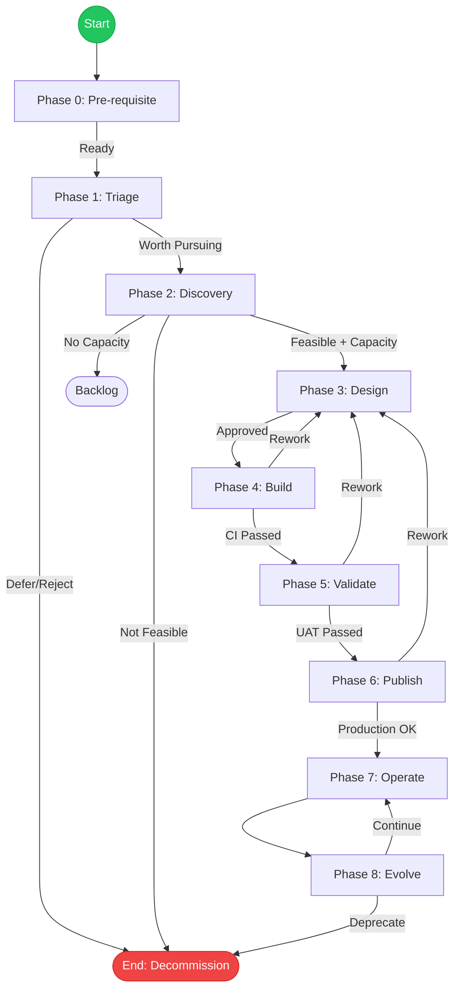

# RFD 2 Data Product Lifecycle

## Problem

Data products are built by multiple teams across the organization, but there is
no shared lifecycle governing how they move from request to production to
retirement. The result is inconsistent quality, weak operational handoffs, and
decisions that are hard to trace after the fact.

As lakehouse implementations expand to federated teams across the organization,
a consistent lifecycle becomes critical to ensuring scalability and consistency
without imposing a rigid process that slows teams down.

## Background

This lifecycle defines the phases, gates, exit criteria, and artifacts for
source-aligned and consumer-aligned data products that can be reused across
multiple use cases and subscribers. It establishes a shared vocabulary and
minimum quality bar across teams.

**What is in scope:** Reusable data products — source-aligned and
consumer-aligned — that serve multiple use cases and subscribers.

**What is not in scope:** Experimental, early-discovery, or ad-hoc data
requests. These follow an abbreviated path and are planned for a separate RFD.

### Templates and the PRD

Each phase has a set of templates in the `templates/` directory. Templates are
the inputs — structured documents that capture what is known at each phase.
They are designed to be filled out step by step, either manually or guided by a
skill or LLM-driven workflow.

The Product Requirements Document (PRD) is the output — a consolidated view of
the product assembled from the phase templates. It is generated (not filled out
manually) by combining the completed templates from Triage through Publish. For feature-level work, the PRD is updated incrementally rather than
regenerated from scratch.

> **Note:** The demand tracker must be a real organizational system — not just
> the markdown template. The demand-tracker-entry.md template is a reference
> format for documenting what is logged. If no organization-wide demand tracker
> exists, Phase 0 is not met.

### Applicability

This lifecycle applies to any lakehouse implementation, not just a single
platform. Teams on different lakehouse platforms can use this as their baseline
and adapt tooling and artifact details to their environment.

### Product vs. Feature

The full lifecycle applies to **new product introductions**. Most day-to-day
work — adding sources, enhancing transformations, fixing defects — operates at
the **feature level**. All work (new products, new features, enhancements, and
defect fixes) flows through the demand tracker to manage capacity, but
feature-level work follows the same phases with lighter-weight Triage and
Discovery since the product context already exists. Design and Build anchor at
the feature level, while Validate, Publish, and Operate converge back to the
product level since features ship as part of the product.

Use the following heuristic to classify work:

| Question | Yes |
|---|---|
| Does this introduce a new data contract? | +1 |
| Does this change an existing schema version? | +1 |
| Does this onboard net-new consumer teams? | +1 |
| Does this require a new architecture pattern? | +1 |

Score 2 or more → product-level lifecycle. Score 0–1 → feature-level. For
feature-level work: update the existing demand tracker entry and
requirements-acceptance-criteria artifacts rather than creating new ones.
Phases 1 and 2 are lighter-weight since the product context already exists.

### Iterative, Not Waterfall

The inner phases (Triage through Validate) are explicitly iterative.
A design review can send you back to Discovery; build-phase testing can reveal
design gaps. This is not a one-way conveyor belt.

Not every product follows the full lifecycle. Exploratory analyses, one-time
extracts, or short-lived prototypes may follow an abbreviated path and skip
Operate and Evolve entirely.

### Scaling With Complexity

Not every data product requires the same level of rigor. Each phase includes
concern-area gates (e.g., Privacy, Architecture, InfoSec, Data Governance) that
teams either address or mark as not applicable for that product. A materialized
view that speeds up queries does not need a full architecture review; a
cross-domain product with PII does. Teams apply judgment about which artifacts
and gates are relevant. A formal tiering framework is planned for a follow-on
RFD once there is enough real usage to calibrate what "low-risk" and "high-risk"
mean in practice.

## Proposal

### Overview

The data product lifecycle consists of nine phases (phases 0 through 8) that
guide a data product from initial request through production operation to
eventual retirement. Each phase has a defined purpose, gate criteria, exit
criteria, and artifacts (required and optional).

| Phase | Purpose | Key Gate |
|-------|---------|----------|
| **0 — Pre-requisite** | Verify foundational conditions exist | Data Owner assigned? |
| **1 — Triage** | Capture demand, identify consumers, confirm scope | Proceed to Discovery? |
| **2 — Discovery** | Validate feasibility, document requirements | Accepted, Feasible & Capacity? |
| **3 — Design** | Define contract, model, architecture | Design & Contract Approved? |
| **4 — Build** | Develop, test, document | Code Review & CI Passed? |
| **5 — Validate** | Business acceptance, governance review | UAT Passed & Accepted? |
| **6 — Publish** | Deploy to production, register in catalog | Production Validated? |
| **7 — Operate** | Run, monitor, warranty, handoff to DataOps | *(continuous)* |
| **8 — Evolve** | Assess health, improve or retire | Deprecate? |

---

### Phase 0: Pre-requisite

**Purpose:** Capture the foundational conditions that must exist before a data
product request enters the lifecycle. These are organizational pre-requisites —
not repeated for each request, but verified as being in place.

**Good looks like:** A Data Owner is identified and informed, Data Stewards are
assigned, and at least one Data Product Creator has capacity to support
Discovery. A Data Product Manager (or equivalent) is identified and available.

The **Data Product Manager (DPM)** leads requirements analysis, drives
stakeholder alignment, and owns the acceptance criteria. In teams without a
dedicated DPM, the technical lead or product owner fills this role.

#### Gate: Ready for Triage?

- Data Owner, at least one Data Product Creator, and a Data Product Manager (or
  equivalent) are assigned
- Yes → Triage (Phase 1)
- No → Address pre-requisites first

#### Exit Criteria

- Data Owner is identified and informed
- Capacity is secured to support discovery work
- A Data Product Manager (or equivalent: technical lead or product owner filling
  this role) is identified and available to lead requirements analysis through
  Discovery

#### Artifacts

Templates for Phase 0 are in [`templates/00-prereq/`](templates/00-prereq/).

| Artifact | Necessity | Template |
|---|---|---|
| Phase zero checklist | Recommended | [`phase-zero-checklist.md`](templates/00-prereq/phase-zero-checklist.md) — confirms roles and organizational infrastructure are in place |

---

### Phase 1: Triage

**Purpose:** Quickly determine whether demand is worth investing in Discovery.
Triage captures the request, maps consumers, and confirms the scope is clear
enough to assess before committing to the deeper Discovery work.

**Good looks like:** Demand tracked, consumers identified, scope clear enough
to assess.

#### Gate: Worth Pursuing?

Before proceeding to Discovery, the Data Owner confirms the preliminary
sensitivity and criticality classification in the demand tracker entry.

- Yes → Discovery (Phase 2)
- No → Defer/Reject

#### Exit Criteria

- Demand tracker entry created with Data Owner approval
- Consumer use case map drafted with initial consumers and their use cases
  identified
- Preliminary scope is agreed and clear enough to assess feasibility
- Preliminary domain classification, data sensitivity, and criticality are
  documented in the demand tracker entry (confirmed by the Data Owner)

#### Artifacts

Templates for each artifact are in [`templates/01-triage/`](templates/01-triage/). For feature-level work on an existing product, update the existing artifacts rather than starting from scratch.

| Artifact | Necessity | Template |
|---|---|---|
| Demand tracker entry | Required | [`demand-tracker-entry.md`](templates/01-triage/demand-tracker-entry.md) |
| Consumer / use case map | Required | [`consumer-use-case-map.md`](templates/01-triage/consumer-use-case-map.md) |

---

### Phase 2: Discovery

**Purpose:** Validate feasibility, perform detailed requirements analysis, and
confirm capacity. This phase produces the artifacts needed to justify Design.

**Detailed requirements analysis** is a core activity of this phase. The Data
Product Manager leads the effort — working with Data Owners, Stewards, and the
Data Product Creator team to define business logic, identify the right sources,
and document acceptance criteria. Requirements may be refined as more is
discovered in subsequent phases, but the baseline is established here.

**Good looks like:** Feasibility confirmed, requirements documented, PIA
triggered if needed, capacity confirmed, and readiness to begin Design.

#### Gate: Accepted, Feasible & Capacity?

The Data Steward reviews the request to confirm it is complete and properly
categorized. The team presents findings to the product owner/steward or steering
group. Three conditions must be met to proceed:

All demand — new products, new features, enhancements, and defect fixes — must
be logged in the organization's demand tracker with Data Owner approval before
proceeding.

- Yes → Design
- No Capacity → Return to Backlog (feasible but not resourced — revisit later)
- Not Feasible → Park/Reject
- Not Accepted → Defer/Reject

#### Exit Criteria

- Data Owner is identified and has approved the request
- Data Product Creator is assigned by the Data Owner
- Business need is clearly articulated and stakeholders are aligned on scope
- Source data has been identified and profiled for sufficient quality and
  availability
- Domain classification, data sensitivity, and criticality are documented
- Regulatory, privacy, cross-border, and retention requirements are understood
  (e.g., SOX, DORA, GLBA, Reg S-P, GDPR, CCPA)
- Technical feasibility is confirmed (or risks are documented with mitigations)
- Team capacity is confirmed, effort is sized, and an optional business case
  justifies the investment
- Requirements and acceptance criteria are documented at a level sufficient to
  inform Design (Data Product Manager responsibility)
- Detailed requirements analysis is complete, including business logic, source
  identification, and calculation definitions

#### Artifacts

Templates for each artifact are in [`templates/02-discovery/`](templates/02-discovery/). For feature-level work on an existing product, update the existing artifacts rather than starting from scratch.

| Artifact | Necessity | Template |
|---|---|---|
| Requirements and acceptance criteria | Required | [`requirements-acceptance-criteria.md`](templates/02-discovery/requirements-acceptance-criteria.md) — DPM responsibility |
| Feasibility report | Required | [`feasibility-report.md`](templates/02-discovery/feasibility-report.md) |
| Outcome / KPI statement | Recommended | [`outcome-kpi-statement.md`](templates/02-discovery/outcome-kpi-statement.md) |
| Effort estimate | Recommended | [`effort-estimate.md`](templates/02-discovery/effort-estimate.md) |
| Business case | Optional | [`business-case.md`](templates/02-discovery/business-case.md) |
| Privacy impact assessment | Required when the feasibility report records PII = Yes or Unknown. The Data Owner (not the DPM) must confirm the sensitivity classification before proceeding from Phase 1 to Phase 2. | [`privacy-impact-assessment.md`](templates/02-discovery/privacy-impact-assessment.md) |
| PoC / spike findings | Optional when feasibility is uncertain | [`poc-spike-findings.md`](templates/02-discovery/poc-spike-findings.md) |

---

### Phase 3: Design

**Purpose:** Define the data product's data contract, model, architecture, and
operational plan before building. The data contract is the key artifact — it
codifies what consumers can depend on.

Architecture review is required only when introducing a pattern that is **not
in the organization's approved pattern registry**. Products that implement an
approved pattern proceed without architecture review. If no matching approved
pattern exists, the team works with Data Architecture to either (a) qualify the
new pattern for the registry, or (b) adapt to an existing approved pattern. The
approved pattern registry must exist before Phase 3 gates can be enforced;
maintaining it is an organizational prerequisite.

**Good looks like:** A complete data contract with schema, SLAs, and quality
expectations; approved architecture (if applicable); and a draft plan for
operational handoff.

#### Gate: Design & Contract Approved?

Design artifacts are reviewed by technical leads, the data architect (for new
patterns), and the product owner.

- Yes → Build
- No → Rework (address review feedback and resubmit)

#### Exit Criteria

- Data contract is defined with schema, SLAs, quality expectations, and
  versioning strategy
- Logical and physical data models are complete and reviewed
- Transformation logic is specified (source-to-target mapping)
- Architecture and pipeline design are documented and approved (required when
  introducing a pattern not in the approved pattern registry; not required for
  products implementing an approved pattern)
- Integration interfaces are defined (inbound from sources and outbound to
  consumers)
- Schedule, frequency, and backfill approach are defined
- Security and access control design meets classification and criticality
  requirements from Discovery
- Security design is approved by InfoSec for any product classified Restricted
  or above, or subject to a named regulation (SOX, DORA, GLBA, Reg S-P, GDPR,
  CCPA)
- Observability and monitoring plan covers SLAs, freshness, and quality
- Non-functional requirements are specified where applicable (idempotency,
  restartability, resiliency, performance, scalability, availability, DR, cost
  budgets)
- DataOps handoff plan is drafted with playbook structure, escalation paths, and
  support tiers

#### Artifacts

Templates for each artifact are in [`templates/03-design/`](templates/03-design/).

| Artifact | Necessity | Template |
|---|---|---|
| Data contract | Required | [`data-contract.md`](templates/03-design/data-contract.md) — schema, SLAs, quality thresholds, versioning, consumer expectations. A follow-on RFD will define the minimum contract structure. |
| Data model (logical + physical) | Required | [`data-model.md`](templates/03-design/data-model.md) |
| Transformation specification | Required | [`transformation-spec.md`](templates/03-design/transformation-spec.md) |
| Architecture diagram | Required when introducing a pattern not in the approved pattern registry | [`architecture-diagram.md`](templates/03-design/architecture-diagram.md) |
| DataOps handoff (draft) | Recommended | [`dataops-handoff-draft.md`](templates/03-design/dataops-handoff-draft.md) — finalized at end of Build |
| NFR specification | Optional | [`nfr-specification.md`](templates/03-design/nfr-specification.md) — standard platform NFRs apply by default; document deviations only |
| Integration blueprint | Optional | [`integration-blueprint.md`](templates/03-design/integration-blueprint.md) — required for multi-source or multi-consumer products |
| Schedule / backfill plan | Optional | [`schedule-backfill-plan.md`](templates/03-design/schedule-backfill-plan.md) — needed when scheduling is non-trivial |
| Security design | Required for any product classified Restricted or above, or subject to a named regulation (SOX, DORA, GLBA, Reg S-P, GDPR, CCPA). Optional for all other products. | [`security-design.md`](templates/03-design/security-design.md) — a dedicated security RFD is planned |

---

### Phase 4: Build

**Purpose:** Develop, test, and validate the data product through code review
and CI. Includes pipeline development, quality checks, and documentation.

**Good looks like:** All code is peer-reviewed and merged, CI pipeline passes,
data quality checks are implemented, and operational playbooks are written.

#### Gate: Code Review & CI Passed?

All code is peer-reviewed and the CI pipeline passes. This gate validates
technical quality — business acceptance happens in the next phase.

- Yes → Validate
- No → Rework (fix failures and resubmit)

#### Exit Criteria

- All pipeline code is written, peer-reviewed, and merged
- CI pipeline passes: linting, unit tests, integration tests, and E2E tests
- Data quality checks and validation rules are implemented and passing
- Orchestration workflows are built and tested
- Lineage is tracked and documented
- Data reconciliation confirms output matches expectations
- Draft catalog entry and documentation are authored
- Technical, business, and operational metadata is captured and registered
- Operational playbooks and runbooks are written for DataOps handoff
- Non-functional requirements are implemented and tested
- Dependency vulnerability scanning passes (no critical or high CVEs unmitigated)
- Secret detection passes (no credentials or secrets in code or commit history)

#### Artifacts

Templates for each artifact are in [`templates/04-build/`](templates/04-build/).

| Artifact | Necessity | Template |
|---|---|---|
| Pipeline code | Required | *(in source control — no template)* |
| Unit test report | Required | [`unit-test-report.md`](templates/04-build/unit-test-report.md) |
| Integration test report | Required | [`integration-test-report.md`](templates/04-build/integration-test-report.md) — end-to-end pipeline behavior, data contract conformance |
| Code review sign-off | Required | [`code-review-sign-off.md`](templates/04-build/code-review-sign-off.md) |
| Build checklist | Recommended | [`build-checklist.md`](templates/04-build/build-checklist.md) — includes security scanning gate (dependency CVE scan and secret detection) for all products |
| Quality rules and validation suite | Recommended | *(implemented in pipeline — no template)* |
| Data catalog entry (draft) | Recommended | *(registered directly in the data catalog — no template)* |
| Technical, business, and operational metadata | Recommended | *(captured in data contract and catalog entry)* |
| Lineage documentation | Optional | *(captured in pipeline tooling — no template)* |
| Orchestration DAGs | Optional | *(in source control — no template)* |
| Reconciliation report | Optional | *(team-authored — no standard template)* |

---

### Phase 5: Validate

**Purpose:** Confirm the data product meets business requirements, governance
standards, and operational readiness before go-live.

**Good looks like:** Data owners have tested and formally signed off on the
product, governance has verified compliance, and DataOps has accepted the
handoff package.

#### Gate: UAT Passed & Accepted?

Data owners and business stakeholders confirm the data product is correct,
complete, and meets their expectations. Governance verifies compliance.

- Yes → Publish
- No → Rework (return to Build or Design to address issues)

#### Exit Criteria

- Data Steward has tested the product against real-world scenarios and confirmed
  correctness
- Data Steward has formally signed off on completeness and accuracy
- Business metadata (names, descriptions, tags) is validated and accurate
- Governance and compliance standards are verified (classification, criticality,
  access controls, retention)
- DataOps handoff package is reviewed and accepted by the DataOps team
- Non-functional requirements are verified against defined thresholds

#### Artifacts

Templates for each artifact are in [`templates/05-validate/`](templates/05-validate/).

| Artifact | Necessity | Template |
|---|---|---|
| UAT sign-off | Required | [`uat-sign-off.md`](templates/05-validate/uat-sign-off.md) |
| Data quality sign-off | Required | [`data-quality-sign-off.md`](templates/05-validate/data-quality-sign-off.md) |
| DataOps handoff package (final) | Recommended | [`dataops-handoff-draft.md`](templates/03-design/dataops-handoff-draft.md) — same document as Design phase, finalized in place. Required when DataOps will assume ownership |

---

### Phase 6: Publish

**Purpose:** Deploy to production, register in the catalog, and onboard
consumers. This is the go-live phase.

**Good looks like:** The product is deployed to production, smoke tests pass,
the catalog listing is live, and consumers can access the product.

#### Gate: Production Validated?

The product is deployed to production and confirmed working.

- Yes → Operate
- No → Rework (fix deployment issues and redeploy)

#### Exit Criteria

- Operational readiness review is passed (runbook, monitoring, alerting, support
  model confirmed)
- Access and entitlements are configured for approved consumers
- Staging deployment passes smoke tests
- Production deployment is successful and verified
- Data product is registered and discoverable in the data catalog / marketplace
- Consumers are onboarded and notified of availability
- Annual Evolve review is scheduled in the demand tracker at time of publish

#### Artifacts

Templates for each artifact are in [`templates/06-publish/`](templates/06-publish/).

| Artifact | Necessity | Template |
|---|---|---|
| Catalog / marketplace listing | Required | *(registered directly in the data catalog — no template)* |
| Deployment record | Recommended | [`deployment-record.md`](templates/06-publish/deployment-record.md) |
| Consumer onboarding guide | Optional | [`consumer-onboarding-guide.md`](templates/06-publish/consumer-onboarding-guide.md) — required when the product has external consumers |
| Release notes | Optional | [`release-notes.md`](templates/06-publish/release-notes.md) — required for versioned products or multiple consumer teams |

---

### Phase 7: Operate

**Purpose:** Run the data product in production. This phase has two stages:
**warranty** and **steady-state**.

During **warranty**, the development team operates the product, resolves
production issues, and transfers knowledge to the DataOps team. Warranty ends
when the DataOps team demonstrates they are self-sufficient — they can handle
incidents, execute runbooks, and meet SLAs without development team support.

During **steady-state**, the DataOps team owns day-to-day operations.

**Good looks like:** SLAs are consistently met, monitoring and alerting are
active, incidents are managed within agreed response times, and the DataOps
team is self-sufficient post-warranty.

#### Warranty Gate

The warranty period is 30 calendar days from the date of production deployment.
At the end of the warranty period, the development team demonstrates DataOps
team readiness. If DataOps is not ready, the warranty is extended in 2-week
increments with documented gap closure actions. Disputes escalate to the Data
Domain Lead (or equivalent organizational authority).

- DataOps can handle incidents using existing runbooks
- DataOps can meet SLAs without development team escalation
- Knowledge transfer is complete
- Yes → Steady-state operations (DataOps owns)
- No → Extend warranty in 2-week increments with documented gap closure actions

#### Gate

There is no discrete gate between Operate and Evolve. Operational metrics,
consumer feedback, and usage data flow continuously into the Evolve phase.

#### Exit Criteria

Operate is ongoing, but healthy steady-state operations are indicated by:

- SLAs are consistently met (freshness, quality, availability)
- Monitoring and alerting are active and tuned
- Incidents are managed within agreed response times
- Consumer feedback is being collected and routed to the right teams
- Costs are tracked and within budget
- DataOps handoff is complete (post-warranty) and the team is self-sufficient
- Technical debt is tracked and managed

#### Artifacts

Templates for each artifact are in [`templates/07-operate/`](templates/07-operate/).

| Artifact | Necessity | Template |
|---|---|---|
| Incident log | Required | [`incident-log.md`](templates/07-operate/incident-log.md) |
| Runbook | Required | [`runbook.md`](templates/07-operate/runbook.md) — operational SOPs, alert responses, escalation paths, maintenance schedule |
| Warranty handoff sign-off | Recommended | [`warranty-handoff-sign-off.md`](templates/07-operate/warranty-handoff-sign-off.md) |
| SLA dashboard spec | Optional | [`sla-dashboard-spec.md`](templates/07-operate/sla-dashboard-spec.md) |
| Drift detection reports | Optional | *(generated by monitoring tooling — no template)* |
| Root-cause analysis reports | Optional | *(team-authored — no standard template)* |
| Cost reports | Optional | *(generated by platform tooling — no template)* |
| Consumer feedback log | Optional | *(tracked in demand tracker or team tooling)* |
| Usage metrics | Optional | *(generated by platform tooling — no template)* |
| Technical debt register | Optional | *(tracked in team tooling — no template)* |

---

### Phase 8: Evolve

**Purpose:** Assess the data product's health and future. Drive adoption, plan
versions, retire, or rebuild.

**Good looks like:** Usage and adoption metrics are reviewed, the product's
value is assessed against original KPIs, and a clear decision is made to
continue, improve, or deprecate.

#### Gate: Deprecate?

Annually (or triggered by significant events), the product owner evaluates
whether the data product should continue operating, be improved, or be retired.
A data product health score — if available in the marketplace — is a natural
input to this decision.

- No → back to Operate (product continues as-is)
- Yes → End (decommission)

#### Exit Criteria

Exit depends on the decision:

- **Continue:** Product is healthy, adoption is stable or growing, SLAs are
  met. Returns to Operate.
- **Improve:** Specific enhancements identified, downstream impact assessment
  completed (required for schema changes or breaking changes), backward-
  compatibility plan in place. Routes back to Triage (new feature)
  or Design (breaking change / new version).
- **Deprecate:** Product is no longer valuable, downstream impact assessment
  completed, consumers have migrated, data is archived. Proceeds to End.

#### Artifacts

Templates for each artifact are in [`templates/08-evolve/`](templates/08-evolve/).

| Artifact | Necessity | Template |
|---|---|---|
| Usage analytics report | Recommended | [`usage-analytics-report.md`](templates/08-evolve/usage-analytics-report.md) |
| Deprecation notice | Optional | [`deprecation-notice.md`](templates/08-evolve/deprecation-notice.md) — required when retiring the product |
| Version / migration plan | Optional | *(team-authored — no standard template)* |
| Downstream impact assessment | Required when the Evolve recommendation is Improve (schema change or breaking change) or Deprecate. | [`downstream-impact-assessment.md`](templates/08-evolve/downstream-impact-assessment.md) |
| Backward-compatibility matrix | Optional | *(team-authored — no standard template)* |
| Migration guide | Optional | *(team-authored — no standard template)* |
| Archive / decommission record | Optional | *(team-authored — no standard template)* |

#### Feedback Loops

- Improvement required → back to **Triage**
- New version / breaking change → back to **Design**
- Deprecate → **End** (decommission)

## Alternatives

### No lifecycle — teams self-organize

Teams build data products however they see fit. This is the status quo. It
results in inconsistent quality, poor operational handoffs, and no shared
vocabulary for how products move from idea to production.

### Full Kimball / DAMA lifecycle

A heavyweight methodology with extensive documentation requirements. Too rigid
for the pace of delivery expected from data engineering teams. The overhead
discourages adoption.

### Tiering from day one

Define a formal complexity/risk tiering model before establishing the base
lifecycle. Rejected because there is not yet enough real usage to calibrate tier
boundaries. The base lifecycle is designed to be right-sized through the
required/optional artifact model and concern-area gates. A formal tiering
framework is planned as a follow-on RFD.

## Impact

All data products that cross team boundaries or are intended for reuse should
follow this lifecycle. Day-to-day feature work follows the same phases at
lighter weight. Experimental and ad-hoc work is out of scope for this RFD and
will be addressed separately.

### Follow-on RFDs

- **Data contract standard** — minimum structure for schema, SLAs, quality thresholds, and versioning semantics
- **Tiering framework** — formal model for scaling lifecycle rigor with product complexity and criticality
- **Experimentation lifecycle** — abbreviated path for ad-hoc, exploratory, and prototype data work
- **Security model** — baked-in platform controls, access patterns, and security design guidance
