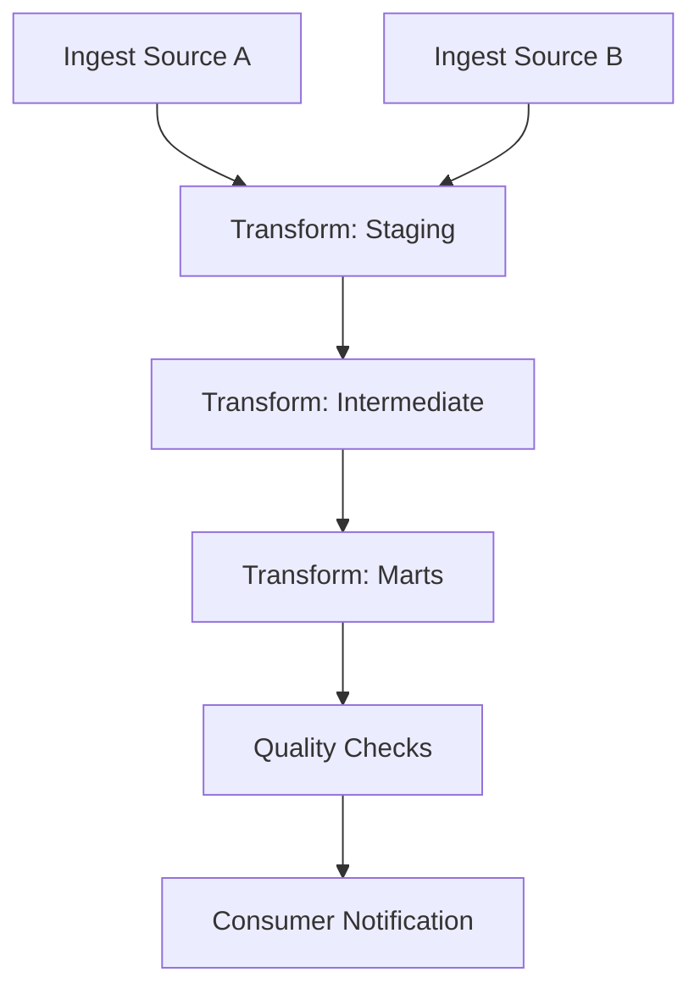

# DataOps Handoff Document

> **Note:** This is a living document. Do not create a separate 'final' version — update this document in place and increment the version number.

> **Status:** Created during Design. Finalized at the end of Build/Validate when implementation details are confirmed. Sections marked with [TBD] are expected to be completed during Build.

---

## Version History

| Version | Date | Phase | Author | Changes |
|---------|------|-------|--------|---------|
| 0.1 | | Design | | Initial draft |
| | | | | |

---

## 1. Overview

| Field | Value |
|-------|-------|
| Product Name | [Product name] |
| Owner | [Team or individual] |
| Classification | Sensitivity: [e.g., General / Restricted] |
|                | Criticality: [e.g., Medium / High] |
| Target Go-Live Date | [Date] |
| Handoff Status | Draft (to be finalized end of Build) |

---

## 2. Compute Requirements

| Component | Resource | Specification | Scaling Notes |
|-----------|----------|---------------|---------------|
| Ingestion | [e.g., Warehouse, cluster, serverless function] | [e.g., Size, vCPU/memory, concurrency] | [e.g., Scale up for backfill, scale down for steady state] |
| Transformation | [e.g., Warehouse, cluster] | [e.g., Size, estimated credits/cost per run] | [e.g., Auto-suspend after X minutes idle] |
| Serving / Query | [e.g., Warehouse, endpoint] | [e.g., Size, concurrent query capacity] | [e.g., Auto-scale based on queue depth] |
| Quality Checks | [e.g., Same as transformation, or dedicated] | [e.g., Size, estimated duration] | [Generally stable; does not need scaling] |

### Cost Estimate

| Component | Estimated Monthly Cost | Assumptions |
|-----------|----------------------|-------------|
| Ingestion compute | [e.g., $X/month] | [e.g., 2 runs/day, X minutes each] |
| Transformation compute | [e.g., $X/month] | [e.g., 1 run/day, X minutes each] |
| Serving compute | [e.g., $X/month] | [e.g., X hours active/day, Y concurrent queries] |
| Storage | [e.g., $X/month] | [e.g., X TB, Y month retention] |
| **Total** | **$X/month** | |

---

## 3. Orchestration Details

| Field | Value |
|-------|-------|
| Orchestration Tool | [e.g., Platform orchestrator, custom scheduler] |
| DAG / Pipeline Name | [Name or identifier] |
| Repository Location | [Where orchestration code lives] |
| Environment Config | [How environment-specific settings are managed] |

### Job Dependency Graph

### Job Configuration Summary

| Job | Schedule / Trigger | Timeout | Retries | Retry Delay | Alert On |
|-----|-------------------|---------|---------|-------------|----------|
| Ingest Source A | [e.g., 04:00 UTC daily] | [e.g., 60 min] | [e.g., 3] | [e.g., 5 min] | Failure, timeout |
| Ingest Source B | [e.g., 04:00 UTC daily] | [e.g., 30 min] | [e.g., 3] | [e.g., 5 min] | Failure, timeout |
| Transform | [e.g., After ingestion] | [e.g., 90 min] | [e.g., 2] | [e.g., 10 min] | Failure, timeout, SLA risk |
| Quality Checks | [e.g., After transform] | [e.g., 30 min] | [e.g., 1] | [e.g., 5 min] | Failure, critical check failure |
| | | | | | |

---

## 4. Monitoring & Alerting Signals

### 4.1 Key Metrics

| Metric | Source | Normal Range | Warning Threshold | Critical Threshold |
|--------|--------|-------------|-------------------|-------------------|
| Pipeline duration | Orchestrator | [e.g., 45-75 min] | [e.g., > 90 min] | [e.g., > 120 min] |
| Data freshness | Serving layer timestamp | [e.g., < 4 hours] | [e.g., > 4 hours] | [e.g., > 6 hours] |
| Row count (daily) | Quality checks | [e.g., 80K-120K rows/day] | [e.g., < 60K or > 150K] | [e.g., < 20K or > 300K] |
| Quality check pass rate | Quality framework | [e.g., 100%] | [e.g., Any warning-level failure] | [e.g., Any error-level failure] |
| Compute cost (daily) | Platform billing | [e.g., $X-Y/day] | [e.g., > $Z/day] | [e.g., > $W/day] |
| | | | | |

### 4.2 Alert Routing

| Alert Severity | Channel | Responder | Response Time |
|---------------|---------|-----------|---------------|
| Critical | [e.g., PagerDuty, on-call phone] | On-call engineer | [e.g., 15 minutes] |
| Warning | [e.g., Team chat channel] | Data product team | [e.g., Next business day] |
| Informational | [e.g., Email digest, dashboard] | Data product team | Review at next standup |

---

## 5. Infrastructure Provisioning Checklist

> Track infrastructure that needs to be provisioned before go-live.

| Item | Description | Owner | Status |
|------|-------------|-------|--------|
| [ ] Compute resources | Provision warehouses / clusters per Section 2 | [Platform team / Product team] | [Not started / In progress / Done] |
| [ ] Storage | Provision schemas, databases, buckets as needed | [Platform team] | |
| [ ] Service accounts | Create service accounts for ingestion and transformation | [Platform team] | |
| [ ] Secrets / credentials | Store source system credentials in secrets manager | [Product team + Security] | |
| [ ] Network access | Configure firewall rules, VPC peering, private endpoints | [Platform team + Network] | |
| [ ] Orchestration pipeline | Deploy DAG / pipeline configuration | [Product team] | |
| [ ] Monitoring | Configure dashboards, alerts, and alert routing | [Product team] | |
| [ ] Access grants | Provision consumer roles and grants per data contract | [Product team] | |
| [ ] Disaster recovery | Verify backup, replication, and recovery procedures | [Product team + Platform] | |
| [ ] Documentation | Runbook published and accessible to on-call team | [Product team] | |

---

## 6. On-Call & Support Contacts

| Role | Team / Individual | Contact Method | Hours |
|------|-------------------|---------------|-------|
| Primary on-call | [Team or individual] | [e.g., PagerDuty rotation, phone] | [e.g., Business hours / 24x7] |
| Secondary on-call | [Team or individual] | [e.g., PagerDuty escalation] | [e.g., 24x7] |
| Data product owner | [Individual] | [e.g., Chat, email] | [e.g., Business hours] |
| Platform support | [Platform team] | [e.g., Support channel, ticket system] | [e.g., Business hours / 24x7] |
| Source system contact(s) | [Source team(s)] | [e.g., Chat channel, email] | [e.g., Business hours] |

### Escalation Path

1. On-call engineer triages and responds within SLA
2. If unresolved within [X] hours, escalate to data product owner
3. If cross-team dependency, engage source system contact or platform support
4. If SLA breach imminent, notify affected consumers with ETA

---

## 7. Known Operational Risks

| Risk | Likelihood | Impact | Mitigation | Owner |
|------|------------|--------|------------|-------|
| [e.g., Source A has unscheduled downtime windows] | [Medium] | [Pipeline delay, freshness SLA breach] | [Retry logic, consumer notification, backfill on recovery] | [Product team] |
| [e.g., Transformation cost spikes on month-end volume] | [High] | [Budget overrun] | [Pre-scale compute, monitor cost alerts] | [Product team] |
| [e.g., Single point of failure in orchestration] | [Low] | [All jobs blocked] | [Platform HA; manual trigger documented in runbook] | [Platform team] |
| | | | | |

---

## 8. Finalization Checklist (End of Build / Before Validate Gate)

> Complete all items before this document is considered finalized and the Validate gate is attempted.

- [ ] All monitoring thresholds confirmed against live data
- [ ] Runbooks reviewed and approved by DataOps lead
- [ ] Escalation matrix verified with correct contacts
- [ ] At least one dry-run incident scenario completed with DataOps team
- [ ] On-call rotation confirmed and active
- [ ] Known issues documented with mitigation plans
- [ ] Warranty period: 30 calendar days from production deployment
- [ ] Escalation authority for warranty disputes: [Data Domain Lead / equivalent]

---

## Appendix: Revision History

| Version | Date | Author | Summary of Changes |
|---------|------|--------|--------------------|
| 0.1 | | | Initial draft (Design phase) |
| | | | |
