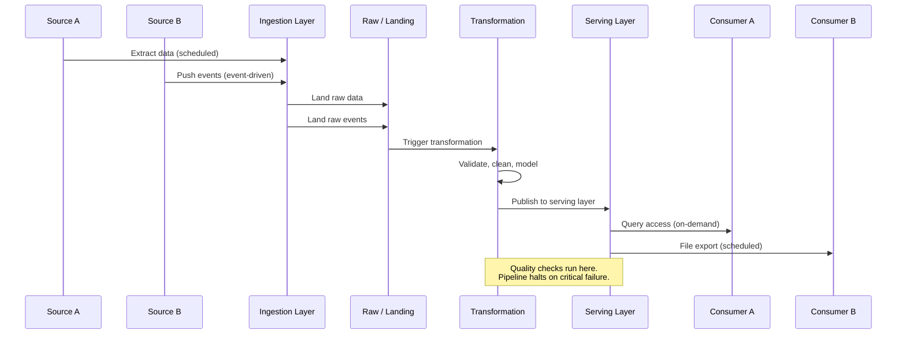

# Integration Blueprint

> **When is this needed?** This artifact is optional, intended for data products with multiple
> sources, multiple consumers, or complex integration patterns (e.g., bidirectional data flows,
> real-time event streams, cross-domain dependencies).

---

## 1. Overview

| Field | Value |
|-------|-------|
| Product Name | [Product name] |
| Integration Complexity | [e.g., Multi-source, multi-consumer, cross-domain] |
| Total Source Integrations | [Count] |
| Total Consumer Integrations | [Count] |
| Classification | Sensitivity: [e.g., General / Restricted] |
|                | Criticality: [e.g., Medium / High] |

---

## 2. Integration Inventory

### 2.1 Source Integrations (Inbound)

| Source | Direction | Protocol | Auth Method | Frequency | Format | Owner | SLA Dependency |
|--------|-----------|----------|-------------|-----------|--------|-------|----------------|
| [Source A] | Inbound | [e.g., JDBC, REST API, File drop, Event stream] | [e.g., Service account, OAuth, API key] | [e.g., Every 15 min, hourly, daily] | [e.g., JSON, Parquet, CSV, Avro] | [Source team] | [e.g., Data available by 06:00 UTC] |
| [Source B] | Inbound | | | | | | |
| | | | | | | | |

### 2.2 Consumer Integrations (Outbound)

| Consumer | Direction | Protocol | Auth Method | Frequency | Format | Owner | SLA Commitment |
|----------|-----------|----------|-------------|-----------|--------|-------|----------------|
| [Consumer A] | Outbound | [e.g., SQL query, API, File export, Event publish] | [e.g., Role-based, API key] | [e.g., On-demand, scheduled] | [e.g., Query result, Parquet, JSON] | [Consumer team] | [e.g., Data fresh within 1 hour] |
| [Consumer B] | Outbound | | | | | | |
| | | | | | | | |

---

## 3. Data Flow Description

### 3.1 Inbound Flows

#### Source A -> Data Product

- **Trigger:** [e.g., Scheduled extraction, event-driven, CDC]
- **Extraction Method:** [e.g., Full extract, incremental based on `updated_at`, change data capture]
- **Landing Zone:** [e.g., Raw layer, staging bucket]
- **Preprocessing:** [e.g., Schema validation, decompression, format conversion]
- **Idempotency:** [e.g., Upsert on primary key, deduplicate on extraction ID]
- **Volume:** [e.g., ~100K records per batch, ~5M records/day]

#### Source B -> Data Product

- **Trigger:** [Description]
- **Extraction Method:** [Description]
- **Landing Zone:** [Description]
- **Preprocessing:** [Description]
- **Idempotency:** [Description]
- **Volume:** [Description]

### 3.2 Outbound Flows

#### Data Product -> Consumer A

- **Delivery Method:** [e.g., Direct query, materialized view, file export, event publish]
- **Trigger:** [e.g., On-demand, post-transformation, scheduled]
- **Format & Schema:** [e.g., Follows data contract schema v1.0]
- **Access Control:** [e.g., Granted via role `analytics_read`]

---

## 4. Error Handling

### 4.1 Inbound Error Handling

| Error Type | Detection | Response | Recovery |
|------------|-----------|----------|----------|
| Source unavailable | Connection failure / timeout | Retry with exponential backoff (max [X] retries) | Alert after max retries; resume on source recovery |
| Schema mismatch | Schema validation on landing | Reject batch, alert data product team | Coordinate with source team to resolve; reprocess |
| Duplicate data | Deduplication check on key columns | Deduplicate during processing | Log duplicates for audit |
| Corrupt / malformed records | Format validation on ingestion | Quarantine failed records, process remainder | Review quarantine; reprocess or discard |
| Volume anomaly | Row count outside expected range | Alert; proceed with caution flag | Investigate with source team |

### 4.2 Outbound Error Handling

| Error Type | Detection | Response | Recovery |
|------------|-----------|----------|----------|
| Consumer query failure | Query timeout / error logs | N/A (consumer-side) | Consumer retries; escalate if persistent |
| Export job failure | Job orchestrator alert | Retry export | Alert consumer if SLA at risk |
| Stale data served | Freshness monitoring | Alert data product team | Investigate pipeline; communicate ETA to consumers |

---

## 5. SLA Dependencies

| This Product's SLA | Depends On | Upstream SLA | Gap / Risk |
|---------------------|-----------|--------------|------------|
| Data fresh by 08:00 UTC | Source A delivery | Source A available by 06:00 UTC | 2-hour buffer; risk if source is > 2 hours late |
| Data fresh by 08:00 UTC | Source B delivery | Source B available by 05:00 UTC | 3-hour buffer; low risk |
| Query available 99.9% | Platform uptime | Platform SLA: 99.95% | Covered by platform SLA |
| | | | |

> Identify any SLA dependencies where upstream commitments are informal or undocumented.

---

## 6. End-to-End Sequence Diagram

> Replace or supplement the placeholder below with your sequence diagram.

---

## 7. Integration Testing Plan

| Test Scenario | Description | Frequency | Owner |
|---------------|-------------|-----------|-------|
| End-to-end smoke test | Run full pipeline with sample data; verify output matches expected | Pre-deployment, post-change | Data product team |
| Source failover test | Simulate source unavailability; verify retry and alerting behavior | Quarterly | Data product team + source team |
| Schema evolution test | Apply a non-breaking schema change at source; verify pipeline handles it | Pre-deployment | Data product team |
| Volume stress test | Run pipeline with 2x expected volume; verify performance targets hold | Pre-launch, quarterly | Data product team |
| | | | |

---

## Appendix: Revision History

| Version | Date | Author | Summary of Changes |
|---------|------|--------|--------------------|
| 0.1 | | | Initial draft |
| | | | |
