# Schedule & Backfill Plan

---

## 1. Overview

| Field | Value |
|-------|-------|
| Product Name | [Product name] |
| Owner | [Team or individual] |
| Classification | Sensitivity: [e.g., General / Restricted] |
|                | Criticality: [e.g., Medium / High] |

---

## 2. Production Schedule

### 2.1 Primary Schedule

| Field | Value |
|-------|-------|
| Trigger Type | [e.g., Cron schedule, event-driven, dependency-triggered] |
| Schedule | [e.g., Daily at 04:00 UTC, every 15 minutes, on upstream completion] |
| Processing Window | [e.g., 04:00 - 06:00 UTC] |
| SLA Deadline | [e.g., Data available by 08:00 UTC] |
| Time Zone | [e.g., UTC] |

### 2.2 Detailed Job Schedule

| Job / Model | Trigger | Schedule / Dependency | Expected Duration | SLA Deadline | Retry Policy |
|-------------|---------|----------------------|-------------------|--------------|--------------|
| [e.g., Ingestion - Source A] | Cron | `0 4 * * *` (04:00 UTC daily) | ~30 minutes | 05:00 UTC | 3 retries, 5-min backoff |
| [e.g., Ingestion - Source B] | Cron | `0 4 * * *` (04:00 UTC daily) | ~15 minutes | 05:00 UTC | 3 retries, 5-min backoff |
| [e.g., Transformation] | Dependency | After all ingestion jobs complete | ~45 minutes | 06:30 UTC | 2 retries, 10-min backoff |
| [e.g., Quality checks] | Dependency | After transformation completes | ~10 minutes | 07:00 UTC | 1 retry |
| [e.g., Consumer notification] | Dependency | After quality checks pass | < 1 minute | 07:00 UTC | 2 retries |
| | | | | | |

### 2.3 Schedule Visualization

```mermaid
gantt
    title Daily Production Schedule (UTC)
    dateFormat HH:mm
    axisFormat %H:%M

    section Ingestion
    Source A extraction   :a1, 04:00, 30min
    Source B extraction   :a2, 04:00, 15min

    section Transformation
    Staging models        :b1, after a1 a2, 15min
    Intermediate models   :b2, after b1, 15min
    Mart models           :b3, after b2, 15min

    section Validation
    Quality checks        :c1, after b3, 10min
    Consumer notification :c2, after c1, 1min

    section SLA
    SLA deadline (08:00)  :milestone, 08:00, 0min
```



---

## 3. Dependencies

### 3.1 Upstream Dependencies

| Dependency | Type | Expected Availability | Impact if Late | Mitigation |
|------------|------|----------------------|----------------|------------|
| [Source A data] | Data availability | By 04:00 UTC | Pipeline delayed; freshness SLA at risk | Retry with backoff; alert at 05:00 UTC if unavailable |
| [Source B data] | Data availability | By 04:00 UTC | Pipeline delayed; partial data possible | Process available sources; backfill Source B on recovery |
| [Platform orchestrator] | Infrastructure | Always available | All jobs blocked | Platform SLA covers; escalate to platform team |
| | | | | |

### 3.2 Downstream Commitments

| Consumer | Expected Availability | Notification Method | Fallback if Delayed |
|----------|-----------------------|--------------------|--------------------|
| [Consumer A] | By 08:00 UTC | [e.g., Event/webhook on completion] | [e.g., Consumer uses previous day's data; alert sent] |
| [Consumer B] | By 09:00 UTC | [e.g., Polling / status endpoint] | [e.g., Consumer job waits and retries] |
| | | | |

---

## 4. Backfill Plan

### 4.1 Initial Historical Load

| Field | Value |
|-------|-------|
| Historical Range | [e.g., 2023-01-01 to present] |
| Estimated Volume | [e.g., ~500M rows across all tables] |
| Approach | [e.g., Chunked by month, full refresh per chunk] |
| Compute Requirements | [e.g., 2x normal warehouse size during backfill] |
| Estimated Duration | [e.g., ~8 hours total, ~30 min per monthly chunk] |
| Parallelism | [e.g., Up to 4 monthly chunks in parallel] |
| Validation | [e.g., Row count reconciliation per month against source] |

### 4.2 Backfill Execution Steps

| Step | Action | Duration | Validation |
|------|--------|----------|------------|
| 1 | Provision backfill compute resources | [X] minutes | Resources available and sized correctly |
| 2 | Disable production schedule (or run in parallel) | [X] minutes | Confirm no conflicts |
| 3 | Run backfill for date range [start] to [end] | [X] hours | Job completes without error |
| 4 | Validate row counts and key metrics per period | [X] minutes | Counts within [X]% of source |
| 5 | Spot-check business metrics for known reference dates | [X] minutes | Metrics match expected values |
| 6 | Re-enable production schedule | [X] minutes | Next scheduled run succeeds |
| 7 | Decommission backfill compute resources | [X] minutes | No orphaned resources |

### 4.3 Re-Run / Replay Strategy

| Scenario | Approach | Scope | Impact on Consumers |
|----------|----------|-------|---------------------|
| Single day re-run | Re-process specific date partition | [e.g., One day's data] | Consumers see updated data on next query; no notification needed |
| Multi-day re-run | Re-process date range in chunks | [e.g., Configurable date range] | Notify consumers of in-progress reprocessing |
| Full reprocessing | Drop and rebuild from raw | [e.g., All historical data] | Major event; coordinate with all consumers before executing |
| Source correction | Reingest corrected source data, then reprocess | [e.g., Affected date range] | Notify consumers of data correction and expected timeline |

### 4.4 Re-Run Command / Process

```
[Document the exact command, configuration, or process to trigger a re-run.
Include parameters for date range, target tables, and any flags needed.]

Example:
  - Set date range parameters: start_date=YYYY-MM-DD, end_date=YYYY-MM-DD
  - Trigger pipeline with backfill flag enabled
  - Monitor job completion and validate output
```

---

## 5. Maintenance Windows

| Window | Schedule | Duration | Impact | Communication |
|--------|----------|----------|--------|---------------|
| Planned maintenance | [e.g., First Sunday of month, 02:00-06:00 UTC] | [X] hours | Pipeline paused; data freshness delayed | [e.g., 5 business days advance notice to consumers] |
| Platform upgrades | [e.g., As scheduled by platform team] | [Varies] | [Depends on upgrade scope] | [e.g., Per platform team communication] |
| Emergency maintenance | As needed | [Varies] | Pipeline paused | [e.g., Immediate notification to consumers] |

### Maintenance Checklist

- [ ] Notify all registered consumers of upcoming maintenance window
- [ ] Pause production schedule before maintenance begins
- [ ] Perform maintenance activities
- [ ] Run validation suite after maintenance completes
- [ ] Re-enable production schedule
- [ ] Confirm next scheduled run completes successfully
- [ ] Notify consumers that maintenance is complete

---

## Appendix: Revision History

| Version | Date | Author | Summary of Changes |
|---------|------|--------|--------------------|
| 0.1 | | | Initial draft |
| | | | |
