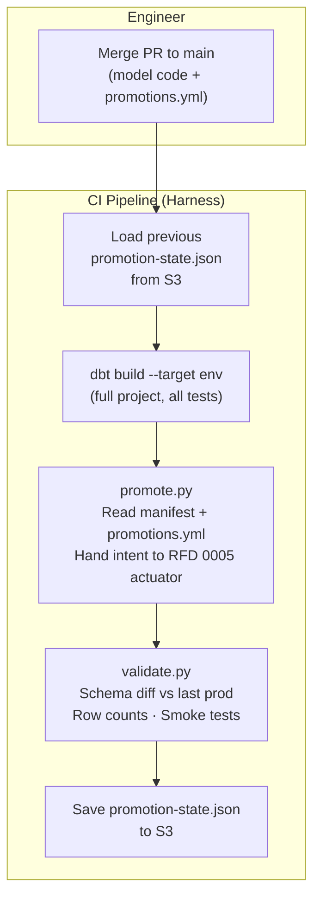
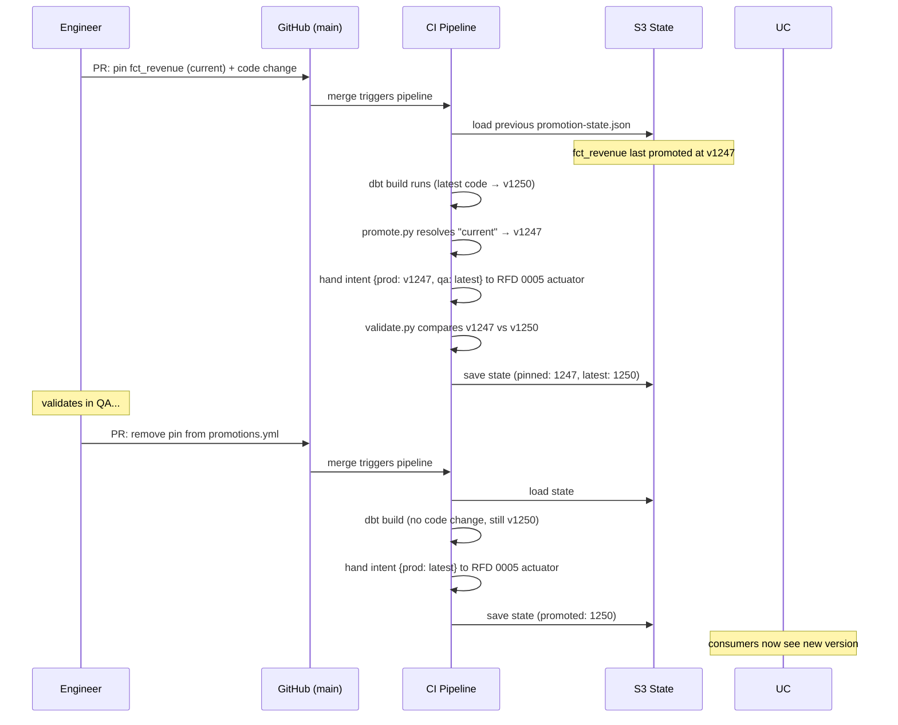

# RFD 0004 Branching Strategy

> **Related:** [RFD 0005 — Lake Versioning Strategy](../0005/README.md)
> decides how promotion intent (the per-environment selector in
> `promotions.yml`) is realized in
> the catalog. This RFD specifies the manifest format, the CI workflow that
> applies it, and the lifecycle governance; it is agnostic to whatever
> access pattern RFD 0005 lands on.

## Introduction

With many domain teams working across multiple repositories (see
[RFD 0003](../0003/README.md)), we need a branching strategy that minimizes
merge conflicts, enables continuous integration, and supports different
deployment cadences. Data pipelines add a constraint that traditional
application branching models do not account for: rollback is not just
"deploy the old code" -- it involves data that has already been written,
incremental model state, and downstream consumers who may have already
read from the broken output.

This RFD proposes trunk-based development with short-lived branches and no
release branches, and documents why that model fits data engineering work
better than the alternatives.

## Background

Branching strategies exist on a spectrum from "one long-lived branch per
concern" (GitFlow) to "everyone commits to main" (pure trunk-based). The
right choice depends on deployment model, team size, and how rollback works.

For data pipelines on Databricks with dbt, three properties shape the
decision:

1. **Full-project deployment.** dbt deploys the entire project, not individual
   models. There is no concept of patching a single file in production.
2. **Single production version.** We maintain one version of each domain's
   models in production at any time. There is no v1.x and v2.x running
   simultaneously.
3. **Complex rollback.** Reverting code does not revert data. If a broken
   model ran and wrote bad data to a curated table, downstream dashboards
   and consumers may have already read it. Rollback requires re-running
   the previous good version, which may involve rebuilding incremental
   models from scratch depending on what changed.

These properties make release branches unnecessary (no concurrent versions
to maintain) and make the speed of the feedback loop critical (the longer
bad code lives in a branch, the more damage it can do when it finally
merges).

## Proposal

### Trunk-Based Development

All work happens on short-lived branches off `main`. Branches are merged
back to `main` via pull request with squash merge. `main` is always the
source of truth for what will be deployed next.

There are no `develop`, `staging`, or `release` branches. Environment
promotion (dev, qa, prod) is handled by CI/CD pipelines deploying from
`main`, not by branching.

### Branch Naming

Branches follow the prefixes established in [RFD 0001](../0001/README.md) and
enforced by the repository ruleset:

| Branch Type | Pattern | Example | Lifetime |
|-------------|---------|---------|----------|
| Main | `main` | `main` | Permanent |
| RFD | `rfd/{number}` | `rfd/0042` | Until merged |
| Feature | `feat/{description}` | `feat/add-order-metrics` | 1-5 days |
| Bug fix | `fix/{description}` | `fix/null-handling-orders` | 1-3 days |
| Hotfix | `hotfix/{description}` | `hotfix/prod-revenue-calc` | Hours |

### Branch Lifetime

Branches should be short-lived. The target is **1-5 days** for feature
branches across all repository types. Domain repositories have lower merge
conflict risk -- feature branches typically touch different dbt models and are
self-contained -- but shorter branches are still preferred because they reduce
stale assumptions and keep the blast radius small when merging.

For work that takes longer than a few days, decompose it into smaller
increments that each meet the *WIP Code on Main* bar (compiles, runs in
dev, tests pass). The goal is to keep `main` moving forward rather than
accumulating large changes in a branch. Platform and framework
repositories should target the lower end of the range (1-3 days) due to
their wider contributor base.

### Pull Request Guidelines

For dbt model PRs, the "no-and" heuristic helps spot scope creep: if
the one-sentence description requires "and" to describe two **unrelated
concerns**, the PR should be split. The unit is the *concern*, not the
*model count*. Examples of one concern that may touch multiple files:
schema YAML alongside the corresponding SQL; a fix and its test; a
single requirement (one JIRA story) that requires coordinated changes
across multiple models when splitting would leave production in a
temporarily inconsistent state. The PR description should name the
concern, not enumerate the models. This is a coaching heuristic for
code review, not a CI gate.

For non-dbt changes (Terraform, Python utilities, CI pipeline configs), the
guideline is that a PR should have a single purpose, reviewable in under 30
minutes. The scope boundary is left to team judgment.

Every PR must be independently deployable. A reviewer should be able
to answer "what happens to production if only this PR merges and
nothing else follows?" with "it's fine." If the honest answer is "it
depends on the next PR," the PR has been split incorrectly: either the
concern straddles two PRs and should be one (see *no-and* above), or
the second PR represents a different concern that shouldn't have been
promised yet.

Coordinated cross-model changes that must land atomically belong in a
single PR — that PR is then independently deployable *as a whole*.
Splitting an atomic concern across multiple PRs violates this rule and
introduces the very semantic drift the rule exists to prevent.

For PRs with more than 5 commits — a proxy for multi-step refactors — a
Harness pipeline workflow automatically posts the `git log --oneline` summary
as a PR comment when the commit count exceeds the threshold. This preserves
the intra-branch narrative without requiring manual author action.

Squash merge is the only permitted merge strategy, enforced at the repository
ruleset level. Merge commits and rebase merges are disabled with no
exceptions.

**Branch protection ruleset for `main`:**

- Minimum 1 approving review (2 for the platform monorepo).
- Dismiss stale reviews on new push.
- All named status checks must pass.
- No bypass for repository admins without a second approval.
- Force-push is disabled for all users.
- Deletion of `main` is disabled.

These rules are configured as a GitHub organization-level ruleset so domain
teams cannot weaken them at the repository level.

### WIP Code on Main

Trunk-based development raises a fair question: can incomplete work
land on `main`? This RFD takes a hard position.

Two cases need to be distinguished up front — they look similar but
need different mechanisms:

1. **Code is incomplete** (won't compile, missing logic, broken
   upstream). This section governs that case.
2. **Code is complete but consumer-visibility is deferred for
   business reasons** (release window, downstream coordination, market
   timing, regulatory go-live). Use the promotion manifest
   (`promotions.yml`) — set the affected environment to `hidden` or
   `current`. The code runs in every environment and tests run
   normally; consumers don't see it until the business signs off. See
   *Promotion Gating*. This is not a WIP scenario — the code is ready;
   the *exposure* is gated.

The rest of this section applies to case 1 only.

**Default: WIP code does not land on `main`.**

A change is ready for `main` when:

1. It compiles (`dbt parse` and `dbt compile` succeed).
2. It runs cleanly in dev against real data (`dbt build --target dev`
   succeeds).
3. Tests it touches pass.

Code that doesn't meet these stays in a feature branch. Trunk-based
development means *short-lived* branches (1–3 days), not
*merge-incomplete*. The branch lifetime ladder enforces this — a 5-day
branch is a coaching signal, not a normal state.

**Escape hatch: `enabled = var('include_wip', false)`**

For the narrow case where part of a change must land on `main` before the
full change is testable — typically a refactor of a base model whose
dependent isn't ready, or an import of a new source table that downstream
models don't yet consume — the in-progress portion is gated:

```sql
{{ config(enabled=var('include_wip', false)) }}
```

dbt parses the model (it appears in the manifest and is selectable) but
does not execute it in any environment unless `include_wip=true` is
explicitly passed. CI templates for QA and Prod never set this var. Dev
and local development can override (`dbt build --vars 'include_wip: true'`)
for testing.

This flag is the only sanctioned mechanism for WIP code on `main`. It is
not a default — feature branches are. It exists for cross-team handoff
cases where part of a change has to be shared via `main` before the full
change is testable.

#### CI Enforcement

A `validate_wip.py` step runs after `dbt parse` and blocks the PR if any
of the following hold (CI's default vars resolve `include_wip=false`, so a
gated model has `config.enabled == False` in `manifest.json`):

1. **No fan-in to gated.** An enabled model `depends_on` a gated model
   (resolved via `manifest.nodes[*].depends_on.nodes`).
2. **`promotions.yml` excludes gated.** An entry in `promotions.yml`
   references a model where `config.enabled == False`.

Pipeline templates for QA and Prod do not pass `include_wip=true` —
enforced in the Harness template, not the script.

These checks block at PR time. There is no scheduled alerting or stale-
gate dashboard — the CI blocks prevent gated code from reaching consumers
or breaking the pipeline, which are the only failure modes that matter.
PR review (CODEOWNERS routes any change adding the WIP gate to data
platform leads) catches whether the gate is justified. A
stale WIP gate that nobody removes is housekeeping, not risk.

### Promotion Gating

Promotion of changes to prod consumers is gated by a per-model manifest
(`promotions.yml`) processed by CI after each build, not by branches. This
RFD specifies the manifest format, the CI workflow that applies it, and
the governance lifecycle. The *implementation* of the gate — how the
catalog represents a held or pinned model to consumers — is decided in
[RFD 0005 (Lake Versioning Strategy)](../0005/README.md); this RFD is
agnostic to that choice and depends on whatever RFD 0005 lands.

The diagrams below show the workflow this RFD owns: PR → CI → manifest →
state. Everything past the actuator hand-off — how the catalog represents
a held or pinned model, how consumers query it — is owned by
[RFD 0005](../0005/README.md) and is not drawn here.

#### Deployment Flow



#### Breaking Change Flow (Single PR)



**Applicability.** The manifest's per-environment selectors (`current`,
`v<id>`, `hidden`) depend on the actuator's capabilities (defined in
[RFD 0005](../0005/README.md)). Models whose underlying storage
cannot support visibility control or version pinning are auto-promoted
only (`latest` is the only valid selector for them) — see RFD 0005
for the supported catalog/format matrix.

**Build discipline.** dbt builds the full project on every CI run, with
no selectors, no exclusions, and no environment-conditional gating in
model files. Every model runs in every environment on every deployment.
This guarantees that incremental models maintain state, tests run against
real data, and there are no "surprise" models excluded from CI that land
in prod later. The `enabled = var('include_wip', false)` escape hatch in
*WIP Code on Main* is the one explicit, governed exception.

A `promotions.yml` file in the repo declares which models are gated and
how (per-environment visibility, pinning). CI reads this file after
every `dbt build` and hands the resolved intent to the RFD 0005
actuator.

### Promotion Manifest

The `promotions.yml` file is the single control point for promotion
intent. It is checked into the repo and changes go through normal PR
review.

**Default: auto-promote.** Any model with `access: public` and
`contract: {enforced: true}` in its dbt schema YAML is auto-promoted —
CI hands the actuator an intent of "show `latest`" for every
environment. Models without those properties are internal and not
promoted.

**Per-environment selector.** `promotions.yml` overrides the default
with a per-environment selector. One concept covers what was previously
expressed as `hold`, `qa_visible`, and `pin`: for each environment,
what should consumers see?

| Selector | Meaning |
|---|---|
| `latest` | The freshest build (default if no entry exists) |
| `current` | The version that was last promoted to this environment, resolved from the state file |
| `v<id>` | A specific version identifier — opaque to this RFD; defined by the actuator (RFD 0005) |
| `hidden` | Not visible to consumers in this environment |

`promotions.yml` only contains **exceptions** to the default:

```yaml
# promotions.yml
#
# Default: models with access: public + enforced contract are
# auto-promoted (every environment shows `latest`).
# Only list exceptions below.

overrides:
  # New model — hidden from prod, visible in qa for validation
  fct_orders_new_metric:
    qa: latest
    prod: hidden
    ticket: JIRA-5678
    expires: 2026-05-15      # CI fails the build if still here past this date

  # Breaking change — prod stays on the pre-change version, qa on the new code
  fct_revenue:
    qa: latest
    prod: current
    ticket: JIRA-5679
    expires: 2026-05-20
    acknowledge_breaking: true  # CI won't block prod promotion on the schema diff
```

For a project with 100+ models, this file typically has 0-3 entries.

**The `current` keyword.** Engineers do not need to look up version
identifiers. Writing `prod: current` tells the promote script to pin
to the version that was last promoted to that environment. The script
resolves `current` by reading the state file (see *State File* below).

This means the pin and the code change can be in the **same PR**:

```yaml
# Same PR: pin prod to the pre-change version + make the breaking change
fct_revenue:
  qa: latest
  prod: current     # resolved at deploy time to the pre-change version
```

The pipeline processes this correctly because it loads the state file
before running `dbt build`. The new code is built; the intent handed to
the actuator keeps prod consumers on the previous version while qa
sees the latest.

#### State File

The state file records which version is currently promoted to each
environment per model. It lives in a persistent store keyed by domain:

```
s3://{deployment-bucket}/{domain}/promotion-state.json
```

Schema:

```json
{
  "schema_version": 1,
  "updated_at": "2026-05-06T14:30:00Z",
  "models": {
    "fct_revenue": {
      "prod": { "version": "v1247", "promoted_at": "2026-04-22T08:00:00Z" },
      "qa":   { "version": "v1250", "promoted_at": "2026-05-06T14:30:00Z" }
    },
    "fct_orders": {
      "prod": { "version": "v1098", "promoted_at": "2026-05-01T08:00:00Z" },
      "qa":   { "version": "v1098", "promoted_at": "2026-05-01T08:00:00Z" }
    }
  }
}
```

Lifecycle:

1. **Read at pipeline start.** CI loads the state file before
   `dbt build`. Resolves any `current` references against the prior
   state.
2. **Build runs.** dbt produces new artifacts; the actuator returns a
   version identifier for each promoted model.
3. **State updated atomically** at the end of the promote stage.
   Per-domain pipeline concurrency in Harness serializes writes — no
   two pipelines for the same domain race.
4. **Audit trail.** S3 versioning retains every state file revision so
   "what was deployed on date X" is answerable by reading the file as
   of that timestamp.

**Versioning is opaque.** This RFD treats the version identifier as a
string. The actuator (RFD 0005) decides what it means — Delta version,
Iceberg snapshot, commit SHA, artifact tag. CI stores the string and
hands it back on the next run. RFD 0004's manifest format and CI
workflow do not depend on the catalog's versioning model.

**Failure mode: fail closed.** If the state file is missing,
unreadable, or schema-incompatible, the pipeline fails. `current`
cannot resolve without it, and silently picking a wrong default would
risk silently rolling back consumers. Operators restore from S3
versioning or reconstruct manually.

### How Promotion Intent Is Realized

CI runs a `promote.py` script after every `dbt build`. For each model
with `access: public`, the script reads the resolved manifest entry
(auto-promoted, held, or pinned) and hands that intent to the actuator
defined in [RFD 0005](../0005/README.md). RFD 0005 owns the actuator;
this RFD does not specify how the intent is realized in the catalog.
Promotion (removing a hold or pin) is a one-line PR to `promotions.yml`.
Rollback (re-adding a pin to a previous version) is also
a one-line PR. CI handles the actuation automatically.

### CI Pipeline Stages

The Harness pipeline runs these stages on every merge to `main`:

**Stage 1 — Build.** `dbt build --target {env}`. Full project, no
selectors. All models run; all tests run.

**Stage 2 — Promote.** `promote.py` reads the dbt manifest and
`promotions.yml`, resolves any `current` keywords against the previous
state, and hands the resolved intent to the RFD 0005 actuator. Records
the version of each model in a `promotion-state.json` artifact for
audit.

**Stage 3 — Validate.** `validate.py` runs automated checks. Every
check is a hard block — a failure fails the build:

- **Pinned models**: latest build vs pinned version — schema diff, row
  count diff, key metric diff. Comparison report posted to pipeline
  artifacts (informational; does not block).
- **Newly promoted models**: smoke tests — non-null primary keys, row
  count > 0, freshness within SLA.
- **All promoted models**: manifest column shape vs last
  prod-promoted version. If a breaking change is detected (column
  dropped, renamed, type narrowed, or required→optional flipped) and
  `acknowledge_breaking` is not set in `promotions.yml`, **fails the
  prod promotion**.
- **Stale manifest entries**: every `promotions.yml` entry's age is
  computed from git blame. Entries older than 14 days without a
  refreshed ticket comment **fail the build** until updated or
  removed.
- **Expired `promotions.yml` entries**: any entry past its `expires`
  date **fails the build**.

Schema-diff detection uses the dbt manifest only — no cross-repo
querying, no Airflow DAG parsing. Identifying which consumers are
actually affected by a change is out of scope for CI; that work
belongs to a separate event-notification mechanism (future RFD).

PR-time checks (independent of the build pipeline):

- **Orphaned manifest entries**: a PR that deletes a model file must
  also remove the corresponding `promotions.yml` entry. PR fails if
  the manifest entry references a model that no longer exists.

### Scenarios

**New model (most common path):**

1. Engineer writes `fct_new_metric.sql` with `access: public` and
   `contract: {enforced: true}`.
2. Adds to `promotions.yml`:
   ```yaml
   fct_new_metric:
     qa: latest
     prod: hidden
     ticket: JIRA-5678
     expires: 2026-05-15
   ```
3. Merges to `main`.
4. CI builds the model in all environments. Hands the actuator an
   intent of "qa: latest, prod: hidden."
5. QA consumers validate. CI runs smoke tests automatically.
6. Engineer removes the entry from `promotions.yml` (one-line PR).
7. CI auto-promotes (every environment defaults to `latest`). Done.

**Non-breaking change to existing model:**

1. Engineer modifies `fct_orders.sql` (additive column, logic fix).
2. No `promotions.yml` change needed.
3. Merges to `main`.
4. CI builds. Auto-promotion (`latest` everywhere) flows through
   dev → qa → prod via SHA-targeted deployment.
5. Validate stage confirms schema is backward-compatible.
6. Done. Zero manual steps beyond the code change.

**Breaking change to existing model (single PR):**

1. Engineer submits one PR containing both the `promotions.yml`
   override and the code change:
   ```yaml
   # promotions.yml
   fct_revenue:
     qa: latest
     prod: current
     ticket: JIRA-5679
     expires: 2026-05-20
     acknowledge_breaking: true
   ```
   ```sql
   -- fct_revenue.sql (breaking change — column renamed)
   ```
2. PR merges to `main`. CI pipeline runs:
   - Loads `promotion-state.json` (records the last-promoted version
     of `fct_revenue`, e.g. v1247).
   - `dbt build` runs the new code (now v1250).
   - `promote.py` sees `prod: current` → resolves to v1247. Hands the
     actuator an intent of `prod=v1247, qa=latest`.
   - Validate stage posts comparison report (v1247 vs v1250: row
     counts, schema diff, key metrics) and the schema-diff check
     against the last prod-promoted version.
3. After validation and consumer coordination: engineer removes the
   override from `promotions.yml` (one-line PR).
4. CI returns to auto-promote (`latest` everywhere). The change is
   live.

**Rollback after a bad promotion:**

1. Engineer adds an override pinning the affected environment to a
   previous version. One-line PR.
2. CI hands the actuator the pin intent. Instant rollback — no
   rebuild, no data loss, no full refresh. (How the actuator achieves
   this is RFD 0005's concern.)

### What CI Enforces

| Check | When | Failure mode |
|---|---|---|
| `expires` date has passed | Every build | Build fails. Forces: promote, extend with new ticket, or delete. |
| Model has `access: public` but no enforced contract | PR CI check | PR cannot merge. Public models must have contracts. |
| Promoted model has breaking schema change vs last prod deployment | Validate stage | Schema-diff report posted to artifacts. Prod promotion fails unless `acknowledge_breaking` is set. |
| Pinned model: latest build vs pinned version schema drift | Validate stage | Comparison report posted (informational, does not block). |
| `promotions.yml` entry older than 14 days without refreshed ticket comment | Validate stage | Build fails until updated or removed. |
| Orphaned `promotions.yml` entry (model file deleted, manifest entry remains) | PR CI check | PR fails until manifest entry is removed in the same PR. |

### Why Not Shadow Models or Environment Gates

This RFD intentionally avoids two patterns that appear in other dbt branching
strategies — except for the narrow WIP escape hatch defined above.

**Shadow models** (`fct_orders_v2.sql` alongside `fct_orders.sql`) create
code duplication that diverges immediately. Bug fixes to the original are not
reflected in the shadow. The QA catalog contains two conflicting versions of
the same logical table. Incremental shadows start from scratch with no
historical state, making QA validation unreliable. Promoting (renaming the
file) breaks dbt's manifest tracking and `state:modified` selectors. Shadow
models are forbidden in this RFD; there is no narrow case where they are
preferred.

**Environment gates as a *promotion* mechanism** (`enabled = target.name
!= 'prod'`) are rejected: excluded models accumulate no incremental state,
are not tested against real data, and `target.name` is a magic-string
convention without compiler validation. Promotion is governed by the
manifest (`promotions.yml`), not by per-model environment conditionals.

**Environment gates as a *WIP* mechanism** (`enabled =
var('include_wip', false)`) are accepted under the rules in
*WIP Code on Main*. The dbt var is typed and validated by dbt, not a
magic string. The flag is bounded: tracked, time-limited, removed before
promotion, blocked by CI from creating fan-in into enabled models.

The promotion mechanism (manifest + RFD 0005 actuator) handles
*completed* code that isn't yet ready for consumers. The WIP escape
hatch handles the rare case of *incomplete* code that must land on
`main`. The two are distinct; conflating them produced earlier drafts of
this RFD that didn't hold up under review.

### Definition: Validation Complete

A model (or commit) is considered **validation complete** when all of the
following are true:

1. CI build stage is green in the QA environment (all `dbt build`
   tasks pass).
2. All dbt tests pass in QA.
3. The CI validate stage reports no critical validation failures.
4. For models with `prod: hidden`: the qa artifact has been queried
   and confirmed correct by the domain team.
5. For models with `prod: current` or `prod: v<id>`: the CI comparison
   report (old vs new) shows acceptable differences, reviewed by the
   domain team lead.
6. No data quality alerts have fired in the monitoring window (1 run cycle or
   24 hours, whichever is longer) following the QA deployment.
7. The domain team lead has approved the promotion PR.

This definition is referenced by the promotion workflow and the Prod
deployment gate.

### Environment Promotion and Deployment Tracking

Deployment to environments is driven by CI/CD, not by branching. Each
environment is a deployment target, not a branch.

**Dev** deploys automatically on every merge to `main`. Dev always reflects
the latest state of `main`.

**QA** deploys on a schedule or on demand. When QA deploys, it takes
whatever commit is current on `main` at that time. If multiple PRs have
merged since the last QA deployment, they are all included. There is no
per-PR promotion -- QA validates a point-in-time snapshot of `main`.

**Prod** deploys only with explicit approval. The approval targets a specific
commit SHA that has been validated in QA. If new commits have landed on
`main` since the QA deployment, Prod does not automatically pick them up.
The approver is approving a specific commit, not "whatever is on `main`
right now."

This means there will be times when `main` is ahead of Prod. That is
expected and normal. The gap must not exceed 10 business days. Domain
team leads are responsible for resolving gaps that approach the ceiling
— either by deploying to Prod or reverting the blocking change from
`main`. The mechanism for surfacing gap age is operational and not
specified by this RFD.

**Tracking what is deployed.** Harness provides this natively through its
Service and Environment model. Each domain's dbt project is modeled as a
Harness Service, and each target (dev, test, prod) is modeled as a Harness
Environment. The commit SHA is passed through as the artifact version using
the `<+codebase.commitSha>` expression. With this configuration, the Harness
dashboard shows which commit is deployed to which environment at any time,
and the Harness API allows querying execution history programmatically.

At minimum, each deployment records:

- The commit SHA deployed (via `<+codebase.commitSha>`)
- The environment targeted (via Harness Environment entity)
- The timestamp and pipeline execution ID (automatic)

The promotion flow is modeled as a Harness pipeline with three stages: Dev
triggers automatically on merge to `main`, QA triggers on schedule or
manual invocation, and Prod requires a Harness Approval step with the domain
team lead as approver.

The SHA input to the Prod stage must be declared as a runtime input
(`<+input>`) on the stage, not the pipeline, so approving one SHA does not
trigger subsequent stages automatically. The Approval step must have a
Pipeline Timeout set to 14 days; approvals not collected within that window
expire.

A pre-deployment script in the Prod stage queries the Harness API to assert
that the provided SHA appears in the QA environment's execution history and
that no later SHA has been deployed to QA since (to prevent silently rolling
back QA-validated changes). If the check fails, the deployment aborts.

The script is **fail-closed**: any non-200 response from the Harness API,
any timeout (60-second default), or any ambiguous result causes the Prod
deployment to abort. If the Harness API is unreachable and a Prod deployment
is urgent, a manual override requires dual approval from the domain team lead
and a platform team engineer, logged as a Harness deployment annotation
(immutable audit trail). The script is stored in a protected path with its
own CODEOWNERS entry so it cannot be modified in the same PR as a deployment
change.

### Bug Fixes and Hotfixes

The `fix/*` and `hotfix/*` prefixes carry different meaning and should not be
used interchangeably.

`fix/*` branches are for non-urgent bugs discovered outside production
incidents. They follow the normal PR process with no expedited SLA and do not
signal urgency to reviewers.

`hotfix/*` branches are for production incidents with active data corruption
or pipeline failure. They carry the expectation of prioritized review, the
option to skip QA with team lead approval, and the incident reference
requirement described below. If an engineer opens a `hotfix/*` branch for a
non-urgent bug,
reviewers should flag it and ask them to rename to `fix/*`. The prefix is a
signal that consumes reviewer urgency -- using it incorrectly degrades the
signal for real incidents.

**Who can declare a hotfix.** Any engineer can create a `hotfix/*` branch.
The branch prefix is a signal to reviewers that the change is urgent, not
a gate that requires permission.

**Review requirements.** Hotfixes require the same PR approval as any other
change. The expectation is that reviewers prioritize hotfix PRs — the
`hotfix/` prefix is an explicit request for urgent review. The domain team
lead is responsible for ensuring timely review during active incidents.

**Skipping QA.** For critical production issues where data is actively being
corrupted, a hotfix may be deployed directly from Dev to Prod, skipping the
QA environment. This is enforced via a **separate Harness pipeline stage**
(not the normal Prod stage) that requires:

1. A Harness Approval step from the domain team lead.
2. A mandatory incident tracker link (PagerDuty or JIRA incident ID) as a
   pipeline input — the pipeline fails if the field is empty.
3. The approval and incident link are recorded in Harness execution history
   (immutable — not editable like a PR description).

**Incident reference.** A CI check fails if a PR from a `hotfix/*` branch
does not contain a valid incident tracker link (PagerDuty incident URL or
JIRA incident ID matching `INC-\d+`). This converts the social norm into a
technical gate and ensures every hotfix is traceable to an incident.

**Scope.** A hotfix should contain only the minimal change needed to resolve
the production issue. If a broader fix is needed, the hotfix stops the
bleeding and a follow-up `fix/*` branch addresses the root cause through
the normal process.

### Merging During Incidents

When a production incident is active and a hotfix is in flight, other teams
should continue merging to `main` as normal. The hotfix will be a separate
PR that merges independently.

Because Prod deployments target a specific commit SHA (not "latest on
`main`"), unrelated merges do not contaminate the hotfix deployment. The
hotfix commit is approved for Prod; other commits that landed on `main`
after it are not included until the next normal Prod deployment cycle.

If a situation arises where `main` itself is broken (CI is failing for all
PRs), the team that broke it is responsible for fixing it immediately. Other
teams should hold their PRs until CI is green. This is not a formal merge
freeze -- it is common courtesy enforced by the CI gate.

### Independent Teams Shipping at Different Speeds

A common concern with trunk-based development is what happens when multiple
developers merge to `main` but their changes reach production-readiness at
different times. This is handled by SHA-targeted deployments without needing
release branches.

**Walkthrough.** Consider two developers working independently:

1. Developer 1 merges `feat/new-order-metrics` to `main` (commit `aaa111`).
2. Developer 2 merges `feat/update-revenue-calc` to `main` (commit `bbb222`).
3. Both changes deploy to Dev automatically and then to QA on the next
   scheduled deployment.
4. Developer 1 completes testing and is ready for Prod. Developer 2 is still
   validating.

At this point, the Prod deployment targets **commit `aaa111`** -- the last
commit that has been fully validated. Developer 2's change (`bbb222`) is on
`main` and in QA, but it is not included in the Prod deployment because
Prod approves a specific SHA, not "whatever is on `main`."

When Developer 2 finishes testing, the next Prod deployment targets `bbb222`
(or whatever the latest validated commit is at that point). There is no
coordination required between the two developers, and neither blocks the
other.

**What if Developer 2's change is not ready for weeks?** If Developer 2's
modification to an existing production model needs extended validation,
they pin the model in `promotions.yml` so prod consumers continue seeing
the previous version while the new code validates in QA. The code merges
to `main` and runs everywhere — the manifest is the gate, not the branch.
Other developers' changes are unaffected because the pin is per-model,
not per-commit. The key insight is that trunk-based development does not
force untested code into production — the promotion manifest provides the
isolation that release branches would otherwise provide.

**How does this differ from a release branch?** A release branch provides
isolation by copying code to a separate branch where only validated changes
are included. SHA-targeted deployments provide the same isolation without the
branch: the Prod deployment simply points at a commit that has been validated.
The result is the same -- only tested code reaches Prod -- but without the
overhead of maintaining a release branch, cherry-picking fixes between
branches, or reconciling divergence after the release.

### Platform Monorepo Considerations

The branching strategy applies to all repositories, but the platform
monorepo ([RFD 0003](../0003/README.md)) has additional considerations due to
its broader contributor base and wider blast radius:

- **CODEOWNERS is required.** The platform monorepo must use a CODEOWNERS
  file to route PR reviews to the appropriate team based on which files are
  changed. A change to a Terraform module should not require review from the
  dbt package maintainers.
- **CI must be scoped.** Changes to `terraform/` should not trigger dbt
  tests, and vice versa. CI pipelines in the platform monorepo must use
  path-based filtering to avoid running the entire test suite on every
  change.
- **Branch lifetime is stricter.** Because more people are affected by merge
  conflicts in the platform monorepo, the target branch lifetime is 1-3 days
  as described in [Branch Lifetime](#branch-lifetime).

#### Ownership

CODEOWNERS files must use GitHub team names, not individual usernames. A CI
lint step validates this on every PR that touches a CODEOWNERS file. Each
entry must map to a team with at least two members, validated via the GitHub
Teams API. A single-member team is not a valid review gate because it
creates a single point of failure for every PR that touches the covered paths.

Teams with fewer than three engineers must establish a named cross-team review
agreement before their first PR. The agreement names a backup reviewer from
another domain team who holds approval rights for incidents. This prevents
the reviewer availability problem from surfacing for the first time during an
active incident.

### Rollback

Rolling back a data pipeline is fundamentally different from rolling back an
application. Deploying a previous version of the code does not undo data that
has already been written.

The Harness deployment history provides the mechanism for identifying the
rollback target. To roll back, find the commit SHA of the last known-good
Prod deployment in the Harness dashboard or API, and re-trigger the Prod
pipeline stage for that commit.

For **full-refresh models**, rollback is straightforward: re-run the previous
known-good version of the code. The table is rebuilt from source.

For **incremental models**, rollback depends on what broke:

- If the schema changed (column added/removed/retyped), the incremental
  model's state is invalid. A full refresh from the last known-good code
  version is required.
- If the logic changed but the schema is intact, re-running from the
  previous code version with the appropriate incremental window may suffice,
  but this must be validated case by case.

In either case, downstream consumers who already read bad data may need to
be notified and re-run. This is an operational concern that branching strategy
cannot solve, but it reinforces why short-lived branches and fast feedback
are important: the less time bad code spends in production, the less data
damage it causes.

## Migration from GitFlow

Teams currently using GitFlow or release branches should follow this cutover
sequence:

1. **Freeze release branches.** Stop cutting new releases. Merge any
   in-flight release branch fixes back to `main`.
2. **Merge all in-flight work to `main`.** Feature branches targeting
   `develop` should be retargeted to `main`. Code that doesn't yet
   compile or run cleanly stays in a feature branch (per *WIP Code on
   Main*); the rare partial change that must land uses
   `enabled = var('include_wip', false)`.
3. **Delete `develop` and release branches.** Once all work is on
   `main`, these branches serve no purpose.
4. **Enable branch protection.** Apply the ruleset defined in this RFD.

## Alternatives Considered

### GitFlow

GitFlow uses long-lived `develop` and `main` branches with feature branches,
release branches, and hotfix branches. It was designed for software with
multiple supported versions in production simultaneously -- desktop
applications, libraries with major version lines, and similar contexts where
customers run different releases at the same time.

None of those conditions apply to our data pipelines. We deploy one version
at a time. The `develop` branch becomes a merge bottleneck where integration
issues accumulate silently until release day. Release branches add maintenance
overhead for cherry-picking fixes between branches, and that overhead buys
nothing when there is only one production version to maintain. Teams working
on dbt projects reported that GitFlow's ceremony slowed delivery without
catching issues earlier -- the issues were simply discovered later, during
the release branch stabilization phase, when they were harder to fix.

### Trunk-Based with Release Branches

This hybrid approach uses short-lived feature branches like trunk-based
development, but cuts release branches for production deployments. Hotfixes
are applied to the release branch and merged back to `main`.

Release branches make sense when you need to stabilize a release while
development continues on `main`, or when you need to hotfix a specific
release without picking up everything that has landed on `main` since. For
data pipelines, neither case applies. Stabilization is unnecessary because
dbt deploys the full project atomically -- there is nothing to stabilize
that CI would not already catch. And hotfixes do not need isolation because
we deploy from `main` directly; a hotfix is just a fast-tracked PR.

The cherry-picking workflow between release branches and `main` is also a
source of errors. A fix applied to a release branch but not merged back to
`main` (or vice versa) creates divergence that is painful to discover later.
Eliminating release branches eliminates this class of error entirely.

### Trunk-Based with Automatic Semantic Version Tags

Automatic tagging on every merge conflates "a PR was merged" with "a release
was cut." Under this RFD's promotion model, Prod deployments target a
specific commit SHA and require explicit approval. The commit SHA, recorded
in the deployment log, is the release identifier. A separate version tag
is redundant -- it adds a naming ceremony on top of a mechanism that already
exists.

Semantic versioning also maps poorly to data pipelines. The semver contract
-- major for breaking changes, minor for features, patch for fixes -- assumes
a well-defined API boundary. Data pipelines have implicit contracts: any query
against a curated table is a consumer, and the pipeline author may not know
who they all are. A "minor" change (adding a column) is never breaking by
semver's definition, but if it introduces a bug in an existing column's logic,
it breaks every downstream consumer. The version number provides false
confidence about compatibility.

If a need for human-readable version identifiers arises (e.g., for
communicating releases to stakeholders), lightweight tags can be added to
the deployment process without changing the branching strategy. That decision
can be made independently and does not need to be settled here.

## Impact

- **Economic**: Trunk-based development reduces the time spent on branch
  management, merge conflict resolution, and release coordination. The
  overhead of maintaining release branches and cherry-picking fixes is
  eliminated entirely. The tradeoff is that it requires discipline around
  short-lived branches and incremental delivery -- teams accustomed to
  batching large changes will need to adjust.
- **Customer/User**: Domain teams retain full control of their merge cadence.
  Teams that ship daily and teams that ship weekly both use the same branching
  model. The only difference is how often they open PRs.
- **Performance**: No impact on pipeline runtime performance. CI/CD feedback
  loops are faster because there is no release branch stabilization phase.
  Path-scoped CI in the platform monorepo avoids running unnecessary tests.
- **Security**: Branch protection on `main` ensures all changes go through
  PR review. Squash merges keep the commit history clean and auditable.
  Harness execution history provides a full audit trail of what was deployed
  to each environment and when.

## Risks and Open Questions

The following items were open questions during the initial draft. Each is
resolved.

**PR decomposition.** Short-lived branches require features to be
decomposed into small, independently mergeable increments. The "no-and"
heuristic for dbt PRs and the "single purpose, under 30 minutes"
guideline for non-dbt PRs are the coaching signals. Teams accustomed
to large PRs should expect to adjust in the early weeks.

**Branch lifetime targets.** The 1-5 day targets are policy. The
mechanism for surfacing branches that exceed the target is left to
domain team operations and is not specified by this RFD.

**Squash merge strategy.** Squash-only is enforced at the repository
ruleset level. Merge commits and rebase merges are disabled. For PRs
with more than 5 commits, a Harness pipeline workflow automatically
posts the commit log summary as a PR comment.

**Reviewer availability.** CODEOWNERS files must use GitHub team names (not
individual usernames), and each entry must map to a team with at least two
members. Teams with fewer than three engineers must establish a cross-team
review agreement before their first PR. Domain team leads are responsible
for ensuring timely review of hotfix PRs during active incidents.

**Promotion manifest discipline.** CI blocks on every stale or expired
manifest entry — every check is a build fail or PR fail, never a soft
alert. Expired entries (`expires` date past) fail the build. Entries
older than 14 days without a refreshed ticket comment fail the build.
Orphaned entries (model file deleted, manifest entry remains) fail the
PR. The auto-promotion default (public + contract = promoted) means
most models require no manifest entry at all, reducing the surface
area for manual error.

**Modifying existing production models.** For non-breaking changes, no
special action is needed — the code merges and auto-promotion flows
through to consumers via the actuator. For breaking changes, the engineer
pins the model in `promotions.yml` before merging the code change,
validates in QA, then removes the pin. CI blocks promotion of breaking
changes unless `acknowledge_breaking` is set, ensuring consumer
coordination happens before the change goes live. The 10-business-day
ceiling on the Prod/main gap ensures that pinned models do not accumulate
indefinitely.

**WIP code on main.** WIP code does not land on `main` by default —
feature branches handle the common case. The `enabled =
var('include_wip', false)` escape hatch covers the narrow case where
part of a change must land before the full change is testable. CI
checks (no fan-in to gated, `promotions.yml` exclusion) block PRs
that would let WIP code reach consumers or break
the pipeline. There is no scheduled alerting on stale gates — the CI
blocks are sufficient; stale gates are housekeeping, not risk.

**Cross-RFD dependency on RFD 0005.** This RFD specifies promotion
*intent* (the manifest); RFD 0005 specifies *realization* (how the
catalog represents a held or pinned model to consumers). Both must land
together or this RFD's CI workflow has nothing to apply. The manifest
format and CI workflow defined here are agnostic to the access pattern
chosen in RFD 0005.

## References

- [RFD 0001: Requests for Discussion](../0001/README.md)
- [RFD 0003: Repository Strategy](../0003/README.md)
- [Trunk-Based Development](https://trunkbaseddevelopment.com/)
