# RFD 0007 Data-Ready Event Notification Schema v2

## Problem

The current data-ready notifications schema (`AirflowDataEvents` in 
caspian-blueprint-confluent-kafka) is fundamentally S3-centric. Fields like `locations`, 
`rows`, `current`, and `src_file_name` assume data lives in S3 and offer no native support 
for Unity Catalog or Dremio as query targets.

As we move to Databricks with Unity Catalog as our future state catalog, and continue to
support Dremio and S3 as additional data locations, the schema needs to evolve to support
multiple data access patterns rather than assuming a single storage layer, with the consideration
that S3 access is a less favorable access pattern compared to accessing data through unity catalog. 

Additionally, the current schema is Airflow-specific: the `source` record bakes in
`dag_id`, `task_id`, and `run_id` at the top level, so the contract assumes an Airflow
producer rather than treating orchestrator details as one possible shape of metadata.

Because the event payload doesn't carry the business window it represents, downstream
consumers can't tell from the message alone what data is new. To work around this, we
maintain checkpoint tables in `curation-libs` and `caspian-im-foundation` that record
the latest processed partition per dataset. Glue jobs read these tables on each run to
decide what to pick up. This is becoming problematic: reruns and backfills require
hand-editing or rolling back checkpoint rows before the pipeline will reprocess a
window, and any failure between "data committed" and "checkpoint updated" leaves the
checkpoint and the actual data out of sync. The net effect is that pipelines are not
idempotent against the event stream; replaying the same event does not reliably
reproduce the same outcome, because the checkpoint state mutates underneath it.

Beyond the schema itself, the current design uses a single Kafka topic for all event
types. As notification use cases grow beyond data-ready signals, we need to decide how
to organize topics to keep schemas focused, consumers simple, consumption compute reasonable, and operations manageable.

### Additional Pain Points

Beyond the points described above, the current schema also has the following gaps:

* **Asset identity is coupled to physical storage.** The schema names datasets by S3 path (`current`, `locations`), so the event's notion of *what* the dataset is cannot be separated from *where* it currently lives. Any storage reorganization moves the identifier downstream consumers subscribe to. v2 separates the two: a logical `subject` for identity, with physical location resolved out-of-band (see [Resolving physical location](#resolving-physical-location)) rather than carried per-engine in the event.
* **Schema doubles as a data contract.** Fields like row counts and file metadata belong in the data contract, not in a notification event. Mixing the two makes the event payload larger than it needs to be and couples notification consumers to contract-level changes.
* **The relationship between the event and data quality is undefined.** v1 never stated whether receiving an event implies the data passed its quality checks, so consumers cannot safely infer either way -- some ignore DQ, others look it up before acting, and nothing makes one of them wrong. v2 makes the contract explicit rather than adding a verdict field: a run that fails DQ does not emit, so arrival *is* the pass signal, and an optional `dq_report_uri` points at the detail without claiming to be a verdict (see [Quality is signalled by emission](#quality-is-signalled-by-emission)).
* **Asset URI has no enforced convention.** Cross-team subscription is fragile because there is no agreed pattern for how a dataset is named in the event, so subscribers end up coupling to producer-internal naming.
* **No distributed-tracing context.** Events emitted from an Airflow DAG that was itself triggered by an upstream request have no way to propagate the trace through the Kafka hop, so end-to-end tracing breaks at every event boundary. Adding the CE `traceparent` extension later is cheap and non-breaking (CE extension attributes need no pre-declaration); v2 does not emit it -- see [Envelope: bespoke vs CloudEvents 1.0](#envelope-bespoke-vs-cloudevents-10).
* **No data-classification signal.** Consumers receive payload bytes with no envelope-level indication of how the data should be handled (logging, SIEM forwarding, retention policy), so either every consumer makes its own classification decision or sensitive data flows through paths that should never see it. Addressing this is deferred to the same foundations RFD as `traceparent`.

## Background

### Prior ADRs

Two existing Caspian ADRs provide foundational context for this proposal:

* [ADR: Types of Events and Caspian Event Processing](https://capitalgroup.atlassian.net/wiki/spaces/CSPN/pages/115541502) --
  Established the distinction between **control plane events** (pipeline lifecycle,
  infrastructure provisioning, step state transitions) and **data events** (DQ metrics,
  data lineage, dataset availability). The topic strategy options in this RFD build on
  that taxonomy; the data-ready schema proposed here evolves the "data events" category
  while control plane events map naturally to a separate topic.
* [ADR: Streaming Backbone - Kafka](https://capitalgroup.atlassian.net/wiki/spaces/CSPN/pages/115541328) --
  Selected Confluent Kafka as the enterprise streaming backbone (with MSK as a tactical
  interim). Confirms Schema Registry availability for schema evolution and compatibility
  enforcement, which is assumed throughout this proposal.

### CloudEvents 1.0

This RFD adopts the CNCF [CloudEvents 1.0](https://github.com/cloudevents/spec) envelope
*shape and field naming* -- not the broader event-fabric program; see
[Envelope: bespoke vs CloudEvents 1.0](#envelope-bespoke-vs-cloudevents-10) for the exact
dividing line. CloudEvents is a CNCF specification (currently v1.0.2) for describing event
data in a common way. Relevant specs:

* [CloudEvents 1.0 Core](https://github.com/cloudevents/spec/blob/v1.0.2/cloudevents/spec.md) -- the core envelope attributes v2 adopts (`specversion`, `id`, `source`, `type`, `time`, `subject`, `dataschema`)
* [CE Kafka Protocol Binding](https://github.com/cloudevents/spec/blob/v1.0.2/cloudevents/bindings/kafka-protocol-binding.md) -- the binary-mode `ce_*` header encoding used on the wire
* [CE Distributed Tracing Extension](https://github.com/cloudevents/spec/blob/v1.0.2/cloudevents/extensions/distributed-tracing.md) -- the `traceparent` extension v2 does not emit but can add later without a breaking change
* [CE Partitioning Extension](https://github.com/cloudevents/spec/blob/v1.0.2/cloudevents/extensions/partitioning.md) -- the `partitionkey` attribute, which v2 does **not** emit; the Kafka key is set directly via the binding's default mapping (see [CloudEvents conformance](#cloudevents-conformance))

Conforming to the envelope gives v2 standard slots for fields the contract already needs
(idempotency `id`, producer `source`, event `type`, asset `subject`, `time`) plus a
standardized binary-mode Kafka encoding, so CE-aware tooling integrates without bespoke
per-producer logic -- at near-zero cost over a hand-rolled envelope.

## Goals

This RFD is driven by three concrete outcomes the data-ready event should enable.
Every schema and topic decision below is evaluated against whether it advances these
goals.

### Goal 1: Trigger downstream DAGs via Airflow Assets

The data-ready event must be the signal that drives event-driven DAG dependency
resolution through the astro-dependency-plugin. The plugin consumes the event,
surfaces it as an Airflow Asset (formerly Dataset) update, and downstream DAGs
scheduled on that Asset trigger automatically. To support this, the event needs:

* A stable, producer-agnostic identifier for the asset (the CE `subject` attribute) so
  downstream DAGs can subscribe without coupling to physical UC paths. **Triggering keys
  on the Asset URI alone** -- the producing `dag_id` / `run_id` are not required to resolve
  or fire a downstream DAG.
* A producer identity (the CE `source` URI) whose `{system-instance}` segment is the
  producing `deployment`, so the plugin can self-echo filter on an exact match and not
  re-trigger its own producer DAG.
* Enough metadata (`data.data_interval_start` / `data.data_interval_end`, where the run type
  makes them meaningful -- see
  [Interval semantics by run type](#interval-semantics-by-run-type)) for the downstream DAG to
  make a decision when it wakes up, without a second round-trip. Quality is not among
  it: the event's *existence* is the quality signal, because a run that fails DQ never emits
  (see [Quality is signalled by emission](#quality-is-signalled-by-emission)).

### Goal 2: Notify non-Airflow downstream consumers

The same event must be consumable by systems that don't run on Airflow: Databricks
workflows, Dremio refresh jobs, dashboards, agents and skills, ad-hoc analytics
processes, and future consumers we haven't built yet. To support this, the event
needs:

* A schema that is not Airflow-specific. Only orchestrator-specific IDs (`deployment`,
  `dag_id`, `task_id`, `run_id`) live under `data.orchestrator_metadata`; the business window and
  dataset coordinates sit at the top level of `data`, neutral to any producer.
* A storage-neutral dataset identity (the CE `subject`) that a non-Airflow consumer resolves
  to a physical object through the catalog / ODCS data contract, so the event does not couple
  producers to any downstream query engine (see
  [Resolving physical location](#resolving-physical-location)).
* A predictable CloudEvents 1.0 envelope (key, `ce_*` headers, schema subject)
  documented in [Topic envelope conventions](#topic-envelope-conventions), so non-Airflow
  consumers have one standard envelope to integrate against (see [CloudEvents 1.0](#cloudevents-10)).

### Goal 3: Replace checkpoint tables with event-driven checkpointing

The event must carry enough orchestration state for downstream consumers to do
their own checkpointing off the message, eliminating the checkpoint tables in
`curation-libs` and `caspian-im-foundation`. With the v2 schema, the event carries
the business window (top-level `data.data_interval_start` / `data.data_interval_end`)
and the dataset identity (`data.asset`). Downstream consumers use the event as the
trigger and the message payload as the pointer, removing the need to poll checkpoint
tables entirely. Carrying the window is necessary but **not sufficient** for idempotent
reruns -- that needs a defined dedup key, below.

**Deduplication and watermark keys.** The envelope `id` is a per-*event* identifier: a rerun
of the same window legitimately publishes a **new** `id`, so `id` cannot be the dedup key for
logical reprocessing. The contract defines two distinct keys:

| Purpose | Key | Notes |
|---|---|---|
| Transport dedup (at-least-once redelivery of the *same* message) | `id` | Same message twice means the same `id` twice. Cheap idempotency guard, nothing more |
| Logical dedup / checkpointing | (`subject`, `data_interval_end`) | The identity of "this asset, this window." Stable across reruns, which is the point |

A consumer keeps a high-water mark per `subject` and processes an event when
`data_interval_end` is beyond it, then advances. A rerun re-presents an already-seen
(`subject`, `data_interval_end`), which the consumer can recognise and skip -- or reprocess,
if reprocessing that window is safe.

**What the contract cannot give you.** The event makes reruns *detectable*; it cannot make a
consumer's processing idempotent. If applying a window twice double-counts, that is a property
of the consumer's write path and must be fixed there -- typically by making the write
idempotent on (`subject`, `data_interval_end`) rather than appending. The earlier framing that
v2 "makes reruns and backfills idempotent" overstated this and has been corrected.

**Out-of-order backfills need more than a watermark.** A backfill replays a *historical*
window, so its `data_interval_end` is **older** than the consumer's high-water mark. A naive
max-watermark consumer silently skips it -- the same silent-miss failure class as elsewhere in
this RFD. A consumer that accepts backfills must therefore track *which windows* it has
processed (a set or range per `subject`), not just the maximum. Consumers that do not intend
to accept backfills should say so explicitly and drop older windows deliberately rather than
by accident.

**Scope:** this works for **cron and backfill** runs, where `data_interval_end` is a genuine
window close. It does not apply to asset-triggered runs, whose interval is zero-width, or to
producers with no window at all -- those consumers derive the window from the upstream
triggering event or sit outside this use case. See
[Interval semantics by run type](#interval-semantics-by-run-type).

The diagram below shows how Airflow's `execution_date` (a.k.a. `logical_date`),
`data_interval_start`, and `data_interval_end` line up across a few days of an `@daily`
schedule. For interval-based schedules, `execution_date` is the same instant as
`data_interval_start`, and the run is actually triggered at `data_interval_end` once the
window has closed. The data-ready event emitted after the run carries both interval
boundaries, so consumers can use `data_interval_end` as the high-water mark that the
checkpoint tables track today.



## Proposed Schemas

This RFD specifies exactly one schema -- the **data-ready event** (below). The other
notification types appear only as sketches so the topic-strategy options can reference them;
they are **not** proposed or specified by this RFD and each will get its own RFD / field spec
when built. Topic strategy options reference these schemas rather than redefining them, so the
trade-offs in topic organization stay separated from the field-level contract.

### Reusable envelope, event-specific payloads

Although only the data-ready event is specified here, the **envelope is designed to be
reused** by every notification type that follows. The split is deliberate:

| Layer | Contents | Reused across event types? |
|---|---|---|
| **Envelope** (CloudEvents 1.0 core attributes) | `specversion`, `id`, `source`, `type`, `time`, `subject`, `datacontenttype`, `dataschema` | **Yes** -- identical for every type |
| **Common `data` metadata** | `orchestrator`, `orchestrator_metadata`, `extra` | **Yes** -- any orchestrator-produced event carries these |
| **Event-specific `data` payload** | data-ready: `data_interval_*`, `business_date`, `asset`, `data_contract_version`, `dq_report_uri` | **No** -- each type defines its own |

**What this buys.** A new event type -- an orchestrator lifecycle event, a DAG-start or
task-failure signal, a lineage event, a telemetry event -- reuses the envelope and the common
metadata block and defines only its own payload. Consumers keep one integration for routing,
identity, idempotency (`id`), and self-echo filtering regardless of which types they read, and
CE-aware tooling works on all of them without per-type handling.

**What this deliberately avoids.** It is *not* a single union schema with every type's fields
made nullable (Option A's schema implication). Nullable-field accumulation is the failure mode
we are avoiding: it makes "what is actually required" unanswerable and couples every type's
evolution to every consumer. Shared envelope, separate payloads -- not one schema for
everything.

**Constraint this places on future RFDs.** A new notification type must not redefine envelope
semantics: no alternative identity field in place of `subject`, no per-type reinterpretation
of `source`, no payload-level `event_type` discriminator duplicating the CE `type`. Anything
genuinely envelope-wide (a `classification` or `traceparent` attribute, say) is an amendment
to *this* contract -- see the deferred list in
[Envelope: bespoke vs CloudEvents 1.0](#envelope-bespoke-vs-cloudevents-10) -- not a field
invented inside one type's payload.

### Data-ready event (v2)

The data-ready schema is the only schema this RFD specifies. It is designed to
be the backbone for event-driven DAG dependency management via the
astro-dependency-plugin and Airflow Assets (formerly Datasets). The goal is a lean
signal: "this dataset is available, here is where to find it."

The envelope follows **CloudEvents 1.0**: CE core attributes (`id`, `time`, `source`,
`subject`, `type`) sit at the top level and the payload lives under `data`, serialized
as **JSON** for v2 -- see [CloudEvents 1.0](#cloudevents-10) for the rationale and
[Envelope: bespoke vs CloudEvents 1.0](#envelope-bespoke-vs-cloudevents-10) for exactly
what we did and did not adopt.

#### Sample Message

Shown in CloudEvents structured mode for readability. On the wire the contract uses CE
**binary mode**: CE attributes become `ce_*` Kafka headers and the JSON `data` object is
the Kafka message value (see [Topic envelope conventions](#topic-envelope-conventions)).
All timestamps (`time`, `data_interval_start`/`end`) are **RFC 3339** (a profile of ISO 8601),
UTC with a `+00:00` offset -- the form Airflow's `.isoformat()` emits, so producers pass them
through without reformatting. `business_date` is the one exception: it is a business date, so it
is an RFC 3339 **full-date** (`YYYY-MM-DD`) unless the source system genuinely cycles
intra-day, in which case it may carry a full RFC 3339 date-time.

```json
{
  "specversion": "1.0",
  "id": "f47ac10b-58cc-4372-a567-0e02b2c3d479",
  "source": "/sandbox-airflow2-deployment-dev1/dag/etl_daily_positions",
  "type": "com.capgroup.data.asset.changed",
  "time": "2026-04-09T14:30:00+00:00",
  "subject": "asset://investment_operations/daily_positions",
  "datacontenttype": "application/json",
  "data": {
    "orchestrator": "astronomer",
    "orchestrator_metadata": {
      "deployment": "sandbox-airflow2-deployment-dev1",
      "dag_id": "etl_daily_positions",
      "task_id": "publish_daily_positions",
      "run_id": "scheduled__2026-04-08T06:00:00+00:00"
    },
    "data_interval_start": "2026-04-08T06:00:00+00:00",
    "data_interval_end": "2026-04-09T06:00:00+00:00",
    "business_date": "2026-04-08",
    "asset": {
      "domain": "investment_operations",
      "name": "daily_positions"
    },
    "data_contract_version": "3.2.0",
    "dq_report_uri": "https://dq.capgroup.com/reports/investment_operations/daily_positions/2026-04-08",
    "extra": {}
  }
}
```

#### Envelope fields (CloudEvents 1.0 attributes)

| Attribute | CE category | Type | Nullable | Description |
|-----------|-------------|------|----------|-------------|
| `specversion` | required core | string | no | Always `"1.0"` |
| `id` | required core | string (uuid) | no | Idempotency key (was `uuid` in v1) |
| `source` | required core | URI-reference | no | Producer identity. Convention: `/{system-instance}/{resource-type}/{resource-id}` (env is scoped by the Kafka cluster). Drives self-echo filtering by **exact segment match** -- see [Self-Echo Filtering](#self-echo-filtering). |
| `type` | required core | string | no | Reverse-DNS event type. Data-ready: `com.capgroup.data.asset.changed`. Other notification types map to sibling reverse-DNS names; whether each gets its own topic is the open [topic-strategy](#topic-strategy-options) question, not pre-decided here. |
| `time` | optional core | string (RFC 3339) | no | Event timestamp -- producer wall-clock at emit (was `timestamp` in v1) |
| `subject` | optional core | string | no | Logical, storage-neutral asset URI. Convention: `asset://<data_product>/<dataset>` (`<data_product>` = `asset.domain`, `<dataset>` = `asset.name`). Resolves to a physical object out-of-band via the catalog / ODCS data contract, not from the event body (was `asset_uri` in v1) |
| `datacontenttype` | optional core | string | no | Media type of the `data` payload -- always `application/json` in v2. Emitted so consumers know how to deserialize before reading the body |
| `dataschema` | optional core | URI | yes | Schema Registry endpoint for the `data` schema |

#### CloudEvents conformance

v2 targets **CloudEvents 1.0**, whose `specversion` value is the string `"1.0"` across the
whole 1.0.x line. The latest published release is
[v1.0.2](https://github.com/cloudevents/spec/releases/tag/ce%40v1.0.2) (Feb 2022), which every
link in [CloudEvents 1.0](#cloudevents-10) is pinned to; `1.0.3-wip` is in flight on `main` and
changes nothing v2 depends on. There is no 1.1 or 2.0, so "CloudEvents 1.0" is current, not
dated.

| Spec requirement | v2 |
|---|---|
| `id` MUST be non-empty, unique within the producer's scope | UUID per event |
| `source` MUST be a non-empty URI-reference | `/{system-instance}/{resource-type}/{resource-id}` -- see deviation below |
| `specversion` MUST be non-empty | `"1.0"` |
| `type` MUST be non-empty; SHOULD be reverse-DNS prefixed | `com.capgroup.data.asset.changed` |
| `time`, if present, MUST be RFC 3339 | RFC 3339 UTC with explicit `+00:00` offset |
| `subject`, if present, MUST be a non-empty string | `asset://<data_product>/<dataset>` |
| `datacontenttype`, if present, MUST be RFC 2046 | `application/json` |
| `dataschema`, if present, MUST be a non-empty URI | Schema Registry endpoint (absolute URI) |
| Producers MUST ensure `source` + `id` is unique per distinct event | `id` is a per-event UUID, so uniqueness holds regardless of `source` scope |
| Kafka binary mode: attributes prefixed `ce_` | Yes -- `ce_id`, `ce_source`, `ce_type`, `ce_subject`, ... |
| Kafka binary mode: `datacontenttype` maps to the `content-type` header, not `ce_datacontenttype` | Yes -- noted explicitly in [Topic envelope conventions](#topic-envelope-conventions) |

**Deviation: `source` is a relative URI-reference, not an absolute URI.** The spec requires
only a non-empty URI-reference, so `/{system-instance}/{resource-type}/{resource-id}` is
conformant -- but the spec also says "An absolute URI is RECOMMENDED," and v2 knowingly does
not follow that recommendation. The reason is that the absolute form's authority component
would have to name the Kafka cluster or environment, which is already implied by the topic a
consumer is reading: baking it into every `source` would duplicate that context and, worse,
make the *same logical producer* emit different `source` values per environment, breaking the
exact-segment self-echo comparison that [Self-Echo Filtering](#self-echo-filtering) depends on.
The cost of the deviation is that `source` carries no cluster authority, so its uniqueness
rests on deployment names being unique rather than on the URI itself -- which holds, because
the deployment naming pattern is ours and makes collisions structurally impossible (see
[Self-Echo Filtering](#self-echo-filtering)). The spec's uniqueness requirement is on
`source` + `id`, and `id` is a UUID, so event identity is unaffected either way.

**Kafka keying uses the binding's default, not the `partitionkey` extension.** v2 sets the
Kafka message key to the asset URI directly. The
[Kafka binding](https://github.com/cloudevents/spec/blob/v1.0.2/cloudevents/bindings/kafka-protocol-binding.md)
states that "Every implementation MUST, by default, map the user provided record key to the
Kafka record key," so a producer-set key is the conformant default path. The
[Partitioning extension](https://github.com/cloudevents/spec/blob/v1.0.2/cloudevents/extensions/partitioning.md)'s
`partitionkey` attribute is the *opt-in* alternative -- the binding says implementations
"SHOULD provide an opt-in 'Key Mapper'" for it -- and v2 does not emit it. We would gain one
thing by adding it: the key would be declared in-band, so a consumer could see what the key was
derived from and a stock CE SDK could reproduce it. That is not worth a field today, since
data-ready events key on `subject` and a consumer reading them already has it. Worth revisiting
when a second event type arrives that keys on something *other* than its `subject` (orchestrator
events on the run id, say) -- at that point `partitionkey` becomes the one standard slot for
declaring the key, and adding it then is a non-breaking change.

#### `data` payload fields

| Field | Type | Nullable | Description |
|-------|------|----------|-------------|
| `orchestrator` | enum: `astronomer` (future: `databricks_workflow`, `external`) | no | System that produced the event. Currently always `astronomer` since all pipelines (including DBT) are orchestrated through Astronomer. Enum is extensible for future non-Airflow producers. Carried explicitly so consumers needn't parse `source`. |
| `orchestrator_metadata` | object | no | Orchestrator-specific IDs, for lineage/debugging -- **not used for routing**. Must include `deployment` (drives [self-echo](#self-echo-filtering)). Astronomer also sets `dag_id`, `task_id`, and `run_id` (the producing task, aligned with the Airflow Asset event), all optional -- downstream triggering keys on `subject`, never on these. |
| `data_interval_start` | string (RFC 3339) | yes | Start of the window this run was responsible for. Top-level (not orchestrator-nested) because most consumers need it. **Optional** -- see [Interval semantics by run type](#interval-semantics-by-run-type) for when it is meaningful, zero-width, or absent. |
| `data_interval_end` | string (RFC 3339) | yes | End of the window this run was responsible for, and the checkpoint high-water mark for the run types where it is meaningful (Goal 3). **Optional**, and *not* a universal watermark -- for asset-triggered runs it is zero-width and carries no window. See [Interval semantics by run type](#interval-semantics-by-run-type). |
| `business_date` | string (RFC 3339 full-date; date-time only if the source genuinely cycles intra-day) | yes | The **source system's** business / cycle date that this batch represents -- the v1 `dlloadeffectivedate` for producers that sourced it from the application rather than the scheduler (e.g. IM-foundation's `app_cycle_date`). Distinct from `data_interval_*`: the interval is what the *scheduler* covered, `business_date` is what the *data* is as of, and the two diverge for late-arriving data, cycle-date-driven loads, and any non-calendar business cycle. **A date, not a timestamp** -- see [Why `business_date`](#why-business_date). Optional: omit it when the producer has no source-supplied business date -- do **not** synthesise one from `data_interval_end`, since a consumer cannot tell a real cycle date from a derived one. |
| `asset` | object | no | Canonical asset identity: `domain` and `name` (respectively the `<data_product>` and `<dataset>` segments of `subject`). Identity only -- the event carries no per-engine location; see [Resolving physical location](#resolving-physical-location). |
| `data_contract_version` | string | yes | Version of the dataset's ODCS data contract (RFD 0009, forthcoming) this batch was produced against -- a pointer, not the contract body. Optional; absent for datasets without a formal contract yet. Distinct from the CE `dataschema` attribute (which is this event's own message schema). |
| `dq_report_uri` | string (URI) | yes | Deep link to the DQ results for this batch -- a **pointer, not a verdict**. Saves consumers assembling the DQ interface query themselves. Presence means "a report exists (or will) at this address," not "DQ passed"; absence means the producer has no DQ integration or no report address to offer, and is **not** a quality signal either way. See [Quality is signalled by emission](#quality-is-signalled-by-emission). |
| `extra` | map<string> | no | Free-form pass-through for arbitrary producer metadata (flows to Airflow `Asset.extra`). Empty by default; recurring keys should graduate to first-class fields via schema review. |

#### Fields Removed from v1

| Field | Reason |
|-------|--------|
| `source` (record) | Replaced by the CE `source` URI (producer identity) + `data.orchestrator_metadata` |
| `locations` | S3-specific; derivable from UC/Delta; belongs in data contract |
| `rows` | Derivable from UC/Delta; belongs in data contract |
| `src_file_name` | S3-specific legacy field |
| `datasettype` | Data modeling concern, not event concern |
| `delivery_metadata` | Kafka offset/partition available from message envelope |
| `table_format` | Metadata on the UC table; belongs in data contract |
| `dlloadeffectivedate` | Split by meaning. Where it was scheduler-derived (`caspian-ingestion-libs` `templated_process_date`; `kafka_dataset_notify`), it is superseded by `data.data_interval_start` / `data.data_interval_end`. Where it carried the source system's business cycle date (the `app_cycle_date` XCom used by most `caspian-im-foundation` templates), it becomes the typed `data.business_date`. The v1 field conflated the two -- which is why it was variously a date, a timestamp, or the string `'NA'` -- so v2 does not carry the name forward |
| `current` | S3-specific path; physical location is not carried in v2 at all -- resolve it from the catalog / data contract ([Resolving physical location](#resolving-physical-location)) |

The v1 top-level fields that survive are renamed onto their CloudEvents 1.0 core
attributes -- `uuid` -> `id`, `timestamp` -> `time`, `asset_uri` -> `subject` -- and the
free-form `type` enum becomes a reverse-DNS CE `type`. These are renames, not behavioral
changes; see the [envelope field table](#envelope-fields-cloudevents-10-attributes) above.

#### Considered and dropped for v2

These were specified in earlier drafts of v2 and removed after the design review. They are
listed separately from [Fields Removed from v1](#fields-removed-from-v1) because they were
never v1 fields -- they are v2 proposals that did not survive.

| Field | Reason dropped |
|-------|----------------|
| `load_type` (`full_refresh` / `incremental`) | The bi-temporal model makes the distinction largely uninformative to a consumer: history is retained either way, so "the whole dataset was rewritten" no longer implies "invalidate everything you derived." Load strategy remains a real pipeline-internal concept (caspian's dbt materializations still take a `load_type`), but it describes *how* the producer wrote the data, not anything the consumer must do -- so it does not belong in the consumer contract. Can be added later as an optional field if a concrete consumer need appears. |
| `asset.available_via` (per-engine Unity / Dremio coordinates) | Couples producers to downstream platforms and asserts simultaneous availability across engines that refresh independently. See [Resolving physical location](#resolving-physical-location). |
| `dq` object (`status`, `rules_passed`, `rules_failed`) | The *verdict* fields are dropped. A run that fails DQ never emits, so the event's existence already carries the pass signal and an explicit `status` could only ever hold `passed`. The report link survives as the optional scalar `dq_report_uri` -- a pointer is not a verdict. See [Quality is signalled by emission](#quality-is-signalled-by-emission). |
| Retry metadata (e.g. `retry_count`, attempt history) | Retries and operational failures are properties of a *run*, not of the data that a run produced. A data-ready event describes an outcome that succeeded, so retry counts have no bearing on whether a consumer should act on the dataset -- and threading them through this schema would make every consumer parse orchestration detail it does not use. These belong in the orchestrator / operational event types sketched below, and explicitly do **not** block this RFD. |

#### Interval semantics by run type

`data_interval_start` / `data_interval_end` are **optional**, and where present their meaning
depends on how the run was triggered. A consumer that treats them as a universal processing
window will be wrong for asset-triggered runs, so the contract states the cases explicitly:

| Run type | What the interval carries | Consumer guidance |
|---|---|---|
| **Cron / scheduled** | The window the run is responsible for: `start` = the interval's beginning, `end` = its close | `data_interval_end` is the checkpoint high-water mark -- this is the Goal 3 case |
| **Backfill** | The *replayed historical* window, not the wall-clock of the rerun | Same as cron: the watermark is the replayed `data_interval_end`, which is what makes backfills participate in event-driven checkpointing rather than being an exception |
| **Asset / event-triggered** | **Zero-width**: Airflow collapses `data_interval_start` and `data_interval_end` to `logical_date`, so `start == end` | The interval is **not** a processing window. Derive the window from the triggering upstream event (`triggering_dataset_events`) per [RFD 0008 PY-AIRFLOW-001](../0008/python/airflow.md#py-airflow-001--derive-partitions-and-paths-from-the-processing-window) |
| **Manual** | Whatever interval Airflow assigned the run | Treat as cron if the window is genuine; otherwise as point-in-time |
| **Non-Airflow / point-in-time producer** | Either `start == end` (the event instant) or both omitted, if the producer has no meaningful window | Do not infer a window. Omission is legitimate, not malformed |

**Why these are optional rather than required.** An earlier draft required both fields on the
reasoning that Airflow always assigns a `data_interval`. That is true but misleading: for
asset-triggered runs the assigned value is zero-width and carries no window, and a non-Airflow
producer may have no window at all. Requiring the fields would force those producers to emit a
value that *looks* like a window and is not -- which is worse than absence, because a consumer
cannot distinguish a synthesised interval from a real one. Optional-and-documented beats
required-and-meaningless.

**Consequence for Goal 3.** Event-driven checkpointing works off `data_interval_end` for cron
and backfill runs. It does **not** work off this field for asset-triggered runs or window-less
producers: there the consumer either derives the window from the upstream triggering event, or
is outside the checkpoint-replacement use case entirely. A consumer doing event-driven
checkpointing should treat an absent or zero-width interval as "no watermark in this event"
and fall back deliberately, never by synthesising one.

**Distinguishing the cases.** `start == end` means zero-width (asset-triggered, or a
point-in-time producer marking the instant); both absent means the producer has no window
concept. Neither is an error, and neither should be read as a window of duration zero that
"covers" nothing.

#### Why `business_date`

The field carrying the source system's cycle date is named `business_date`, and it is a
**date, not a timestamp**.

**On the name.** Three candidates were weighed -- `as_of_date`, `batch_date`, and
`business_date`. `batch_date` was rejected as ambiguous between the batch's *run* and the
period the batch *covers* -- exactly the conflation that made v1's `dlloadeffectivedate`
unusable. `as_of_date` reads as a point-in-time snapshot marker, which misdescribes a
business cycle that may not align to a calendar day at all. `business_date` names the thing
directly: the business cycle the data represents.

**Consistency with existing usage.** No existing notification field is named `business_date`,
so nothing is being renamed out from under a consumer. The surrounding code already uses the
*phrase* for this concept while spelling the field differently in each place -- caspian's
runtime variable and dbt macros use `app_cycle_date`, the v1 event used
`dlloadeffectivedate`, `caspian-ingestion-libs` uses `templated_process_date`, and the
source-aligned dbt configs ask for an `as_of_col` that they document as "business date
column." v2 standardizes on the term those all reach for, rather than adopting any one
codebase's spelling.

**On date vs timestamp.** A business date is a calendar concept; giving it a time component
invites a timezone question that has no correct answer (a cycle date belongs to the source
system's business calendar, not to UTC). Producers emit an RFC 3339 full-date. The one
exception is a source that genuinely cycles intra-day, which may carry a full date-time --
and that is an exception to justify per producer, not a default.

#### Asset URI Convention

The CE `subject` attribute carries a logical, storage-neutral asset URI:

```
asset://<data_product>/<dataset>
```

The `asset://` scheme deliberately does **not** encode where the data lives. A dataset may
be queryable through Unity Catalog, Dremio, or more than one engine, and that set can change
over time; encoding a storage engine in the scheme (e.g. `unity://`) would mislead consumers
whenever the data is not queryable there. The event carries **identity only** -- residence is
resolved out-of-band (see [Resolving physical location](#resolving-physical-location)).

`<data_product>` is a logical name aligned with EDO data-product naming (it corresponds to
`data.asset.domain`); `<dataset>` is the logical dataset name (`data.asset.name`). Because the URI is logical it
stays stable across Unity Catalog reorganizations (renaming a catalog, moving a schema), so
downstream subscriptions do not move.

**Naming authority: the data contract.** `<data_product>` is **read from the dataset's
ODCS/ODPS data contract**, not authored by the producer and not invented by this RFD. The
contract is already the system of record for what a data product is called (and
`data_contract_version` in the payload points at the exact version the batch was produced
against), so the event inherits the name rather than restating it. The EDO taxonomy governs
what goes *into* the contract; this RFD just consumes the result.

That closes the obvious failure mode by construction: a producer cannot drift from the
taxonomy by picking its own name, because it does not pick one. A wrong `subject` means a
wrong contract, which is a contract-correctness problem with its own review path, not a
notification problem.

**Asset URIs are immutable once published.** Downstream DAGs schedule on the `subject`, and it
is also the Kafka message key, so a rename is not an edit -- it moves every subscription and
breaks per-asset ordering continuity. If a data product is renamed upstream, treat it as a
*new* `subject`: emit both for a migration window and retire the old one once consumers have
moved. Never repoint an existing URI in place.

**Not gated on Schema Registry.** The schema does not encode data-product names -- `subject`
is an opaque string as far as the registry is concerned, so registration neither validates nor
blocks on naming. The control is upstream of the event entirely: the name is correct because
the contract is correct.

#### Resolving physical location

**The event does not carry per-engine coordinates.** v2 deliberately omits any
`available_via`-style map of Unity Catalog and Dremio locations. A consumer that needs the
physical object resolves `subject` through the catalog or the dataset's ODCS data contract
(pointed at by `data_contract_version`), not from the message body.

**Why the event stays out of the delivery business.** Two reasons, both about coupling:

1. **Engines refresh independently.** Unity Catalog and Dremio do not necessarily become
   queryable at the same instant. A single event asserting availability in both would be
   wrong for a window whose length the producer does not know and cannot measure -- and a
   consumer trusting it would query an engine that is not ready yet.
2. **It couples producers to downstream platforms.** A producing pipeline would have to know,
   and keep correct, the set of engines serving its output. Adding or retiring an engine then
   becomes a producer change across every pipeline, for information the catalog already holds
   authoritatively.

**What a consumer does instead.** Treat the event as "this dataset advanced," then resolve
location from the catalog. A consumer that genuinely needs to wait for a *specific engine* to
be ready needs a per-engine readiness signal, which is an availability event distinct from
this one -- it gets its own `type` (and, under a per-type topic strategy, its own topic)
rather than extra fields here. That work is out of scope for this RFD.

**Why the CE `subject` attribute rather than a custom field?** CloudEvents defines
`subject` as "the resource the event is about" -- an exact semantic match for the asset
URI. Using the standard slot means it is available as a `ce_subject` Kafka header for
pre-deserialization filtering and is understood natively by CE-aware tooling.

#### Self-Echo Filtering

**The topology this operates in:** many Astronomer deployments publish to and consume from a
**single shared Kafka cluster**. The fan-out is on the Astronomer side -- it is Airflow Assets
that propagate across instances, via Kafka as the transport (see
[Goal 1](#goal-1-trigger-downstream-dags-via-airflow-assets)). The Kafka side is not
distributed, federated, or mirrored, and this RFD assumes it stays that way. Self-echo exists
precisely because every deployment reads the same topic it writes to.

The astro-dependency-plugin must skip messages from its own Astronomer instance so it
doesn't re-trigger its own producer DAG. The CE `source` URI encodes the producing
deployment in its `{system-instance}` segment, so self-echo is a comparison on that
segment. The `deployment` key remains required in `data.orchestrator_metadata`, and is
also emitted as a `deployment` Kafka header so the check can run *before* deserializing
the payload.

**Match on the exact segment, never a raw string prefix.** A `source.startswith(prefix)`
test is a character comparison, not a path-aware one: `...-dev1` is a string prefix of
`...-dev1-canary` and `...-dev12`, so a prefix match would silently drop a *sibling*
deployment's events (missed downstream triggers -- the worst failure mode because it is
silent). It is also brittle to format drift (a different leading segment or casing
fails to match the producer's own event and creates a self-trigger loop). Compare the
deployment segment for equality instead:

```python
# Current (v1): dict-key fishing on a nested source record
if payload["source"]["system"] == DEPLOYMENT_NAME:
    skip()

# Proposed (v2): exact match on the source URI's deployment segment.
# source = /{system-instance}/{resource-type}/{resource-id}
def is_self_echo(source: str, local_deployment: str) -> bool:
    segments = source.strip("/").split("/")
    return len(segments) > 0 and segments[0] == local_deployment

# Or, cheaper, before deserializing: exact match on the `deployment` Kafka header.
if headers.get("deployment") == DEPLOYMENT_NAME:
    skip()
```

**Assumption: deployment names are globally unique.** The check is a comparison of *names*,
so it treats "the name matches mine" as "this event is mine." That is sound because we own the
**naming pattern** for Astronomer deployments: names are generated from a convention that
encodes enough context to distinguish every deployment in the estate, so two deployments do
not collide by construction rather than by luck. This is a stated invariant of the contract,
not an accident of the current topology.

Worth being explicit that the guarantee is **organizational, not technical** -- nothing in the
schema, the broker, or the plugin enforces it. If it were ever violated, the failure is the
silent kind: a deployment would discard a *different* deployment's legitimate events as its
own echo, and the only symptom is a downstream DAG that never fires, with no error to find.
That is the same failure class as the prefix-match footgun above, which is why the invariant
is written down rather than assumed.

#### Quality is signalled by emission

**v2 carries no `dq` object.** Quality is conveyed by whether the event exists at all, not by
a field inside it.

**Why there is nothing to carry.** A blocking DQ failure fails the run, and a failed run does
not emit (RFD 0011's PY-AIRFLOW-015). Every data-ready event on the topic therefore comes from
a run whose DQ passed -- which makes an explicit `status` redundant: the only value it could
ever legitimately hold is `passed`. A field with one reachable value is not a signal, it is
overhead that invites consumers to write a check that can never fail, or worse, to wait for a
`failed` event that will never arrive.

**Out-of-band DQ does not change this.** Checks that run outside the producing run do not block
publication -- the data is available, so the event fires. But their verdict cannot be *in* the
event: if out-of-band DQ finishes after emit, the message is already on the topic and cannot be
amended. Embedding a quality field would therefore assert a guarantee the producer cannot keep,
and consumers would be trusting a verdict with no defined freshness.

**What v2 does carry: an optional link.** The event may include `dq_report_uri`, a deep link to
where this batch's DQ results can be read. This is deliberately a *pointer*, not a verdict, and
the distinction is what makes it safe to carry:

* A verdict embedded in the message is **frozen at emit time** and silently goes stale. A link's
  *target* stays current -- follow it later and you get today's answer, not the one that was true
  when the message was written.
* A verdict has one reachable value here and so carries no information. A link carries real
  information -- *where* to look -- which the consumer would otherwise have to reconstruct by
  knowing the DQ interface's addressing scheme, the right business date, and the right asset
  identifier.
* A link cannot be misread as a gate. There is no value to compare, so no consumer writes
  `if status == ...` against a field that can only say one thing.

**It is a scalar, not an object, on purpose.** `dq_report_uri` sits at the top level of `data`
rather than as `dq: { report_uri }`. A `dq` object would be an open invitation to re-accumulate
the verdict fields we just removed -- the first `dq.status` added "for convenience" reintroduces
every problem above. A bare URI has nowhere to grow.

**How to read presence and absence.** Presence means "a report exists, or will, at this address."
Absence means the producer has no DQ integration or no address to offer. **Neither is a quality
signal** -- do not treat a missing `dq_report_uri` as a failure, and do not treat a present one
as a pass. The pass signal is the event's arrival; this field only tells you where to look for
detail.

**Consumers should tolerate an unresolvable link.** For out-of-band DQ the report may not exist
yet when the event arrives -- the link is valid but not yet populated. Treat a 404 or empty
report as "not available yet," not as a quality problem or a malformed event, and retry if the
detail actually matters.

**What consumers do instead of a verdict field.**

* **Treat the event's arrival as the pass signal.** Do not condition on a quality field; there
  is none, and its absence is not a gap.
* **For quality detail** -- rule counts, which rules ran, the full report -- follow
  `dq_report_uri`, or query the DQ interface keyed on the asset and business date if the link is
  absent. Either way the source is authoritative and current, where a copy in the message would
  be stale.
* **For quality that changes after publication**, subscribe to a DQ event rather than
  re-reading this one. That event type is out of scope here (see
  [Other notification schemas](#other-notification-schemas-sketch)).

**Consequence worth stating plainly.** A consumer cannot learn *from this event* that a published
dataset was later found faulty -- following the link is a pull, not a notification, so nothing
wakes the consumer when the verdict changes. That is a real limitation: a point-in-time event is
the wrong instrument for a fact that changes after emission, which is why the quality *signal*
belongs in its own interface even though the *address* of the results can ride along here.

#### Consumer guidance

Build consumers off the **content of the event**, not hard-coded assumptions, so they ride
schema evolution without breaking. The `data` payload is **JSON** (CE binary mode: `data` is
the Kafka message value; CE attributes are `ce_*` headers):

* **Key off only the fields you need**, and configure your JSON deserializer to ignore unknown
  properties -- Jackson `FAIL_ON_UNKNOWN_PROPERTIES=false`, Pydantic `ConfigDict(extra="ignore")`,
  Go `encoding/json` ignores extras by default -- so a producer-added field never fails
  deserialization.
* **Tolerate absent optional fields.** Any field the tables mark Nullable may legitimately be
  missing (`business_date`, `data_contract_version`, `dq_report_uri`, `dataschema`,
  `orchestrator_metadata.dag_id`/`task_id`/`run_id`). Read them defensively (null-check /
  default); a producer that omits an optional field is conformant, not malformed -- never fail
  a message over a missing optional.
* Adding new optional fields is **non-breaking**, but mind the direction: `BACKWARD_TRANSITIVE`
  (see [Topic envelope conventions](#topic-envelope-conventions)) lets producers add optional
  fields freely, so new fields *will* appear over time -- the registry does **not** make your
  consumer tolerate them; that's the ignore-unknown-fields discipline above.
* **Resolve physical location from the catalog / data contract**, not from the event and not
  by parsing the `subject` URI -- the event carries identity only
  ([Resolving physical location](#resolving-physical-location)).
* **Do not infer engine readiness from this event.** It says the dataset advanced, not that
  any particular engine is queryable yet. A genuinely new consumption mode gets its own event
  `type` (and, under a per-type topic strategy, its own topic), not extra fields here.
* **Do not look for a quality verdict.** The event's arrival is the pass signal. For detail,
  follow the optional `dq_report_uri` -- a pointer, not a verdict, so never infer pass or fail
  from whether it is present ([Quality is signalled by emission](#quality-is-signalled-by-emission)).

#### scaphe / astro-dependency-plugin compatibility

[scaphe](https://github.com/cg-open-itg/scaphe) is the Kafka bridge that publishes Airflow
Asset changes and consumes them on other instances to drive cross-instance scheduling. v2
is designed so scaphe routes purely on the Asset URI -- the rework it needs (tracked in
[EDOPL-12131](https://capitalgroup.atlassian.net/browse/EDOPL-12131)) is in the
producer/consumer mapping, not new schema fields.

| scaphe v1 today | v2 mapping | scaphe-side change |
|---|---|---|
| nested `source.{system, dag_id}`, message **dropped if either is missing** | CE `source` URI + `data.orchestrator_metadata.{deployment, dag_id}` | route on `subject`; require only the `deployment` segment for self-echo; stop requiring `dag_id` |
| self-echo `source.system == DEPLOYMENT_NAME` | exact-segment match on the CE `source` URI | see [Self-Echo Filtering](#self-echo-filtering) |
| Kafka message key = `uuid` | Kafka key = `subject` (asset URI) | producer change; gives per-asset ordering |
| promotes `{domain, dataset, datasettype, current, rows, dlloadeffectivedate, locations}` from the outlet `extra` to top level | v2 top-level `data` fields | realign the promotion allow-list: `domain` and `dataset` survive (now under `data.asset` as `domain` / `name`); `current`/`locations` (S3) and `rows`/`datasettype` are dropped (see Fields Removed), and `dlloadeffectivedate` splits into the interval pair (row below) or `data.business_date` depending on which meaning the producer intended (see [Fields Removed](#fields-removed-from-v1)) |
| emits only `execution_date` | `data.data_interval_start` / `data.data_interval_end` | start emitting the interval pair where the run type provides a genuine window (the Goal 3 path for cron/backfill; zero-width for asset-triggered) |
| `extra` -> `register_asset_change(extra=...)`, source stashed under `extra._scaphe_source` | `data.extra` pass-through to `Asset.extra` | Pass-through channel unchanged, but drop the `_scaphe_source` stash -- `source` is now the first-class CE `source` URI |

For triggering to work, the `subject` must be the exact Asset URI that downstream DAGs
schedule on; scaphe's legacy `<system>.<dag_id>` / `<dag_id>` URI fallbacks become
unnecessary once producers emit the canonical `asset://<data_product>/<dataset>` subject.

### Other notification schemas (sketch)

Only the data-ready schema is specified in this RFD; the other notification types are out of
scope here and appear only as sketches so the topic strategy options can reference them. Each
gets its own field spec when it is actually built.

* **Orchestrator events** -- DAG/workflow lifecycle signals (run started, succeeded,
  failed, retried). Carries `orchestrator`, `orchestrator_metadata`, run state,
  duration, and **retry metadata** (attempt counts and history -- see
  [Considered and dropped](#considered-and-dropped-for-v2) for why these are not in the
  data-ready contract). No dataset coordinates.
* **Dashboard notifications** -- Refresh and alerting signals from BI tooling.
  Carries dashboard id, refresh status, owner.
* **Dependency sets** -- Cross-system dependency resolution payloads. Carries the
  set of upstream assets a downstream job is waiting on.
* **General notifications** (Option B only) -- Catch-all envelope for delays,
  failures, DQ alerts, and operational signals. Uses a `type` discriminator and
  type-specific payload sub-record.

### Topic envelope conventions

Independent of which topic strategy is chosen, every message uses the same envelope
conventions so producers and consumers behave consistently:

* **CE Kafka binding mode** -- **binary**: CE attributes become `ce_*` Kafka headers
  (`ce_id`, `ce_source`, `ce_type`, `ce_subject`, ...) and the JSON `data` object is the
  Kafka message value. Consumers can route on `ce_type`, `ce_source`, and `ce_subject`
  without deserializing the payload. `datacontenttype` is the one exception to the `ce_*`
  prefix: the CE Kafka binding maps it to the standard `content-type` header.
* **Kafka key** -- the asset URI (CE `subject`) for data-ready events, set directly by the
  producer per the Kafka binding's default key mapping. (Other notification types, when they are
  built, would pick their own key -- e.g. orchestrator events on the run id -- and that is the
  point at which declaring it via the CE `partitionkey` extension is worth reconsidering; see
  [CloudEvents conformance](#cloudevents-conformance).) Keying on the asset URI gives per-asset
  ordering and supports log compaction if it is ever enabled.
* **Additional (non-CE) headers** -- two filters the CE attributes don't cover:
  * `domain`: business data domain (e.g. `portfolio`). Note `ce_type` carries the full
    event type (e.g. `com.capgroup.data.asset.changed`) whose category segment is
    `data`/`compute`/`bi`, not the business domain -- so a dedicated `domain` header is
    retained for domain-scoped filtering on shared topics.
  * `deployment`: producing orchestrator deployment, used for the
    [self-echo](#self-echo-filtering) `==` check before deserializing the payload.
* **Schema Registry subject** -- `<topic>-value`, compatibility mode
  `BACKWARD_TRANSITIVE`. Where Option D fans out per dataset, all per-dataset topics
  share a single subject via `RecordNameStrategy` to avoid schema duplication. (For
  one-topic-per-type the default `TopicNameStrategy` suffices. `RecordNameStrategy` is
  needed wherever the subject must be decoupled from the topic name -- Option D's
  many-topics/one-type fan-out, and any multi-type-per-topic case in Options A/B.)

### Header-based routing

Routing is done on **Kafka headers, before deserialization**. CE binary mode puts every
routing-relevant attribute in a header, so a consumer or broker-side filter never has to parse
the message value to decide whether it cares:

| Header | Source | Routing use |
|---|---|---|
| `ce_type` | CE `type` | Select the event type (`com.capgroup.data.asset.changed`) -- the primary discriminator on any shared topic |
| `ce_subject` | CE `subject` | Per-asset filtering and per-asset ordering (it is also the message key) |
| `ce_source` | CE `source` | Producer-identity filtering |
| `domain` | non-CE header | Business-domain scoping (`ce_type`'s category segment is `data`/`compute`/`bi`, not the business domain) |
| `deployment` | non-CE header | [Self-echo](#self-echo-filtering) `==` check |

**Confluent-side support and its limits.** Header-based filtering is a *consumer-side*
concern in plain Kafka -- the broker does not filter, so a consumer subscribed to a shared
topic still receives every message and discards what it does not want. That is cheap (headers
are read without deserializing the payload) but it is not zero: the network and broker fetch
cost is paid regardless. Genuine server-side filtering requires either a derived stream
(ksqlDB / Kafka Streams materializing a filtered topic) or a proxy layer.

**What this means for topic strategy.** Header routing makes a shared topic *workable*, which
is why it is a real mitigation for Option A's and Option B's main drawback -- but it does not
make it free, so it is not an argument that topic choice does not matter. Where filtering cost
genuinely needs to come off consumers, the managed answer is a derived stream rather than a
broker-side filter -- see
[Managed sub-topics via derived streams](#managed-sub-topics-via-derived-streams). The recommendation
below stands on schema-evolution isolation and per-topic governance, not on filtering cost.
Confirming which server-side filtering primitives our Confluent platform actually exposes is
tracked as a follow-up; the contract above is deliberately independent of the answer, since
every option routes on the same headers.

### Publisher governance and access control

A shared topic with many producers raises a question the v1 design never answered: what stops
an unauthorized or malfunctioning publisher from putting events on it? Three controls, in
order of how much they buy:

1. **Schema validation (required).** Enable Schema Registry validation on the topic so
   structurally invalid events are rejected at publish time rather than discovered by a
   consumer. This is table stakes and is independent of topic strategy.
2. **Publisher identity (required, and not satisfied by topic ACLs).** The CE `source` URI
   asserts producer identity, but an assertion in the payload is not a credential -- a
   misconfigured or malicious publisher can claim any `source`. Kafka authenticates a
   principal and authorizes it against a *topic*; it does **not** compare that principal with
   the `source` the message claims. So topic ACLs alone leave an authorized producer free to
   publish events impersonating another deployment, which defeats both producer identity and
   [self-echo](#self-echo-filtering) -- a spoofed `deployment` segment can make a consumer
   discard its own legitimate upstream events, silently.

   Binding principal to claimed `source` therefore requires an explicit mechanism: either
   API-mediated publishing that *derives* `source` from the authenticated principal rather
   than trusting the payload, or a validating proxy / broker-side policy that rejects a
   mismatch. **This is a rollout prerequisite, not an open question** -- the binding must
   exist before the producer set is broadened beyond the astro-dependency-plugin. Until it
   does, `source` is advisory: consumers should not treat it as an authenticated claim, and
   self-echo should be understood as a loop-prevention heuristic rather than a security
   control.
3. **Publish path (open question).** Two approaches, to be settled before rollout:
   * **Topic-level ACLs** -- grant produce rights per principal per topic. Native to Kafka, no
     new infrastructure, and the granularity available is per-topic, which makes it a genuine
     input to the [topic strategy](#topic-strategy-options) decision: per-type or per-dataset
     topics can be locked down per producer, a single shared topic cannot. Note that ACLs
     alone do **not** satisfy control 2 above -- they gate who may write to a topic, not what
     `source` they may claim once permitted -- so this option still needs a source-binding
     mechanism alongside it.
   * **API-mediated publishing** -- producers call a service that validates and forwards.
     Allows finer rules than ACLs (per-asset authorization, payload-level policy, quota) at
     the cost of a service to run and a hop in the critical path.

**Specific risk worth naming: agent publishers.** As agents and skills become producers, the
failure mode shifts from "a team misconfigured a field" to "a process generated a
plausible-looking event for an asset it does not own." Schema validation does not catch this
-- the event is structurally valid. Only authorization tied to the claimed `source` (and, under
per-dataset topics, to the asset) does. This is an argument for enforcing control 2 before
broadening the publisher set, not for restricting the event contract.

## Topic Strategy Options

This section is about *where* messages live. The schemas themselves are defined in
[Proposed Schemas](#proposed-schemas) above; each option below references them
rather than redefining the field set.

Note that Option D (topic-per-dataset) can be combined with the multi-topic options (B or C)
as a further level of granularity specifically for data-ready notifications.

### Option A: Single topic (status quo)

Keep one topic for all notification types. Differentiate events using the `type` field
in the message payload.

**Schema implication:** all notification types share a single union schema. The
[data-ready event (v2)](#data-ready-event-v2) becomes one branch of that union alongside
orchestrator events, dashboard notifications, and dependency sets, with most fields
nullable so each type only populates what applies to it.

**Pros:**
* Consumers (including agents and skills) only care about one schema -- simple to integrate
* Simpler integration effort for producers and consumers; everybody uses the same topic and only configures once.
* Lowest operational overhead - no topic provisioning workflow needed

**Cons:**
* Every consumer reads every message regardless of what they care about -- wasted
  network and processing. Derived streams can mitigate this by materializing per-consumer or
  per-type topics off the shared one (see
  [Managed sub-topics via derived streams](#managed-sub-topics-via-derived-streams)), at the
  cost of extra infrastructure and a duplicated copy of the data per view.
* Message size grows as the schema accommodates all notification types; consumers
  pay the deserialization cost for fields they ignore
* Schema becomes a superset of all use cases -- nullable fields accumulate, making
  it harder to reason about what's required vs optional
* Schema evolution affects all consumers even when only one notification type changes
* Many consumers derive different downstream products from the same message, so any
  schema change slows the Impact Assessment Template (IAT) process across all of them
* No way to apply topic-level ACLs or retention policies per notification type



### Option B: Two topics: data-ready + general notifications

Split into a lean **data-ready** topic focused solely on "this dataset is available"
and a broader **general notification** topic for everything else (delays, failures,
DQ alerts, operational signals).

**Schema implication:** the data-ready topic carries the
[data-ready event (v2)](#data-ready-event-v2) schema as-is. The general topic
carries a [general notifications](#other-notification-schemas-sketch) envelope with
a `type` discriminator and type-specific payload sub-record.

**Pros:**
* Data-ready topic stays lean with a tight, purpose-built schema -- small message
  size, fast deserialization
* The astro-dependency-plugin (which surfaces events as Airflow Assets) subscribes
  only to the signal it needs -- no filtering overhead
* General notification topic absorbs future event types without touching the
  data-ready contract
* Clear separation between the critical scheduling signal (data-ready) and
  informational events
* Two topics is easy to reason about and monitor

**Cons:**
* The general notification topic risks becoming a catch-all that accumulates
  unrelated concerns over time -- eventually hits the same problems as Option A
* General topic consumers still need client-side filtering to find relevant events
* Schema evolution on the general topic affects all non-data-ready consumers
* Two schemas to manage, but the general one may still need internal versioning
  as new event types are added
* Unclear boundary for what belongs in "general" vs deserving its own topic



### Option C: One topic per notification type

Create a dedicated topic for each category of notification, each with its own
purpose-built schema:

| Topic | Schema |
|-------|--------|
| `data-ready` | [data-ready event (v2)](#data-ready-event-v2), consumed by the astro-dependency-plugin to drive Airflow Assets |
| `orchestrator-events` | [orchestrator events](#other-notification-schemas-sketch) |
| `dashboard-notifications` | [dashboard notifications](#other-notification-schemas-sketch) |
| `dependency-sets` | [dependency sets](#other-notification-schemas-sketch) |

**Pros:**
* Each topic owns a schema tailored to its domain -- no unused fields, small
  message size
* Consumers subscribe only to the topics they care about -- zero noise
* Schema evolution is scoped to the notification type; changing the dashboard
  schema doesn't affect data-ready consumers
* Adding a new notification type means adding a topic, not modifying an existing
  schema
* Topic-level retention, ACLs, and monitoring can be tuned per notification type
* Aligns with the control plane vs data events taxonomy from the
  [existing Caspian ADR](#prior-adrs)

**Cons:**
* More topics to provision, monitor, and govern
* A naming convention is needed to prevent sprawl; the reverse-DNS CE `type` can seed one (e.g. mapping `com.capgroup.<category>.<event>` to a topic name), reducing but not eliminating the need for a registry. Convention ownership, the approval path for new types, and whether a registry is warranted are [deferred](#topic-strategy) rather than settled here
* Producers emitting multiple notification types must publish to multiple topics
* Consumers that need a cross-cutting view (e.g., "all events for dataset X")
  must subscribe to multiple topics
* Each new notification type requires a topic provisioning and schema registry
  workflow



### Option D: Topic-per-dataset for data-ready notifications

Instead of a single `data-ready` topic, create a dedicated topic for each dataset
(or data product). Producers publish to a topic scoped to their dataset, and consumers
subscribe only to the exact datasets they depend on.

Example topic names:
* `data-ready.portfolio.daily_positions`
* `data-ready.risk.var_calculations`
* `data-ready.reference.security_master`

This option can be layered on top of Options B or C. For example, Option C's
`orchestrator-events`, `dashboard-notifications`, and `dependency-sets` topics remain
as-is, but the `data-ready` category is fanned out to one topic per dataset.

**Schema implication:** every per-dataset topic carries the same
[data-ready event (v2)](#data-ready-event-v2) schema, registered in Schema Registry
via `RecordNameStrategy` so the subject is shared across topics. Because the topic
name implies the asset, the `subject` attribute could in principle be omitted from the
payload, but keeping it preserves portability if a consumer ever sees a message outside its
topic context.

**Pros:**
* Consumers subscribe to exactly the datasets they care about -- zero filtering
* No cross-dataset noise; a team consuming `security_master` never sees events
  for `daily_positions`
* Natural alignment with Airflow Assets -- each topic maps 1:1 to an Asset URI,
  making the astro-dependency-plugin's subscription model explicit
* Schema can be extremely lean since every message on a topic describes the same
  dataset
* Topic-level ACLs can enforce producer/consumer permissions per dataset
* Retention and compaction policies can be tuned per dataset

**Cons:**
* **Plugin subscription complexity** -- the astro-dependency-plugin would need to
  manage subscriptions to potentially hundreds of topics, one for every dataset
  dependency across all DAGs. Dynamic subscription management, rebalancing, and
  monitoring become significantly harder.
* **Topic provisioning overhead** -- every new dataset requires a new topic, schema
  registry entry, and ACL configuration. This must be fully automated or it becomes
  a bottleneck for onboarding new data products.
* **Operational visibility** -- monitoring and alerting across hundreds of topics is
  harder than watching a single topic with header-based filtering
* **Consumer group sprawl** -- each plugin instance may join many consumer groups or
  use pattern-based subscription (`data-ready.*`), which has its own trade-offs in
  rebalancing behavior
* **Schema duplication** -- the same schema is registered per topic unless a shared
  subject naming strategy is used in Schema Registry

**When this makes sense:** If the number of datasets is bounded and grows slowly, or
if per-dataset access control is a hard requirement. Less practical if the platform
expects rapid growth in the number of data products.



### Consumer-side filtering within a topic

Regardless of which option is chosen, individual teams may need filtered views of a
topic. Kafka does not have a native sub-topic concept, but several patterns support
per-team filtering:

* **Message headers** -- attach a `domain` or `team` header; consumers filter on it.
  Lightweight, no extra topics needed.
* **Key-based partitioning** -- partition by domain so a consumer group only reads
  assigned partitions. Provides ordering guarantees within the partition.
* **Derived streams (Flink SQL / ksqlDB / Kafka Streams)** -- materialize a filtered stream
  into a real topic that consumers subscribe to normally. The closest thing to a managed
  sub-topic; see below.

For the data-ready use case, message headers with consumer-side filtering is likely
sufficient given expected message volumes.

#### Managed sub-topics via derived streams

**Future work, not part of this RFD.** Recorded here because it shapes how reversible the
topic-strategy decision is, not because anything is being built now -- see
[Topic strategy](#topic-strategy).

Kafka has no native sub-topic, but a persistent streaming query is a close managed
equivalent: it reads the shared topic, applies a predicate on the `ce_*` headers or payload,
and writes the matching events to a derived topic. Consumers subscribe to that derived topic
with an ordinary Kafka client -- they need no filtering logic, and no grant on the source
topic. Two uses are worth planning for:

1. **Filtered views provisioned on a consumer's behalf.** A team that only cares about one
   domain, or one handful of assets, gets a stream containing exactly those events. This is
   the managed version of "attach a `domain` header and filter client-side," with the
   filtering moved off the consumer and the blast radius of a mistake reduced to one derived
   topic.
2. **Splitting types off a master topic.** If we keep a single shared topic, per-`ce_type`
   derived streams recover much of [Option C](#option-c-one-topic-per-notification-type)'s
   consumer isolation without provisioning a topic per type in advance -- the fan-out becomes
   a query we add when a type actually has consumers, rather than a taxonomy we have to guess
   correctly up front.

**Why this matters for the topic-strategy decision.** It makes the choice materially less of
a one-way door. A shared topic plus derived streams can be reshaped as demand becomes known,
where a topic-per-type layout commits us to a taxonomy while we still have very few consumers
and little evidence about how they will slice the stream. That argues for deferring
irreversible fan-out: start with the topic strategy chosen below, and derive views as real
demand appears.

**Engine is left open.** This RFD specifies the *pattern* -- a managed persistent query
materializing a filtered topic -- not the technology. Something like Confluent Cloud for Apache
Flink is the likely candidate; ksqlDB is the more familiar one but is now effectively
maintenance-mode, so it is probably not where new work should start. Nothing in this contract
depends on the choice: the pattern is engine-agnostic and every topic option routes on the same
headers, so the decision can be made by whoever builds it, when they build it.

**Costs, so this is not mistaken for free.**

* **Duplicated data.** Every derived stream is another copy with its own retention and
  storage. Filtered views per team multiply the footprint of the source topic.
* **Each query is an operational object.** It can lag, fail, or be silently mis-specified.
  The failure mode is the bad one: a broken or over-narrow query looks to the consumer exactly
  like the upstream having produced nothing, which is the same silent missed-trigger class of
  bug the [self-echo prefix-match footgun](#self-echo-filtering) creates. Derived streams need
  monitoring on freshness, not just liveness.
* **Latency.** One more hop between producer and consumer.
* **Filter, do not reshape.** A derived stream should narrow *which* events flow, not rewrite
  their shape. A projection that drops or renames fields forks the contract: consumers of the
  derived topic are now coupled to a second, divergent schema that no RFD governs, and the
  envelope-reuse discipline established in
  [Reusable envelope, event-specific payloads](#reusable-envelope-event-specific-payloads)
  stops holding. Same envelope, fewer messages.

## Alternatives

### Schema: evolve v1 in place

Keeping the v1 schema and adding optional fields was considered, but the S3-centric
field names (`locations`, `current`, `src_file_name`) would remain confusing in a
Unity Catalog world. A clean v2 with a documented migration path is clearer than
accumulating optional fields on a schema designed around a different storage model.

### Envelope: bespoke vs CloudEvents 1.0

A [companion draft](https://github.com/cg-open-itg/catalyst/blob/db09f7d/rfd/0007/README-ce-proposal.md) (Robert Walsh) proposed rewriting the
envelope under strict CNCF [CloudEvents 1.0](https://github.com/cloudevents/spec).
After reviewing it side-by-side, v2 adopts the CloudEvents envelope *shape and naming*
but deliberately scopes out the broader event-fabric program the companion draft bundles
with it. The dividing line is whether a change serves this RFD's three goals and ships
from this repo.

**Adopted into v2 (low-cost, goal-serving):**

* **CE 1.0 envelope and field naming** -- `id`, `time`, `source`, `subject`, `type` are
  standard slots for fields the contract already needed, and the payload sits under
  `data` (rationale in [CloudEvents 1.0](#cloudevents-10)).
* **CE `subject` for the asset URI** -- exact semantic match ("the resource the event is
  about"), and it rides as a `ce_subject` header for free.
* **CE binary-mode `ce_*` Kafka headers** -- standardizes the pre-deserialization routing
  the bespoke draft hand-rolled as `event_type` / `domain` / `deployment` headers.
* **`source`-URI producer identity with exact-segment self-echo** -- a single structured
  identifier that improves on a nested `source.system` record, with the prefix-match
  footgun explicitly closed (see [Self-Echo Filtering](#self-echo-filtering)).
* **An explicit `BACKWARD_TRANSITIVE` compatibility mode** -- a concrete governance choice,
  achievable in JSON. (The companion draft's typed `dq` sub-record is not adopted: v2 carries
  no quality field at all -- see
  [Quality is signalled by emission](#quality-is-signalled-by-emission).)

**Deferred to a future event-fabric foundations RFD (valuable, but not load-bearing for
these three goals):** required `classification`, `owneratmid`, and `traceparent`
attributes; a platform-wide Protobuf serialization mandate; `RecordNameStrategy` as the
default; and a fabric-wide dead-letter wrapper type. Each presupposes an org-wide
capability (a classification scheme, an ATM/Backstage registry, OTel-instrumented
producers, a serialization decision) that should be designed deliberately in its own RFD
rather than made a precondition for emitting a data-ready event. v2 keeps the standard
slots open so these can be layered in later without a breaking change.

**Not adopted for v2:** carrying OpenLineage facets in the payload and standing up a
lineage-extractor service belongs in a dedicated lineage RFD -- it advances none of the
three goals and is a separate system. And v2 keeps its migration self-contained: it does
**not** depend on an external SDK (`cg-events-py`), an external schema repo, or the
resumption of a separate, currently-paused migration. v2 ships from this repo with JSON
over Schema Registry plus the plugin changes.

**Dependency direction.** v2 is forward-compatible with a broader event fabric, but the
relationship runs one way: a future foundations RFD should reference and build on RFD
0007, not the reverse. This RFD "lands first," so it must not take a hard dependency on
work that hasn't landed.

### Producer architecture: orchestrator-published vs catalog-emitted

An alternative architecture is to have Unity Catalog be the producer of data-ready
events for UC-resident data. Instead of Astronomer publishing after a pipeline
finishes, a UC commit listener would subscribe to catalog signals
(`system.access.audit`, `system.information_schema.tables`, or table-level CDF) and
forward commit events to Kafka.

**The architectural appeal.** The catalog is a stronger source of truth than the
orchestrator. An orchestrator-published event can in principle disagree with the
catalog if the pipeline reports success but the commit doesn't land. A
catalog-emitted event fires only when a commit actually completes, closing that gap.

**What we'd need to build.** A UC commit listener is a piece of work this platform
should plan for regardless of v2's outcome -- a Databricks streaming job (or
equivalent) that watches UC system signals and produces to Kafka. It becomes the
authoritative "data committed" signal for UC-resident datasets and is reusable
beyond data-ready notifications (lineage capture, audit forwarding, governance
hooks).

**Why this RFD stays with orchestrator-published for v2:**

1. **Multi-storage scope.** This schema covers UC and non-UC (e.g. Dremio) datasets.
   A UC-native producer only addresses UC; non-UC data still needs an
   orchestrator-published path, so v2 needs the orchestrator path either way.
2. **Orchestration-derived state is load-bearing.** The v2 goal of replacing
   checkpoint tables relies on `data.data_interval_start/end` and
   `data.orchestrator_metadata.run_id` -- neither of which UC commit metadata carries
   natively. A catalog-emitted event would still need
   enrichment from orchestrator state to meet the same use case.
3. **The crash-window gap is narrow in practice.** Events emit after DQ runs,
   which run after commit. A failure between commit and publish leaves the
   catalog committed but no event -- symmetric with the catalog-emitted failure
   mode (catalog committed but Kafka producer fails) and recoverable via the
   same retry/replay paths.
4. **The event is itself the Asset-propagation mechanism.** Cross-instance
   scheduling works today because the Airflow Asset lifecycle is what *originates*
   the event: a task updates its outlet Asset on the producing instance, the
   astro-dependency-plugin hooks that Asset event and publishes it to Kafka, and the
   plugin running on every other Airflow instance consumes the notification and
   registers the equivalent Asset update locally. That round trip is what lets a DAG
   on instance B schedule on an Asset produced on instance A (Goal 1) -- the
   notification is the transport for Asset propagation, not just an announcement
   that data is ready. A catalog-emitted event has no Airflow Asset event to hook:
   it arrives as an external signal that still has to be turned into an Asset update
   on each instance, so the plugin's consume-and-register side remains either way
   and only its publish side is replaced. Making UC the producer therefore does not
   remove a hop from this path, it adds a translation step in front of the hops that
   already exist -- and it decouples the event from the Asset URI the plugin routes
   on, which is the one identifier the whole triggering model depends on.

**Recommended follow-up: bifurcation by storage.** Once a UC commit listener
exists, a two-track design becomes attractive: catalog-emitted events for
UC-resident datasets (closer to the truth, smaller schema surface) and the v2
schema for non-UC (e.g. Dremio) datasets. v2 is forward-compatible with this split -- the
`data.asset` identity remains meaningful in either model, precisely because it names the
dataset rather than the engine serving it. We
recommend treating the UC commit listener as a follow-up RFD so this piece is
designed deliberately rather than as an afterthought to v2.

**Domain catalog publishing.** Publishing a UC-resident dataset into a consumer-facing
domain catalog is exactly this use case, and it rides on this RFD: the publish is the
trigger, and the resulting `com.capgroup.data.asset.changed` event is how consumers learn
there is new data -- they react to the event rather than polling the catalog. In v2 the
producing pipeline emits the event when it publishes (orchestrator-published); once the UC
commit listener above exists, a domain-catalog publish can emit a catalog-emitted event
directly. The consumer contract is identical either way -- same `subject`, same topic -- so
consumers do not change when the trigger source does.

### Topic strategy

**What this RFD commits to: one data-ready topic.** That is the only topic it needs, and it is
the same under every option below -- Options A through D differ in what happens as *other*
event types arrive, and no other event type exists yet.

See [Topic Strategy Options](#topic-strategy-options) for the full comparison. Option C (one
topic per notification type) remains the direction we lean, but it is **not decided here** and
does not need to be: choosing it today would commit us to a taxonomy before we have a second
event type or evidence of how consumers slice the stream.

**Deferred to a follow-up governance RFD**, at the point a second event type actually lands:

* Topic naming convention, and who owns it
* How new event types are approved and mapped to topics
* Whether a topic registry is needed
* Derived streams / sub-topics and the stream-processing layer under them (see
  [Managed sub-topics via derived streams](#managed-sub-topics-via-derived-streams))

None of these block the data-ready contract. Deferring them is also cheap in the direction
that matters: standing up one topic now forecloses nothing, whereas committing to a taxonomy
and a registry before there is anything to register is work we would likely redo.

## Impact

### Migration Path

This path is intentionally self-contained -- JSON over Schema Registry plus plugin
changes, no external SDK or new service required to ship.

**v2 is a breaking change from v1, not a compatible evolution of it.** v1 has no
CloudEvents envelope: v2 moves the payload under `data`, renames the surviving top-level
fields onto CE core attributes, and adds `ce_*` headers. No Schema Registry compatibility
mode can bridge that, and `BACKWARD_TRANSITIVE` is not attempting to -- it governs how the
**v2 subject evolves from v2 onward**, so that later additive changes do not break v2
consumers. It says nothing about v1, and a v1 consumer will not read a v2 message.

Consequently v2 lands on a **new topic with a new subject**, rather than repointing the
existing one. Nothing on the v1 topic changes as a result of this RFD.

**Why not `NONE` compatibility?** Compatibility modes are evaluated *within a subject's own
version history*, never across two different subjects. Because v2 registers as a new subject,
there is no v1 version in that history for any mode to compare against -- the first version
registered in a fresh subject is accepted whatever the mode is set to. Setting `NONE` would
therefore buy nothing against v1 while giving up the guard we actually want: `NONE` disables
compatibility checking on *future* v2 revisions, which is exactly the evolution
`BACKWARD_TRANSITIVE` exists to constrain. `NONE` would only be forced on us if we reused the
v1 subject, where v1 and v2 versions would sit in one history and fail any check -- which is
itself a reason to take a new subject rather than purge and reset the old one.

1. Register the v2 `data` schema in Schema Registry as a new subject with
   `BACKWARD_TRANSITIVE` compatibility; provision the v2 topic
2. Enable Schema Registry validation on the topic and configure authenticated publisher
   principals (see [Publisher governance](#publisher-governance-and-access-control)); settle
   the topic-ACL vs API-mediated publish question before broadening the producer set
3. Update the astro-dependency-plugin to produce and consume v2 CloudEvents (CE binary
   mode, `data` as JSON), applying the exact-segment self-echo filter
4. Validate consumers handle v2 messages correctly -- specifically that they resolve physical
   location from the catalog rather than the event, and do not condition on a quality field

**Out of scope for this RFD.** How and when producers stop publishing v1 is a separate
piece of work: dual-publishing to both topics during a transition, the cutover criteria, and
decommissioning the v1 topic are all deliberately not specified here. This RFD defines the v2
contract and stands up the v2 topic; sequencing the retirement of v1 depends on who is still
consuming it, which is a migration question rather than a schema one. The
[Fields Removed from v1](#fields-removed-from-v1) table is a mapping aid for producers moving
across, not a deprecation schedule.

### Affected Systems

* **astro-dependency-plugin** -- producer/consumer changes to emit and consume v2 messages
* **curation-libs / caspian-im-foundation** -- consumers that currently read checkpoint
  tables can migrate to event-driven triggers
* **caspian-blueprint-confluent-kafka** -- schema registry update

## Decision Log

Decisions taken in the Notifications V2 RFD deep dive (2026-09-15) and applied above.

| Decision | Where |
|---|---|
| Scope stays **data-ready notifications only**; other event types remain sketches | [Proposed Schemas](#proposed-schemas) |
| Envelope is **reusable** across future event types; payloads are event-specific. Not a nullable union schema | [Reusable envelope, event-specific payloads](#reusable-envelope-event-specific-payloads) |
| The source cycle date is named **`business_date`** (over `as_of_date` / `batch_date`) and is a **date, not a timestamp** | [Why `business_date`](#why-business_date) |
| **`load_type` removed** -- the bi-temporal model makes it uninformative to consumers | [Considered and dropped](#considered-and-dropped-for-v2) |
| **Per-engine Unity/Dremio coordinates removed** -- engines refresh independently and it couples producers to downstream platforms | [Resolving physical location](#resolving-physical-location) |
| **DQ verdict fields are removed**; an optional `dq_report_uri` link remains. A run that fails DQ never emits, so the event's existence is the pass signal and an explicit status could only ever say `passed`. A *link* is safe to carry where a verdict is not: its target stays current, and it cannot be misread as a gate | [Quality is signalled by emission](#quality-is-signalled-by-emission) |
| **Retry metadata excluded** -- it belongs to operational/orchestrator events, and is not a blocker for this RFD | [Considered and dropped](#considered-and-dropped-for-v2) |
| Routing is **header-based**, pre-deserialization, on `ce_*` plus `domain` / `deployment` | [Header-based routing](#header-based-routing) |
| Publisher governance requires **schema validation** and **enforced publisher identity**; topic-ACL vs API-mediated publishing is an open question | [Publisher governance](#publisher-governance-and-access-control) |

**Verified against the spec after the review** (not deep-dive decisions, but recorded here):

| Finding | Resolution |
|---|---|
| `source` is a relative URI-reference where the spec RECOMMENDS an absolute URI | Kept relative, deliberately -- an absolute form would break per-environment self-echo comparison. Uniqueness rests on the deployment naming pattern, which is ours | 
| Kafka key is set by the producer rather than via the `partitionkey` extension | Conformant -- the binding's default is to map a producer-provided key to the Kafka key. `partitionkey` is the opt-in alternative and is not worth a field until an event type keys on something other than its `subject` |

**Open items carried forward** (none block this RFD):

* Confirm what our Confluent platform exposes: which server-side / broker-side
  header-filtering primitives are available, and what managed stream-processing options exist
  for [derived streams](#managed-sub-topics-via-derived-streams). Affects how much of Option A's
  and B's filtering cost can be pushed off consumers.
* Settle topic-level ACLs vs API-mediated publishing for the publish path.
* Per-engine readiness (if a consumer genuinely needs "Dremio is queryable now") becomes a
  separate availability event type, not fields on this one.
* Retry / operational signals get their own event type and field spec.
