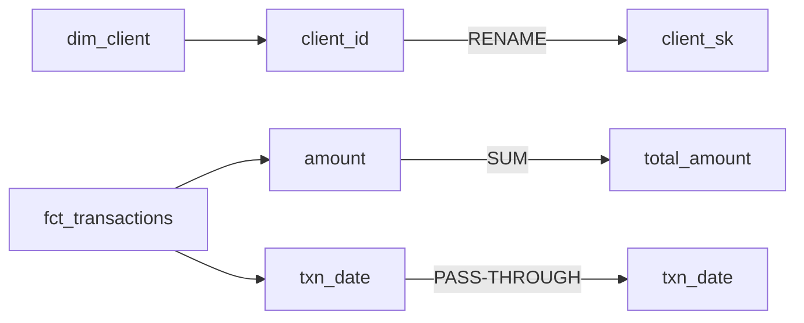

# Column Lineage

Trace column-level lineage for the SQL provided in $ARGUMENTS and produce a
lineage map, a Mermaid flowchart, and optionally OpenLineage JSON.

This is a **Phase 3 (Design) / Phase 8 (Evolve)** execution skill.  During Design
it documents how output columns derive from source columns, feeding the
`transformation-spec` and `data-contract`.  During Evolve it tells you which
output columns are affected when a source column changes — essential for impact
assessment before a schema migration.

## Lifecycle Context

| Phase 3 — Design | Phase 8 — Evolve |
|:-----------------|:-----------------|
| Documents lineage for a new transformation | Traces downstream impact of a planned source change |
| Feeds `transformation-spec`, `data-contract` | Feeds `downstream-impact-assessment` |

## Instructions

1. Read SQL from $ARGUMENTS.  If a file path is given, read the file with the
   Read tool.  If SQL is pasted inline, use it directly.

2. Call `trace_lineage()` from `skills/core/lineage.py`:

   ```python
   from skills.core.lineage import trace_lineage

   result = trace_lineage(sql)
   # result["ctes"]           — list of CTE names
   # result["from_tables"]    — [{table, alias}]
   # result["column_lineage"] — [{output_column, expression, transform, sources}]
   ```

   The function handles CTEs, JOINs, aliases, aggregations, and window functions.
   It works on a single SQL statement; for multi-statement pipelines, call it once
   per statement and stitch the results together.

3. Identify any columns with `transform == "AGGREGATION"` or `"WINDOW"` — these
   are computed columns that cannot be traced back to a single source and should
   be annotated as such.

4. For **Phase 8 Evolve** usage: the user will specify a source column being
   changed.  Filter `column_lineage` to find all output columns whose `sources`
   include that column, and flag them as impacted.

## Output Format

### Lineage Table

| Output Column | Transform | Source Table | Source Column | Notes |
|:--------------|:----------|:-------------|:--------------|:------|
| client_sk | PASS-THROUGH | dim_client | client_id | Renamed |
| total_amount | AGGREGATION | fct_transactions | amount | SUM — computed |
| txn_date | PASS-THROUGH | fct_transactions | txn_date | |
| load_flag | CONDITIONAL | — | status | CASE expression |

### Mermaid Flowchart



If the user requests OpenLineage JSON, produce a valid OpenLineage `RunEvent`
structure with `inputs` and `outputs` facets populated from the lineage result.

## Dependencies

- `skills/core/lineage.py` — `trace_lineage()`
- No platform client required — pure SQL parsing, no external calls
