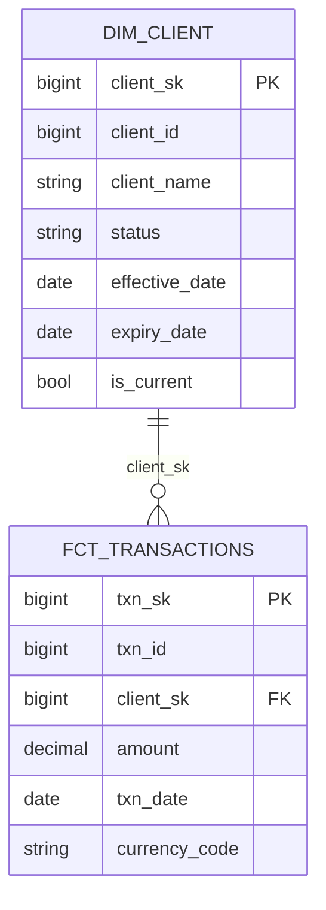

# Data Modeling

Design the conceptual data model for the product described in $ARGUMENTS. Produce
a Mermaid ER diagram and a Design Rationale explaining grain, SCD type, and
materialization decisions. Target schema (DDL) is owned by the data contract;
source-to-target field mappings are owned by dbt SQL.

This is a **Phase 3 (Design)** execution skill. Unlike the other execution skills
it **requires LLM judgment** — materialization strategy, SCD type, naming conventions,
and grain decisions cannot be derived mechanically. Use profiling output and
business requirements as inputs; produce conceptual artifacts that feed
`data-contract` (target schema authoring), `transformation-spec` (model topology),
and `architecture-diagram`.

## Lifecycle Context

| Before this skill | This skill | After this skill |
|:------------------|:-----------|:-----------------|
| `data-profiling` produced source quality metrics | Designs the conceptual model: grain, keys, SCD type, naming, ER diagram | `data-contract` declares target schema; `transformation-spec` lays out dbt model topology; dbt SQL implements transformations |

## Instructions

1. Read the exemplar model at `skills/data-modeling/references/exemplar.mmd` and
   the detailed modeling prompt at `skills/data-modeling/references/prompt.md`
   to understand the expected entity relationship patterns and conventions.

2. Gather inputs from $ARGUMENTS and conversation context:
   - Business requirements (what questions must the product answer)
   - Source tables (from `discover-data`) and their columns
   - Any existing SQL the user can provide
   - Constraints: SLA, query patterns, downstream tools (e.g. Tableau, Databricks SQL)

3. Read `skills/core/lineage.py` to understand the lineage interface.  If source
   SQL is provided in the inputs, call `trace_lineage()` to understand
   source-to-target column flow before designing the target:

   ```python
   from skills.core.lineage import trace_lineage
   lineage = trace_lineage(sql)
   # lineage["column_lineage"] gives you the per-column transform map
   ```

4. Apply judgment to decide:
   - **Grain** — what does one row represent?
   - **Materialization** — Delta table, view, or materialized view?
   - **SCD strategy** — Type 1 (overwrite) or Type 2 (history)?  Justify the choice.
   - **Naming** — follow `<domain>_<entity>_<layer>` convention (e.g. `client_positions_gold`).
   - **Keys** — surrogate vs natural; composite vs single.

5. Produce the conceptual output below: the ER diagram and a Design Rationale paragraph.

## Output Format

### ER Diagram (Mermaid)



### Design Rationale

Include a short **Design Rationale** paragraph explaining your grain, SCD, and
materialization choices.

> **Where field-level mappings live:** source-to-target column transformations
> are implemented in dbt SQL (Phase 4 Build, via `write-dbt-model`). Target
> schema (types, constraints, quality rules) is declared in the data contract
> (`contract/contract.yaml`, RFD 0009). This skill produces the conceptual
> model only; the contract and the dbt code carry the physical truth.

## Dependencies

- `skills/core/lineage.py` — `trace_lineage()` (used when source SQL is available)
- No platform client required — this skill is design-only
