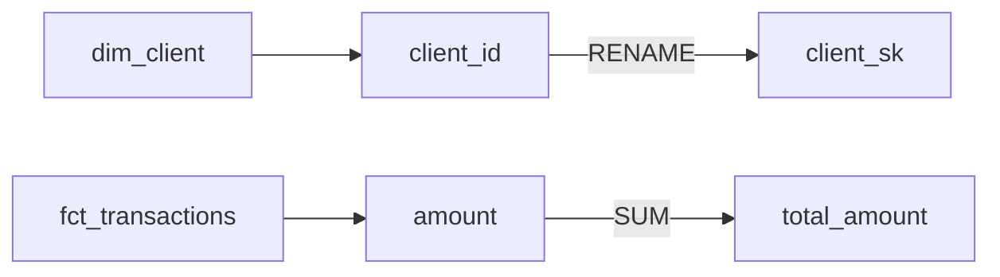

# Parse Lineage

Trace column-level lineage for the SQL provided in $ARGUMENTS and produce
a lineage table and Mermaid flowchart.

## Instructions

1. Read SQL from $ARGUMENTS:
   - If a file path is given, read the file.
   - If SQL is pasted inline, use it directly.
   - If neither is provided, ask the user for SQL or a file path.

2. Call `trace_lineage()` from `skills/core/lineage.py`:

   ```python
   from skills.core.lineage import trace_lineage

   result = trace_lineage(sql)
   # result["ctes"]           -- list of CTE names
   # result["from_tables"]    -- [{table, alias}]
   # result["column_lineage"] -- [{output_column, expression, transform, sources}]
   ```

   The function handles CTEs, JOINs, aliases, aggregations, and window
   functions. It works on a single SQL statement; for multi-statement
   pipelines, call it once per statement and stitch results together.

3. Annotate computed columns:
   - `transform == "AGGREGATION"` or `"WINDOW"` means the column cannot
     be traced to a single source. Mark these as computed.

4. For impact analysis: if the user specifies a source column being
   changed, filter `column_lineage` to find all output columns whose
   `sources` include that column and flag them as impacted.

## Output Format

### Lineage Table

| Output Column | Transform | Source Table | Source Column | Notes |
|:--------------|:----------|:-------------|:--------------|:------|
| client_sk | PASS-THROUGH | dim_client | client_id | Renamed |
| total_amount | AGGREGATION | fct_transactions | amount | SUM -- computed |
| txn_date | PASS-THROUGH | fct_transactions | txn_date | |

### Mermaid Flowchart



If the user requests OpenLineage JSON, produce a valid OpenLineage
`RunEvent` with `inputs` and `outputs` facets populated from the result.

## Error Handling

- **Invalid SQL** -- report the parse error and the approximate location
  in the SQL where parsing failed.
- **Unsupported syntax** -- if `trace_lineage()` cannot handle a
  construct (e.g. dynamic SQL, EXECUTE IMMEDIATE), note the limitation
  and provide a partial lineage for the portions it can parse.
- **Empty SQL** -- ask the user to provide SQL or a file path.

## Standalone Usage

```
/parse-lineage SELECT a.id, SUM(b.amount) FROM a JOIN b ON a.id = b.id GROUP BY a.id
/parse-lineage path/to/transform.sql
```

## Composition

Used by:
- `execution/column-lineage` (full lineage workflow)
- `orchestrators/dplc-design` (Phase 3 lineage documentation)

## Dependencies

- `skills/core/lineage.py` -- `trace_lineage()`
- No platform client required -- pure SQL parsing, no external calls
