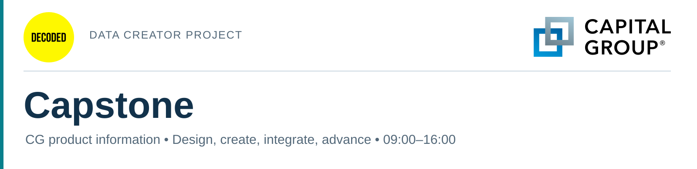
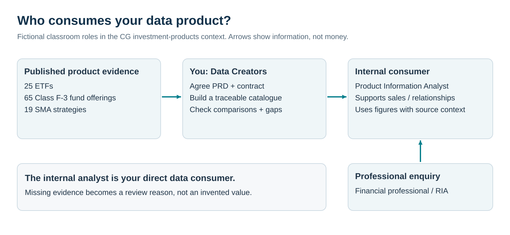
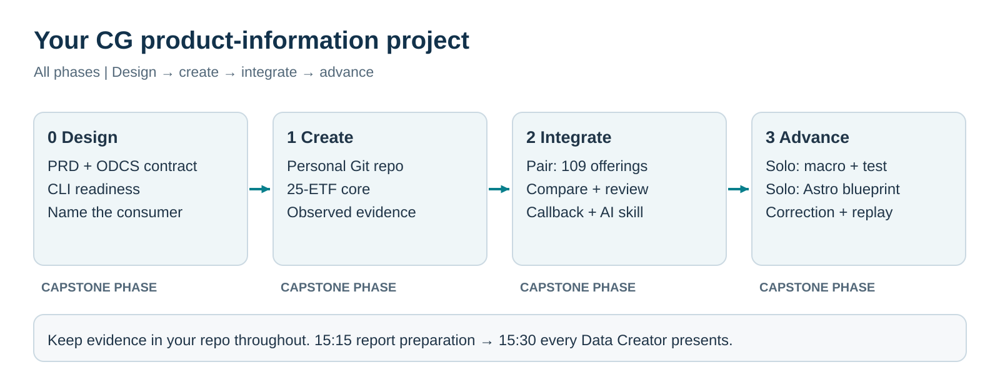
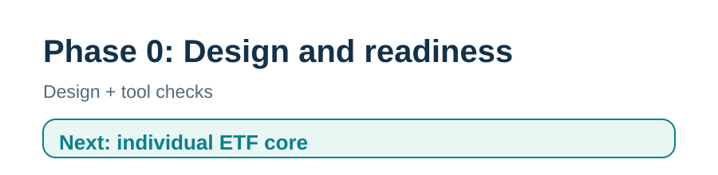
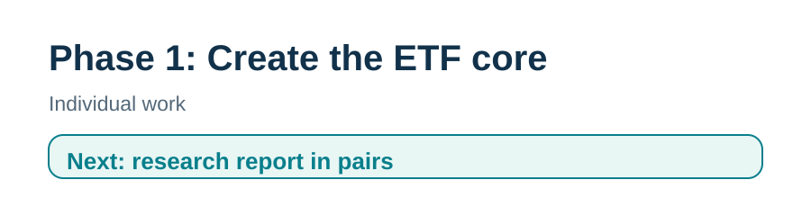
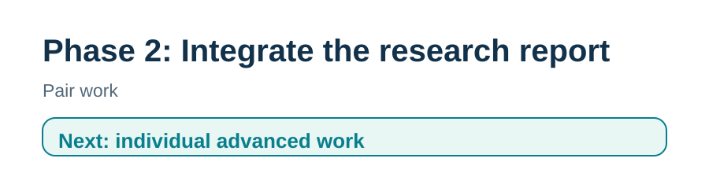
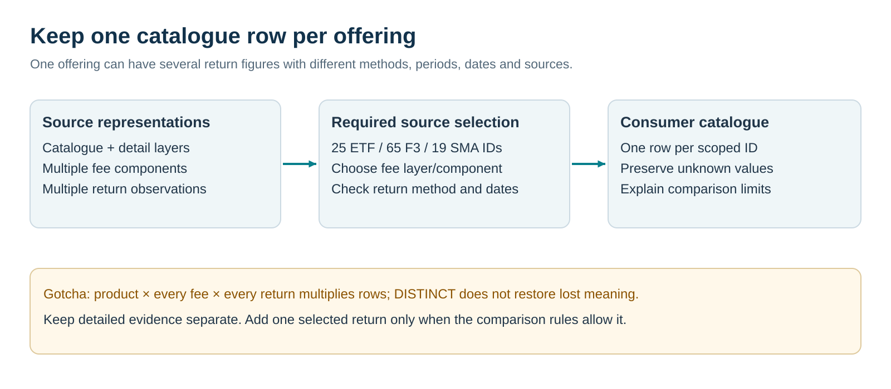
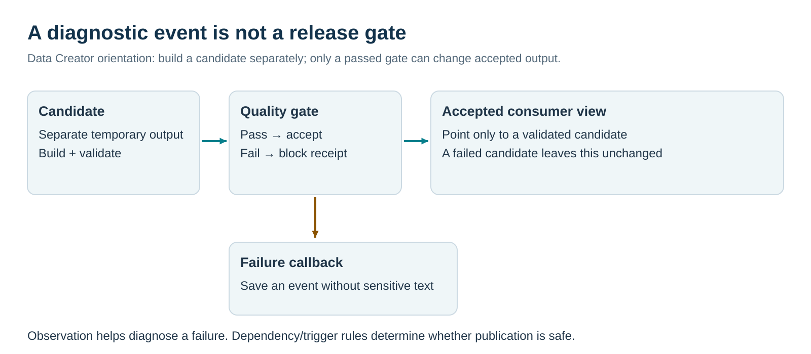
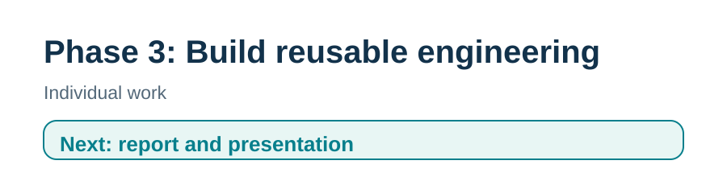

# CG product-information capstone

Your role: Data Creator. Your direct internal consumer: a fictional Product Information Analyst.

09:00–16:00; personal phase-1 submission; phase 2 in pairs; phase 3 individually; every Data Creator presents at 15:30

[Business brief](#your-business-brief) · [Glossary](docs/GLOSSARY.md) · [Phase 0](#phase-0-design-and-readiness-09000930) · [Phase 1](#phase-1-certified-data-creator-09301125) · [Phase 2](#phase-2-technical-practitioner-11251400) · [Phase 3](#phase-3-advanced-practitioner-14151515) · [Submission](#report-presentation-and-submission-15151600)

## Your business brief

Capital Group is an investment manager. Its public offerings include American Funds mutual funds, Capital Group ETFs and separately managed account (SMA) strategies. A share class is a particular way of owning a mutual fund, with its own identifiers and published costs. An exchange-traded fund (ETF) trades on an exchange. An SMA implements a strategy in a separately managed account arrangement, often through a sponsor platform. These are different offering types; their costs and published results are not automatically interchangeable.

Capital Group describes The Capital System™ as an investment approach combining distinct investment perspectives with a long-term focus. Today’s assignment concerns published product information: identities, expenses and performance context.

You are building a product-information data product for an internal analyst who supports sales and relationship colleagues answering financial-professional enquiries. The role name and requests below are fictional classroom scenarios, not statements about an actual CG department. The analyst needs a dependable research view: product identity, stated fund expenses, performance figures with their calculation method and reporting date, and reasons to seek more information.



[Open this diagram at full size](assets/learner/consumer-information-flow.svg)

The analyst's current information comes from different public representations. A catalogue and detail page may describe the same ETF. A mutual fund has multiple share classes. SMA performance is reported for a strategy composite, not a particular client's account. Reporting dates differ; some extracted fields are blank. A plausible-looking joined table can be wrong even when its SQL runs.

Your task is to make the scope, meaning of each row, measurement units and source evidence explicit; implement and check them; then show the analyst what can be answered and what remains uncertain.

An expense ratio measures annual fund operating expenses. A net expense ratio reflects applicable waivers or reimbursements; it does not necessarily include every cost paid by an investor. One basis point (bp, plural bps) is 0.01 percentage point, so 50 bps means 0.50%. NAV means net asset value per share. An annualized return summarizes a multi-year result as a compound annual rate.

An SMA composite reports a group of portfolios under a stated methodology. It is different from an individual client’s account return. These definitions matter when choosing what to combine in your report.

### Three enquiries to answer

| Enquiry | Internal consumer request | What your product supplies |
|---|---|---|
| E1 — Product lookup | “What does our snapshot say about CGGR's vehicle and published net expense ratio? Where did that answer come from?” | One product row with its expense ratio, source link, correct units and any missing reporting date |
| E2 — Research shortlist | “Which scoped fund offerings have a published net expense ratio no greater than 50 bps? Keep products with unknown costs visible.” | A result for the 50-bps filter and a list of products needing follow-up; this covers published fund expenses only |
| E3 — Performance evidence | “Show three-year annualized returns calculated from net asset value (NAV), reported at September 30, 2026. Explain which figures meet our comparison rules and which do not.” | Figures with matching calculation basis, time period and reporting date; products without those figures remain listed with a reason |

Later, the analyst asks an operational question: “Did a failed candidate leave the last accepted output available, and can we reconstruct earlier knowledge after a correction?” You answer using a checked release workflow and a synthetic temporal exercise.

### Your source scope

| Domain | Included records | Important source complication |
|---|---:|---|
| ETFs | 25 ETF identifiers from detailed product records | Repeated catalogue/detail representations; all selected fee reporting dates are unknown |
| Mutual funds | 65 Class F-3 identifiers from detailed mutual-fund records | Source class codes `F3` versus catalogue `F-3`; fund-class history/disclosures matter |
| SMAs | 19 strategy IDs | No quoted expense-ratio table; some fields in the extracted CSVs are blank; returns cover only 12 strategies |
| Combined catalogue | 109 unique scoped IDs | Different kinds of offerings, not 109 distinct underlying portfolios or every CG product worldwide |

Use the frozen files under `data/`; do not scrape during the event. Read [data conventions](data/README.md), [disclosures](data/DISCLOSURES.md) and [glossary](docs/GLOSSARY.md).

### Evidence boundaries

Use each figure within its published meaning. Gross/net expenses and gross/net strategy returns are different measures. A source reporting date differs from the download date. Matching return dates and periods does not establish equal objectives, risk or suitability. Blank CSV fields can reflect information the collector did not extract; check the source disclosure before drawing a broader conclusion.

Use three criterion states: `matches`, `does_not_match`, `needs_review`. Separately use comparison states: `comparable_on_declared_dimensions`, `not_comparable`, `needs_review`. Explain the reason; do not call a product “best,” “eligible” or “cheapest all-in.”

## Your project journey



[Open this diagram at full size](assets/learner/project-map.svg)

Phases 1 and 3 are individual. Phase 2 is done in pairs, with evidence of each person’s contribution. These event phases are separate from CG’s Data Product Lifecycle, explained in the glossary.

| Time | Work |
|---|---|
| 09:00–09:30 | Phase 0: readiness, Catalyst PRD and contract |
| 09:30–10:40 | Phase 1: personal repository and ETF core |
| 10:40–10:55 | Break |
| 10:55–11:25 | Continue individual observation, repair and phase-1 checkpoint |
| 11:25–12:00 | Phase 2: interfaces, ownership and skill draft |
| 12:00–12:45 | Lunch |
| 12:45–14:00 | Phase 2: integrate, compare, orchestrate and review |
| 14:00–14:15 | Break |
| 14:15–15:15 | Phase 3: temporal history, reusable SQL and workflow templates |
| 15:15–15:30 | Finish personal report and speaking notes |
| 15:30–16:00 | Presentations: every Data Creator speaks; final submission |

This capstone is for CG employees with working knowledge of SQL, Python, Git, dbt, Databricks, Airflow/Astro, Docker and mise. Prepare through the relevant Data Creators training, or join directly if you already have equivalent practical expertise. The starter examples, Concept sections and glossary clarify the project’s data conventions and advanced topics. Ask the instructor for the prepared recovery route when a tool fails.

Book your individual observation slot with the instructor. Slots begin during the 10:00–10:40 work block and continue after the break. Keep your report current throughout the day.

## How to use the project

Read each phase’s Concept, then follow the Challenge and How to check sections. Phase-1 hints help diagnose source and join problems. The practice ideas at the end are optional. Solutions and the assessment checker stay with the instructor.

Open your working product folder in VS Code and use Markdown: Open Preview to the Side. Edit checklist boxes in the Markdown source as you work. The phase maps show your place in the guide; assessment uses your submitted work and observation.

## Your working folder

Your working folder is `data_products/YOUR_PRODUCT_NAME` inside the training repository. Edit the models, contracts, reports and skills there, and create your personal Git repository there in phase 1. `challenges/` contains the starting template and instructions; it is not the folder to run the capstone from.

Your instructor supplies your product-folder name and `.capstone-workspace.json`, which records the assigned catalog, schema and table-name prefix. Keep that assignment local to your product. Do not guess a schema or reuse another learner’s settings.

Start in the training repository root: the folder containing `.mise.toml` and `data_products/`. The example path below is the course’s usual devcontainer mount; use the training-root path your instructor provides if it differs. Replace `YOUR_PRODUCT_NAME` and the three target placeholders with your assigned values. Run this setup in each new terminal:

```bash
# Course devcontainer: enter the training repository first.
cd /workspaces/edo-training-data-products
export CG_CLIENT_ROOT="$PWD"
export CG_PERSONAL_PRODUCT_ROOT="$CG_CLIENT_ROOT/data_products/YOUR_PRODUCT_NAME"
export CG_PRODUCT_ROOT="$CG_PERSONAL_PRODUCT_ROOT"

# Non-secret target values supplied by the instructor; do not guess them.
export DBT_CATALOG="YOUR_ASSIGNED_CATALOG"
export DBT_SCHEMA="YOUR_ASSIGNED_SCHEMA"
export DC_RELATION_PREFIX="YOUR_ASSIGNED_PREFIX"
cd "$CG_PRODUCT_ROOT"
pwd

# Verify the working folder, exact project/profile files and assigned target.
python runtime/check_workspace.py
```

Changing directory alone does not switch the dbt project: the helper also reads `CG_PRODUCT_ROOT`. Whenever you change personal/pair/fault products, update that variable and the assigned target values, then run the workspace check. Credentials remain managed by the course setup; these exports do not replace authentication.

The check must display your product path, `dbt_project.yml`, `profiles.yml`, target `training`, assigned catalog/schema and prefix. It blocks a challenge-template path, the wrong working directory, a missing assignment or conflicting target settings. Save the result with your readiness evidence.

There are two command locations:

| Command | Where it runs |
|---|---|
| Git, report edits, readiness checks, contract check and learner dbt commands | Your current product: `$CG_PRODUCT_ROOT` |
| Course setup/token refresh and Astro commands | Training repository root: `$CG_CLIENT_ROOT` |

Use the supplied dbt helper below. It checks the assignment and passes absolute project/profile paths and the target explicitly. Before seed/build/run/test, it compiles the enabled outputs and rejects catalog, schema or prefix overrides. Avoid bare `dbt` or remembered v1 `challenge:dbt` commands that may select another project. Course authentication setup comes from the instructor; if the check reports a mismatch, restore the assigned settings before running a build.

The helper is supplied support, not an assessed model. Your instructor prepares the shared Astro runtime before the event.

Use [the evidence checklist](docs/EVIDENCE.md) for required records and filenames. Save evidence under `evidence/phase-0/` through `evidence/phase-3/`; link those files from your report and submission. Equivalent filenames are fine when the links identify what each file proves.

## Phase 0: Design and readiness (09:00–09:30)



| Inputs | You author | Outputs | Exit condition |
|---|---|---|---|
| Enquiries, frozen source schema, prepared tools | Reviewed Catalyst design drafts | PRD, ODCS contract, STTM, decision notes | You can explain the consumer promise and source limitations |

### Concept

The product requirements document (PRD) explains the consumer’s problem and needed outcome. The data contract states which records you supply, what each row and column means, and the rules for quality, access and change. Write it using the Open Data Contract Standard (ODCS). The source-to-target mapping (STTM) records how source fields become output fields. Checking YAML syntax only shows that the file can be read; you must also check its promises against the data.

Each tool has a different job. mise selects the prepared environment and named tasks. Docker runs containers. Astro manages Airflow, which schedules and runs workflow tasks. dbt builds SQL models and runs data tests. Databricks executes that SQL in the assigned warehouse. A command-line interface (CLI) runs from your terminal; successful login there does not prove an Airflow worker can connect.

### Challenge

Spend approximately eight minutes checking the environment the instructor prepared. Then use Catalyst to draft and personally review:

1. `docs/PRD.md`: internal consumer, E1/E2/E3, scope, exclusions, acceptance and ownership.
2. `contracts/product-research.odcs.yaml`: offering grain/key, units/nulls, quality expectations and consumer responsibilities. The instructor supplies the validator and specifies which ODCS version to use.
3. `docs/STTM.csv`: source-to-target identity, fee and date mappings; extend it in phase 2.
4. `docs/design-decisions.md`: one generated suggestion you checked/corrected, plus an unresolved assumption. Use `rfd/0001/README.md` to record your source-selection decision and its consequences. RFD means Request for Discussion; the template has Context, Decision and Consequences sections.

Draft only the ETF fields needed in phase 1; identify the phase-2 extension in the PRD. Review one unsupported Catalyst suggestion and record your correction. The data does not establish update commitments or investor eligibility.

<details>
<summary>Hint: ask Catalyst to distinguish evidence from assumptions</summary>

Supply the actual source field names, glossary and consumer enquiries. Ask it to identify what cannot be derived. Check whether it has confused reporting date, retrieval time and business-effective time, or treated SMA composite performance as a client fee.

</details>

### How to check

```bash
# Your product root in the course devcontainer.
cd "$CG_PRODUCT_ROOT"
python runtime/check_workspace.py

# Read-only tool/version diagnostics.
mise --version
docker version
astro version
dbt --version
databricks --version

# Public environment checks: local does not establish connected execution.
python verify-starter.py --mode local --output evidence/starter-local.json
python verify-starter.py --mode connected --output evidence/starter-connected.json
```

Success: the requested local and connected checks pass. The connected check requires a new warehouse build and actual Airflow execution with a matching nonce (unique check marker) and saved run receipt. `files` mode checks only the preparation copy. Record missing prerequisites as blockers.

If readiness fails, save the checker output, tell the instructor which check failed and continue the design drafts while they restore the prepared environment. Start database work once access is confirmed.


### Ready to create?

- [ ] Tools/environment checks are confirmed or a named blocker is recorded.
- [ ] The internal consumer and three enquiries are explicit.
- [ ] I checked the generated PRD, ODCS and STTM against the source data and consumer requirements.
- [ ] Grain, expense units, missing values and source dates are defined.
- [ ] Drafts and Catalyst correction notes are saved locally.

## Phase 1: Certified data creator (09:30–11:25)



| Inputs | You author | Outputs | Evidence |
|---|---|---|---|
| Product and fee CSV inputs; supplied SQL that converts fee strings to numbers and dates | Personal Git repo; two SQL models; design completion | One traceable row for every selected ETF | Code commit, build/check results, controlled failure/repair and individual observation |

### Concept

Grain states what one row represents. Population states which keys belong. Both matter: a unique table containing only one ETF is not a complete 25-ETF catalogue.

A dbt seed is a CSV loaded into a database table; a model is SQL that produces a table or view. Here “source layer” means a website representation, such as catalogue or detailed product records. Provenance means keeping the source identifiers and URLs so someone can trace a value.

Select a declared representation before joining. A product appears in catalogue and detail layers; `DISTINCT` or an arbitrary winner can hide the wrong source choice. Fees have components: gross/net expenses are alternatives, not amounts to add together.

The source stores percentages in percentage points, so conversion to bps multiplies by 100. Keep reporting, retrieval and load dates separate; unknown reporting dates remain null.

### Challenge

First create your personal repository in your working product under `data_products/`. Never submit only a team repo or initialize Git in the supplied course root.

```bash
# Phase 1 is personal work. Verify the folder before initializing Git.
export CG_PRODUCT_ROOT="$CG_PERSONAL_PRODUCT_ROOT"
cd "$CG_PRODUCT_ROOT"
python runtime/check_workspace.py
# The shared Airflow container takes ownership of product files; tell Git to trust this folder.
git config --global --add safe.directory "$CG_PRODUCT_ROOT"
git init -b main
git add .
git commit -m "Start CG capstone and record reviewed design"
```

Create a repository on the approved Git host using the Git-host instructions supplied by your instructor. Keep `.env`, tokens and local runtime state out of commits; the starter's ignore rules cover them. If Git later reports "dubious ownership" in a pair product, run the same `safe.directory` command for that folder.

Author only these two core models:

- `models/phase1/src_cg__product.sql`: select the declared ETF offering representation; preserve identifiers and provenance.
- `models/phase1/dom_cg__product_cost.sql`: add the matching net expense ratio to each selected product row; expose `net_expense_pct`, `net_expense_bps`, `fee_as_of_date`, product/fee source IDs and URLs.

The supplied `stg_cg__fee.sql` model converts raw fee values to SQL numbers and dates. The supplied runtime handles task execution. You choose the source records and fee component required by your contract, then join by product ID.

Acceptance: retain all 25 required ETF IDs, each once. Check each ETF’s fee and unit conversion against its source row. Keep unknown dates null and leave unsupported class/currency fields blank. Reject conflicting selected fee records instead of choosing one arbitrarily. Derive values from the source rows so a valid changed fee/date propagates into the output; do not hard-code snapshot values. Show the product source and fee source separately. The supplied checks cover ETF membership and selected fee input. Add a check when your transformation introduces another possible error; record which rule it checks.

<details>
<summary>Hint 1: which representation belongs?</summary>

For one product ID, inspect distinct source-layer labels and row counts. Which representation does the contract select? Can you explain why the other rows remain in the input CSV loaded by dbt as a seed?

</details>

<details>
<summary>Hint 2: are your units and dates answering the right question?</summary>

Compare the source fee field's unit with the consumer unit. Work one conversion by hand. For a blank fee date, ask whether any supplied field establishes its reporting date; a retrieval timestamp answers a different question.

</details>

<details>
<summary>Hint 3: why did a join change the number of offerings?</summary>

Compare product IDs before/after enrichment. Count selected fee rows for one ID. Which extra source layer or component could multiply the row? Diagnose that relationship before introducing deduplication.

</details>

### How to check

```bash
# Your product root: verify location/target, then commit authored code.
cd "$CG_PRODUCT_ROOT"
python runtime/check_workspace.py
git add models tests docs contracts rfd
git commit -m "Implement phase-1 ETF core"

# Load inputs, then build and test only the phase-1 models.
python "$CG_PRODUCT_ROOT/runtime/dbt_command.py" seed
python "$CG_PRODUCT_ROOT/runtime/dbt_command.py" build \
  --select tag:phase1 --vars '{"enable_phase_1": true}'

# Inspect your own derived ETF output in the warehouse, retaining the code/run identity.
python "$CG_PRODUCT_ROOT/runtime/dbt_command.py" show \
  --select dom_cg__product_cost --vars '{"enable_phase_1": true}' --limit 5
```

Save the tested commit identifier, dbt run/test results, a full ID comparison and one traced fee calculation. The five-row preview above is an inspection aid; it cannot establish completeness. Ask the instructor for the disposable conflicting-fee product and its assignment. Switch `CG_PRODUCT_ROOT`, directory and target values together before running its checks, and record the failing rule and diagnostic rows. Then restore `CG_PRODUCT_ROOT="$CG_PERSONAL_PRODUCT_ROOT"`, your personal target values and working directory before rebuilding the unchanged baseline. See the evidence checklist for the before/failure/after record.

When code changes after a run, commit it and rerun the affected checks. Evidence-only commits can refer to the already tested code commit.

### Individual observation

Show the assessor your key trace, unit/date reasoning, actual run output and intended failure/repair. Explain one limitation and a small change if asked. Catalyst assistance is allowed, but you must explain and modify your own work.

After observation, finalize evidence and tag `phase-1-submitted`. The instructor records the commit identifier (SHA) that the tag points to outside your repository. Your phase-1 result is recorded independently of later team completion.


### Ready for integration?

- [ ] My own repo contains the reviewed design and authored core.
- [ ] Exact ETF membership, units, null dates and provenance are checked.
- [ ] I can explain the controlled input failure and restored baseline.
- [ ] Code/run evidence and assessor observation are recorded.
- [ ] I have a source-backed finding and hard/easy note in my report.
- [ ] The phase-1 checkpoint is committed/tagged.

## Phase 2: Technical practitioner (11:25–14:00)



| Inputs | You author | Outputs | Exit condition |
|---|---|---|---|
| Reviewed ETF core and all three source domains | Domain models, comparison rules, release workflow, failure callback and personal AI skill | 109-row research report, accepted release and failure evidence | Both partners can explain their contributions; a failed candidate leaves the accepted report intact |

### Concept

Start with a catalogue containing one row per product or strategy. Fee and return tables can contain several rows for that same ID. To keep one catalogue row per ID, select one observation using explicit rules, or retain the observations in a separate table. Joining all observations directly can multiply catalogue rows; this is called join fan-out.

Before comparing returns, check their calculation basis (such as NAV), kind (annualized or cumulative), horizon (such as three years), reporting date and frequency labels. It is not a suitability judgment. `monthEnd` and `monthly` can be mapped explicitly; an undefined `source_display` basis cannot simply become NAV. Values such as `9.5` and `9.50` are numerically equal; their formatting alone is not a conflict. Select a return only when exactly one observation meets the declared rules. If several qualify, keep the product, leave the selected value null and record ambiguity as `needs_review`.



[Open this diagram at full size](assets/learner/offering-grain.svg)

### Challenge: parallel responsibilities

Agree the column names, types and meaning of one output row by 11:45. Work with one partner and divide responsibilities as follows:

| Owner | Domain contribution | Additional responsibility |
|---|---|---|
| Partner A | Extend the ETF core and select the 65 F-3 offerings, expenses and qualified returns | Comparison/quality rules; dbt invocation and worker-path checks |
| Partner B | Retain the 19 SMA strategies and their separately contextualized returns; integrate the report | Failure callback; release DAG and acceptance gate |

Both partners review the other’s work, run the full ID/value checks and agree the contract changes. Each person develops and exercises their own AI skill.

Each owner can start from the supplied source CSVs. The integration owner can write acceptance queries and review the agreed schema before the domain models are ready. If temporary sample tables help, create and label them as test-only, then replace them with reviewed models before the integrated run. Record each person’s commits and reviews in their personal repository.

Complete `models/phase2/dom_cg__etf.sql`, `dom_cg__f3.sql`, `dom_cg__sma.sql` and `rpt_cg__product_research.sql`. Add a separate table of return observations if useful. Keep one report row per product or strategy. Include the agreed fields, separate source references for product/fee/return data, an explanation of what the cost covers, and the selected return’s basis, kind, horizon and date. Include the cost-filter result, comparison result and reasons.

Acceptance: all 109 IDs retained; missing SMA costs remain review cases, not zero; missing/ambiguous selected returns stay visible; source currency/attributes are not invented; no unrestricted fund-NAV versus SMA-composite ranking. Demonstrate at least two different reasons to reject a comparison, such as mismatched dates and incompatible return bases. In addition to the supplied duplicate-row check, check the full set of IDs, values and comparison rules.

### Challenge: custom orchestration and callback

Your release DAG ID is your product folder name followed by `__product_release`, for example `cg_public_products_alex__product_release`. In code, `dag_id('product_release')` from `runtime.product` builds it for you. Replace `YOUR_RELEASE_DAG_ID` in the commands below with that ID.

In `dags/cg_product_release.py`, connect the supplied tasks in this order: load, build, quality, then receipt. This Airflow workflow is called a DAG (directed acyclic graph). Build new tables under a separate candidate name prefix so they cannot overwrite the accepted report. The receipt task updates the accepted view only after quality checks pass. Use a prefix that starts with your assigned prefix, such as `assignment()['relation_prefix'] + '_release'`; the worker refuses any other prefix. Keep the file's opening import block and add `REQUIRED_TAGS` to the DAG's tags: every product shares the same Airflow, which rejects DAGs without those tags.

Develop `include/failure_callback.py`. When a task actually fails during execution, the callback must save a failure event containing workflow, run, task, attempt and input-batch identifiers, plus an error category. Remove secrets and sensitive text before saving it. Write one saved event per task attempt; repeated delivery of the same event must not create another file. Attach the callback to the workflow, and log any failure to save the event. Use the supplied classroom event writer (the sink); no external notification is required.



[Open this diagram at full size](assets/learner/release-gate.svg)

> Gotcha — callbacks and dependencies do different jobs
>
> Marking a task failed in the UI is not a worker-execution test of the callback. Logging a failure does not block a permissive release task. A failed candidate must not already have overwritten the accepted report.

### Challenge: your personal AI skill

Create `skills/<your-skill>/SKILL.md` for a specific task you actually performed: contract review, comparison review, failure diagnosis or temporal query review. Define purpose/trigger, inputs, workflow, output and limitations. Invoke it through the prepared Catalyst route, record a sanitized result and make a correction/revision. Record an actual use of the skill; saving its instructions alone does not complete the task.

### How to check

<details>
<summary>Commands: switch to the pair product, build and run the release</summary>

```bash
# Phase 2: use the product declared for this pair, even if it is one partner's product.
# Replace the folder and target placeholders with that product's assignment.
export CG_PRODUCT_ROOT="$CG_CLIENT_ROOT/data_products/YOUR_PAIR_PRODUCT_NAME"
export DBT_CATALOG="YOUR_PAIR_ASSIGNED_CATALOG"
export DBT_SCHEMA="YOUR_PAIR_ASSIGNED_SCHEMA"
export DC_RELATION_PREFIX="YOUR_PAIR_ASSIGNED_PREFIX"
cd "$CG_PRODUCT_ROOT"
pwd
python runtime/check_workspace.py
# Commit the integrated code, then load its inputs.
# The helper enforces the instructor-assigned pair prefix and profile.
python "$CG_PRODUCT_ROOT/runtime/dbt_command.py" seed

# Build and test the phase-1 and phase-2 models.
python "$CG_PRODUCT_ROOT/runtime/dbt_command.py" build \
  --select tag:phase1 tag:phase2 \
  --vars '{"enable_phase_1": true, "enable_phase_2": true}'

# Pin this product's code for the Airflow worker. Rerun after every code change, once no run is active.
python runtime/stage_astro.py

# Training repository root: check for import errors and run your owned DAG.
cd "$CG_CLIENT_ROOT"
astro dev run dags list-import-errors
astro dev run dags unpause YOUR_RELEASE_DAG_ID
astro dev run dags trigger YOUR_RELEASE_DAG_ID

# Return to the project root for evidence and later commands.
cd "$CG_PRODUCT_ROOT"
```

</details>

Wait for the baseline run to finish and record its task states and release receipt. With the instructor, run the controlled fault, restore the baseline and retry the repaired release. Do not edit code or inputs while a run is active. Save the four run IDs, callback event, blocked receipt-task state and an ID/value comparison showing that failure left the accepted report unchanged. The repaired retry must preserve the same release identity. Review domain changes, update the contract/STTM and record the tested integration commit.

<details>
<summary>Hint: where does the worker see your files and credentials?</summary>

Your terminal and the Airflow worker see the same product through different paths. Confirm that the worker resolves your product under `/usr/local/airflow/dags/`, uses the recorded code commit and has its own Databricks connection. Compare the unique marker in the smoke-run receipt with your input. A successful terminal connection alone does not establish worker access.

</details>


### Ready for advanced work?

- [ ] My contribution has been reviewed, and its commits show what I authored.
- [ ] The complete key set and per-key expenses are reconciled.
- [ ] Selected evidence preserves reporting context and unsupported cases.
- [ ] Connected workflow, genuine callback failure and blocked receipt are demonstrated.
- [ ] The previous accepted result survives the failed candidate.
- [ ] My AI skill was invoked and revised; report evidence is updated.

## Phase 3: Advanced practitioner (14:15–15:15)



| Inputs | You author | Outputs | Exit condition |
|---|---|---|---|
| Reviewed pair baseline and synthetic events/enquiries | Temporal loader, reusable macro and test, historical reports and workflow factory | Two configured workflows and reproducible historical answers | Corrections preserve prior knowledge; retries add no versions; both workflows pass failure and repair checks |

### Concept

A bitemporal fact has two clocks: when it applies in the business and when the system knew that version. A late correction can change today's interpretation of an earlier period without erasing what a prior report could have known. A retry of an identified input is not another correction.

Intervals are half-open: include the start, exclude the end; null ends remain open. For a given product/metric, two versions are invalid only if they overlap simultaneously in business and knowledge time. Old knowledge can legitimately cover the same business dates as a corrected version.

The training history uses `training_fee_bps`, a clearly synthetic metric anchored to a real product ID. Its effective dates and values are not actual CG fee history. The real fee's unknown effective date stays unknown. Fixture knowledge time is separate from your actual load/run time.

A dbt macro generates reusable SQL from arguments. A generic test uses SQL to return rows that violate a rule. An Astro blueprint here is a Python function that creates a workflow from configuration. The loader processes input events and updates the stored history; its file-writing support is supplied.

For the historical report, ask two questions together: “Which business date do I want?” and “What had the system learned by my knowledge cutoff?” A later correction can change the first answer without changing what was known earlier. Your test cases must cover both clocks.

### Challenge: both advanced components, individually

Return to your personal `data_products/` folder, reset `CG_PRODUCT_ROOT` to that path and check its assignment. Work independently in its Git repository. Start from the reviewed phase-2 integration commit, record that baseline and complete both components below yourself. Use your own output prefixes and workflow IDs. No phase-3 component depends on another person’s work.

| Component | You develop | Evidence of depth |
|---|---|---|
| M — dbt macro + generic test | A dbt macro that generates SQL for both clocks and accepts column names as arguments; a reusable history-validation test; correction/retry logic in `runtime/temporal_loader.py` | Use the macro in two models with different column names. Validate arguments, interval endpoints and null ends. Reject invalid intervals and versions that overlap in both clocks. |
| O — Astro blueprint | `include/blueprint.py`: reusable configuration-driven DAG factory; two independent DAG/config instances; callback and replay wiring | Create two workflows with different IDs and output prefixes. Reject invalid configuration. Check task dependencies, then demonstrate failure, repair and replay through actual worker runs. |

Here “blueprint” means the reusable workflow template you author. Use the supplied task interfaces for this exercise. A helper that multiplies fees by 100 or a copied DAG with another ID is insufficient advanced work.

You author the loader correction/retry logic, temporal macro, generic test and historical reports, then the reusable factory and its two configurations. Integrate and run all of them in your personal project. Record which code you carried forward from the pair baseline and which advanced changes you authored. If processing fails, leave the input history unchanged. Identify retries using the event’s statement fields, excluding the attempt timestamp: another attempt at the same statement must not create a new version. Retain earlier knowledge and apply a correction only to the dates it specifies.

Use the synthetic events/enquiries in `data/`. Derive expected answers independently; retain a no-match enquiry rather than losing it through an inner join. Check the start and end dates exactly. Reject versions that overlap in both clocks. Confirm that retrying an event leaves the stored fact history unchanged. Reject an event ID reused with different statement fields.

### How to check

In `include/blueprint-configs.json`, give both `dag_id` values your product folder name followed by `__`, for example `cg_public_products_alex__history_a`. Give both `relation_prefix` values your assigned prefix followed by `_`. Airflow loads the blueprint DAGs only once both IDs start with your folder name. Replace `YOUR_PERSONAL_DAG_A` and `YOUR_PERSONAL_DAG_B` below with those IDs.

<details>
<summary>Commands: return to your personal product and run both workflows</summary>

```bash
# Phase 3: return to your personal product and restore its own target values.
export CG_PRODUCT_ROOT="$CG_PERSONAL_PRODUCT_ROOT"
export DBT_CATALOG="YOUR_PERSONAL_ASSIGNED_CATALOG"
export DBT_SCHEMA="YOUR_PERSONAL_ASSIGNED_SCHEMA"
export DC_RELATION_PREFIX="YOUR_PERSONAL_ASSIGNED_PREFIX"
cd "$CG_PRODUCT_ROOT"
pwd
python runtime/check_workspace.py
# Prepare your authored code; the loader task creates the generated seed in its own work area.
# Pin the code for the worker after setting both blueprint configurations.
python runtime/stage_astro.py

# Training repository root: check imports and trigger your owned DAGs.
cd "$CG_CLIENT_ROOT"
astro dev run dags list-import-errors
astro dev run dags unpause YOUR_PERSONAL_DAG_A
astro dev run dags unpause YOUR_PERSONAL_DAG_B
astro dev run dags trigger YOUR_PERSONAL_DAG_A
astro dev run dags trigger YOUR_PERSONAL_DAG_B

# Return to the project root after triggering the workflows.
cd "$CG_PRODUCT_ROOT"
```

</details>

For each workflow, wait for completion and save its run ID, output prefix and task states. Export the seven historical enquiry results, test results and replay comparison. Include the macro’s compiled SQL from both model calls and the two workflow configurations/task graphs. Show one deliberately introduced regression and its repair. The evidence checklist separates local checks from warehouse/worker results.


### Ready to report?

- [ ] My personal phase-3 commit identifies my work on both advanced components and the phase-2 baseline I reused.
- [ ] Reusable macro/test and blueprint behavior is exercised, not merely present.
- [ ] Corrections, retries, boundaries and no-match behavior are checked.
- [ ] I can explain both clocks and why this is synthetic history.
- [ ] A controlled regression/repair and connected evidence are recorded—or marked incomplete.
- [ ] I updated the report without taking time from the 15:30 presentation.

## Report, presentation and submission (15:15–16:00)

Finish in your personal product. If you opened a new terminal, repeat the working-folder setup first. Before editing the final report or committing submission evidence:

```bash
export CG_PRODUCT_ROOT="$CG_PERSONAL_PRODUCT_ROOT"
cd "$CG_PRODUCT_ROOT"
python runtime/check_workspace.py
```


Finish the prompts in `reports/REPORT.md` and link the evidence you saved in each phase. Include at least two findings from the real sources, your contribution, what was hard/easy, an AI correction and any incomplete work. Label synthetic temporal results separately.

At 15:30, every Data Creator speaks for roughly one minute inside their pair’s two-minute slot: my contribution, one finding, hard/easy reflection, and evidence or next step. A shared screen is fine; each person presents their own phase-3 work and submits a personal report and speaking notes. Your instructor provides the pair running order.

Finalize `SUBMISSION.md`, commit and tag `capstone-submitted`. Include the tested code commit identifiers (SHAs) and exact phase-2 pair integration commit and personal phase-3 commit, report, skill invocation and run evidence. The instructor records the final tag’s resolved commit outside your repository.

- [ ] My repo and assessed code/evidence references are complete.
- [ ] My report distinguishes findings, limitations and incomplete work.
- [ ] My skill invocation/revision and personal contribution are inspectable.
- [ ] I have speaking notes and present at 15:30.
- [ ] No tokens/private runtime configuration are committed.

Stop at 16:00 and mark unfinished work in your submission. The instructor records individual attainment from the evidence and observation; classroom submission does not publish a production data product.

## Optional practice

These are extra practice ideas, not additional submission requirements. Attempt them only after the phase’s required checks are recorded; keep the 15:15 report and 15:30 presentation times.

- Phase 0: Ask what would change if the consumer required a current eligibility decision instead of snapshot research. Record which extra evidence would be needed, without implementing it today.
- Phase 1: Predict the effect of a valid changed fee/date for one ETF. Explain how a source-driven model differs from hard-coding the example amount. Use a disposable fixture only if time permits.
- Phase 2: After the two required rejection cases, try a third comparison with a different reason. Explain whether the gap is missing evidence, incompatible basis/date/horizon or ambiguity.
- Phase 3: In a disposable copy, rename another column in the second model that calls your macro, while keeping the calculation the same. Explain why a reusable macro handles that variation and a hard-coded SQL condition might not. If time remains, refine your AI skill to review a temporal boundary case, then verify its reasoning independently.
