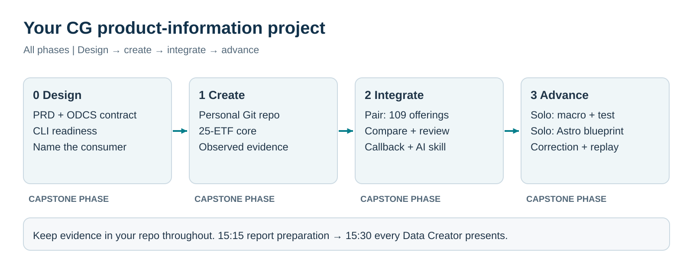

# Capital Group product-information capstone

09:00–16:00 · A practical data-engineering project for individual and paired work.

## Who this is for

This capstone is for CG employees with working knowledge of SQL, Python, Git, dbt, Databricks, Airflow/Astro, Docker and mise. You can prepare through the relevant Data Creators training or join directly if you already have equivalent practical expertise.

The day applies those skills to a complete data product. The starter examples, Concept explanations and glossary clarify the project’s data conventions and advanced topics. Access and the shared environment are prepared before the event so the day can focus on building and investigating.

Your role is a Data Creator: you define, build and check a data product that someone else can use. You will show both that the product works and that you understand its limitations.

## The business problem

Capital Group (CG) is an investment manager. Its public product information describes exchange-traded funds (ETFs), mutual funds and separately managed account (SMA) strategies. Their identities, expenses and performance figures appear in different formats and do not always mean the same thing.

Your internal consumer is a fictional Product Information Analyst who supports sales and relationship colleagues. The analyst needs dependable answers to three enquiries:

- Product lookup: identify an offering, find its published expenses and trace the answer to the source.
- Cost shortlist: find fund offerings with net expenses of 50 basis points (0.50%) or less, keeping unknown costs visible for follow-up.
- Performance research: show three-year annualized returns calculated from net asset value (NAV), reported at September 30, 2026, and explain which figures meet the comparison rules.

The supplied snapshot contains 25 ETFs, 65 Class F-3 mutual-fund offerings and 19 SMA strategies: 109 identifiers. A share class is a way of owning a mutual fund with its own identifiers and published costs. An SMA strategy is not the same thing as an individual client's account.

This is a scoped research product, not a catalogue of every CG offering or an investment recommendation. Later historical corrections use clearly labeled synthetic data; they are not actual CG fee history.

## Tools and what you will build

| Tools | Your work |
|---|---|
| Catalyst | Draft and review a product requirements document, data contract and field mappings. Create an AI skill for a task you perform, then test and revise its instructions. |
| Git | Create your own repository, save meaningful changes, identify tested versions and record your contribution to paired work. |
| mise and Docker | Check the supplied tools and container environment. Run a small working example before developing the product. |
| dbt and Databricks | Use dbt to build and test SQL models in the Databricks warehouse. Later, develop a reusable SQL-generating macro and a generic data test. |
| Airflow and Astronomer/Astro | Use Airflow to run the workflow, Astro to manage the local environment, and real worker runs to test failure handling. Build a reusable workflow factory. |

## Phase 0: Design and readiness — 09:00–09:30

Start with the analyst's questions and decide what your product can promise. A product requirements document (PRD) describes the consumer's needs. A data contract defines the records, fields and quality rules you supply. A source-to-target mapping explains how input fields become output fields.

You will:

- Check tool availability, warehouse access and the supplied smoke example: a minimal build and workflow that prove the environment can execute work.
- Use Catalyst to draft the PRD, data contract and mappings for the initial ETF scope, with the later expansion identified.
- Review the drafts against the supplied data and record one correction to an unsupported suggestion.

The challenge is deciding what the evidence supports. A download date does not establish a figure's reporting date; a generated statement about update frequency or investor eligibility still needs evidence.

Completion evidence: reviewed design files, a recorded assumption or open question, and successful readiness checks. A login in your terminal alone does not prove the Airflow worker can connect.

## Phase 1: Certified data creator — 09:30–11:25, individual

Create your personal Git repository in your assigned working product. Build the ETF core with dbt and run it in Databricks. This phase establishes your individual ability to turn source records into a checked, explainable output.

You will:

- Select the intended product and expense records and author the two unfinished SQL models.
- Produce one output row per ETF, preserve source references and convert percentage-point expenses to basis points.
- Check the complete set of 25 ETF identifiers, values and missing reporting dates.
- Run a supplied conflicting-input case, explain why it should fail, then restore and recheck the baseline.

The source contains repeated representations and alternative fee components. Removing duplicates without understanding their meaning can hide a bad selection. A unique result is not enough if products are missing or expenses use the wrong units.

Completion evidence: your repository, tested code version, source trace, baseline/failure/repair results and an individual explanation to the assessor. Phase-1 attainment is recorded separately from later paired work.

## Phase 2: Technical practitioner — 11:25–14:00, pairs

Work with one partner to extend the ETF core into a research report covering all 109 identifiers. Divide domain and workflow responsibilities, agree the output fields, then review and integrate each other's contributions.

You will:

- Combine ETF, Class F-3 and SMA information while keeping one report row per offering or strategy.
- Apply the expense filter and return-comparison rules; retain missing or ambiguous evidence with an explanation.
- Build an Airflow workflow that loads inputs, builds a candidate, checks quality and accepts a valid result.
- Write a failure callback that records useful diagnostics without exposing secrets or creating duplicate events.
- Demonstrate a genuine worker failure, a blocked acceptance step, repair and retry. The last accepted report must survive the failed candidate.
- Each create, invoke and revise a personal AI skill, such as comparison review or failure diagnosis.

The challenges combine data meaning and operational behavior. Joining every fee and return observation can multiply rows. Missing SMA costs must not become zero. Logging a failure does not itself prevent unsafe acceptance of an output.

Completion evidence: the complete research report, reviewed contract changes, attributed contributions, actual workflow runs and failure records, and each person's skill-use evidence.

## Phase 3: Advanced practitioner — 14:15–15:15, individual

Return to your personal repository with the reviewed integration baseline. Every Data Creator completes both advanced components independently; this phase does not require another person's implementation or availability.

You will develop:

- A temporal loader that applies corrections, preserves earlier knowledge and recognizes retries without creating duplicate versions.
- A reusable dbt macro that answers historical queries using both business date and knowledge cutoff. Use it in two models with different column names.
- A generic data test that rejects invalid intervals and versions overlapping in both clocks.
- An Astro workflow factory driven by configuration, with two independent workflow IDs and output prefixes. Validate its configuration and demonstrate failure, repair and replay.

Bitemporal history tracks two different questions: when did a fact apply, and when did the system know that version? A late correction changes today's view of an earlier period without erasing the answer an earlier report could have given.

The challenges include boundary dates, open-ended intervals, a query with no matching fact and an event identifier reused with different content. A copied workflow with a new name or a macro containing one fixed query does not demonstrate the required reuse.

Completion evidence: independently derived historical answers, correction/retry checks, reusable macro and test calls, and both configured workflows running in your own product.

## Report and presentation — 15:15–16:00

Keep a personal report throughout the day. At 15:15, finish your findings, evidence links and speaking notes. From 15:30, every Data Creator speaks within their pair's presentation slot.

Explain:

- What the analyst can now find, and what still needs follow-up.
- What you personally built, tested and reviewed.
- What was easy or difficult, including one failure and what it taught you.
- How you checked or corrected AI assistance, and any remaining limitations.

Submit your own repository and report. Assessment combines executed checks, observed explanation, controlled failure/repair and evidence of your own contribution. The instructor retains the worked solutions and assessment scripts.

## Working arrangements and support

Your working folder is your assigned product under `data_products/`. Edit and commit there; run dbt and project checks there. Astro commands run from the training repository root. The challenge folder supplies reference material and a template, not the working copy.

The starter includes frozen inputs, unfinished interfaces, a readiness checker, report templates and phase-1 hints. The instructor introduces the scenario and tool roles, helps diagnose environment problems and observes individual work. Solutions are not handed out during assessment.

Breaks: 10:40–10:55 and 14:00–14:15. Lunch: 12:00–12:45.

[Full learner brief](README.md) · [Glossary](docs/GLOSSARY.md)
