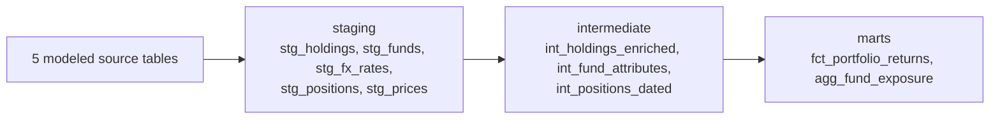

# Challenge 02 — dbt Pipeline: Portfolio Analytics

This challenge walks you through building a complete, tested, documented dbt pipeline on Databricks — from raw sources through a staging layer, intermediate joins, and curated marts. It is split into two phases. Phase 1 covers sources and staging; Phase 2 covers intermediate models, marts, tests, docs, and a capstone.

Work the sections in order. Most authoring sections start from a stub under
`dbt/models/`; singular tests live under `dbt/tests/`, and the capstone asks you
to create new files. The solved references follow the same split under
`solution/models/` and `solution/tests/`. Compare them only after making your own
attempt.

**Runner commands for this challenge:**

| Task | Command |
|---|---|
| Verify the challenge (full build + tests) | `mise run challenge:verify 02` |
| Load the raw source data (seeds) | `dbt seed` |
| Run a dbt command | `dbt <dbt args>` |
| Reset all stubs to blank | `mise run challenge:reset 02` |

The devcontainer has all tooling pre-installed. Auth is a one-time step — if you have not done it yet, run `mise run setup:databricks` before any dbt command. `mise run challenge:verify 02` seeds the raw sources for you; run `dbt seed` once if you want to build individual models before your first verify.

**Work from the dbt project folder.** Every `dbt` command in this guide runs from the challenge's dbt project. Move into it once per terminal session and check your connection:

```bash
cd challenges/v1/02-dbt-pipeline/dbt
dbt debug          # confirms your Databricks connection
```

Run `mise run challenge:verify 02` and `mise run challenge:reset 02` from anywhere in the repo; run the raw `dbt` commands from this folder.

> **dbt can't find your credentials?** (e.g. `Runtime Error ... auth_type: oauth is required when not using access token`.) Your shell environment is not loaded. Open a fresh terminal so mise initializes the environment, or re-run `mise run setup:databricks`, then retry. Every `dbt` command assumes you ran `mise run setup:databricks` once.

---

## Phase 1: Sources & Staging

Phase 1 is small and concrete: get the raw sources declared and the **staging layer** building on Databricks, so every downstream model in Phase 2 has clean, typed inputs to read. By the end of this phase you have a running `source → staging` slice of the pipeline and you know how to debug, build, and test a dbt model.

You author each piece yourself, but every step is guided: the starter ships the project skeleton with each model as a stub you fill in, and each section tells you exactly what to build and how to check it. Work the sections in order.

### The Data

The challenge provisions six raw source tables as CSV **seeds**
(`dbt/seeds/*_raw.csv`) in your training schema
(`training_dev.training_<username>`). The modeled pipeline reads five of them
through `source()`; `bloomberg.refdata_raw` remains available for inspection and
freshness practice but is not part of the core DAG. The first thing
`mise run challenge:verify 02` does is seed all six, and you can load them
yourself at any time with `dbt seed`.

| Source (`models/sources.yml`) | What it is |
|---|---|
| `custodian.holdings_raw` | Position-level holdings per fund per day: `fund_cd, pos_dt, isin, qty, mkt_val_lc, ccy_cd`. |
| `custodian.positions_raw` | Cash + accrued positions per fund per day. |
| `bloomberg.prices_raw` | End-of-day instrument prices. |
| `bloomberg.refdata_raw` | Instrument reference data, provisioned for inspection but not consumed by the core DAG. |
| `fx_feed.fx_rates_raw` | Daily FX close rates to a GBP base. |
| `product_ref.fund_master_raw` | Internal fund master: names, base currency, strategy, active flag. |

Two more reference CSVs ship as seeds and are used in Phase 2: `seed_funds.csv` (the fund master as a fixture) and `seed_custodian_nav.csv` (custodian-reported NAV-per-unit, for the reconciliation test). All seeds — the raw sources and these two — load together when you run `dbt seed` (or the verify gate).

### The Pipeline You Will Build



Phase 1 builds the `source → staging` slice (the left two columns). The intermediate and curated marts are Phase 2.

### Every Section Has The Same Shape

1. **Concept** — what the idea is and why it exists.
2. **Challenge (authoring)** — the exact stub file you complete.
3. **Hint** — where to look, and the shape of the answer.
4. **How to check** — a command to run, and the observable result.
5. **Try a variation** — an optional small twist to make the step your own.

Then a worked **Solution** you compare against once you have tried it yourself.

The learner project under `dbt/` is **intentionally a skeleton**: each shipped
model file is a stub with a `TODO` comment and a `select 1 as placeholder`, so
the project still parses. Project configuration, profiles, sources, seeds, and
the marts' `schema.yml` are supplied. You create the staging `schema.yml` and
the capstone files when the guide reaches them.

### Time Budget

| # | Section | Approx. time |
|---|---------|--------------|
| 1 | Inspect the raw data | `<5min` |
| 2 | Read the dbt project | `~5min` |
| 3 | Declare sources + freshness | `~10min` |
| 4 | First staging model: `stg_holdings` | `~10min` |
| 5 | The remaining staging models | `~15min` |
| 6 | Materializations: view vs table | `~5min` |
| 7 | Build the whole staging layer | `<5min` |
| 8 | A staging test | `~10min` |
| | **Phase 1 total** | **~1 hr** |

---

## Phase 1 — Section 1: Inspect the raw data

**Concept.** Before you write a model, look at what feeds it. Six raw Delta
tables are available in your schema, and the five core staging models read five
of them through dbt **sources**, which are named pointers to tables dbt did not
build. Knowing the columns and keys up front tells you what each staging model
has to rename, cast, and clean.

Docs: dbt sources: <https://docs.getdbt.com/docs/build/sources>

**Challenge (authoring).** Nothing to write here — read. Open `dbt/models/sources.yml` and read the source blocks. Then answer, from what you see:

1. Which source carries the position-level holdings, and what is its grain (one row per what)?
2. Which raw column on `custodian.holdings_raw` will need a `CASH_<ccy>` fallback when an instrument has no ISIN?
3. Which columns need casting before they are useful? Think about `pos_dt`, `qty`, and `mkt_val_lc`.

**Hint.** The column list for `holdings_raw` is spelled out in `sources.yml` under the `columns:` block. A holding is one fund's position in one instrument on one day, valued in the instrument's local currency.

**How to check.** Load the six raw feeds into your schema (once), then peek at the holdings feed through its source (`custodian.holdings_raw` points at the table `dbt seed` just loaded):

```bash
dbt seed
dbt show --inline "select * from {{ source('custodian', 'holdings_raw') }}" --limit 5
```

You should see five real holding rows with a `fund_cd`, a `pos_dt`, an `isin`, and a numeric `qty` and `mkt_val_lc` — the raw shape staging will clean up.

`--inline` runs a one-off query you type on the spot, and `source(...)` resolves to the real table name from `sources.yml` — the same call your staging models are about to make. Note the contrast with `dbt show --select holdings_raw`, which selects the **seed node** rather than querying the table: dbt would re-run the seed (`INSERT 8`) and preview all 8 rows, ignoring `--limit`. Selecting a node builds it; `--inline` just reads.

**Try a variation (optional).** Run the same `--inline` query against `source('product_ref', 'fund_master_raw')` and note which column carries the `is_active` flag — `stg_funds` keeps it so Phase 2 can filter on it.

---

## Phase 1 — Section 2: Read the dbt project

**Concept.** dbt builds a directed graph of SQL models. This project has three layers: **staging** (rename + cast, one model per source table), **intermediate** (joins), and **marts** (consumer-facing facts and aggregates). Each layer has a folder and a materialization set once in `dbt_project.yml` and inherited by every model in the folder. Layers are also tagged (`staging`, `intermediate`, `marts`) so you can build one layer at a time.

**Challenge (authoring).** Read the project layout so the questions are answerable:

- `dbt/dbt_project.yml`: the `models:` block, the per-folder `+materialized` and `+tags`, and the `+post-hook` on marts.
- `dbt/models/staging/`, `dbt/models/intermediate/`, `dbt/models/marts/`: the stub files you will fill in.

Answer:

1. What is the project `name`, and which `profile` does it use?
2. Which layers are materialized as views, and which as tables?
3. What tag is assigned to each layer?
4. Why are the layers separated by `+tags` and not by `+schema`?

The model files are **deliberately stubs** — each is a `select 1 as placeholder` that names its challenge. That is expected; you build them across Phase 1 and Phase 2.

**Hint.** The folder-level `+materialized` and `+tags` configs in the `models:` block answer questions 2 and 3. Question 4 is answered by the comment above the `models:` block: in the training catalog you have exactly one pre-provisioned schema, so every layer lands there and is selected by tag.

**How to check.** dbt can list the models before you build them:

```bash
dbt ls --resource-type model
```

You should see ten model names listed (five `stg_`, three `int_`, two marts), even though they are still stubs.

**Try a variation (optional).** Predict, from the folder configs alone, which models are views and which are tables, then confirm against the `models:` block.

---

## Phase 1 — Section 3: Declare sources + freshness

**Concept.** A dbt **source** is a named pointer to a raw table dbt did not build. Declaring sources buys you two things: dbt documents the raw contract and draws a lineage edge `source → staging`, and dbt can run **freshness** checks. Freshness answers "how stale is this raw feed?" — you name the load-timestamp column (`loaded_at_field`) and the thresholds (`warn_after`, `error_after`), and `dbt source freshness` compares `max(loaded_at_field)` to now and reports fresh / warn / error per table. In a real pipeline this catches a feed that silently stopped delivering before stale data poisons every downstream mart.

Docs: source freshness: <https://docs.getdbt.com/reference/resource-properties/freshness>

**Challenge (authoring).** The sources are already declared in `dbt/models/sources.yml`, with `loaded_at_field` and `freshness` blocks. Your job in this section is to **read and exercise** that config rather than author it, because staging cannot read a source that is not declared. Confirm that `custodian`, `bloomberg` and `fx_feed` each name their `_extracted_at` load field and carry `warn_after` / `error_after` thresholds — and that `product_ref` deliberately carries neither, because the fund master has no `_extracted_at` column for freshness to read. Then run the freshness check.

**Hint.** Each source's `loaded_at_field` and `freshness` live under that source's `config:` block — that is where dbt expects them from v1.10 onward. `freshness` is a `warn_after` and an `error_after`, each a `{count, period}` pair (hours here). `custodian` warns after 4 hours and errors after 6; `fx_feed` and `bloomberg` are wider. `product_ref` has no `config:` block at all, so freshness skips it. The `loaded_at_field: _extracted_at` line is what freshness reads.

**How to check.** Run the freshness check against the declared sources:

```bash
dbt source freshness
```

dbt prints one freshness line per source table that has a `loaded_at_field` — five lines here, not six, because `product_ref.fund_master_raw` has no load timestamp and is skipped. After `dbt seed`, the raw feed timestamps are refreshed and should report `pass`; tighten a threshold to `error_after: {count: 0, period: hour}` and re-run to watch it flip to `error` — that is the check working, not a bug.

**Try a variation (optional).** Every source table already ships a `description:`, so add one a level deeper — put a `description:` under any single column in a `columns:` block, save, and re-run `dbt source freshness` to confirm the YAML still parses. Column descriptions are what `dbt docs` surfaces per field, so this is the level most source contracts are missing.

---

## Phase 1 — Section 4: First staging model — `stg_holdings`

**Concept.** The **staging** layer creates clean, typed building blocks: one staging model per source table, same grain as the source, **rename and cast only — no joins, no aggregations**. Staging reads its source with `source()` and materialises as a view (always fresh, no storage cost). `stg_holdings` is the worked example: it casts and renames the custodian holdings, coalesces a null ISIN into a synthetic `CASH_<ccy>` instrument id, and drops rows with no fund or date.

Docs: dbt SQL models: <https://docs.getdbt.com/docs/build/sql-models>

**Challenge (authoring).** Open `dbt/models/staging/stg_holdings.sql` and complete the stub. Use the standard CTE shape: a `src` CTE that reads `source('custodian', 'holdings_raw')`, a `renamed` CTE that does the rename + cast, and a final `select * from renamed`. Produce these columns:

- `fund_id` — `trim(upper(fund_cd))`
- `position_date` — `cast(pos_dt as date)`
- `instrument_id` — `coalesce(isin, 'CASH_' || upper(ccy_cd))`
- `quantity` — `cast(qty as decimal(18,4))`
- `mv_local_ccy` — `cast(mkt_val_lc as decimal(18,2))`
- `local_ccy` — `upper(ccy_cd)`
- `_src_loaded_at` — `_extracted_at`

Filter out rows where `fund_cd` or `pos_dt` is null.

**Hint.** The grain is one row per (fund, day, instrument) — the same as the source, because staging never changes grain. The `coalesce(...)` is what turns a cash holding (no ISIN) into a `CASH_GBP`-style id so later joins still work.

**How to check.** Build just this model and read a few rows:

```bash
dbt build --select stg_holdings
dbt show --select stg_holdings --limit 5
```

`dbt build` should report `PASS=1`. `dbt show` should return rows with a clean `fund_id` like `PEF-LARGE-CAP`, a real `position_date`, and an `instrument_id` that is either an ISIN or a `CASH_<ccy>` value — never null. Quantities and `mv_local_ccy` are typed decimals.

**Try a variation (optional).** Add a literal `current_date() as built_on` column to the `renamed` CTE, rebuild, and watch it appear in `dbt show`. Then remove it.

<details><summary>Solution</summary>

A `src` CTE reads the source; a `renamed` CTE renames every column to a business name, casts each to an explicit type, coalesces a null ISIN into a `CASH_<ccy>` id, and filters out rows missing a fund or date. Staging stays 1:1 with the source — no joins.

```sql
-- stg_holdings: cast + clean only, no joins.
-- Grain matches the source: one row per (fund, position_date, isin).
with src as (
    select * from {{ source('custodian', 'holdings_raw') }}
),

renamed as (
    select
        trim(upper(fund_cd))                       as fund_id,
        cast(pos_dt as date)                       as position_date,
        coalesce(isin, 'CASH_' || upper(ccy_cd))   as instrument_id,
        cast(qty as decimal(18, 4))                as quantity,
        cast(mkt_val_lc as decimal(18, 2))         as mv_local_ccy,
        upper(ccy_cd)                              as local_ccy,
        _extracted_at                              as _src_loaded_at
    from src
    where fund_cd is not null
      and pos_dt  is not null
)

select * from renamed
```

Reference: `solution/models/staging/stg_holdings.sql`.

</details>

---

## Phase 1 — Section 5: The remaining staging models

**Concept.** Every staging model is the same recipe: read one source with `source()`, rename, cast, and stop. The four left to build vary only in the small cleaning each needs. `stg_funds` is a plain rename of the fund master. `stg_fx_rates` narrows to GBP-base rates with a `where`. `stg_positions` and `stg_prices` each **dedup** to the latest extract per natural key with a `row_number()` window — a source can re-deliver the same day, and staging keeps one row. Repetition in staging is the point: it makes the layer predictable.

Docs: dbt SQL models: <https://docs.getdbt.com/docs/build/sql-models>

**Challenge (authoring).** Complete the four remaining staging stubs:

- `stg_funds.sql` — read `product_ref.fund_master_raw`; rename and cast; keep `is_active`.
- `stg_fx_rates.sql` — read `fx_feed.fx_rates_raw`; cast; `where upper(to_ccy) = 'GBP'`.
- `stg_positions.sql` — read `custodian.positions_raw`; dedup to the latest `_extracted_at` per `(fund_cd, pos_dt)` with `row_number()`, keep `rn = 1`.
- `stg_prices.sql` — read `bloomberg.prices_raw`; dedup to the latest `_extracted_at` per `(isin, price_dt)` the same way.

**Hint.** The dedup pattern is a CTE that adds `row_number() over (partition by <natural key> order by _extracted_at desc) as rn`, then a final `select ... where rn = 1`. `stg_funds` and `stg_fx_rates` need no window — just rename, cast, and (for FX) the GBP filter.

**How to check.** Build the four and confirm the staging layer is whole:

```bash
dbt build --select stg_funds stg_fx_rates stg_positions stg_prices
dbt ls --select tag:staging --resource-type model
```

The build should report `PASS=4`. `dbt ls --select tag:staging` should list all five staging models. Spot-check one: `dbt show --select stg_funds --limit 5` returns the four raw fund-master rows with a `base_ccy` of `GBP` or `USD` and an `is_active` flag.

**Try a variation (optional).** Run `dbt show --select stg_prices --limit 5` and `dbt show --select prices_raw --limit 5` and compare — staging dedupes on the grain, so its row count is the same or lower than the raw `prices_raw`, never higher.

<details><summary>Solution</summary>

Each model reads one source and renames + casts. `stg_funds` is a plain pass-through that keeps `is_active`. `stg_fx_rates` filters to GBP-base rates. `stg_positions` and `stg_prices` dedup to the latest extract per natural key with a `row_number()` window.

```sql
-- stg_funds.sql
with src as (
    select * from {{ source('product_ref', 'fund_master_raw') }}
)
select
    trim(upper(fund_cd))       as fund_id,
    fund_name,
    cast(inception_dt as date) as inception_date,
    upper(base_ccy)            as base_ccy,
    strategy_code,
    is_active
from src
```

```sql
-- stg_fx_rates.sql
with src as (
    select * from {{ source('fx_feed', 'fx_rates_raw') }}
)
select
    upper(from_ccy)               as from_ccy,
    upper(to_ccy)                 as to_ccy,
    cast(rate_dt as date)         as rate_date,
    cast(rate as decimal(18, 8))  as fx_rate
from src
where upper(to_ccy) = 'GBP'
```

```sql
-- stg_positions.sql — dedup to the latest extract per (fund, day)
with src as (
    select * from {{ source('custodian', 'positions_raw') }}
),
deduped as (
    select
        trim(upper(fund_cd))                     as fund_id,
        cast(pos_dt as date)                     as position_date,
        upper(ccy_cd)                            as local_ccy,
        cast(cash_balance as decimal(18, 2))     as cash_balance,
        cast(accrued_interest as decimal(18, 2)) as accrued_interest,
        _extracted_at                            as _src_loaded_at,
        row_number() over (
            partition by fund_cd, pos_dt
            order by _extracted_at desc
        ) as rn
    from src
)
select fund_id, position_date, local_ccy,
       cash_balance, accrued_interest, _src_loaded_at
from deduped
where rn = 1
```

`stg_prices.sql` follows the same dedup shape, partitioned by `(isin, price_dt)`. Its columns are `isin → instrument_id`, `price_dt → price_date`, `close_px → close_price`, and `quote_ccy → price_ccy` — note that Bloomberg names its currency column `quote_ccy`, not `ccy_cd` like the custodian feed. The `columns:` block for `bloomberg.prices_raw` in `dbt/models/sources.yml` is the authority; do not assume the raw feeds agree on names.

Reference: `solution/models/staging/stg_funds.sql`, `solution/models/staging/stg_fx_rates.sql`, `solution/models/staging/stg_positions.sql`, and `solution/models/staging/stg_prices.sql`.

</details>

---

## Phase 1 — Section 6: Materializations — view vs table

**Concept.** A **materialization** is how dbt persists a model. A `view` is a saved query — cheap to build, always fresh, slower to read. A `table` is rows on disk — slower to build, fast to read. The rule of thumb: staging and intermediate are **views** (always fresh, no storage), marts are **tables** (read often by dashboards, so worth materialising). The default is set once per folder in `dbt_project.yml`; any model can override with `{{ config(materialized='...') }}`.

Docs: materializations: <https://docs.getdbt.com/docs/build/materializations>

**Challenge (authoring).** No new model — read and confirm the config. In `dbt/dbt_project.yml`, confirm staging and intermediate default to `view` and marts default to `table`. Then verify it on the warehouse: a staging model should be a view, a mart (once you build it in Phase 2) a table.

**Hint.** The `models:` block sets `+materialized: view` on `staging` and `intermediate` and `+materialized: table` on `marts`. You do not need a per-model `config()` override anywhere in this project — the folder defaults are correct.

**How to check.** dbt logs the materialization as it builds each model. Rebuild the staging model and read the log line:

```bash
dbt build --select stg_holdings
```

It reads `OK created sql view model … stg_holdings` — the `view` confirms staging is a view. After Phase 2, `dbt build --select fct_portfolio_returns` logs `OK created sql table model …` — a managed table.

**Try a variation (optional).** Temporarily add `{{ config(materialized='table') }}` to the top of `stg_holdings.sql`, rebuild it, and watch the log line flip to `table model`. Then remove the override — staging should stay a view.

<details><summary>Solution</summary>

The folder defaults in `dbt_project.yml` already set the right materializations; no per-model override is needed.

```yaml
models:
  portfolio_analytics_challenge:
    staging:
      +materialized: view
      +tags: ["staging"]
    intermediate:
      +materialized: view
      +tags: ["intermediate"]
    marts:
      +materialized: table
      +tags: ["marts"]
```

Staging and intermediate are views (always fresh, no storage); marts are tables (fast for the dashboards and compliance jobs that read them). A model overrides its folder default with `{{ config(materialized='table') }}` at the top of the file — but in this project the defaults are correct everywhere.

Reference: `dbt/dbt_project.yml`.

</details>

---

## Phase 1 — Section 7: Build the whole staging layer

**Concept.** `dbt build` runs seed → run → test in dependency order, and the `--select` flag scopes it to a slice. `--select staging` (or `--select tag:staging`) builds exactly the staging models. This is how you confirm a whole layer is green before moving up to the next one — a clean staging layer is the foundation everything downstream depends on.

Docs: node selection: <https://docs.getdbt.com/reference/node-selection/syntax>

**Challenge (authoring).** Nothing new to write — build and read the summary. Build the staging layer in one command and confirm every model passes:

```bash
dbt build --select staging
```

Read the final summary line and confirm five views built with no errors.

**Hint.** `--select staging` selects by folder; `--select tag:staging` selects by the tag set in `dbt_project.yml`. Both resolve to the same five models here. If a model is missing, its stub is still a placeholder — go back and complete it.

**How to check.** The summary line should end like:

```text
Completed successfully
Done. PASS=5 WARN=0 ERROR=0 SKIP=0 NO-OP=0 TOTAL=5
```

Five staging views built, zero errors. If you wired tests already (next section), the count is higher.

**Try a variation (optional).** Run `dbt build --select stg_holdings+` and read what it selects — `stg_holdings` **and everything downstream** of it. The `+` suffix means "and descendants"; you will use it constantly in Phase 2.

<details><summary>Solution</summary>

`dbt build --select staging` builds the five staging views in DAG order. Because staging models read sources (not other models), they have no upstream dbt dependencies and build first. A clean run ends with `PASS=5` and no `ERROR`.

```bash
dbt build --select staging
# Done. PASS=5 WARN=0 ERROR=0 SKIP=0 NO-OP=0 TOTAL=5
```

`--select staging` is by folder; `--select tag:staging` is by tag — equivalent here.

</details>

---

## Phase 1 — Section 8: A staging test

**Concept.** A dbt **generic test** is a reusable assertion you attach to a column by name. The built-in four are `not_null`, `unique`, `accepted_values`, and `relationships`. dbt runs each as "select the bad rows" — zero rows back means pass. You declare them in a YAML file next to the model. A natural first test on staging is the key: `stg_funds.fund_id` should be `not_null` and `unique`, because it is the fund master's primary key and every downstream join depends on it.

Docs: generic data tests: <https://docs.getdbt.com/docs/build/data-tests>

**Challenge (authoring).** Add a model YAML for the staging layer. Create `dbt/models/staging/schema.yml` and declare `not_null` + `unique` on `stg_funds.fund_id` (the fund master's primary key) and `not_null` on `stg_holdings.fund_id`, `position_date`, and `instrument_id` (the holding grain).

**Hint.** The YAML shape is a `models:` list; each model has a `columns:` list; each column has a `tests:` list. `unique` and `not_null` take no arguments — they are bare list items. This file is yours to author; the marts already have their own `schema.yml`.

**How to check.** Run the staging tests:

```bash
dbt test --select staging
```

Each declared column produces a test like `not_null_stg_funds_fund_id` and `unique_stg_funds_fund_id`, all reporting `PASS`. To prove a test bites, temporarily declare `unique` on `stg_holdings.fund_id` (which repeats across instruments) and watch it FAIL, then remove that line.

**Try a variation (optional).** Add an `accepted_values` test on `stg_funds.base_ccy` and re-run `dbt test --select stg_funds` to watch it execute. Any test that takes arguments nests them under `arguments:`:

```yaml
      - name: base_ccy
        tests:
          - accepted_values:
              arguments:
                values: ['GBP', 'USD']
```

<details><summary>Solution</summary>

A new `models/staging/schema.yml` attaches the built-in generic tests by column. `stg_funds.fund_id` is the primary key, so it gets `unique` + `not_null`; the `stg_holdings` grain columns get `not_null`.

```yaml
version: 2

models:
  - name: stg_funds
    description: "Cleaned fund master, one row per fund."
    columns:
      - name: fund_id
        description: "Primary key — fund identifier."
        tests:
          - not_null
          - unique

  - name: stg_holdings
    description: "Cleaned holdings, one row per (fund, day, instrument)."
    columns:
      - name: fund_id
        tests:
          - not_null
      - name: position_date
        tests:
          - not_null
      - name: instrument_id
        tests:
          - not_null
```

Reference: `solution/models/staging/schema.yml`.

</details>

---

## Phase 2: Intermediate, Marts, Tests & Docs

Phase 1 left you with a running baseline: sources declared with freshness, five staging models cleaned and typed, the staging layer built green on Databricks. That was setup. Phase 2 is the build proper. Here you write the **intermediate** joins, the two **curated marts**, the **generic and singular tests** that enforce the contract, generate the **docs and lineage graph**, wire the Databricks `OPTIMIZE` performance post-hook, and finish with a capstone that adds a new mart end to end.

Every challenge is self-contained. Each defines the dbt or SQL idea it uses before you apply it, so you are never assumed to have met it before. The shape is always:

- **Concept** — the idea, in plain English.
- **Goal** — the business outcome in one line.
- **Authoring task** — exactly what you write, and into which stub file.
- **How to check** — a command to run, or an observable result.

Write your own answer first; a worked **Solution** follows each challenge for you to compare against. Budget roughly ~10 min per challenge — a pacing target, not a deadline. Work the challenges in order: they build on each other, and Challenge 10 ties the marts together into a new end-to-end deliverable.

---

## Phase 2 — Challenge 1: The enrichment join — `int_holdings_enriched`

**Concept.** The **intermediate** layer is where joins live; staging stayed 1:1 with its sources precisely so this layer can combine them without re-cleaning. `int_holdings_enriched` joins the cleaned holdings to prices and FX so each position carries a base-currency market value. The key move is the currency conversion: a holding is valued in its local currency, and to roll funds up you need a common base. `mv_base_ccy = mv_local_ccy * coalesce(fx_rate, 1.0)`. The FX feed ships a `GBP → GBP` rate of `1.0` alongside the `USD → GBP` and `EUR → GBP` rates, so a GBP holding converts through a real matched row; the `coalesce` is the safety net for the other case — a left join that finds **no** rate for that currency and date returns `null`, and multiplying by `null` would silently wipe the value out. Defaulting to `1.0` keeps the holding at its local value instead of losing it. The output grain is unchanged from `stg_holdings`: one row per (fund, date, instrument).

**Goal.** One intermediate model that values every holding in the GBP base currency, ready for the marts to aggregate.

**Authoring task.** Complete `dbt/models/intermediate/int_holdings_enriched.sql`. Read `ref('stg_holdings')`, `ref('stg_prices')`, and `ref('stg_fx_rates')`. Left join prices on `(instrument_id, date)` and FX on `(local_ccy → GBP, date)`. Select the holding columns plus `close_price`, `fx_rate_to_base`, and the computed `mv_base_ccy`. Keep the grain at (fund, date, instrument) — left joins, so a holding with no price or FX row still appears.

**How to check.**

```bash
dbt build --select int_holdings_enriched
dbt show --select int_holdings_enriched --limit 10
```

Every row should carry an `mv_base_ccy`. All eight bundled holdings are quoted in GBP, so each one matches the `GBP → GBP` rate of `1.0` and its `mv_base_ccy` equals its `mv_local_ccy` — that equality is the check that the join worked, not a sign it was skipped. To see a rate other than `1.0` actually bite, use the optional variation below. No row should be dropped — the count matches `stg_holdings`.

Docs: dbt `ref()`: <https://docs.getdbt.com/reference/dbt-jinja-functions/ref>.

**Try a variation (optional).** The FX feed already carries `USD → GBP` at `0.78`, but no bundled holding is quoted in USD, so that rate never gets used. Prove the conversion works by running a one-off query that re-points a holding at USD — no file edits, nothing to undo:

```bash
dbt show --inline "select mv_local_ccy, mv_local_ccy * (select fx_rate from {{ ref('stg_fx_rates') }} where from_ccy = 'USD' and rate_date = '2026-05-20') as mv_if_usd from {{ ref('stg_holdings') }} where position_date = '2026-05-20'" --limit 5
```

`mv_if_usd` comes back at 78% of `mv_local_ccy` — the same arithmetic `int_holdings_enriched` performs, now with a rate that is not `1.0`.

<details><summary>Solution</summary>

Three CTEs read the staging models; a `joined` CTE left-joins prices on (instrument, date) and FX on (local ccy → GBP, date), then computes the base-currency MV. The `coalesce(fx_rate, 1.0)` guards the left join: when no rate exists for that currency and date, `fx_rate` is `null` and the multiplication would erase the value, so the default of `1.0` leaves the holding at its local value.

```sql
with holdings as (
    select * from {{ ref('stg_holdings') }}
),
prices as (
    select * from {{ ref('stg_prices') }}
),
fx as (
    select * from {{ ref('stg_fx_rates') }}
),
joined as (
    select
        h.fund_id,
        h.position_date,
        h.instrument_id,
        h.quantity,
        h.mv_local_ccy,
        h.local_ccy,
        p.close_price,
        f.fx_rate                                   as fx_rate_to_base,
        h.mv_local_ccy * coalesce(f.fx_rate, 1.0)   as mv_base_ccy
    from holdings h
    left join prices p
        on p.instrument_id = h.instrument_id
        and p.price_date = h.position_date
    left join fx f
        on f.from_ccy = h.local_ccy
        and f.to_ccy = 'GBP'
        and f.rate_date = h.position_date
)
select * from joined
```

Reference: `solution/models/intermediate/int_holdings_enriched.sql`.

</details>

---

## Phase 2 — Challenge 2: The two supporting intermediate models

**Concept.** Not every intermediate model is a big join. The other two are small, focused re-shapes that the marts need. `int_fund_attributes` selects the **active** funds and their reporting attributes — filtering to `is_active = true` once here means no mart has to remember that filter. `int_positions_dated` rolls cash and accrued interest into one `cash_plus_accrued` figure per (fund, day). Each model does one job, named in its filename, so the marts read a clean, purpose-built input rather than re-deriving it.

**Goal.** Two ready-to-join intermediate models: one of active funds, one of cash per fund-day.

**Authoring task.** Complete two stubs. In `dbt/models/intermediate/int_fund_attributes.sql`, select `fund_id`, `fund_name`, `inception_date`, `base_ccy`, `strategy_code` from `ref('stg_funds')` where `is_active = true`. In `dbt/models/intermediate/int_positions_dated.sql`, select `fund_id`, `position_date`, `local_ccy`, and `cash_balance + accrued_interest as cash_plus_accrued` from `ref('stg_positions')`.

**How to check.**

```bash
dbt build --select int_fund_attributes int_positions_dated --indirect-selection=cautious
dbt show --select int_fund_attributes --limit 10 --indirect-selection=cautious
```

`int_fund_attributes` should return only active funds. In the bundled raw fund master all four rows are active, so all four appear; the filter is still intentional and would exclude inactive fixture rows such as `PEF-LEGACY-X` from `seed_funds`. `int_positions_dated` returns one row per (fund, day) with a single `cash_plus_accrued` column.

**Why `--indirect-selection=cautious` here.** When you select a model, dbt also picks up the tests attached to it — that is *indirect selection*, and its default mode (`eager`) pulls in a test as soon as **any one** of the test's inputs is selected. The shipped `models/marts/schema.yml` declares a `relationships` test that checks `fct_portfolio_returns.fund_id` against `int_fund_attributes.fund_id`, so that test has **two** inputs. Selecting `int_fund_attributes` is enough for `eager` to run it — but `fct_portfolio_returns` is still the untouched `select 1 as placeholder` stub until Challenge 4, so the test asks for a `fund_id` column that does not exist yet and fails with `UNRESOLVED_COLUMN ... Did you mean [placeholder]`. `cautious` runs a test only when **all** of its inputs are selected, which skips that not-yet-buildable test and leaves you with just the two models you actually wrote. Drop the flag once you finish Challenge 4 — from then on both inputs are real and the test passes on its own.

Docs: indirect selection: <https://docs.getdbt.com/reference/node-selection/test-selection-examples#indirect-selection>.

Docs: dbt SQL models: <https://docs.getdbt.com/docs/build/sql-models>.

<details><summary>Solution</summary>

Both are single-select re-shapes. `int_fund_attributes` filters to active funds; `int_positions_dated` sums cash and accrued into one column.

```sql
-- int_fund_attributes.sql
with funds as (
    select * from {{ ref('stg_funds') }}
)
select
    fund_id, fund_name, inception_date, base_ccy, strategy_code
from funds
where is_active = true
```

```sql
-- int_positions_dated.sql
with positions as (
    select * from {{ ref('stg_positions') }}
)
select
    fund_id,
    position_date,
    local_ccy,
    cash_balance + accrued_interest as cash_plus_accrued
from positions
```

Reference: `solution/models/intermediate/int_fund_attributes.sql` and `solution/models/intermediate/int_positions_dated.sql`.

</details>

---

## Phase 2 — Challenge 3: First curated mart — `agg_fund_exposure`

**Concept.** A **mart** is the consumer-facing layer: it trades row-level detail for a report-ready shape and materialises as a table for fast reads. `agg_` is the prefix for a pre-aggregated mart — measures grouped by reporting dimensions. `agg_fund_exposure` rolls the enriched holdings up to one row per (fund, date, strategy), summing base-currency exposure, counting distinct instruments, and isolating the cash-only slice with a `case` inside the `sum`. Compliance reads it for concentration alerts: how much is each fund exposed to, by strategy, and how much of that is cash.

**Goal.** A per-(fund, date, strategy) exposure aggregate compliance can read for concentration.

**Authoring task.** Complete `dbt/models/marts/agg_fund_exposure.sql`. Read `ref('int_holdings_enriched')` and join `ref('int_fund_attributes')` for the `strategy_code`. Group by `(fund_id, position_date, strategy_code)` and produce: `exposure_base_ccy` (sum of `mv_base_ccy`), `instrument_count` (`count(distinct instrument_id)`), and `cash_exposure_base_ccy` (the sum of `mv_base_ccy` only where `instrument_id like 'CASH_%'`).

**How to check.**

```bash
dbt build --select agg_fund_exposure
dbt show --select agg_fund_exposure --limit 10
```

Each row is one (fund, date, strategy). `exposure_base_ccy` should be a positive GBP figure — with the bundled holdings it lands around 0.9–1.5 billion, since each fund holds a single large position — and `instrument_count` a small positive integer. The bundled holdings have no cash-only rows, so `cash_exposure_base_ccy` is `0`; if you add `CASH_<ccy>` holdings, cash exposure should never be larger than total exposure.

Docs: dbt marts: <https://docs.getdbt.com/best-practices/how-we-structure/4-marts>.

<details><summary>Solution</summary>

Read the enriched holdings, join the active-fund attributes for the strategy, group by (fund, date, strategy), and aggregate. The cash slice is a `case` expression inside the `sum`.

```sql
with holdings as (
    select * from {{ ref('int_holdings_enriched') }}
),
funds as (
    select * from {{ ref('int_fund_attributes') }}
)
select
    h.fund_id,
    h.position_date,
    f.strategy_code,
    sum(h.mv_base_ccy)                                    as exposure_base_ccy,
    count(distinct h.instrument_id)                       as instrument_count,
    sum(case when h.instrument_id like 'CASH_%'
             then h.mv_base_ccy else 0 end)               as cash_exposure_base_ccy
from holdings h
left join funds f
    on f.fund_id = h.fund_id
group by 1, 2, 3
```

Reference: `solution/models/marts/agg_fund_exposure.sql`.

</details>

---

## Phase 2 — Challenge 4: Second curated mart — `fct_portfolio_returns`

**Concept.** `fct_` is the prefix for a **fact** table — one row per event or measurement, at a fine grain. `fct_portfolio_returns` is the published daily-grain fact: one row per (fund, date, instrument), carrying the base-ccy MV and a calculated NAV-per-unit. NAV-per-unit is total fund market value divided by units outstanding; here units are synthesised (a real feed ships them), so you roll the per-instrument MV up to a per-fund total in a CTE, divide by units, and join that back to the instrument grain. This is the mart the RM dashboard, compliance, and the client app all read.

**Goal.** A daily-grain fact carrying each position's base-ccy value and the fund's calculated NAV-per-unit.

**Authoring task.** Complete `dbt/models/marts/fct_portfolio_returns.sql`. Read `ref('int_holdings_enriched')` and `ref('int_fund_attributes')`. In a `fund_mv` CTE, `sum(mv_base_ccy)` per (fund, date). In a `with_units` CTE, add `100000000.0 as units_outstanding` and keep the total. The final select is at the instrument grain: carry the holding columns through, join `fund_name` from the fund attributes, and compute `calc_nav_per_unit = total_mv_base / units_outstanding`.

**How to check.**

```bash
dbt build --select fct_portfolio_returns
dbt show --select fct_portfolio_returns --limit 10
```

One row per (fund, date, instrument), each with an `mv_base_ccy` and a `calc_nav_per_unit`. The NAV-per-unit should land in a believable range — single digits to low tens (the bundled funds run about 9 to 15), close to the custodian NAVs in `seed_custodian_nav.csv` — not zero and not millions.

Docs: dbt SQL models: <https://docs.getdbt.com/docs/build/sql-models>.

<details><summary>Solution</summary>

Roll the enriched holdings up to a per-fund-day total MV in `fund_mv`, divide by a synthesised `units_outstanding` in `with_units`, then join that back to the instrument grain and carry the holding columns plus the fund name.

```sql
with holdings as (
    select * from {{ ref('int_holdings_enriched') }}
),
funds as (
    select * from {{ ref('int_fund_attributes') }}
),
fund_mv as (
    select fund_id, position_date, sum(mv_base_ccy) as total_mv_base
    from holdings
    group by 1, 2
),
with_units as (
    select
        fund_id, position_date, total_mv_base,
        100000000.0 as units_outstanding
    from fund_mv
)
select
    h.fund_id,
    h.position_date,
    h.instrument_id,
    f.fund_name,
    h.quantity,
    h.mv_local_ccy,
    h.local_ccy,
    h.fx_rate_to_base,
    h.mv_base_ccy,
    u.total_mv_base / u.units_outstanding as calc_nav_per_unit
from holdings h
left join with_units u
    on u.fund_id = h.fund_id and u.position_date = h.position_date
left join funds f
    on f.fund_id = h.fund_id
```

Reference: `solution/models/marts/fct_portfolio_returns.sql`.

</details>

---

## Phase 2 — Challenge 5: Generic tests on the marts

**Concept.** dbt's four built-in **generic tests** turn your assumptions into executable checks: `not_null` and `unique` for keys, `accepted_values` for a closed set of categories, and `relationships` for referential integrity (every foreign-key value exists in a parent model). You attach them by column in a YAML file next to the model — zero bad rows means pass. On a mart they guard the contract: a `not_null` on a grain column catches a join that dropped a key, a `relationships` test catches an orphaned fund id, an `accepted_values` test catches a new strategy code that slipped in unmapped.

**Goal.** The two marts guarded by generic tests so a broken build fails loudly rather than shipping wrong numbers.

**Authoring task.** The marts' `dbt/models/marts/schema.yml` ships with the test declarations already in place — read it and run it. On `fct_portfolio_returns`: `not_null` on `fund_id`, `position_date`, `instrument_id`, `mv_base_ccy`, plus a `relationships` test from `fund_id` to `ref('int_fund_attributes')`. On `agg_fund_exposure`: `not_null` on `fund_id` and `position_date`, plus an `accepted_values` test on `strategy_code` (`EQ-LC`, `EQ-EM`, `EQ-GC`, `FI-IG`). Confirm you understand each, then run them.

**How to check.**

```bash
dbt test --select fct_portfolio_returns agg_fund_exposure
```

Every attached column produces a test like `not_null_fct_portfolio_returns_fund_id` and `relationships_fct_portfolio_returns_fund_id__...`, all `PASS`. To prove the `accepted_values` test bites, drop `FI-IG` from the list and run `dbt test --no-partial-parse --select agg_fund_exposure` to watch the fixed-income fund fail the test, then restore it.

Docs: generic data tests: <https://docs.getdbt.com/docs/build/data-tests>.

<details><summary>Solution</summary>

The generic tests are declared by column in `models/marts/schema.yml`. Keys get `not_null`; the fact's `fund_id` gets a `relationships` test against the active-fund model; the aggregate's `strategy_code` gets `accepted_values`.

```yaml
models:
  - name: fct_portfolio_returns
    columns:
      - name: fund_id
        tests:
          - not_null
          - relationships:
              arguments:
                to: ref('int_fund_attributes')
                field: fund_id
      - name: position_date
        tests: [not_null]
      - name: instrument_id
        tests: [not_null]
      - name: mv_base_ccy
        tests: [not_null]

  - name: agg_fund_exposure
    columns:
      - name: fund_id
        tests: [not_null]
      - name: position_date
        tests: [not_null]
      - name: strategy_code
        tests:
          - accepted_values:
              arguments:
                values: ['EQ-LC', 'EQ-EM', 'EQ-GC', 'FI-IG']
```

Reference: `solution/models/marts/schema.yml`.

</details>

---

## Phase 2 — Challenge 6: A singular reconciliation test — NAV within tolerance

**Concept.** A **singular test** is a single hand-written SQL file in `tests/` that fails when its query returns any rows. Unlike a generic test it is not attached to a column — it tests one specific assertion across whatever models it references. The powerful case is **reconciliation**: your calculated number must agree with an independent source. `assert_nav_within_tolerance` compares the `calc_nav_per_unit` your `fct_portfolio_returns` produces against the custodian-reported NAV in `seed_custodian_nav.csv`, and returns a row only when they differ by more than **1 basis point** (1bp = 0.0001 fractional). Because a singular test returning any rows is a failure, this halts the pipeline if the calculated NAV ever drifts from the custodian's.

**Goal.** Prove the calculated NAV-per-unit reconciles to the custodian NAV within 1bp, enforced as a test.

**Authoring task.** Complete `dbt/tests/assert_nav_within_tolerance.sql`. In a `calc` CTE, select `fund_id, position_date, calc_nav_per_unit` from `ref('fct_portfolio_returns')` where it is not null. In a `custodian` CTE, select `fund_id, position_date, nav_per_unit` from `ref('seed_custodian_nav')`. Join them on `(fund_id, position_date)`, compute `variance_bps = (calc - custodian) / custodian * 10000`, and return rows where `abs(variance_bps) > 1.0`.

**How to check.**

```bash
dbt build --select fct_portfolio_returns seed_custodian_nav
dbt test --select assert_nav_within_tolerance
```

The test should PASS (zero rows). To see it fire with the bundled data, temporarily change the final comparison to `>= 0.0` so even zero variance trips it, confirm it FAILS, then set it back to `> 1.0`.

Docs: singular data tests: <https://docs.getdbt.com/docs/build/data-tests>.

<details><summary>Solution</summary>

Compare the calculated NAV to the seeded custodian NAV, join on (fund, date), compute the variance in basis points, and return only the rows that breach the 1bp tolerance — so any breach is a test failure.

```sql
with calc as (
    select fund_id, position_date, calc_nav_per_unit
    from {{ ref('fct_portfolio_returns') }}
    where calc_nav_per_unit is not null
),
custodian as (
    select fund_id, position_date, nav_per_unit
    from {{ ref('seed_custodian_nav') }}
),
variance as (
    select
        c.fund_id,
        c.position_date,
        c.calc_nav_per_unit,
        cu.nav_per_unit                                          as custodian_nav,
        (c.calc_nav_per_unit - cu.nav_per_unit) / cu.nav_per_unit * 10000.0
            as variance_bps
    from calc c
    inner join custodian cu
        on cu.fund_id = c.fund_id
        and cu.position_date = c.position_date
)
select * from variance
where abs(variance_bps) > 1.0
```

Reference: `solution/tests/assert_nav_within_tolerance.sql`.

</details>

---

## Phase 2 — Challenge 7: The full build — `dbt build`

**Concept.** `dbt build` runs seed → run → test in dependency order across the whole project. Crucially, if a model's upstream test fails, downstream models are **skipped** — you do not propagate bad data. This is the command CI and scheduled jobs run, and it is your end-to-end proof that the pipeline is whole: seeds loaded, all ten models built, every generic and singular test passing.

**Goal.** One green end-to-end run: seeds, all ten models, every test.

**Authoring task.** Nothing new to write — run the full build and read the summary:

```bash
dbt build
```

Read the final summary line and confirm every resource passed with no errors and no skips.

**How to check.** The summary should end like:

```text
Completed successfully
Done. PASS=N WARN=0 ERROR=0 SKIP=0 NO-OP=0 TOTAL=N
```

`N` covers the eight seeds, ten models, and every test. `ERROR=0` and `SKIP=0` together mean nothing failed and nothing was skipped for a failed upstream.

To run the full verified gate: `mise run challenge:verify 02`

Docs: dbt build: <https://docs.getdbt.com/reference/commands/build>.

<details><summary>Solution</summary>

`dbt build` loads all eight CSV seeds, builds the five staging views, three intermediate views, and two mart tables in DAG order, then runs every test. A clean run ends with `ERROR=0 SKIP=0`. There is no model SQL for this section; the deliverable is a green full build.

```bash
dbt build
# Done. PASS=N WARN=0 ERROR=0 SKIP=0 NO-OP=0 TOTAL=N
```

</details>

---

## Phase 2 — Challenge 8: Docs and the lineage graph

**Concept.** dbt generates a documentation site from your model and source descriptions plus the DAG it infers from every `ref()` and `source()` call. `dbt docs generate` writes the metadata; `dbt docs serve` serves an interactive site with column docs, the compiled SQL for each model, and a **lineage graph** you can click through. The lineage graph is the payoff of declaring sources and using `ref()` everywhere: it shows, end to end, that `fct_portfolio_returns` is fed by the intermediate holdings, which are fed by the staging models, which read the sources — so you can see exactly what breaks if you change any one of them.

**Goal.** A browsable docs site whose lineage graph shows the full `source → staging → intermediate → marts` DAG.

**Authoring task.** Generate and serve the docs:

```bash
dbt docs generate
dbt docs serve --host 127.0.0.1 --port 8081
```

`dbt docs serve` holds the terminal until you stop it with **Ctrl-C** — open a second terminal if you want to keep working. Two flags matter here and are easy to miss:

- **`--host 127.0.0.1` is required in this devcontainer.** `dbt docs serve` takes its bind address from the `DBT_HOST` environment variable, and this repo sets `DBT_HOST` to your Databricks workspace URL (the dbt *profiles* use it as the warehouse host). Without the flag, dbt tries to bind a local socket to `https://…databricks.com` and dies with `socket.gaierror: [Errno -2] Name or service not known`.
- **Port 8081, not dbt's default 8080.** Challenge 03 runs the Airflow UI on 8080; if Airflow is up, 8080 gives you `OSError: [Errno 98] Address already in use`.

Then, in the served site, find the lineage graph for `fct_portfolio_returns` and
trace it back to the four source tables used by that mart. The separately built
`stg_positions → int_positions_dated` branch is visible in the project graph but
does not feed this mart.

**How to check.** `dbt docs generate` writes `target/manifest.json` and
`target/catalog.json` and prints a "Catalog written" line. In the served site,
the lineage graph for `fct_portfolio_returns` should show it fed by
`int_holdings_enriched` and `int_fund_attributes`, those fed by the staging
models, and those staging models fed by four source tables.

Docs: dbt docs and lineage: <https://docs.getdbt.com/docs/collaborate/documentation>.

<details><summary>Solution</summary>

`dbt docs generate` writes the manifest and catalog from your descriptions plus the inferred DAG; `dbt docs serve` renders them. The lineage graph is built entirely from the `source()` and `ref()` calls already in your models — there is nothing extra to author. Click `fct_portfolio_returns` in the served site and the graph traces back through the intermediate and staging layers to the sources.

```bash
dbt docs generate
dbt docs serve --host 127.0.0.1 --port 8081
```

Reference: the graph is generated from `dbt/models/sources.yml` and every
`ref()` across `solution/models/`.

</details>

---

## Phase 2 — Challenge 9: The Databricks performance post-hook — `OPTIMIZE … ZORDER`

**Concept.** A dbt **post-hook** is SQL that runs after a model is built. On Databricks, `OPTIMIZE <table> ZORDER BY (cols)` is a Delta-table optimisation: it compacts small files and co-locates rows by the columns most queries filter on, so reads prune faster. The marts in this project query by `fund_id` and `position_date`, so z-ordering on those two columns speeds up every dashboard and compliance query that filters on a fund or a date. The post-hook is set once at the folder level in `dbt_project.yml`, so every mart inherits it — and because it is a table optimisation, it only makes sense on the mart tables, not the staging views.

**Goal.** Every mart table z-ordered on its query columns so reads prune efficiently.

**Authoring task.** The post-hook ships in `dbt/dbt_project.yml` on the `marts` folder — read it and confirm it runs. Confirm the `marts` block carries `+post-hook: "OPTIMIZE {{ this }} ZORDER BY (fund_id, position_date)"`, then rebuild a mart and watch the `OPTIMIZE` statement run after the table is created.

**How to check.**

```bash
dbt build --select agg_fund_exposure
```

In the dbt run log, after the `OK created sql table model ... agg_fund_exposure` line you should see the post-hook execute the `OPTIMIZE ... ZORDER BY (fund_id, position_date)` statement against that table. Staging models, being views, run no such hook.

**dbt does not print hook SQL to the console** — at the default log level you only see the `OK created sql table model` line, so it looks like nothing ran. The statement is recorded in the debug log. Confirm it with either of these, run from `challenges/v1/02-dbt-pipeline/dbt`:

```bash
grep "ZORDER BY" logs/dbt.log | tail -1
```

```bash
dbt --debug build --select agg_fund_exposure 2>&1 | grep "ZORDER BY"
```

You should see `OPTIMIZE \`training_dev\`.\`training_<username>\`.\`agg_fund_exposure\` ZORDER BY (fund_id, position_date)`.

Docs: dbt hooks: <https://docs.getdbt.com/docs/build/hooks-operations>; Databricks OPTIMIZE/ZORDER: <https://docs.databricks.com/aws/en/delta/data-skipping>.

<details><summary>Solution</summary>

The post-hook is a one-line folder-level config on `marts` in `dbt_project.yml`. `{{ this }}` resolves to the mart's own table; dbt runs the `OPTIMIZE` after building each mart. It sits on the `marts` folder so only the mart tables are z-ordered — the staging and intermediate views run nothing.

```yaml
models:
  portfolio_analytics_challenge:
    marts:
      +materialized: table
      +tags: ["marts"]
      +post-hook: "OPTIMIZE {{ this }} ZORDER BY (fund_id, position_date)"
```

Reference: `dbt/dbt_project.yml`.

</details>

---

## Phase 2 — Challenge 10: Capstone — add a new mart end to end

This is the integrative challenge. Earlier challenges each added one piece; here you compose the pattern into a new deliverable of your own and prove it is correct. You will add a new mart, a test that guards it, and confirm it lands in the lineage graph — the full `model + test + docs` loop you have been building.

**Concept.** A new consumer question arrives: "what is each fund's total base-currency exposure per day, across all strategies?" `agg_fund_exposure` is at (fund, date, strategy) grain — one grain too fine for this. The answer is a new mart, `agg_fund_daily_exposure`, at (fund, date) grain, built by re-aggregating the strategy-level mart up one level. Building it from `agg_fund_exposure` rather than from scratch reuses work and means the new total must reconcile to the strategy-level total — which gives you a natural reconciliation test.

**Goal.** A per-(fund, date) total-exposure mart, tested and visible in lineage, that reconciles to the strategy-level aggregate.

**Authoring task.** Three pieces:

1. Create `dbt/models/marts/agg_fund_daily_exposure.sql`: read `ref('agg_fund_exposure')`, group by `(fund_id, position_date)`, and sum `exposure_base_ccy` into `total_exposure_base_ccy` (plus a `sum(cash_exposure_base_ccy) as total_cash_base_ccy`).
2. Add a `not_null` test on `fund_id` and `position_date` for the new mart in `dbt/models/marts/schema.yml`.
3. Create a singular reconciliation test `dbt/tests/reconcile_daily_exposure.sql` that returns a row when `sum(total_exposure_base_ccy)` from the new mart differs from `sum(exposure_base_ccy)` from `agg_fund_exposure` by more than a small tolerance (`0.01`).

**How to check.**

```bash
dbt build --select agg_fund_daily_exposure
dbt test --select reconcile_daily_exposure
dbt docs generate
```

`agg_fund_daily_exposure` returns one row per (fund, date) with a `total_exposure_base_ccy` that, for a single-strategy fund, equals that fund's strategy-level exposure. `reconcile_daily_exposure` should PASS (zero rows) — that passing test is the integration proof. After `dbt docs generate`, the new mart appears in the lineage graph fed by `agg_fund_exposure`.

Docs: singular tests and marts: <https://docs.getdbt.com/docs/build/data-tests>, <https://docs.getdbt.com/best-practices/how-we-structure/4-marts>.

<details><summary>Solution</summary>

Roll `agg_fund_exposure` up from (fund, date, strategy) to (fund, date), guard the keys with `not_null`, and assert the two totals agree in a singular reconciliation test — the same "prove the rollup lost no money" pattern, applied to your own mart.

`dbt/models/marts/agg_fund_daily_exposure.sql`:

```sql
with strat as (
    select * from {{ ref('agg_fund_exposure') }}
)
select
    fund_id,
    position_date,
    sum(exposure_base_ccy)      as total_exposure_base_ccy,
    sum(cash_exposure_base_ccy) as total_cash_base_ccy
from strat
group by 1, 2
```

Add to `dbt/models/marts/schema.yml`:

```yaml
  - name: agg_fund_daily_exposure
    description: "Per (fund, date) total base-ccy exposure, rolled up from agg_fund_exposure."
    columns:
      - name: fund_id
        tests: [not_null]
      - name: position_date
        tests: [not_null]
```

`dbt/tests/reconcile_daily_exposure.sql`:

```sql
-- Reconciliation: rolling the strategy-level exposure up to (fund, date) must
-- preserve the total. Returns a row (test FAILS) only on drift beyond tolerance.
select
    daily_total,
    strat_total,
    abs(daily_total - strat_total) as diff
from (
    select
        (select sum(total_exposure_base_ccy) from {{ ref('agg_fund_daily_exposure') }}) as daily_total,
        (select sum(exposure_base_ccy)       from {{ ref('agg_fund_exposure') }})       as strat_total
)
where abs(daily_total - strat_total) > 0.01
```

Reference: `solution/models/marts/agg_fund_daily_exposure.sql`, the `agg_fund_daily_exposure` block in `solution/models/marts/schema.yml`, and `solution/tests/reconcile_daily_exposure.sql`.

</details>

---

## Done

You built the full pipeline: the enrichment join, the two supporting intermediate models, the two curated marts, generic tests on the marts, a singular NAV reconciliation, a green full build, the docs and lineage graph, the Databricks `OPTIMIZE` post-hook, and a new mart of your own with its reconciliation test. That is a complete, tested, documented dbt product running on Databricks.

Run the full verification gate at any time:

```bash
mise run challenge:verify 02
```
