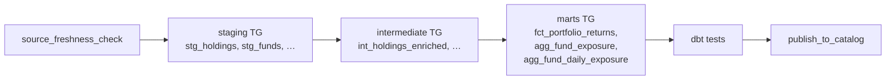

# Portfolio Analytics Airflow — Challenge 03: Orchestrate the dbt Pipeline

This challenge has two phases:

- **Phase 1** wires the portfolio-analytics dbt project into a real Airflow DAG
    using Cosmos.
- **Phase 2** makes that DAG operable with alerting, an SLA, monitoring,
    runbooks, structural tests, and a production-checklist capstone.

The dbt project under `data_products/portfolio_analytics/dbt/` is already
complete from Challenge 02. This challenge is about **orchestration**, not
authoring models.

## At A Glance

**Main task:** fill in the `# TODO` at the bottom of
`data_products/portfolio_analytics/dags/portfolio_analytics_daily.py`.

```python
# TODO: wire start -> source_freshness_check -> dbt_pipeline -> publish_to_catalog -> end
```

Everything else in the stub — imports, `profile_config`, `default_args`, the DAG
constructor, and every individual task — ships pre-built. You wire the chain.
Phase 2 walks you through the operational pieces already present in the supporting
files.

**Verify your work**

```bash
mise run challenge:verify 03
```

**Start over**

```bash
mise run challenge:reset 03
```

**Reference solution:** `challenges/v1/03-airflow-orchestration/solution/`

**Training stub:** `challenges/v1/03-airflow-orchestration/stubs/`

---

## Phase 1: Orchestrate the dbt pipeline with Cosmos

dbt answers *what to transform*; Airflow answers *when, in what order, with
retries, and history*. By the end of Phase 1 you have a scheduled DAG that runs
`source → staging → intermediate → marts → tests` as one Cosmos task group, with
a freshness gate in front and retries with backoff behind.

The starter ships as a **complete, parseable DAG** — the freshness gate, the
Cosmos `dbt_pipeline` group, the schedule, and the retries are all built. The one
piece you author is the **dependency wiring** that connects them (section 6);
every other section walks you through a pre-built piece so you understand it, and
its collapsible shows the code already in the starter. Work the sections in order.

> **Databricks is the platform.** dbt runs through Cosmos against your Databricks
> SQL warehouse; nothing here uses a local engine. The dbt project under
> `data_products/portfolio_analytics/dbt/` is already complete — this lab is
> about orchestration, not authoring models.

### What You Will Orchestrate

The dbt project ships complete: four raw sources, five staging models, three
intermediate models, and three curated marts (`fct_portfolio_returns`,
`agg_fund_exposure`, `agg_fund_daily_exposure`), with generic tests and a NAV
reconciliation test. Your DAG runs all of it.

### The Pipeline You Will Orchestrate



Cosmos renders the staging / intermediate / marts / tests boxes from the dbt
project automatically — you build the `freshness → dbt_pipeline → publish`
spine around them.

### Every Section Has The Same Shape

1. **Concept** — what the idea is and why it exists.
2. **Challenge (authoring)** — the exact starter file you complete.
3. **Hint** — where to look, and the shape of the answer.
4. **How to check** — a command to run, and the observable result.
5. **Try a variation** — an optional small twist to make the step your own.

Then a worked **Solution** you compare against once you have tried it yourself.

### Time Budget

| # | Section | Approx. time |
|---|---------|--------------|
| 1 | Why orchestration | `<5min` |
| 2 | Anatomy of a DAG | `~5min` |
| 3 | Connect to Databricks (`dbt debug`) | `~10min` |
| 4 | Your first task: the freshness gate | `~10min` |
| 5 | The Cosmos `DbtTaskGroup` | `~15min` |
| 6 | Wire the dependency chain | `~10min` |
| 7 | Scheduling (timezone-aware cron) | `~5min` |
| 8 | Retries and exponential backoff | `~10min` |
| 9 | First full run | `~10min` |
| 10 | Reading logs and re-running | `~5min` |
| | **Phase 1 total** | **~1.5 hr** |

### Prerequisites

Open the repo in VS Code and reopen it in the devcontainer. It ships with
Airflow 3.x, astronomer-cosmos 1.15, apache-airflow-providers-databricks 7.7.4,
the Astro CLI, and dbt-databricks. First time only, run Databricks setup so dbt
and Cosmos can connect:

```bash
mise run setup:databricks
```

It launches a browser OAuth login and persists host, warehouse, catalog, and
schema. The in-repo dbt profile (`data_products/portfolio_analytics/dbt/profiles.yml`)
authenticates with a short-lived `DBT_ACCESS_TOKEN` that `.mise/env.sh` mints
from your OAuth session on each mise run, so there is no static token to manage.
The DAG resolves the same profile through `profiles_yml_filepath`.

> **Auth is OAuth-based, no static token to manage.** The setup script logs you
> in once with `databricks auth login`. The in-repo dbt profile reads a
> short-lived `DBT_ACCESS_TOKEN` that mise mints from that OAuth session; there
> is no access token to keep, commit, or revoke.

**Provision your raw source feeds (first time only).** The DAG reads four raw
feeds — custodian, Bloomberg, FX, and product reference — from your training
schema. They are the same feeds challenge 02 builds on, so reuse its seed step:
it lands them in your schema with a fresh `_extracted_at`, so the freshness gate
passes on a green run.

```bash
(cd challenges/v1/02-dbt-pipeline/dbt && dbt seed)
```

**Boot your local Airflow and leave it running.** The section-4 and section-5
checks run their task inside the live scheduler, so start the stack now. The
first boot takes a few minutes; it stays up for the rest of the challenge.

> **Start it _after_ setup finishes.** `astro dev start` captures your Databricks
> settings (host, warehouse `http_path`, catalog, schema) from the shell
> environment at boot, and the DAG needs them at parse time. Those values are
> written by `mise run setup:databricks`, so let that command — and the
> devcontainer's first-run initialization — finish before you boot. If you started
> the stack earlier, run `astro dev restart` so it picks them up.
>
> **Symptom of a cold start:** the DAG fails to import entirely. `astro dev run dags
> list-import-errors` is non-empty and shows a Cosmos error ending in:
>
> ```
> Credentials in profile "portfolio_analytics", target "dev" invalid:
>   Invalid catalog name : ``.
> ```
>
> The empty catalog name is the tell — the Astro containers booted without
> `DBT_CATALOG` set. `dbt` in your devcontainer terminal still works fine, which is
> what makes this confusing: the containers captured the environment at boot, so
> fixing your shell does not fix them. Recover with:
>
> ```bash
> echo "$DBT_CATALOG"          # blank? your shell is the problem, not Airflow
> mise run setup:databricks    # writes the settings AND the shell hook that loads them
> # open a NEW terminal, then:
> astro dev restart --wait 5m
> astro dev run dags list-import-errors   # expect: No data found
> ```
>
> Start the restart from a **new** terminal where `echo "$DBT_CATALOG"` prints a real
> value. A restart launched from the same blank shell just re-captures the same blanks.

```bash
cd /workspaces/edo-training-data-products
astro dev start
```

When it finishes and prints the project URLs, open the Airflow UI at the URL `astro` prints — it is a per-project hostname and port, like `http://edo-training-data-products.localhost:6563`, not a fixed `localhost:8080`.

DAG edits live in `data_products/portfolio_analytics/dags/`; dbt commands run
from `data_products/portfolio_analytics/dbt/`.

You will switch directories in this challenge: run `astro`/`mise` commands from
the repo root, and run raw `dbt` commands from
`data_products/portfolio_analytics/dbt/`.

The starter `data_products/portfolio_analytics/dags/portfolio_analytics_daily.py`
**ships complete and parseable** — every task is already built. The single
`# TODO` is the dependency wiring you add in section 6. The dbt project, the
callbacks transport, and the devcontainer are complete too — you do not rebuild
plumbing.

---

### 1. Why orchestration

**Concept.** You can already build the pipeline by hand:
`cd data_products/portfolio_analytics/dbt && dbt build`. That works once, when
you are watching. It cannot retry a task that flaked, page anyone when it
breaks, remember yesterday's run, run itself at 06:00, or refuse to build on a
stale source feed. Those are the gaps an orchestrator fills.

Airflow runs your dbt models as a **DAG** — a directed acyclic graph of tasks
where each edge says "this waits for that" — on a schedule, with retries, logs,
and alerting. The conductor metaphor holds: Airflow plays no instrument (dbt
transforms, Databricks stores), it just tells each tool when to start and what
to do when something goes wrong.

Docs: [Airflow concepts](https://airflow.apache.org/docs/apache-airflow/stable/core-concepts/overview.html)

**Challenge (authoring).** Nothing to write here — read. Open
`data_products/portfolio_analytics/dags/portfolio_analytics_daily.py` and read
the module docstring and the topology comment. Then answer, from what you see:

1. What runs first, and why is it the freshness gate rather than the build?
2. Which task carries the SLA, and what is the business deadline?
3. Where does dbt actually execute — on the Airflow worker, or inside Databricks?

**Hint.** Read the code, not the docstring: the stub's docstring is deliberately two lines,
and the operators themselves are the answer. `source_freshness_check` and
`publish_to_catalog` are `PythonOperator`s, `dbt_pipeline` is the Cosmos `DbtTaskGroup`, and
`start`/`end` are `EmptyOperator`s. `publish_to_catalog` carries the `sla=timedelta(minutes=90)`.
Cosmos's execution mode is set by `ExecutionConfig(dbt_executable_path=...)` — dbt runs on the
Airflow worker, issuing SQL to Databricks. The freshness gate is first so a stale feed fails
the run *before* any compute is spent.

**How to check.** No command — this section is reading. Confirm you can name
the four spine tasks and the one task group between them.

**Try a variation (optional).** Read the second DAG,
`data_products/portfolio_analytics/dags/databricks_submit_run_dag.py`, and note
how the *same* pipeline is expressed when dbt runs inside Databricks as a Job.
You wire that variant as a stretch in Phase 2.

---

### 2. Anatomy of a DAG

**Concept.** A DAG is a Python object built inside a `with DAG(...) as dag:`
block in a file under `dags/`. Airflow scans that folder, imports each `.py`
file, and registers every `DAG(...)` it finds. The constructor takes a
`dag_id` (unique, matches the filename), a `schedule`, a `start_date`,
`default_args` (a dict every task inherits), and `tags`. Tasks created inside
the block attach to the DAG automatically; `>>` between them declares the
order.

Docs: [DAGs](https://airflow.apache.org/docs/apache-airflow/stable/core-concepts/dags.html)

**Challenge (authoring).** Read the skeleton's DAG block so the questions are
answerable. In
`data_products/portfolio_analytics/dags/portfolio_analytics_daily.py`, find the
`with DAG(...)` call and the `default_args` dict above it. Answer:

1. What is the `dag_id`, and does it match the filename?
2. What two `EmptyOperator` bookend tasks frame the pipeline?
3. Which dict is inherited by every task, and what is in it so far?

The skeleton already imports `DAG`, `EmptyOperator`, `PythonOperator`, and the
Cosmos classes, and defines `start` and `end`. That is expected — you fill the
middle across the next sections.

**Hint.** `EmptyOperator` tasks do no work; `start` and `end` are markers that
make the graph read cleanly in the UI. `default_args` is where retries and the
failure callback live (sections 8 and Phase 2).

**How to check.** Check the DAG file parses — a syntax check, no airflow or
warehouse needed (run from the repo root):

```bash
python -c "import ast; ast.parse(open('data_products/portfolio_analytics/dags/portfolio_analytics_daily.py').read()); print('parses OK')"
```

You should see `parses OK`. This only checks Python syntax; a **full DagBag load**
— resolving imports and rendering the Cosmos task group, which needs the
`databricks_default` connection — happens once the stack is up, which you did in
the Prerequisites. Confirm it now: `astro dev run dags list` lists
`portfolio_analytics_daily` and `astro dev run dags list-import-errors` is empty.

> **Running Airflow CLI commands.** Airflow runs inside the astro containers, so
> the `airflow` CLI is not on your devcontainer `PATH`. With the stack up from
> the Prerequisites (`cd /workspaces/edo-training-data-products && astro dev start`), prefix Airflow commands with
> `astro dev run` (e.g. `astro dev run dags list`), which runs them in the scheduler.

**Try a variation (optional).** Add a throwaway tag to the `tags=[...]` list,
re-run the parse check, and confirm it still parses; then remove it.

---

### 3. Connect to Databricks (`dbt debug`)

**Concept.** Cosmos does not invent a connection — it reads the in-repo dbt
profile. dbt itself still needs to reach the warehouse, and the fastest way to
prove the whole chain (host, warehouse, catalog, schema, auth) is green is
`dbt debug` from the dbt project. The same OAuth session the setup script
establishes is what mise uses to mint the short-lived `DBT_ACCESS_TOKEN` that
the in-repo profile reads at run time.

**Challenge (authoring).** You already ran `mise run setup:databricks` in the
Prerequisites — it took catalog `training_dev` and schema `training_$(whoami)`.
Nothing to re-run here; the task is to prove the connection with `dbt debug`.

**Hint.** The in-repo profile is
`data_products/portfolio_analytics/dbt/profiles.yml`; it reads
`DATABRICKS_HOST`, `DATABRICKS_HTTP_PATH`, `DBT_CATALOG`, and `DBT_SCHEMA`
from the environment, which the setup script exports, and authenticates with
`DBT_ACCESS_TOKEN` that `.mise/env.sh` mints from your OAuth session.

**How to check.**

Each dbt peek below is a self-contained `(cd data_products/portfolio_analytics/dbt && dbt …)` command, so you can run it while staying at the repo root — where the `astro` commands in this challenge run. (The `mise run challenge:*` gate and reset commands also run from anywhere in the repo.)

> **dbt can't find your credentials?** (e.g. `Runtime Error ... auth_type: oauth is required when not using access token`.) Your shell environment is not loaded. Open a fresh terminal so mise initializes the environment, or re-run `mise run setup:databricks`, then retry.

```bash
(cd data_products/portfolio_analytics/dbt && dbt debug)
```

A green `dbt debug` (connection OK, catalog and schema resolved) means dbt —
and therefore the Cosmos task group — can reach Databricks. The summary line
should read `All checks passed!`.

**Try a variation (optional).** Read back which catalog and schema `dbt debug`
reports; confirm they are `training_dev` and your personal `training_<username>`.

---

### 4. Your first task: the freshness gate

**Concept.** The first task in a production data DAG is almost always a
**gate**: a cheap check that fails fast so the expensive build never runs on
bad inputs. `dbt source freshness` reads each source's `loaded_at_field` and
compares it to `now`; it exits **non-zero only when a source breaches its
`error_after` threshold**. The `source_freshness_check` task runs that command
and **raises on a non-zero exit**, so wiring it as the first task means a stale
custodian feed fails the run and skips everything downstream — no compute spent
building on stale data. (A `warn_after` breach prints a warning but exits zero,
so it does *not* stop the pipeline: where you set `error_after` is the real
decision.)

It is a **`PythonOperator`**, not a `BashOperator`: CG governance (the Cimon
cluster policy) blocks operators that execute arbitrary shell — `BashOperator`,
`SSHOperator`, `DockerOperator` and friends — so a compliant DAG wraps the dbt
call in a Python callable that shells out via `subprocess` and raises on a
non-zero exit.

Docs: [PythonOperator](https://airflow.apache.org/docs/apache-airflow/stable/howto/operator/python.html)

**Challenge (authoring).** In
`data_products/portfolio_analytics/dags/portfolio_analytics_daily.py`, read the
pre-built `source_freshness_check` `PythonOperator`. Its `python_callable`
(`_check_source_freshness`) runs `dbt source freshness --select source:custodian`
via `subprocess` and raises on a non-zero exit. Confirm the `DBT_PROJECT_DIR`
and `DBT_EXECUTABLE_PATH` constants the skeleton resolves near the top of the
file.

**Hint.** The callable runs `dbt source freshness --select source:custodian`
against `DBT_PROJECT_DIR`, using the dbt in the Astro cosmos venv
(`DBT_EXECUTABLE_PATH`). Scope to `source:custodian` because the custodian feed
is the one with the tight (6h) `error_after` — it is the gate that matters for
the 07:30 UK SLA.

**How to check.** Run the single task on its own, without the scheduler and
without waiting for its upstream tasks:

```bash
astro dev run tasks test portfolio_analytics_daily source_freshness_check 2026-05-04
```

> `tasks test` is not a dry run. In Airflow 3 it creates a real DAG run for that
> logical date and writes the task's state to the metadata database, so the run
> shows up in `astro dev run dags list-runs` and the attempt counter climbs each
> time you re-run it. That is expected — it is why the retry behaviour below is
> visible at all.

With a fresh feed the run ends with `Task instance state updated ...
new_state=success` — Airflow 3 logs task state as structured key/value pairs, so
do not go looking for the older `Marking task as SUCCESS` wording. To prove the
gate bites, tighten the custodian `error_after` in
`data_products/portfolio_analytics/dbt/models/sources.yml` to
`{count: 0, period: hour}` and re-run — the task should fail. Put it back.

> Expect `up_for_retry` (yellow) first, not an immediate red. `default_args` sets
> `retries=2` with exponential backoff, so the task only reaches `failed` once both
> retries are exhausted — around 9-10 minutes later. That wait is the retry behaviour
> from section 8 working, not the gate failing to fire.

> Use `0`, not `1`. The seeds carry a post-hook that stamps `_extracted_at` with
> `current_timestamp()` every time they load, so straight after the
> `dbt seed` above the feed is minutes old and a 1-hour threshold still
> passes. A threshold of `0` hours fails regardless of when you last seeded.

**Try a variation (optional).** Change `--select source:custodian` to run
freshness over all sources, re-test, and read which sources report `pass` /
`warn`.

<details><summary>Solution</summary>

The freshness gate is a `PythonOperator` whose callable runs `dbt source
freshness` scoped to the custodian source and raises on a non-zero exit. It is
the first task after `start`, so a stale feed fails the run before the build.

```python
def _check_source_freshness() -> None:
    import subprocess

    from airflow.hooks.base import BaseHook

    # Auth with the fresh OAuth token from the databricks_default connection (as
    # Cosmos does) and run dbt against the token-auth `airflow` target — the static
    # oauth profile falls back to interactive browser auth and hangs the task.
    conn = BaseHook.get_connection("databricks_default")
    freshness_env = os.environ.copy()
    freshness_env["DATABRICKS_HOST"] = (
        (conn.host or freshness_env.get("DATABRICKS_HOST", ""))
        .replace("https://", "").replace("http://", "").rstrip("/")
    )
    if conn.password:
        freshness_env["DBT_ACCESS_TOKEN"] = conn.password

    completed = subprocess.run(
        [
            DBT_EXECUTABLE_PATH,
            "source", "freshness",
            "--select", "source:custodian",
            "--project-dir", DBT_PROJECT_DIR.as_posix(),
            "--profiles-dir", DBT_PROJECT_DIR.as_posix(),
            "--target", "airflow",
        ],
        env=freshness_env,
        check=False,
    )
    if completed.returncode != 0:
        raise RuntimeError(
            "dbt source freshness failed: the custodian feed breached error_after."
        )


source_freshness_check = PythonOperator(
    task_id="source_freshness_check",
    python_callable=_check_source_freshness,
)
```

`dbt source freshness` exits non-zero only on an `error_after` breach, which
raises in the callable and skips everything downstream. A `warn_after` breach
exits zero and does not stop the pipeline. (A `PythonOperator` is used instead
of a `BashOperator` because CG governance blocks arbitrary-shell operators.)

Reference: `challenges/v1/03-airflow-orchestration/solution/dags/portfolio_analytics_daily.py`.

</details>

---

### 5. The Cosmos `DbtTaskGroup`

**Concept.** You could hand-write one task per dbt model, but the
dbt project already knows its own DAG. **Cosmos** reads the project and renders
one Airflow task per model and per test, with edges that mirror the dbt graph
(`source → staging → intermediate → marts → tests`). A `DbtTaskGroup` wraps the
whole project as a single collapsible group in the UI. Cosmos needs two
configs: a `ProjectConfig` (where the project is) and a `ProfileConfig` (how
to connect) — the latter reads the in-repo dbt profile directly via
`profiles_yml_filepath`. This approach avoids runtime connection lookups via
`BaseHook.get_connection` that can intermittently fail in Airflow 3 local
`dags test` context.

This repo runs **astronomer-cosmos 1.15**. The import path is:

```python
from cosmos import DbtTaskGroup, ProfileConfig, ProjectConfig
```

Docs: [Cosmos DbtTaskGroup](https://astronomer.github.io/astronomer-cosmos/)

**Challenge (authoring).** In
`data_products/portfolio_analytics/dags/portfolio_analytics_daily.py`, read and
understand two pre-built things:

1. The `profile_config` — a `ProfileConfig` with
   `profile_name="portfolio_analytics"`, `target_name="dev"`, and
   `profiles_yml_filepath=(DBT_PROJECT_DIR / "profiles.yml").as_posix()`.
2. The `dbt_pipeline` — a
   `DbtTaskGroup(group_id="dbt_pipeline", project_config=ProjectConfig(DBT_PROJECT_DIR.as_posix()), profile_config=profile_config, execution_config=ExecutionConfig(dbt_executable_path=DBT_EXECUTABLE_PATH), render_config=RenderConfig(test_behavior=TestBehavior.AFTER_ALL), operator_args={"install_deps": True, "append_env": True, "env": DBT_TEMPLATED_ENV})`.

**Hint.** `ProjectConfig` takes the project path as a string (`.as_posix()`).
`operator_args` is passed through to every rendered task: `install_deps` runs
`dbt deps` first; `append_env` forwards the process environment; `env` carries
`DBT_ACCESS_TOKEN` from the helper that reads the `databricks_default` connection.

**How to check.** Parsing renders the task group; confirm the model tasks appear:

```bash
astro dev run tasks list portfolio_analytics_daily | grep dbt_pipeline
```

You should see one task per dbt model and test, all prefixed `dbt_pipeline.`
(for example `dbt_pipeline.stg_holdings_run`). That list is Cosmos reading your
dbt project — you wrote none of those tasks by hand.

**Try a variation (optional).** Open the Graph view in the Airflow UI
(the DAG → Graph) and expand the `dbt_pipeline` group
to see the staging → intermediate → marts → tests shape Cosmos inferred.

<details><summary>Solution</summary>

A `ProfileConfig` points to the in-repo `profiles.yml`; a `DbtTaskGroup`
renders the whole project as one group. No task per model is written by hand.

```python
profile_config = ProfileConfig(
    profile_name="portfolio_analytics",
    target_name="dev",
    # Use the repo profile directly to avoid runtime lookups via BaseHook in
    # Airflow 3 task-execution context, which can intermittently fail to resolve
    # connection metadata during local `astro dev run dags test` runs.
    profiles_yml_filepath=(DBT_PROJECT_DIR / "profiles.yml").as_posix(),
)

dbt_pipeline = DbtTaskGroup(
    group_id="dbt_pipeline",
    project_config=ProjectConfig(DBT_PROJECT_DIR.as_posix()),
    profile_config=profile_config,
    execution_config=ExecutionConfig(dbt_executable_path=DBT_EXECUTABLE_PATH),
    # Run tests after all model builds so relationship tests don't reference
    # downstream marts before those relations exist.
    render_config=RenderConfig(test_behavior=TestBehavior.AFTER_ALL),
    operator_args={
        "install_deps": True,
        "append_env": True,
        "env": DBT_TEMPLATED_ENV,
    },
)
```

`install_deps` runs `dbt deps` before each task; `append_env` forwards the
`DATABRICKS_*` environment so every rendered task can reach the warehouse.

Reference: `challenges/v1/03-airflow-orchestration/solution/dags/portfolio_analytics_daily.py`.

</details>

---

### 6. Wire the dependency chain

**Concept.** Tasks become a pipeline only when you declare the edges. The `>>`
operator reads left-to-right: `a >> b` means "b runs after a". A `TaskGroup`
participates in the chain as a single node — `freshness >> dbt_pipeline` makes
the whole group wait for the gate, and `dbt_pipeline >> publish` makes publish
wait for every task in the group. The spine you want is
`start → source_freshness_check → dbt_pipeline → publish_to_catalog → end`:
gate first (fail fast), build in the middle (Cosmos), publish last (the
deliverable).

Docs: [task dependencies](https://airflow.apache.org/docs/apache-airflow/stable/core-concepts/dags.html#task-dependencies)

**Challenge (authoring).** In
`data_products/portfolio_analytics/dags/portfolio_analytics_daily.py`, replace
the `# TODO` at the bottom of the `with DAG(...)` block with the single
dependency line that wires all five tasks in order.

**Hint.** One line:
`start >> source_freshness_check >> dbt_pipeline >> publish_to_catalog >> end`.
That is the entire authoring task for this section.

**How to check.** The DAG-load check confirms the spine tasks and their wiring:

```bash
mise run challenge:verify 03
```

It should report all DAGs load and each of `start`, `source_freshness_check`,
`publish_to_catalog`, and `end` is present in the correct order. In the UI
Graph view, the chain runs left to right with the `dbt_pipeline` group between
the gate and publish.

**Try a variation (optional).** Temporarily drop `source_freshness_check` from
the chain (wire `start >> dbt_pipeline`) and re-parse — note that the gate now
has no downstream and the build no longer waits for it. Put it back.

<details><summary>Solution</summary>

The spine is one `>>` chain; the freshness gate sits between `start` and the
Cosmos group, and `publish_to_catalog` runs after the whole group.

```python
start >> source_freshness_check >> dbt_pipeline >> publish_to_catalog >> end
```

`dbt_pipeline` is a `TaskGroup`, so `freshness >> dbt_pipeline >> publish`
makes the group wait for the gate and publish wait for the whole group.

Reference: `challenges/v1/03-airflow-orchestration/solution/dags/portfolio_analytics_daily.py`.

</details>

---

### 7. Scheduling (timezone-aware cron)

**Concept.** A DAG's `schedule` is a cron string (or a preset like `@daily`).
The five fields are minute, hour, day-of-month, month, day-of-week, so
`0 6 * * 1-5` is "06:00, Monday–Friday". Weekdays-only is right for financial
data — markets are closed at the weekend and the feeds do not update. The subtle
part is **timezone**: Airflow stores everything in UTC, so if your `start_date`
is timezone-naive, a "06:00" schedule silently shifts by an hour across a
daylight-saving change. Anchoring `start_date` to a real zone with `pendulum`
pins 06:00 to 06:00 *UK* year-round.

Note: Airflow 3.x uses `schedule=` (not the older `schedule_interval=`).

Docs: [scheduling + timetables](https://airflow.apache.org/docs/apache-airflow/stable/authoring-and-scheduling/timezone.html)

**Challenge (authoring).** In the `with DAG(...)` call (already set in the
stub), confirm `schedule="0 6 * * 1-5"`,
`start_date=pendulum.datetime(2026, 5, 1, tz="Europe/London")`, `catchup=False`,
`max_active_runs=1` and `max_active_tasks=4` are all in place.

**Hint.** `pendulum` is already imported. `Europe/London` is the zone that
tracks BST/GMT. `catchup=False` stops Airflow backfilling every weekday since
the `start_date` on first deploy; `max_active_runs=1` stops two days' runs
overlapping. `max_active_tasks=4` is the different knob: it caps how many tasks
run **at once inside a single run**. It matters here because the Cosmos group
renders one task per dbt model — at `1` every model waits for the previous one
even when they are independent (the five staging models are), which roughly
doubled the wall-clock time of a run.

**How to check.** Read the schedule back from the parsed DAG:

```bash
astro dev run dags details portfolio_analytics_daily | grep -i -E "timetable|schedule"
```

The `timetable_summary` should be `0 6 * * 1-5` ("At 06:00, Monday through
Friday"); the `Europe/London` timezone comes from the DAG's `start_date`.

**Try a variation (optional).** Work out the worst-case finish time: 06:00
start, ~25-min build, two retries at 2/4-min backoff. Does it clear the 07:30
UK SLA? (It does — comfortably.) That budget is why the SLA is 90 minutes.

<details><summary>Solution</summary>

A weekday cron plus a timezone-aware `start_date` pins 06:00 to UK local time
across daylight-saving changes.

```python
with DAG(
    dag_id="portfolio_analytics_daily",
    ...
    start_date=pendulum.datetime(2026, 5, 1, tz="Europe/London"),
    schedule="0 6 * * 1-5",          # 06:00 UK, Mon–Fri
    catchup=False,
    max_active_runs=1,               # never two runs at once
    max_active_tasks=4,              # up to 4 tasks at once *within* a run
    ...
) as dag:
```

A naive `start_date` would make Airflow treat 06:00 as UTC, so the run would
drift to 07:00 UK for half the year — the timezone-aware date prevents that.

The two `max_active_*` settings are easy to confuse: `max_active_runs` limits
whole runs, `max_active_tasks` limits tasks inside one run. Measured on this
DAG, dropping `max_active_tasks` to `1` took a full run from ~2 minutes to
~4, because every dbt model queued behind the previous one even when they were
independent.

Reference: `challenges/v1/03-airflow-orchestration/solution/dags/portfolio_analytics_daily.py`.

</details>

---

### 8. Retries and exponential backoff

**Concept.** Tasks flake — a warehouse blip, a transient network error. A
retry policy hides the transient ones so they never page a human. Set it once
in `default_args` and every task inherits it: `retries` is how many extra
attempts, `retry_delay` the wait between them. **Exponential backoff**
(`retry_exponential_backoff=True`) grows the wait each attempt — 2 min, then 4,
then 8 — so a warehouse that needs a moment to recover gets it, capped by
`max_retry_delay`. The failure callback only fires once the retries are
*exhausted*, so a single transient failure never pages.

Docs: [retries](https://airflow.apache.org/docs/apache-airflow/stable/core-concepts/tasks.html#retries)

**Challenge (authoring).** In `default_args` (already set in the stub), confirm
`retries=2`, `retry_delay=timedelta(minutes=2)`,
`retry_exponential_backoff=True`, and `max_retry_delay=timedelta(minutes=20)`.

**Hint.** `timedelta` is imported from `datetime`. Two retries with 2/4-min
backoff is ~6 minutes of recovery before the third attempt — well inside the
90-minute SLA, so retries spend spare budget without risking the deadline.

**How to check.** Force a transient failure to watch the retries. Temporarily
make the freshness callable fail (add `raise RuntimeError("boom")` at the top of
`_check_source_freshness`), trigger the DAG, and watch the task go
`up_for_retry` twice before `failed`:

```bash
astro dev run dags test portfolio_analytics_daily 2026-05-04 2>&1 | grep -iE "retry|attempt"
```

You should see two retry attempts logged. Remove the `raise` afterwards.

**Try a variation (optional).** Set `retries=0` temporarily and re-run the
forced failure — the task fails on the first attempt with no backoff. Compare
the log. Put `retries=2` back.

<details><summary>Solution</summary>

The retry policy lives in `default_args`, so every task inherits it.
Exponential backoff grows the wait between attempts and the failure callback
only fires after the retries are spent.

```python
default_args = {
    "owner": "portfolio-analytics-team",
    "retries": 2,
    "retry_delay": timedelta(minutes=2),
    "retry_exponential_backoff": True,
    "max_retry_delay": timedelta(minutes=20),
    "on_failure_callback": on_failure_callback,
    "on_retry_callback": on_retry_callback,
}
```

Two retries with 2/4-min backoff absorb a transient warehouse blip in ~6
minutes — well inside the 90-minute SLA — without paging anyone.

Reference: `challenges/v1/03-airflow-orchestration/solution/dags/portfolio_analytics_daily.py`.

</details>

---

### 9. First full run

**Concept.** With the gate, the Cosmos group, the chain, the schedule, and
retries all in place, the DAG is the orchestrated equivalent of `dbt build`. A
new DAG starts **paused** — Airflow knows it but the scheduler will not fire it.
`unpause` flips that; `trigger` asks for one immediate run on top of the
schedule. The proof the DAG works is **warehouse parity**: it should land the
marts in the same state a plain `dbt build` does, because both run the same
models.

> **If `unpause` reports `No paused DAGs were found`, nothing is wrong.** Paused
> state lives in Airflow's own metadata database, which sits in a Docker volume
> that survives `astro dev restart` and `mise run challenge:reset 03` — neither of
> those touches it. So "starts paused" is true the *first* time only; if you or an
> earlier attempt already unpaused this DAG, it stays unpaused. Skip straight to
> `trigger`.

Docs: [dags trigger/test](https://airflow.apache.org/docs/apache-airflow/stable/cli-and-env-variables-ref.html)

**Challenge (authoring).** Nothing new to write — run the DAG end to end and
read the result. Unpause and trigger it:

```bash
astro dev run dags unpause portfolio_analytics_daily
astro dev run dags trigger portfolio_analytics_daily
```

**Hint.** Three UI views to know: **Grid** (runs over time), **Graph** (the
task chain for one run), **Logs** (per task). The `dbt_pipeline` group expands
to show every model and test as its own node.

**How to check.** Confirm the run lands green and the marts are populated. After
the run reaches `success`, check parity against a direct build:

```bash
(cd data_products/portfolio_analytics/dbt && dbt show --select fct_portfolio_returns --limit 5)
```

You should see mart rows previewed — the same rows a plain `dbt build` produces,
because both ran the same models on Databricks.

**Try a variation (optional).** Trigger the DAG a second time and re-run the
preview. The rows should be unchanged — the pipeline is idempotent because the
marts materialise with `create or replace`.

<details><summary>Solution</summary>

There is no new code for this section; the deliverable is a green end-to-end
run. Unpause, trigger, and confirm the run reaches `success` in the Grid view,
then check warehouse parity.

```bash
astro dev run dags unpause portfolio_analytics_daily
astro dev run dags trigger portfolio_analytics_daily
# after success (run dbt from its project folder):
(cd data_products/portfolio_analytics/dbt && dbt show --select fct_portfolio_returns --limit 5)
```

The DAG and a plain `dbt build` land the warehouse in the same state — that
parity is the proof the orchestration is correct.

Reference: `challenges/v1/03-airflow-orchestration/solution/dags/portfolio_analytics_daily.py`.

</details>

---

### 10. Reading logs and re-running

**Concept.** When a task fails, you do two things: read its log to find the
cause, then **clear** it to re-run once you have fixed the cause. Clearing a
task (with "Include Downstream") re-queues it and everything after it *without*
creating a new DAG run — the right move when a transient or upstream issue is
resolved. "Mark success" is the escape hatch for a known-good failure you do
not want to re-run. This clear-and-rerun loop is exactly what the runbook
(Phase 2) tells the on-call engineer to do.

Docs: [re-run / clear](https://airflow.apache.org/docs/apache-airflow/stable/core-concepts/dag-run.html#re-run-dag)

**Challenge (authoring).** Nothing new to write — practise the failure loop.
Break one model so a `dbt_pipeline` task fails, watch the failure propagate,
then fix and clear. A clean way to break it: tighten the custodian `error_after`
in `data_products/portfolio_analytics/dbt/models/sources.yml` to
`{count: 0, period: hour}` so the freshness gate fails.

**Hint.** Trigger the DAG, open the failed run's Graph view, click the red task
→ Logs, read the cause. Then put the threshold back, click the failed task →
Clear → check "Include Downstream" → Confirm.

> **Clear from the UI, not the CLI.** Clicking the task clears exactly the run you
> clicked. The CLI equivalent has no run id — it scopes by *date*, so it can clear
> several runs at once and re-run all of them, which on this DAG is around twenty
> minutes of warehouse compute you did not ask for. If you have no browser access and
> must use the CLI, read the Solution below first.

> Section 8 gave every task `retries: 2` with exponential backoff, so the broken
> gate first sits in `up_for_retry` (yellow) and only turns terminally `failed`
> (red) once both retries are exhausted — several minutes later. That is the
> retry policy working, not a stuck task. Wait it out, or set `retries: 0` in
> `default_args` while you practise this loop if you would rather see the
> failure immediately.

**How to check.** After the clear, the run should reach `success` and the
downstream tasks (which were `upstream_failed` / `skipped`) re-run green:

```bash
astro dev run tasks states-for-dag-run portfolio_analytics_daily <run_id>
```

The failed task and its downstream show `success` after the clear. (Find the
`<run_id>` with `astro dev run dags list-runs portfolio_analytics_daily`.)

**Try a variation (optional).** Instead of clearing, "Mark success" on the
failed gate and observe that downstream still runs but on whatever data is there
— a reminder that "mark success" skips the check rather than fixing it.

<details><summary>Solution</summary>

There is no new code; the deliverable is the muscle memory. Read the failed
task's log for the cause, fix it, then Clear with "Include Downstream" to
re-run the task and everything after it in the same DAG run.

```bash
# find the run and inspect its task states:
astro dev run dags list-runs portfolio_analytics_daily
astro dev run tasks states-for-dag-run portfolio_analytics_daily <run_id>
```

Then clear it **from the UI**: click the failed task → Clear → check "Include
Downstream" → Confirm. The UI clears only the run you clicked, which is what you
want here.

> **Do not clear from the CLI without scoping it.** `astro dev run tasks clear`
> takes no run id: left unscoped it matches that task in *every* historical DAG
> run, and `--yes` suppresses the confirmation that would have shown you so. On
> this DAG that means clearing nine runs and re-running all of them, serialized
> by `max_active_runs=1` — roughly twenty minutes of unrequested warehouse
> compute. Always run it **without** `--yes` first and read the
> `You are about to delete these N tasks` line before confirming.

If you do use the CLI, scope it by logical date. `-e` is a timestamp, so an end
date of the same day parses to midnight and matches nothing — use the next day:

```bash
# scoped to one CALENDAR DAY -- not to one run:
astro dev run tasks clear portfolio_analytics_daily -t source_freshness_check \
  --downstream -s 2026-08-05 -e 2026-08-06
```

`-s` / `-e` filter on `logical_date` and their granularity is a **day**, so a day that
contains both a scheduled run and one of yours will match **both** — one trainee run saw
`You are about to delete these 34 tasks` across two DAG runs. They also cannot select a
run started with a plain `dags trigger`, which carries no logical date. **If you want
exactly one run, clear it from the UI** — that is the only run-scoped option. Reserve the
CLI for when you genuinely want a date range, and always read the count before confirming.

Clearing re-queues the task and its descendants without a new DAG run — the
same recovery the runbook prescribes for an on-call engineer.

Reference: the recovery procedure is documented in
`challenges/v1/03-airflow-orchestration/solution/include/runbooks/portfolio_analytics.md`.

</details>

---

### Phase 1 Summary

You have the dbt pipeline running as a scheduled Airflow DAG on Databricks: a
freshness gate that fails fast on a stale feed, a Cosmos `DbtTaskGroup` that
renders the whole dbt project as one group, the spine wired
gate → build → publish, a timezone-aware weekday schedule, retries with
exponential backoff, a green first run, and the clear-and-rerun recovery loop.

The tiered alerting, the SLA wiring, the runbook, the monitoring config, the
consumer guide, the structural tests, and the paved-path
`DatabricksSubmitRunOperator` variant are all in Phase 2 below.

---

## Phase 2: Production operations

Phase 1 left you with a running baseline: a scheduled DAG that drives the dbt
pipeline on Databricks through a Cosmos `DbtTaskGroup`, with a freshness gate
and retries. That makes the pipeline *run*. Phase 2 makes it **operable**:
tiered alerting wired through callbacks, an SLA that catches a slow run, a
monitoring config, the runbook and consumer-onboarding doc the next on-call
engineer reads, structural tests that guard the DAG, the paved-path
`DatabricksSubmitRunOperator` variant, and a capstone that assembles a complete
production-ready DAG.

Every challenge is self-contained. Each defines the operations idea it uses
before you apply it. The shape is always four parts:

- **Concept** — the idea, in plain English.
- **Goal** — the operational outcome in one line.
- **Authoring task** — exactly what you write, and into which starter file.
- **How to check** — a command to run, or an observable result.

Write your own answer first; a worked **Solution** follows each challenge for
you to compare against. A few conventions hold throughout: Databricks is the
only platform; alerting is **Slack-free, PagerDuty-free** — P1 emits a Datadog
event (support pages the on-call via xMatters from the payload), P2 notifies
Microsoft Teams through the vendor-neutral `send_alert`, P3 opens a ticket; the
transports degrade to a log line when their credential env var is unset, so
everything runs offline in the DAG-load check.

Budget roughly ~10 min per challenge — a pacing target, not a deadline. Work
the challenges in order: they build on each other, and challenge 10 assembles
the pieces into one production-ready DAG.

---

### Challenge 1: The vendor-neutral alert transport

**Concept.** Every alert in this pipeline goes through one boundary:
`send_alert` in
`data_products/portfolio_analytics/include/alerting/notifications.py`. It posts
to a team-chat **webhook** held in an Airflow HTTP connection
(`alert_webhook`) — there is no Slack SDK and no hard-coded webhook URL in the
code (the Teams webhook lives in the connection, not the source). That single boundary is what keeps the pipeline vendor-neutral: swap the
webhook behind the connection and nothing else changes. Callbacks call
`send_alert(text=...)`; they never know which chat tool is on the other end.

**Goal.** One transport function the P2 (team-chat) tier calls, with no chat
vendor named in the code.

**Authoring task.** Read
`data_products/portfolio_analytics/include/alerting/notifications.py` and
confirm its shape: it builds an
`HttpHook(method="POST", http_conn_id="alert_webhook")`, assembles a
`{"text": text}` payload (adding `channel` only when passed), and
`hook.run(...)`s it. This file ships complete — your job is to understand it,
because every callback in the next challenge calls it. Confirm there is no
hard-coded webhook URL or vendor name anywhere in the file.

**How to check.**

```bash
python -c "import ast; ast.parse(open('data_products/portfolio_analytics/include/alerting/notifications.py').read()); print('parses OK')"
grep -niE 'https?://|slack_sdk|WebhookClient|hooks\.slack' data_products/portfolio_analytics/include/alerting/notifications.py || echo "no hard-coded URL or vendor SDK — good"
```

The parse should succeed and the grep should find nothing — the only coupling is
to the `alert_webhook` Airflow connection id.

<details><summary>Solution</summary>

`send_alert` is the one transport boundary. It resolves the webhook from the
`alert_webhook` Airflow connection and posts the message — no vendor named in
the code.

```python
from airflow.providers.http.hooks.http import HttpHook


def send_alert(text, channel=None, conn_id="alert_webhook"):
    hook = HttpHook(method="POST", http_conn_id=conn_id)
    payload = {"text": text}
    if channel is not None:
        payload["channel"] = channel
    hook.run(endpoint="", json=payload)
```

Swapping the team's chat tool means re-pointing the `alert_webhook` connection
— no code change.

Reference: `challenges/v1/03-airflow-orchestration/solution/include/alerting/notifications.py`.

</details>

---

### Challenge 2: Tiered failure alerting — page on P1, notify on P2

**Concept.** Not every event deserves the same channel. A task that fails after
exhausting its retries means the pipeline is down and the 07:30 UK SLA is at
risk — that is a **P1**: it emits a Datadog event (the auto sink; support pages
the on-call via xMatters from the payload) *and* notifies Microsoft Teams.
Matching severity to channel is the whole point of tiering: an xMatters page
wakes a human, so it is reserved for "the mart will be late". The
`on_failure_callback` is set in `default_args`, so it fires for any task in the
DAG once its retries are spent.

**Goal.** A failure callback that emits a Datadog event (P1, the auto sink) and
posts to Microsoft Teams (P2), wired so it fires once a task's retries are
exhausted.

**Authoring task.** Read `on_failure_callback(context)` in
`data_products/portfolio_analytics/dags/callbacks.py`. It ships complete — your
job is to understand it, not retype it. Trace how it pulls `task_instance` and
`dag_run` from `context`, builds a `detail` dict (dag_id, task_id, run_id,
log_url, exception), then calls the `_emit_datadog(...)` helper (severity
`"error"`) and `send_alert(...)` with a message naming the DAG, task, log URL,
and a runbook link. The `_emit_datadog` helper posts to the Datadog Events API
(carrying the MDS routing tags; support pages the on-call via xMatters from the
payload) and falls back to a log line when `DD_API_KEY` is unset.

**How to check.**

```bash
python -c "import ast; ast.parse(open('data_products/portfolio_analytics/dags/callbacks.py').read()); print('parses OK')"
grep -niE 'slack_sdk|hooks\.slack|slack\.com' data_products/portfolio_analytics/dags/callbacks.py || echo "no Slack SDK — good"
```

The file parses and contains no Slack reference. The behavioural proof comes in
challenge 8's structural test, which exercises the callback with the transports
stubbed.

<details><summary>Solution</summary>

The failure callback is the P1 tier: it pages and notifies. `_emit_datadog`
posts to the Datadog Events API (or logs when `DD_API_KEY` is unset); support
pages via xMatters from the payload; `send_alert` posts to Microsoft Teams.

```python
def on_failure_callback(context):
    ti = context["task_instance"]
    dag_run = context.get("dag_run")
    detail = {
        "dag_id": ti.dag_id,
        "task_id": ti.task_id,
        "run_id": dag_run.run_id if dag_run else None,
        "log_url": ti.log_url,
        "exception": str(context.get("exception")),
    }
    _emit_datadog(summary=f"DAG failure: {ti.dag_id}.{ti.task_id}",
          severity="error", detail=detail)
    send_alert(text=(
        f"*DAG failure (Datadog alerted, xMatters paged)*\n*DAG:* {ti.dag_id}\n"
        f"*Task:* {ti.task_id}\n*Log:* {ti.log_url}\n"
        f"*Runbook:* https://wiki.internal/runbooks/{ti.dag_id}"
    ))
```

It is set in `default_args`, so it covers every task — and only fires after
retries are exhausted, so a transient blip never pages.

Reference: `challenges/v1/03-airflow-orchestration/solution/dags/callbacks.py`.

</details>

---

### Challenge 3: The P2 and P3 tiers — SLA miss and retry

**Concept.** The other two tiers round out the taxonomy. An **SLA miss** means
the pipeline was slow, not down — the DAG still ran (or will), so it is a
**P2**: notify team chat, do not page. A **retry** is expected (a transient
warehouse blip) — nobody needs paging or even pinging, but a flaky task should
leave a trail, so it is a **P3**: open a ticket. `on_sla_miss_callback` has a
fixed signature Airflow calls with the missed-task list; `on_retry_callback`
gets the same `context` dict as the failure callback.

**Goal.** An SLA-miss callback that notifies team chat (P2) and a retry callback
that opens a ticket (P3) — neither pages.

**Authoring task.** Read the two remaining callbacks in
`data_products/portfolio_analytics/dags/callbacks.py`. They ship complete — your
job is to understand them.
`on_sla_miss_callback(dag, task_list, blocking_task_list, slas, blocking_tis)`
builds a comma-joined list of the missed `task_id`s and `send_alert(...)`s a P2
message naming the DAG and the tasks past SLA. `on_retry_callback(context)`
pulls `task_instance`, reads its `try_number`, and calls `open_ticket(...)` (the
P3 helper that logs when `TICKET_WEBHOOK_URL` is unset) with the task id and
log url.

**How to check.**

```bash
python -c "import ast; ast.parse(open('data_products/portfolio_analytics/dags/callbacks.py').read()); print('parses OK')"
```

The file parses. In the DAG, `on_sla_miss_callback` is wired on the DAG object
and `on_retry_callback` in `default_args`; the structural test in challenge 8
asserts the DAG carries an `sla_miss_callback`.

<details><summary>Solution</summary>

The SLA-miss callback is P2 (notify, no page); the retry callback is P3
(ticket only).

```python
def on_sla_miss_callback(dag, task_list, blocking_task_list, slas, blocking_tis):
    missed = ", ".join(t.task_id for t in task_list) or "(none)"
    send_alert(text=(
        f"*SLA miss on {dag.dag_id}*\n*Tasks past SLA:* {missed}\n"
        f"Check the run and warn downstream consumers if the 07:30 UK mart "
        f"is at risk.\n*Runbook:* https://wiki.internal/runbooks/{dag.dag_id}"
    ))


def on_retry_callback(context):
    ti = context["task_instance"]
    open_ticket(
        summary=f"Retry: {ti.dag_id}.{ti.task_id} (attempt {ti.try_number})",
        detail={"task_id": ti.task_id, "log_url": ti.log_url},
    )
```

Severity drives channel: down → page, slow → notify, flaky → ticket.

Reference: `challenges/v1/03-airflow-orchestration/solution/dags/callbacks.py`.

</details>

---

### Challenge 4: Wire the callbacks and the SLA into the DAG

**Concept.** Callbacks do nothing until they are attached. Three attachment
points, each at the right scope: `on_failure_callback` and `on_retry_callback`
go in `default_args` (every task inherits them); `sla_miss_callback` goes on
the `DAG(...)` object (it is a DAG-level event); `on_success_callback` goes on
the **final task only** (so it fires once per successful run, not once per
task). The SLA itself is a `timedelta` on the task you want to time — here
`publish_to_catalog`, because end-to-end-by-90-minutes is what the 07:30 UK
deadline means.

**Goal.** The three callback tiers and the 90-minute SLA wired at the right
scopes so a failure pages, an SLA miss notifies, and a green run pings once.

**Authoring task.** Nothing to write — this one ships already wired, and your job
is to verify each attachment point so you know where callbacks hang. In
`data_products/portfolio_analytics/dags/portfolio_analytics_daily.py`: confirm
the four callbacks are imported from `callbacks`; confirm `on_failure_callback`
and `on_retry_callback` are in `default_args`; confirm
`sla_miss_callback=on_sla_miss_callback` is on the `DAG(...)` call; and confirm
`publish_to_catalog` has `sla=timedelta(minutes=90)` and
`on_success_callback=on_success_callback`.

**How to check.**

```bash
mise run challenge:verify 03
pytest data_products/portfolio_analytics/tests/ -q -k "callback or sla"
```

The DAG loads, and the structural tests confirm `default_args` carries a failure
callback, the DAG carries an `sla_miss_callback`, and `publish_to_catalog` has
an SLA.

<details><summary>Solution</summary>

Each callback is attached at its correct scope; the SLA is a timedelta on the
publish task.

```python
from callbacks import (
    on_failure_callback, on_retry_callback,
    on_sla_miss_callback, on_success_callback,
)

default_args = {
    ...
    "on_failure_callback": on_failure_callback,   # every task
    "on_retry_callback": on_retry_callback,        # every task
}

with DAG(
    ...
    sla_miss_callback=on_sla_miss_callback,        # DAG-level
) as dag:
    publish_to_catalog = PythonOperator(
        task_id="publish_to_catalog",
        python_callable=_publish_to_catalog,       # logs a publish message
        sla=timedelta(minutes=90),                 # times the whole run
        on_success_callback=on_success_callback,   # final task only
    )
```

Scope is the whole lesson: failure/retry are per-task defaults, SLA-miss is
DAG-level, success is final-task-only.

Reference: `challenges/v1/03-airflow-orchestration/solution/dags/portfolio_analytics_daily.py`.

</details>

---

### Challenge 5: The source-freshness gate as a contract

**Concept.** Phase 1 wired the freshness task; here you make its thresholds a
deliberate **contract** rather than a default. `dbt source freshness` fails the
gate only on an `error_after` breach, so where you set `error_after` is where
you draw the line between "stale enough to block" and "old but acceptable". The
custodian feed is the binding one: it lands by 02:00 UK and the SLA is 07:30,
so a 6-hour `error_after` means a feed more than 6 hours stale blocks the run
— but a feed 5 hours old (past the 4-hour `warn_after`) only warns and the
pipeline proceeds on borderline data. That gap is a decision, not an accident.

**Goal.** A freshness contract whose `error_after` on the custodian source is
set where you can defend it, gating the DAG.

**Authoring task.** Read
`data_products/portfolio_analytics/dbt/models/sources.yml` and confirm the
custodian source's `freshness` block:
`warn_after: {count: 4, period: hour}` and
`error_after: {count: 6, period: hour}`, with
`loaded_at_field: _extracted_at`. This ships configured — your task is to
exercise it and decide whether 6 hours is the right blocking threshold for
*your* SLA, then prove the gate fires.

**How to check.**

```bash
(cd data_products/portfolio_analytics/dbt && dbt source freshness --select source:custodian)
```

With the bundled data the custodian line reports `pass` or `warn`. Tighten
`error_after` to `{count: 0, period: hour}`, re-run, and watch it flip to
`error` (exit non-zero) — that is the gate that would stop the DAG. Put it
back to 6 hours.

<details><summary>Solution</summary>

The freshness contract lives in `sources.yml`; `error_after` is the threshold
that actually blocks the DAG.

```yaml
sources:
  - name: custodian
    config:
      loaded_at_field: _extracted_at
      freshness:
        warn_after:  {count: 4, period: hour}
        error_after: {count: 6, period: hour}
    tables:
      - name: holdings_raw
      - name: positions_raw
```

A 5-hour-old feed warns but exits zero (pipeline runs); a 7-hour-old feed
errors and the freshness gate fails. Tightening `error_after` blocks
sooner at the cost of false alarms — that trade-off is the decision the
threshold encodes.

Reference: `challenges/v1/03-airflow-orchestration/solution/dbt/models/sources.yml`
and the `source_freshness_check` task in
`challenges/v1/03-airflow-orchestration/solution/dags/portfolio_analytics_daily.py`.

</details>

---

### Challenge 6: The monitoring config

**Concept.** Alerting tells you when something just broke; **monitoring** tells
you when something is *drifting* before it breaks. A monitoring config declares
the panels that track pipeline health — each a metric, an alert condition, and a
channel. Five panels cover most pipelines (run status, duration, task-failure
rate, SLA compliance, source freshness). The sixth is the one that catches the
nastiest failure mode: a **fresh-but-truncated** feed. Freshness watches the
clock; a volume-anomaly panel watches the row count, so a short extract that
passes freshness but fails completeness is caught at ingestion, not three steps
later at the test gate.

**Goal.** A six-panel monitoring config whose channels are Slack-free and whose
sixth panel catches a fresh-but-short feed.

**Authoring task.** Read
`data_products/portfolio_analytics/include/monitoring/portfolio_analytics.yml`
and confirm the six panels. Check that every `alert_channel` is one of
`datadog` / `teams` / `ticket` (no Slack, no PagerDuty), that "SLA compliance"
routes to `datadog, teams`, and that "Source volume anomaly" fires when today's
`holdings_raw` row count drops below 80% of the trailing-7-day average. This
file ships complete; understand why the sixth panel exists — it is the
`INC`-style fresh-but-truncated failure mode the first five all miss.

**How to check.**

```bash
grep -cE '^  - name:' data_products/portfolio_analytics/include/monitoring/portfolio_analytics.yml   # expect 6
grep -niE 'alert_channel.*slack' data_products/portfolio_analytics/include/monitoring/portfolio_analytics.yml || echo "no Slack channel — good"
```

There are six panels, and no `alert_channel` routes to Slack.

<details><summary>Solution</summary>

Six panels; the sixth is the volume-anomaly panel that catches a
fresh-but-short feed. Channels are datadog / teams / ticket only.

```yaml
  - name: "Source volume anomaly"
    metric: >
      landed row count on the current load date for holdings_raw, vs the
      trailing 7-day average for the same weekday.
    alert_condition: >
      fire when today's rows are below 80% of the trailing-7-day average —
      a likely partial / truncated extract.
    alert_channel: "datadog, teams"
```

Freshness watches the clock; this watches the volume. Firing here lets the
on-call hold publication before exposure is understated, rather than
diagnosing a completeness-test failure after the fact.

Reference: `challenges/v1/03-airflow-orchestration/solution/include/monitoring/portfolio_analytics.yml`.

</details>

---

### Challenge 7: The runbook and the consumer guide

**Concept.** Two documents turn a pipeline you understand into one anyone can
operate. The **runbook** is the page the on-call engineer opens when an alert
lands: service overview, architecture, a common-alerts table (symptom →
diagnosis → remediation), an escalation matrix, and manual procedures. The
**consumer guide** is the page a downstream user reads to adopt the data
product: where the marts live, what each column means, sample queries, known
limitations, and freshness. Both live in the repo next to the DAG so they
change in the same pull request the code does.

**Goal.** A runbook the next on-call engineer can act on and a consumer guide a
downstream user can onboard from — both naming the real marts and the tiered,
Slack-free alert channels.

**Authoring task.** Read
`data_products/portfolio_analytics/include/runbooks/portfolio_analytics.md` and
`data_products/portfolio_analytics/include/launch/consumer-guide.md`. Confirm
the runbook's common-alerts table covers source-freshness error, dbt build
failure, dbt test failure, SLA miss, and the fresh-but-truncated feed; that
escalation names Datadog/xMatters and Microsoft Teams (no Slack); and that the
consumer guide documents `fct_portfolio_returns`, `agg_fund_exposure` and
`agg_fund_daily_exposure` with sample queries. These ship complete — verify they
are internally consistent with your DAG (task names, schedule, SLA, marts).

**How to check.**

```bash
grep -c "^### Alert" data_products/portfolio_analytics/include/runbooks/portfolio_analytics.md       # expect 5
grep -E "fct_portfolio_returns|agg_fund_exposure|agg_fund_daily_exposure" data_products/portfolio_analytics/include/launch/consumer-guide.md
grep -niE 'slack' data_products/portfolio_analytics/include/runbooks/portfolio_analytics.md data_products/portfolio_analytics/include/launch/consumer-guide.md | grep -viE 'slack-free' || echo "no Slack — good"
```

Five alert entries, all three marts named in the consumer guide, no Slack anywhere.

<details><summary>Solution</summary>

The runbook's common-alerts table is the page an on-call engineer reads at
03:00 — each row is symptom → numbered diagnosis → remediation, and the
escalation path is Datadog auto-alert + xMatters page + Microsoft Teams. The
consumer guide documents all three marts with runnable sample queries and the
07:30 UK freshness SLA.

The five alert rows are: source-freshness error, dbt build failure, dbt test
failure, SLA miss, and the fresh-but-truncated feed (the failure mode freshness
alone misses). All channels are Datadog / xMatters / Microsoft Teams / ticket
— no Slack, no PagerDuty.

Reference: `challenges/v1/03-airflow-orchestration/solution/include/runbooks/portfolio_analytics.md`
and `challenges/v1/03-airflow-orchestration/solution/include/launch/consumer-guide.md`.

</details>

---

### Challenge 8: Structural tests for the DAG

**Concept.** The cheapest, highest-value Airflow test is the **structural**
test: does the file parse into the expected shape, without hitting Databricks?
It runs in milliseconds and catches most breakage — a bad import, a renamed
task, a dropped dependency edge, a secret accidentally pasted into the DAG. The
test parses the `dags/` files (no DagBag, no warehouse, no airflow), confirms the
tiered callbacks and the SLA are wired at their scopes, and greps the DAG files
for a token literal that must never be committed. The
`freshness → pipeline → publish` chain is the learner deliverable and is checked
separately by `mise run challenge:verify 03`.

**Goal.** A structural test suite that proves the DAG parses, has the right
chain, carries the callbacks and SLA, and embeds no secret.

**Authoring task.** Read
`data_products/portfolio_analytics/tests/test_dag_structure.py` and run it.
Confirm it covers: both DAGs and the callbacks module parse; the primary DAG
wires `on_failure_callback` / `on_retry_callback` (in `default_args`),
`sla_miss_callback` (DAG-level), `on_success_callback` (publish task), and
`sla=timedelta(minutes=90)` on `publish_to_catalog`; and no DAG file contains a
`dapi…` token or a workspace-host literal. This ships complete — your job is to
run it and read what each assertion guards. (The wiring chain is checked by
`mise run challenge:verify 03`.)

**How to check.**

```bash
pytest data_products/portfolio_analytics/tests/ -q
```

All assertions pass. To prove the secret check bites, paste a fake
`token = "dapi0123456789abcdef0123"` line into a DAG file and re-run — the
`test_no_secret_literals_in_dag_files` test fails. Remove it.

<details><summary>Solution</summary>

The suite parses the DAG files and asserts the callback/SLA wiring and the
absence of secrets — all without airflow or a warehouse.

```python
def test_no_secret_literals_in_dag_files():
    leak = re.compile(r"dapi[0-9a-f]{16,}|cloud\.databricks\.com|adb-\d+\.\d+\.")
    for py in DAGS_DIR.glob("*.py"):
        text = py.read_text(encoding="utf-8")
        assert not leak.search(text), f"possible secret literal in {py.name}"
```

The parse test, the callback/SLA test, and the secret test together catch the
breakage that eyeballing the DAG misses — an unwired callback, a missing SLA, a
pasted token.

Reference: `challenges/v1/03-airflow-orchestration/solution/tests/test_dag_structure.py`.

</details>

---

### Challenge 9: Stretch — the paved-path `DatabricksSubmitRunOperator` variant

**Concept.** The Cosmos variant runs dbt **on the Airflow worker**. Capital
Group's paved path runs dbt **inside Databricks** as a Job: each Airflow task
submits one step via `DatabricksSubmitRunOperator` and polls until it finishes.
The trade-off is granularity for locality — you lose Cosmos's per-model tasks
(the Databricks Job is one opaque step in the Airflow graph), but the warehouse
autoscales for the build, logs live with the data in the Databricks Jobs UI,
and the worker pool stays free. Knowing both shapes is the point: you will meet
Cosmos in dbt-centric shops and Submit-Run in Databricks-centric ones.

**Goal.** A second DAG expressing the same pipeline as four
`DatabricksSubmitRunOperator` steps that submit dbt-wrapping notebooks to
Databricks.

**Authoring task.** Read
`data_products/portfolio_analytics/dags/databricks_submit_run_dag.py` and
confirm its shape: four `DatabricksSubmitRunOperator` tasks
(`check_source_freshness` → `run_dbt_models` → `test_dbt_models` →
`generate_dbt_docs`), each submitting a `notebook_task` under
`/Workspace/data-creators/dbt/portfolio_analytics` to the
`databricks_default` connection, with the SLA on `run_dbt_models` and the
tiered callbacks reused from `callbacks.py`. This ships complete — wire it by
confirming it loads alongside the primary DAG.

**How to check.**

```bash
mise run challenge:verify 03
```

`mise run challenge:verify 03` confirms the primary DAG's wiring. Both DAGs also
parse (Challenge 8's structural test), and the submit-run DAG reuses
`on_failure_callback` and `on_sla_miss_callback` — so P1 (down) and P2 (slow)
alert identically across both shapes. It does **not** wire `on_retry_callback`
or `on_success_callback`, so despite setting `retries=2` it raises no P3 ticket
on a flaky retry and emits no success signal. Spotting that gap is the exercise:
compare its imports against the four in `portfolio_analytics_daily.py`.

<details><summary>Solution</summary>

The same pipeline, dbt-inside-Databricks. Each step is a notebook submission;
the run is one Databricks Job per task rather than a Cosmos task per model.

```python
run_dbt_models = DatabricksSubmitRunOperator(
    task_id="run_dbt_models",
    databricks_conn_id="databricks_default",
    json={
        "run_name": "portfolio_analytics_dbt_build",
        "existing_cluster_id": DATABRICKS_EXISTING_CLUSTER_ID,
        "notebook_task": {
            "notebook_path": f"{DBT_NOTEBOOK_BASE}/run_dbt_models",
        },
    },
    polling_period_seconds=60,
    timeout_seconds=3600,
    sla=timedelta(minutes=60),
)

check_source_freshness >> run_dbt_models >> test_dbt_models >> generate_dbt_docs
```

It reuses two of the Phase 2 callbacks — `on_failure_callback` (P1) and
`on_sla_miss_callback` (P2) — so those tiers behave identically to the Cosmos DAG
while only the execution surface changes. P3 (`on_retry_callback`) and the
success signal are absent here, which is worth noticing before copying this
shape into a real pipeline that sets `retries`.

Reference: `challenges/v1/03-airflow-orchestration/solution/dags/databricks_submit_run_dag.py`.

</details>

---

### Challenge 10: Capstone — a complete production-ready DAG

This is the integrative challenge. Earlier challenges each added one operational
piece; here you confirm they compose into one DAG that an on-call team could
own, and you prove it green end to end.

**Concept.** "Production-ready" is not one feature — it is the sum: the
pipeline runs on a defensible schedule, fails fast on bad inputs, retries the
transient, pages the right person at the right severity, times itself against
the business SLA, and ships with the runbook and consumer doc that let someone
else operate it. `portfolio_analytics_daily` is that sum. The capstone is to
walk the whole DAG against the checklist and run the verification gate.

**Goal.** One DAG that passes the full production checklist and the
DAG-load verification gate.

**Authoring task.** Walk
`data_products/portfolio_analytics/dags/portfolio_analytics_daily.py` against
this checklist and fix any gap you find:

1. **Schedule** — timezone-aware weekday cron (`0 6 * * 1-5`, `Europe/London`),
   `catchup=False`, `max_active_runs=1`.
2. **Fail fast** — `source_freshness_check` is the first task and gates the
   build.
3. **Build** — the Cosmos `DbtTaskGroup` renders the dbt project.
4. **Retries** — `retries=2` with exponential backoff in `default_args`.
5. **Tiered alerting** — `on_failure_callback` (P1+P2) and `on_retry_callback`
   (P3) in `default_args`; `sla_miss_callback` (P2) on the DAG.
6. **SLA** — `publish_to_catalog` carries `sla=timedelta(minutes=90)` and the
   success notification.
7. **Docs** — the runbook, consumer guide, and monitoring config are present and
   consistent.
8. **No secrets** — no token or host literal in any DAG file.

**How to check.**

```bash
pytest data_products/portfolio_analytics/tests/ -q
mise run challenge:verify 03
```

The structural tests pass and the DAG-wiring gate is green.

<details><summary>Solution</summary>

The capstone is not new code — it is the composition. `portfolio_analytics_daily`
already carries every checklist item: the timezone-aware weekday schedule, the
freshness gate first, the Cosmos group, retries with backoff, the three
callback tiers at their correct scopes, the 90-minute SLA with the success
ping, and the runbook / consumer / monitoring docs alongside.

```bash
pytest data_products/portfolio_analytics/tests/ -q
mise run challenge:verify 03
```

Passing structural tests plus a green wiring gate is a complete, operable,
Slack-free production DAG on Databricks.

Reference: `challenges/v1/03-airflow-orchestration/solution/dags/portfolio_analytics_daily.py`,
with `challenges/v1/03-airflow-orchestration/solution/dags/callbacks.py`,
`challenges/v1/03-airflow-orchestration/solution/include/`, and
`challenges/v1/03-airflow-orchestration/solution/tests/test_dag_structure.py`.

</details>

---

### Phase 2 Summary

You took the running DAG and made it operable: a vendor-neutral alert transport,
tiered Slack-free alerting (Datadog auto-sink + xMatters page / Teams notify /
ticket) wired at the right scopes, the freshness gate as a deliberate contract,
a six-panel monitoring config that catches a fresh-but-short feed, the runbook
and consumer guide the next operator reads, structural tests that guard the DAG
shape and ban committed secrets, the paved-path `DatabricksSubmitRunOperator`
variant, and a capstone that proves the whole thing is a complete,
production-ready orchestration.
