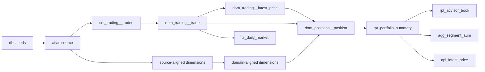

# Atlas Capstone: Build the Atlas ELT Data Product

Atlas is a fictional wealth-management platform. Your job is to turn its raw trades and
reference data into trustworthy views of portfolios, advisor books, market activity, and
fees. You will build the dbt pipeline, inspect how Airflow orchestrates it, and use the final
marts to answer a business question.

## Purpose

This capstone gives CG evidence to certify attendees as **Data Creators**: people who can
combine the key soft skills and paved-path technologies needed to create a trustworthy data
product. Those skills include framing a business outcome, collaborating across roles, reviewing
assumptions, applying quality judgement, and communicating decisions. The technologies include
AI Catalyst, dbt, Databricks, Airflow, testing, and consumer-focused documentation, including
the operational hand-offs needed to support what the team builds.

Certification is based on the evidence you create and explain as a team, not on completing one
command or writing SQL quickly.

## Learning Outcomes

By the end of the capstone, you should be able to:

- explain a data product's business purpose, consumers, and supported decisions;
- distinguish source-aligned, domain-aligned, and consumer-aligned products;
- identify source data, keys, joins, transformations, shared terminology, assumptions, and
  quality risks;
- build and test a dbt dependency graph on Databricks;
- use reconciliation and data-quality checks to establish trust;
- explain how Airflow and Databricks Jobs orchestrate the paved path and what an operational
  hand-off must communicate;
- use AI Catalyst and Copilot as reviewed engineering assistance, not unexamined output; and
- present a supported finding, its caveats, next steps, and the decision it enables.

## Who This Is For

The room may include non-technical learners, technical managers, analysts, developing engineers,
and experienced data engineers. Everyone contributes to the shared outcome:

- **Non-technical learners** focus on the business brief, data meaning, acceptance criteria,
  quality evidence, consumer value, and presentation.
- **Technical managers and product leads** focus on design choices, controls, delivery risk,
  orchestration, and team coordination.
- **Analysts and developing engineers** can follow the guided implementation and choose suitable
  extensions.
- **Experienced data engineers** may complete the baseline more quickly, then move into advanced
  extensions or the advanced own-product path.

Phase 1 is the common baseline for every team. Team members can divide business analysis,
implementation, validation, and presentation responsibilities; everyone does not need to type
every command.

## Plan of the Day

| Time | Activity |
|---|---|
| **09:00** | Start sharp: facilitator welcome, form teams, and introduce the Atlas brief. |
| **09:00–09:30/10:00** | Team discovery (30–60 minutes): complete the Atlas Product Discovery and Reverse-Mapping activity below. |
| **09:30/10:00–12:00** | Build session: establish the Phase 1 baseline or begin an agreed advanced path. |
| **12:00–13:00** | Lunch. |
| **13:00–14:30** | Continue Phase 1, select Phase 2 extensions, or develop an advanced team data product. Validate the result and prepare its story. |
| **14:30** | Stop technical work and prepare presentations. |
| **15:00** | Presentations begin. |

Take short breaks whenever you need them throughout the day. Phase 1 commonly takes teams
**1–3 hours**, depending on experience and how work is divided; an experienced engineer may
complete it in about one hour, but that is a reference point rather than a deadline. Phase 2
represents **3+ hours** of advanced work if pursued in depth, so select the challenges that add
the most value instead of expecting to finish all 14 during the scheduled day.

Every team should prepare a presentation and nominate one person to present. Facilitators will
choose a handful from the nominated presenters according to the number and length of presentation
slots available. The person who gives the opening activity playback does not have to be the final
presenter.

## Atlas Product Discovery and Reverse-Mapping

Complete this required team activity before anyone begins the guided implementation. Its purpose
is to build a shared understanding of the problem, producers, Data Creator role, consumers,
language, transformations, assumptions, and trust criteria. It is a discussion and design
activity: you do not need to write SQL, choose physical keys, or design a database schema.

### Scenario

Atlas leadership is preparing for quarterly wealth-management planning, but the information it
needs is fragmented:

- advisor leaders need to understand who manages the largest books and where AUM is concentrated;
- portfolio oversight needs a trustworthy view of portfolio value, fees, clients, and strategy;
- the trading desk needs daily activity by instrument and asset class; and
- product owners need confidence that dashboards agree when they report the same measure.

The **producers** are the Trading, Security Master, Portfolio Administration, CRM, and Fund
Reference teams. Your team is the **Data Creator**. The **consumers** are advisor leadership,
portfolio oversight, the trading desk, and product owners.

The producer source datasets are:

| Producer | Source datasets |
|---|---|
| Trading | `trades` |
| Security Master | `instruments` |
| Portfolio Administration | `portfolios` |
| CRM | `clients`, `advisors` |
| Fund Reference | `funds`, `fund_holdings` |

These are source datasets, not the source-aligned `src_*` models you will build in Phase 1.

The Phase 1 business-facing outputs are:

- `rpt_portfolio_summary` and `rpt_advisor_book`;
- `agg_segment_aum`, `agg_instrument_activity`, and `agg_fund_nav`;
- `ts_daily_market`; and
- `api_latest_price`.

### Team Task

Choose at least **two business-facing outputs** and work backwards from consumer need to source
data. For each output, discuss:

1. Who uses it, and what decision does it support?
2. What information must it contain?
3. Which producer source datasets provide that information?
4. What cleaning, calculation, joining, or filtering is likely to be needed?
5. Which terms require one agreed business definition?
6. Which assumption or data-quality problem could make the result untrustworthy?

Describe transformations in plain English. Do not write implementation SQL yet.

### One Shared Team Worksheet

Record the following four sections on one whiteboard, shared document, or worksheet:

1. **Producer–Creator–Consumer map:** who supplies the data, who creates the product, and who
   consumes each selected output.
2. **Consumer-backwards map:** `Consumer need | Business-facing output | Required sources |
   Rules and assumptions`.
3. **Mini-STTM:** map only four to six important fields using `Target field | Business meaning |
   Source field(s) | Transformation in plain English | Check`. Good starting fields are
   `advisor_name`, `trade_date`, `market_value`, `aum`, `fees_paid`, and `book_aum`.
4. **Shared glossary and trust questions:** agree definitions for AUM, position, latest price,
   gross value, fee, basis point, advisor book, and valid trade. Record questions about latest-price
   selection, invalid trades, fee calculation, reconciliation, and the lack of FX conversion.

Assign temporary discussion roles. The **facilitator** keeps the discussion moving and inclusive;
the **scribe** records decisions; the **quality challenger** tests assumptions and asks what could
make a result wrong; and the **playback spokesperson** gives a two- or three-minute summary. Combine
roles in smaller teams.

Use the 30–60 minute discovery timebox flexibly: spend about 5 minutes on roles and the scenario,
10 minutes choosing outputs and decisions, 15–25 minutes on reverse-mapping and the mini-STTM,
10 minutes on definitions and quality checks, and 5–10 minutes on playback. These are facilitation
guides, not completion targets.

Treat the worksheet as your team's working hypothesis. Phase 1 tests its source, transformation,
terminology, and quality assumptions against a working data product. Phase 2 lets technical
learners extend the product and revisit those decisions. In the final presentation, compare the
implemented result with the opening assumptions and explain what changed.

An example response is hidden in the
[appendix](#appendix-quick-reference-and-opening-team-activity-example). Review it
after your team has completed its own worksheet.

## Choose Your Capstone Path

### Guided Atlas Capstone

This is the recommended path for most attendees. Every team establishes the Phase 1 baseline.
Technical learners can then choose Phase 2 extensions that strengthen the team's outcome.

### 🚀 Advanced Path: Build Your Own Paved-Path Data Product

Attendees already working in-role as Data Creators may skip the individual guided Atlas
implementation and create their own data product using AI Catalyst, dbt, Databricks, Airflow,
testing, quality controls, and consumer-focused documentation. This is an **advanced** option;
agree it with the facilitator early so its scope fits the day.

Your team must still complete the opening discovery activity and demonstrate evidence equivalent
to the Phase 1 baseline: a named consumer and decision, approved or synthetic source data, clear
transformations and terminology, data-quality proof, an orchestration approach, and a presentation.
Do not use sensitive data or deploy to production unless the facilitator explicitly approves it.

> **Work in the product, not the templates.** Edit files only under `data_products/atlas_elt/`.
> Do not edit `challenges/v1/04-atlas-capstone/stubs/`; those files are reset templates and dbt
> does not run them. If you get stuck, compare your work with the solved references under
> `challenges/v1/04-atlas-capstone/solution/`.

## Prepare the Guided Atlas Environment

If you chose the guided path, complete these readiness checks before starting Phase 1.

Run from the repository root:

```bash
cd /workspaces/edo-training-data-products
test -f .mise.toml && test -d data_products/atlas_elt && echo "Repository root: OK"
mise exec -- databricks auth describe --profile DEFAULT
```

Run from `data_products/atlas_elt`:

```bash
cd data_products/atlas_elt
dbt debug
```

Both checks must succeed before you continue. Do not run the full project yet: several models
are intentionally placeholders that you replace in Phase 1.

---

## Understand the data

Atlas is a fictional wealth-management platform. The source data ships as **dbt seeds** —
CSVs in `data_products/atlas_elt/seeds/` — one fact table and six dimension tables.

| Seed | What it is |
|---|---|
| `trades.csv` | Trade executions: `trade_id, ts, portfolio_id, instrument_id, side, qty, price_cents, fee_bps, venue, ccy` |
| `instruments.csv` | Securities with ticker, asset class, sector, and currency |
| `portfolios.csv` | Portfolios mapped to clients and advisors |
| `clients.csv` | Clients with segment and domicile |
| `advisors.csv` | Advisors with region |
| `funds.csv` | Model funds with investment style |
| `fund_holdings.csv` | Fund-to-instrument holdings and target weights |

### Domain concepts

**Client** — the person whose money is managed. One client can own multiple portfolios.

**Advisor** — the employee responsible for a client relationship. Their *book* is the total
AUM (assets under management) they look after.

**Portfolio** — a container of investments owned by a client, with a strategy such as income,
balanced, preservation, or growth.

**Instrument** — something that can be bought or sold: equities, bonds, ETFs, or commodities.
Each has a ticker, asset class, sector, and currency.

**Trade** — a buy or sell event. Records what portfolio traded, which instrument, how many
units, the price in cents, the fee in basis points, the venue, and the currency.

**Position** — the net amount of an instrument held by a portfolio after all buys and sells.

**AUM (assets under management)** — the current value of the money being managed, estimated
by valuing positions at the latest observed price.

**Fees and basis points** — trade fees are stored in basis points (bps). One basis point is
0.01%, so `fee_bps = 5` means a fee of 0.05% of the traded value.

### How the tables relate

The `trades` fact table holds identifiers, not names. Use those IDs to connect each trade to
details in other tables, such as its portfolio, instrument, client, and advisor:

| trade_id | portfolio_id | instrument_id | side | qty | price_cents | ccy |
|---|---|---|---|---|---|---|
| 1 | 2385 | 794 | B | 145 | 10281 | USD |
| 2 | 257 | 877 | B | 78 | 5180 | CHF |

(The ids are plain integers, not prefixed codes; `trades` also carries `ts`, `fee_bps` and
`venue`, omitted above for readability.)

Following `portfolio_id` to `portfolios` tells you which client and advisor. Following
`instrument_id` to `instruments` tells you what was traded and at what price. Most consumer
marts are built by joining these tables.

### Alignment: source-aligned → domain-aligned → consumer-aligned

The three folders under `datasets/` map to three product alignments. This is the vocabulary
the course teaches and the one you will use on a real CG squad:

- **Source-aligned** (`staging/src_*`): one faithful pass-through per producing system. Keeps
  the producer's shape — clear audit path back to the extract.
- **Domain-aligned** (`integration/dom_*`): the agreed, conformed view of a business domain.
  One definition of a client, an instrument, a trade, a position — shared by every consumer.
  Cleaned, typed, and filtered.
- **Consumer-aligned** (`prepared/*` and the advisor rollup chain): shaped for how reports
  will actually be read. Named by query pattern:
  - `rpt_` — a report, one row per business question
  - `agg_` — a pre-aggregated measure grouped by a dimension
  - `ts_` — a time-series rollup, one row per entity per period
  - `api_` — a low-latency single-row lookup

> **A note on older layer names.** You will still hear *raw / staging / intermediate / curated*
> and the medallion names *bronze / silver / gold* at Capital Group. Those names describe how
> far data has been cleaned, not whose shape it is built for. This course teaches the alignment
> model. Recognise the layer names when you meet them, but reach for source-/domain-/consumer-aligned.

---

## The pipeline you will build



Phase 1 builds the baseline: seed → source-aligned → domain-aligned → consumer foundations.
Phase 2 extends it with richer consumer marts, tests, macros, and snapshots.

---

## How each section is structured

Every Phase 1 section and Phase 2 challenge follows the same pattern:

1. **Concept** — what the idea is and why it exists.
2. **Challenge / Authoring task** — the file you write or complete.
3. **Hint** — where to look and the shape of the answer.
4. **How to check** — a command or observable result.

Solutions are collapsed below each challenge. Write your own answer first, then compare.

---

## 🎯 Phase 1: Baseline for Every Team

This is the shared technical baseline. Build the source-to-consumer pipeline, test its core
reconciliations, and inspect its orchestration. Teams commonly reserve 1–3 hours depending on
experience and how responsibilities are divided; the sections below have no individual deadlines.

---

### 1. Inspect the source data

#### Concept

Before you write a single model, look at the source data. dbt **seeds** are CSVs
that live in version control and load into your warehouse with one command: a clean,
reproducible way to land a small classroom dataset. Knowing the columns and keys up front
tells you what the source-aligned, domain-aligned, and consumer-aligned products have to
work with.

Docs: [dbt seeds](https://docs.getdbt.com/docs/build/seeds)

#### Task

There is nothing to write here; read the seeds. You should still be in
`data_products/atlas_elt`. In VS Code, open its `seeds/` folder in the Explorer, then list it:

```bash
pwd
ls seeds/
```

Then open a few CSVs in the editor and look at the header row plus the first few rows. Start
with the fact seed:

```bash
head -3 seeds/trades.csv
head -3 seeds/instruments.csv
head -3 seeds/portfolios.csv
```

Then answer, from what you see:

1. Which seeds have a real-world identifier that uniquely identifies each row (often called a
  **natural key**)?
2. Which columns connect `trades` to `instruments` and to `portfolios`?
3. Which columns will need cleaning or casting before they are useful? Think about `ts`,
   `price_cents`, and `side`.

#### Hint

The column types are pinned in `dbt_project.yml` under the `seeds:` block.
`datasets/sources.yml` shows the `atlas` source declaration.

#### Check

Every seed should have a header row and consistent column counts. Open `seeds/trades.csv` in
the editor and confirm the header matches the
column list in the table above; the editor's row count in the status bar tells you how many
rows each seed carries.

**Try a variation (optional).** Match each seed to the story it tells: which table would you
need to answer "which advisor runs the biggest book?"

---

### 2. Understand the dbt project

#### Concept

dbt builds a directed graph of SQL models. This project is organised by product
**alignment**, whose shape each product is built for: **source-aligned** for faithful
pass-throughs, **domain-aligned** for cleaned and conformed products, and
**consumer-aligned** for query-shaped, business-facing marts. Each alignment has a folder and
a tag applied per-folder in `dbt_project.yml`. Materialization is not per-folder: the project
sets `+materialized: view` once for every model, and the handful that need a table override it
inline with `{{ config(materialized='table') }}`.

#### Task

Read the project layout so the questions below are answerable:

- `dbt_project.yml`: the `seeds:`, `models:`, tags, and materializations.
- `datasets/*/dbt/staging/`: the source-aligned stubs you will fill in.
- `datasets/*/dbt/integration/`: the domain-aligned stubs.
- `datasets/*/dbt/prepared/`: the consumer-aligned stubs.

Answer:

1. What is the project `name` and which `profile` does it use?
2. Which alignments are materialized as views, and which as tables?
3. What tag is assigned to each alignment?
4. How does the `datasets/sources.yml` declare the `atlas` source?

The stub model files are **deliberately placeholders**: each is a `select 1 as placeholder`
you replace. That is expected; you build them across Phase 1.

#### Hint

Open `dbt_project.yml` in VS Code and read the `models:` block. To see the stubs, open
`datasets/trades/dbt/staging/src_trading__trades.sql`.

#### Check

Install the local shared package, then ask dbt to list the models without building them:

```bash
dbt deps
dbt ls --resource-type model
```

**Try a variation (optional).** Predict from the folder configs alone which models are views
and which are tables, then confirm against the `models:` block in `dbt_project.yml`.

---

### 3. Set up your Databricks connection

#### Concept

dbt needs a SQL warehouse, a catalog, a schema, and authentication. In this
repo the `atlas_elt` profile is configured for you and reads the same environment variables
used by the rest of the workspace. You use the **pre-provisioned** catalog and schema:
catalog `training_dev`, schema `training_<username>`. You cannot create your own catalog or
schema; they are provisioned for you, and everything you build lands inside that personal
schema.

#### Task

You completed the connection check in **Prepare the Guided Atlas Environment**. If it passed, do not log in
again. If it reported that no valid profile exists, run this from the repository root and
complete the browser login:

```bash
mise run setup:databricks
```

It writes the workspace settings and configures OAuth; there is no access token to manage.

#### Hint

The profile ships twice, byte-identical: `profiles.yml` is
the one raw `dbt` picks up when you run it from inside the project (so it is the one
`dbt debug` reports), and `dbt_profiles/profiles.yml` is the copy
`mise run challenge:verify 04` points at. Either way it reads
`DATABRICKS_HOST`, `DATABRICKS_HTTP_PATH`, `DATABRICKS_CATALOG`, and `DATABRICKS_SCHEMA`
from the environment. Defaults are `training_dev` and `training_$(whoami)`. The profile's
default **local** target lands every model and seed in your personal `training_<username>`
schema (the Caspian schema macro reserves custom schema names for non-local targets, so
`local` is what keeps the capstone in your own schema).

#### Check

```bash
mise exec -- databricks auth describe --profile DEFAULT
dbt debug
```

A green `dbt debug` (connection OK, catalog and schema resolved) means you are configured.
The debug output shows which catalog and schema it will use.

---

### 4. Seed the source data

#### Concept

`dbt seed` loads the CSVs in `seeds/` into your schema as tables, using the
column types pinned in `dbt_project.yml`. That one command is the classroom ingestion path:
fully reproducible, with no file uploads. On the default local target the seeds land directly
in your `training_<username>` schema, and the source-aligned models read them through the
`atlas` source declared in `datasets/sources.yml`.

Docs: [dbt sources](https://docs.getdbt.com/docs/build/sources)

#### Task

Seeding is provided; run it:

```bash
dbt seed
```

This creates seven tables (`trades`, `instruments`, `portfolios`, `clients`, `advisors`,
`funds`, `fund_holdings`) in your personal training schema.

#### Hint

The seed configuration (per-table `+column_types`) is in `dbt_project.yml`; the `atlas`
source points at the seeded tables in your personal training schema.

#### Check

Selecting a seed node rebuilds and prints the whole seed, so query the relation to preview
only five rows:

```bash
dbt show --inline "select * from {{ source('atlas', 'trades') }}" --limit 5
```

**Try a variation (optional).** Run `dbt show --select instruments --limit 5`
and confirm the column types match what you pinned in Section 1.

---

### 5. Build source-aligned

#### Concept

The source-aligned layer is one faithful pass-through per producing system. Each
source-aligned model is a typed pass-through of one seed, read through the `atlas` source,
so the lineage `seed → source → source-aligned` is explicit and dbt knows the dependency.
Because the seeds are already typed, a source-aligned model does little more than
`select * from source(...)`.

`src_trading__trades` is reused throughout the pipeline and is much larger than each
reference dataset, so persisting it as a table avoids repeatedly scanning the seed. The six
small dimensions remain views, which avoids storing unnecessary copies while keeping them
current with their source tables.

Docs: [dbt sources](https://docs.getdbt.com/docs/build/sources)

#### Task

Complete the source-aligned stubs. Start with
`src_trading__trades` as the worked example, then do the six dimensions the same way.

Open `datasets/trades/dbt/staging/src_trading__trades.sql` and replace the placeholder so
the model reads every column straight from the `atlas` `trades` source, materialized as a
**table**. Use
`source('atlas', '<table>')` so dbt knows the dependency.

Then complete these six dimension stubs the same way, each as a pass-through of its matching
source table (dimensions are **views**, so they need no `config(materialized='table')`):

| File | Source table |
|---|---|
| `datasets/instruments/dbt/staging/src_secmaster__instruments.sql` | `instruments` |
| `datasets/portfolios/dbt/staging/src_portfolio__portfolios.sql` | `portfolios` |
| `datasets/clients/dbt/staging/src_crm__clients.sql` | `clients` |
| `datasets/advisors/dbt/staging/src_crm__advisors.sql` | `advisors` |
| `datasets/funds/dbt/staging/src_fundref__funds.sql` | `funds` |
| `datasets/fund_holdings/dbt/staging/src_fundref__fund_holdings.sql` | `fund_holdings` |

Build only the source-aligned layer:

```bash
dbt run --select tag:source-aligned
```

#### Hint

Every source-aligned model is `select *` from the matching
`source('atlas', '<table>')`. The only difference is `src_trading__trades`, which adds a
`{{ config(materialized='table') }}`; the dimensions inherit the folder default (view).

#### Check

Inspect the built table:

```bash
dbt show --select src_trading__trades --limit 5
```

**Try a variation (optional).** Add a literal `current_timestamp() as loaded_at` to
`src_trading__trades`, rebuild the source-aligned layer, and watch it appear in `dbt show`.

<details><summary>Solution</summary>

`src_trading__trades` is a typed pass-through materialized as a table; each dimension is the
same `select *` against its source, left as the folder-default view.

```sql
-- datasets/trades/dbt/staging/src_trading__trades.sql
{{ config(materialized='table') }}

select *
from {{ source('atlas', 'trades') }}
```

```sql
-- datasets/instruments/dbt/staging/src_secmaster__instruments.sql
-- (each dimension follows this same shape)
select *
from {{ source('atlas', 'instruments') }}
```

Reference: `challenges/v1/04-atlas-capstone/solution/datasets/trades/dbt/staging/src_trading__trades.sql`
and the matching files in each dimension dataset.

</details>

---

### 6. Build domain-aligned

#### Concept

The domain-aligned layer turns source-aligned rows into clean, conformed
products: one agreed definition per business domain. The headline `dom_trading__trade` gives
real dates, decimal prices, gross values, fees, a signed quantity, and tidied text, and
**intentionally filters out invalid rows**: trades with non-positive quantity or price, or a
side that is not `B`/`S`. Its row count is therefore **lower** than the source-aligned trade
fact, by design. Two more domain products live here: `dom_trading__latest_price` (the shared
current mark per instrument) and `dom_positions__position` (the position grain the consumer
marts roll up).

Docs: [dbt ref()](https://docs.getdbt.com/reference/dbt-jinja-functions/ref)

#### Task

Complete exactly these nine models in this section:

| File | Purpose |
|---|---|
| `datasets/trades/dbt/integration/dom_trading__trade.sql` | Clean, typed trade fact |
| `datasets/instruments/dbt/integration/dom_instrument__instrument.sql` | Conformed instruments |
| `datasets/portfolios/dbt/integration/dom_portfolio__portfolio.sql` | Conformed portfolios |
| `datasets/clients/dbt/integration/dom_party__client.sql` | Conformed clients |
| `datasets/advisors/dbt/integration/dom_party__advisor.sql` | Conformed advisors |
| `datasets/funds/dbt/integration/dom_fund__fund.sql` | Conformed funds |
| `datasets/fund_holdings/dbt/integration/dom_fund__holding.sql` | Conformed fund holdings |
| `datasets/market_daily/dbt/integration/dom_trading__latest_price.sql` | Latest instrument mark |
| `datasets/portfolios/dbt/integration/dom_positions__position.sql` | Netted, valued positions |

The six dimensions are conformed views of their source-aligned models: trim text,
standardise codes (uppercase ticker/ccy/domicile), and drop non-positive IDs.

Start with `datasets/trades/dbt/integration/dom_trading__trade.sql`. Build it from
`ref('src_trading__trades')` and produce the clean columns:

- `trade_date`: the epoch `ts` converted to a calendar date with the `epoch_date` macro.
- `direction`: `+1` for a buy (`side = 'B'`), `-1` for a sell.
- `price`: `price_cents` as decimal currency units (the `cents_to_decimal` macro).
- `gross_value`, `fee`, and a `signed_qty` (negative for sells).
- tidied `venue` and `ccy` (uppercase, trimmed).

Then apply the **quality filter**: keep only rows where `qty > 0`, `price_cents > 0`, and
`side in ('B', 'S')`.

Then complete the domain dimensions from their `ref('src_*')` models, and finish the two
conformed trading/positions products:

- `dom_trading__latest_price` (in `datasets/market_daily/dbt/integration/`): ranks
  `dom_trading__trade` to the newest mark per instrument using `row_number()` over `ts desc`.
- `dom_positions__position` (in `datasets/portfolios/dbt/integration/`): nets
  `dom_trading__trade` per portfolio/instrument and marks it at
  `dom_trading__latest_price`. Materialized as a **table** since several downstream products
  reuse it.

Build only the nine models you completed:

```bash
dbt run --select dom_trading__trade dom_instrument__instrument dom_portfolio__portfolio dom_party__client dom_party__advisor dom_fund__fund dom_fund__holding dom_trading__latest_price dom_positions__position
```

> **Why not `tag:domain-aligned` yet?** That broad folder tag selects 13 models. It includes
> the nine models above plus four advisor reports: `rpt_portfolio_summary`,
> `rpt_advisor_book`, `rpt_advisor_leaderboard`, and `rpt_region_report`. The first two belong
> to Section 7 and the last two to optional Phase 2 challenges, so the explicit selector keeps
> this check limited to work you have completed.

#### Hint

The `epoch_date` and `cents_to_decimal` macros live in `shared/macros/`. The direction and signed-quantity columns are
`case side when 'B' then ... end` expressions. The filter goes in a single `where` clause at
the bottom. dbt orders the build from the `ref()` graph, so the tag command builds them in
dependency order.

#### Check

The domain model filters to settled BUY/SELL trades, so it has fewer rows
than the source-aligned `src_trading__trades`. Inspect it:

```bash
dbt show --select dom_trading__trade --limit 10
```

**Try a variation (optional).** Add a `trade_size_band` CASE expression (`small`/`medium`/`large`
over `gross_value`) to `dom_trading__trade` and rebuild the domain-aligned layer.

<details><summary>Solution</summary>

`dom_trading__trade` reads the source-aligned trade fact, derives date/money/direction columns
via the macros, and drops invalid rows with a single `where` clause.

```sql
-- datasets/trades/dbt/integration/dom_trading__trade.sql
select
  trade_id,
  {{ epoch_date('ts') }} as trade_date,
  ts,
  portfolio_id,
  instrument_id,
  case side when 'B' then 1 else -1 end as direction,
  qty,
  {{ cents_to_decimal('price_cents') }} as price,
  qty * (price_cents / 100.0) as gross_value,
  qty * (price_cents / 100.0) * fee_bps / 10000.0 as fee,
  case side when 'B' then qty else -qty end as signed_qty,
  venue,
  upper(trim(ccy)) as ccy
from {{ ref('src_trading__trades') }}
where qty > 0
  and price_cents > 0
  and side in ('B', 'S')
```

```sql
-- datasets/market_daily/dbt/integration/dom_trading__latest_price.sql
{{ config(materialized='table') }}

with ranked as (
  select
    instrument_id,
    price as last_price,
    ts as last_ts,
    row_number() over (
      partition by instrument_id
      order by ts desc, trade_id desc
    ) as rn
  from {{ ref('dom_trading__trade') }}
)

select instrument_id, last_price, last_ts
from ranked
where rn = 1
```

```sql
-- datasets/portfolios/dbt/integration/dom_positions__position.sql
{{ config(materialized='table') }}

select
  t.portfolio_id,
  t.instrument_id,
  i.ticker,
  i.asset_class,
  i.sector,
  sum(t.signed_qty)                                               as net_qty,
  sum(t.signed_qty) * max(lp.last_price)                         as market_value,
  sum(case when t.direction = 1  then t.gross_value else 0 end)  as total_bought,
  sum(case when t.direction = -1 then t.gross_value else 0 end)  as total_sold,
  sum(t.fee)                                                      as fees,
  count(*)                                                        as trades
from {{ ref('dom_trading__trade') }} t
join {{ ref('dom_trading__latest_price') }} lp using (instrument_id)
join {{ ref('dom_instrument__instrument') }} i  using (instrument_id)
group by t.portfolio_id, t.instrument_id, i.ticker, i.asset_class, i.sector
```

Reference: `challenges/v1/04-atlas-capstone/solution/datasets/trades/dbt/integration/dom_trading__trade.sql`
and the matching files in `market_daily` and `portfolios` datasets.

</details>

---

### 7. Build the consumer-aligned layer + run tests

#### Concept

Consumer-aligned models are business-facing marts: they trade row-level detail
for report-ready summaries. Each is built from the **domain-aligned** products, and its name
records the query shape it serves: `rpt_` for a report, `agg_` for a pre-aggregated measure,
`ts_` for a time-series rollup, and `api_` for a single-row lookup. dbt **tests** turn your
assumptions into executable checks; the `non_negative` generic test (already shipped in
`tests/generic/non_negative.sql`) asserts a money column never goes below zero.

Docs: [dbt data tests](https://docs.getdbt.com/docs/build/data-tests),
[dbt tags](https://docs.getdbt.com/reference/resource-configs/tags)

#### Task

Build the foundational consumer-aligned marts.

The consumer layer's foundation is `api_latest_price` (a thin lookup over the shared
`dom_trading__latest_price`) and `rpt_portfolio_summary` (rolls the shared
`dom_positions__position` up to one row per portfolio). Complete those two stubs first.

Then complete every other consumer stub tagged for Phase 1:

| File | What it produces |
|---|---|
| `datasets/market_daily/dbt/prepared/api_latest_price.sql` | Latest price per instrument |
| `datasets/advisors/dbt/integration/rpt_portfolio_summary.sql` | One row per portfolio: client, advisor, AUM, fees, trades |
| `datasets/advisors/dbt/integration/rpt_advisor_book.sql` | Advisor-level book size, clients, fees |
| `datasets/market_daily/dbt/prepared/ts_daily_market.sql` | Daily traded value, fees, trade counts |
| `datasets/segment_aum/dbt/prepared/agg_segment_aum.sql` | AUM by client segment |
| `datasets/market_daily/dbt/prepared/agg_instrument_activity.sql` | Activity by instrument, asset class, sector |
| `datasets/fund_nav/dbt/prepared/agg_fund_nav.sql` | Simplified fund net asset value |

Phase 2's marts all `ref()` these, so a half-built consumer layer blocks later challenges.

Build the seven models:

```bash
dbt run --select api_latest_price rpt_portfolio_summary rpt_advisor_book ts_daily_market agg_segment_aum agg_instrument_activity agg_fund_nav
```

#### Hint

`rpt_portfolio_summary` rolls `dom_positions__position` up to one row per portfolio
and joins the domain-aligned client and advisor dimensions for AUM, fees, and ownership.
`api_latest_price` is a straight `select` over `dom_trading__latest_price`. Later, Challenge 7
has you wire the `non_negative` generic test onto money columns in the dataset YAML files.

#### Check

Run one reconciliation whose inputs are now complete, then preview the portfolio summary:

```bash
dbt test --select reconcile_advisor_book_aum
dbt show --select rpt_portfolio_summary --limit 10 --indirect-selection=cautious
```

Expect the reconciliation test to report `PASS`. The full test suite still includes a
regional report you only build in optional Challenge 14, so do not run bare `dbt test` yet.

**Why `--indirect-selection=cautious`.** Selecting a model also picks up the tests attached to it, and dbt's default mode (`eager`) pulls in a test as soon as **any one** of its inputs is selected. `rpt_portfolio_summary` is an input to three singular reconciliation tests, one of which — `reconcile_region_aum` — also reads `rpt_region_report`, a mart you do not write until Challenge 14. Without the flag, `dbt show` runs that test, it fails on the still-stubbed mart, and you get an `UNRESOLVED_COLUMN ... Did you mean [placeholder]` error that has nothing to do with the model you asked to preview. `cautious` runs a test only when **all** its inputs are selected. Drop the flag once Challenge 14 is done.

**So what.** These marts reveal the concentration story: a few clients hold most of the
assets, and a few advisors run most of the AUM. `rpt_portfolio_summary` is the first cut of
that picture.

**Try a variation (optional).** Add a `not_null` test to `rpt_portfolio_summary.portfolio_id`
in the `advisors.yml` dataset YAML and re-run `dbt test` to watch it execute.

<details><summary>Solution</summary>

`api_latest_price` is a thin published surface over the shared `dom_trading__latest_price`;
`rpt_portfolio_summary` rolls `dom_positions__position` up to one row per portfolio.

```sql
-- datasets/market_daily/dbt/prepared/api_latest_price.sql
select instrument_id, last_price, last_ts
from {{ ref('dom_trading__latest_price') }}
```

```sql
-- datasets/advisors/dbt/integration/rpt_portfolio_summary.sql
select
  pf.portfolio_id,
  pf.strategy,
  c.client_id,
  c.name      as client_name,
  c.segment,
  a.advisor_id,
  a.name      as advisor_name,
  a.region,
  count(*)           as positions,
  sum(g.market_value) as aum,
  sum(g.fees)         as fees_paid,
  sum(g.trades)       as trades
from {{ ref('dom_positions__position') }} g
join {{ ref('dom_portfolio__portfolio') }} pf using (portfolio_id)
join {{ ref('dom_party__client') }}        c  using (client_id)
join {{ ref('dom_party__advisor') }}       a  using (advisor_id)
group by
  pf.portfolio_id, pf.strategy,
  c.client_id, c.name, c.segment,
  a.advisor_id, a.name, a.region
```

Reference: `challenges/v1/04-atlas-capstone/solution/datasets/market_daily/dbt/prepared/api_latest_price.sql`
and `solution/datasets/advisors/dbt/integration/rpt_portfolio_summary.sql`.

</details>

---

### 8. Understand the orchestration

#### Concept

dbt builds the graph; Airflow schedules it, retries it, and shows you when it
fails. In this project, each dataset ships a `*.dag.yml` file that configures an Airflow DAG
for that dataset — these are the **paved-path DAG YAML** files, and they ship complete. Under
the CG paved path, dbt runs as a Databricks job task (a DAB `spark_python_task` invoking
`dbt_wrapper.py` — `deps → seed → run → test`, tees logs and uploads artifacts to a UC
Volume), which Airflow *triggers* with `DatabricksRunNowOperator`.

#### Task

There is nothing to author here: the DAG scaffolding ships complete. Return to the repository
root, inspect the advisor DAG configuration, then start local Airflow:

```bash
cd /workspaces/edo-training-data-products
cat data_products/atlas_elt/datasets/advisors/airflow/advisors.dag.yml
astro dev start
```

Start Astro only after the Databricks setup check passes. It captures your host, warehouse,
catalog, and schema when its containers start. If Astro was already running before setup,
run `astro dev restart --wait 5m` instead.

When startup finishes, use the URL printed by Astro; the hostname and port are assigned for
this project and are not necessarily `localhost:8080`. In the Airflow UI, open
`atlas_elt_advisors`, select **Graph**, and trace the dbt job, DQ job, XCom, and notification
tasks.

Answer:
1. What schedule does the `advisors` DAG run on?
2. Which Databricks bundle job name does it trigger?
3. How does this differ from the TaskFlow `@task.bash` shape you would see in a classroom DAG?

#### Check

Confirm Airflow loaded the YAML-generated DAGs, then compare the rendered graph with the
configuration file:

```bash
astro dev run dags list-import-errors
astro dev run dags list | grep atlas_elt
```

Expect no import errors and at least one `atlas_elt_*` DAG. Leave Astro running if you plan to
complete Challenges 12 or 13; otherwise stop it with `astro dev stop` after inspecting the UI.

> **Classroom vs CG paved path.** A teaching environment might wire tasks directly with
> `@task.bash` returning `dbt run --select tag:source-aligned`; you read every command and
> run the lab interactively. The CG paved path DAG YAML here delegates to Databricks Jobs
> instead — the orchestration pattern scales to production without re-wiring the whole DAG.

---

## Complete Phase 1

After Sections 1–8 are complete, run the Phase 1 live gate from the repository root:

```bash
CERT_INTEGRATION_TESTS=1 ATLAS_VERIFY_SCOPE=mvp mise run challenge:verify 04
```

This runs only the 23 required Phase 1 models and the three reconciliations whose inputs are
complete at this point. It does not select the five optional Phase 2 models or the regional
reconciliation. `MVP LIVE PASS` and `Atlas ELT Phase 1 MVP complete.` are your definitive
Phase 1 finish line.

---

## 🚀 Phase 2: Advanced Technical Extensions

Phase 1 left you with a running baseline: seeds landed, source-aligned and domain-aligned
products built, a first consumer-aligned mart, and the `atlas_elt` DAG configuration in
place. Phase 2 is optional, advanced capstone work for technical learners who want to design
and build richer consumer-aligned marts, dbt tests, macros, source-freshness and exposure
metadata, incremental models, and snapshots.

Every challenge is self-contained. The shape is always:

- **Concept** — the idea, explained in plain English.
- **Goal** — the business outcome in one line.
- **Authoring task** — exactly what you write, and into which stub file.
- **How to check** — a command or observable result.

The complete set represents 3+ hours of work if pursued in depth. Pick the challenges that
support your team's outcome; they build on each other roughly in order, and Challenge 14 is
the integrative capstone that ties the marts together. You are not expected to finish all 14.

---

### Phase 2 dependency map

All Phase 2 challenges require the completed Phase 1 MVP. Most can then be attempted
independently; use this map before choosing one:

| Challenge | Additional prerequisite | Why |
|---|---|---|
| 1. Portfolio performance | None | Uses Phase 1 portfolio summary and positions |
| 2. Advisor leaderboard | None | Uses the Phase 1 advisor book |
| 3. Asset-class activity | None | Uses Phase 1 trades and instruments |
| 4. Source freshness | None | Uses the existing `trades` source declaration |
| 5. Exposures | None | Documents consumers of Phase 1 marts |
| 6. Money macro | None | Reviews macros already used by Phase 1 trades |
| 7. Non-negative test | None | Applies a test to Phase 1 money columns |
| 8. Relationship test | None | Connects Phase 1 trades and portfolios |
| 9. Reconciliation tests | None | Compares Phase 1 mart totals |
| 10. Incremental mart | None | Rebuilds the Phase 1 daily-market logic incrementally |
| 11. Portfolio snapshot | None | Snapshots the Phase 1 portfolio model |
| 12. Extend orchestration | Section 8 Airflow inspection | Builds on the rendered DAG workflow |
| 13. Params-driven orchestration | Section 8 Airflow inspection | Traces runtime values through the bundle job |
| 14. Regional capstone | Challenge 2 required; Challenge 9 recommended | Builds the leaderboard and applies the reconciliation pattern |

Before running any Phase 2 dbt command, return to the project:

```bash
cd /workspaces/edo-training-data-products/data_products/atlas_elt
```

---

### Challenge 1: A richer executive report mart

#### Concept

The Phase 1 `rpt_portfolio_summary` answers "what is each portfolio worth?" An
executive wants more in one place: how much was traded, how much flowed in versus out, and
what fee rate the client actually paid. Fees are stored in basis points (bps), where one
basis point is 0.01% of the traded value. Different trades carry different bps, so the
*blended* rate a portfolio actually paid is the total fees divided by the total traded value,
expressed back in basis points: `fees_paid / traded_value * 10000`. This is `fee_bps_realized`.

#### Goal

One mart an executive can read to see AUM, fees, trading volume, net flow, and the
realised fee rate per portfolio.

#### Task

Complete the stub at
`data_products/atlas_elt/datasets/portfolio_perf/dbt/prepared/rpt_portfolio_performance.sql`,
one row per portfolio with: `aum`, `fees_paid`, `trades`, `positions`, `buy_value`,
`sell_value`, `net_flow` (buys minus sells), and `fee_bps_realized`. The AUM, fees, trades,
and positions counts are already rolled up in `ref('rpt_portfolio_summary')`. The buy and sell
values come from `total_bought` and `total_sold` in `ref('dom_positions__position')`, which
is at portfolio/instrument grain — re-aggregate to portfolio grain first. Guard the fee-rate
division against a zero traded value.

#### Check

```bash
dbt build --select rpt_portfolio_performance
dbt show --select rpt_portfolio_performance --limit 5
```

The `fee_bps_realized` values should be in a believable range (low single digits to low tens
of bps), not zero and not thousands. If a portfolio shows a wild number, your denominator
is wrong.

Docs: [dbt marts](https://docs.getdbt.com/best-practices/how-we-structure/4-marts),
[dbt SQL models](https://docs.getdbt.com/docs/build/sql-models)

<details><summary>Solution</summary>

Take the per-portfolio AUM/fees/trades/positions straight from `rpt_portfolio_summary`,
re-aggregate `dom_positions__position` to portfolio grain for the buy/sell totals, and
compute the blended rate as `fees_paid / nullif(traded_value, 0) * 10000`.

```sql
with positions as (
  select
    portfolio_id,
    sum(total_bought) as buy_value,
    sum(total_sold)   as sell_value
  from {{ ref('dom_positions__position') }}
  group by portfolio_id
)

select
  s.portfolio_id,
  s.aum,
  s.fees_paid,
  s.trades,
  s.positions,
  p.buy_value,
  p.sell_value,
  p.buy_value - p.sell_value as net_flow,
  -- Why: nullif so a zero traded value yields NULL not a div-by-zero error
  s.fees_paid / nullif(p.buy_value + p.sell_value, 0) * 10000 as fee_bps_realized
from {{ ref('rpt_portfolio_summary') }} s
join positions p using (portfolio_id)
```

Reference: `challenges/v1/04-atlas-capstone/solution/datasets/portfolio_perf/dbt/prepared/rpt_portfolio_performance.sql`.

</details>

---

### Challenge 2: Advisor leaderboard with `dense_rank()`

#### Concept

A *window function* computes a value across a set of rows related to the current
row, without collapsing them the way `group by` does. Ranking is the classic case. SQL gives
you three ranking functions that differ in how they treat ties:

- `row_number()` gives every row a distinct number, even on a tie.
- `rank()` gives tied rows the same rank but then *skips* the next number.
- `dense_rank()` gives tied rows the same rank and does *not* skip — ties share a position,
  the ranking stays gap-free.

For a leaderboard you usually want `dense_rank()`: "rank 5" always means the fifth distinct
AUM level. You write it as `dense_rank() over (order by book_aum desc)`.

#### Goal

A leaderboard a sales manager can read top-down: advisors ordered by the size of
the book they run.

#### Task

Complete the stub at
`data_products/atlas_elt/datasets/advisors/dbt/integration/rpt_advisor_leaderboard.sql`.
Select from `ref('rpt_advisor_book')` (which carries `advisor_id`, `advisor_name`, `region`,
`book_aum`, `fees_generated`) and add a `rank` column computed with `dense_rank()` ordered
by `book_aum` descending.

#### Check

```bash
dbt build --select rpt_advisor_leaderboard
dbt show --select rpt_advisor_leaderboard --limit 10
```

Rank 1 should be the largest `book_aum`. If you have ties, confirm they share a rank and the
next rank is not skipped. Try swapping `dense_rank()` for `rank()` to see the gap behaviour
change.

Docs: [dbt SQL models](https://docs.getdbt.com/docs/build/sql-models)

<details><summary>Solution</summary>

Pass the advisor-book columns through and add the gap-free ranking window.

```sql
-- Advisors ranked by book AUM. dense_rank() so ties share a rank with no gaps.
select
  advisor_id,
  advisor_name,
  region,
  book_aum,
  fees_generated,
  dense_rank() over (order by book_aum desc) as rank
from {{ ref('rpt_advisor_book') }}
```

Reference: `challenges/v1/04-atlas-capstone/solution/datasets/advisors/dbt/integration/rpt_advisor_leaderboard.sql`.

</details>

---

### Challenge 3: Daily activity by asset class, plus a rolling window

#### Concept

The Phase 1 `ts_daily_market` totals trading per day across everything. Two
refinements make it analyst-grade. First, *break it down by asset class* (Equity, Bond, ETF,
Commodity) so you can see which kinds of instruments drove a given day. That needs a join to
`dom_instrument__instrument` and a `group by trade_date, asset_class`. Second, add a *rolling
window*. A window function can run a calculation over a sliding *frame* of rows defined by a
`rows between` clause. A 7-day rolling sum is
`sum(traded_value) over (... rows between 6 preceding and current row)`: the current row plus
the six before it. The `partition by asset_class` keeps each asset class's window separate;
`order by trade_date` defines what "preceding" means.

#### Goal

A daily activity mart split by asset class, with a 7-day rolling traded-value
column for trend-spotting.

#### Task

Complete the stub at
`data_products/atlas_elt/datasets/market_daily/dbt/prepared/ts_daily_asset_class.sql`. Start
from `ref('dom_trading__trade')` joined to `ref('dom_instrument__instrument')`, group by
`trade_date` and `asset_class`, and produce `traded_value`, `fees`, and `trades` per group.
Then add `rolling_7d_value`: a window sum of `traded_value` over a 7-row frame, partitioned
by `asset_class` and ordered by `trade_date`.

#### Check

```bash
dbt build --select ts_daily_asset_class
dbt show --select ts_daily_asset_class --limit 20
```

For any asset class, on the earliest dates the rolling value equals the running sum (fewer
than 7 days exist yet); once seven days have passed it tracks a 7-day total.

Docs: [dbt SQL models](https://docs.getdbt.com/docs/build/sql-models)

<details><summary>Solution</summary>

Build the per-day, per-asset-class aggregate in a CTE, then layer the 7-row rolling sum over
it so the window sees one row per `(asset_class, trade_date)`.

```sql
with daily as (
  select
    t.trade_date,
    i.asset_class,
    sum(t.gross_value) as traded_value,
    sum(t.fee)         as fees,
    count(*)           as trades
  from {{ ref('dom_trading__trade') }} t
  join {{ ref('dom_instrument__instrument') }} i using (instrument_id)
  group by t.trade_date, i.asset_class
)

select
  trade_date,
  asset_class,
  traded_value,
  fees,
  trades,
  sum(traded_value) over (
    partition by asset_class
    order by trade_date
    rows between 6 preceding and current row
  ) as rolling_7d_value
from daily
```

Reference: `challenges/v1/04-atlas-capstone/solution/datasets/market_daily/dbt/prepared/ts_daily_asset_class.sql`.

</details>

---

### Challenge 4: Declare source freshness on the source extracts

#### Concept

A dbt **source** is a named pointer to tables that dbt did not build. Declaring
sources lets dbt run freshness checks: you tell dbt which column carries the load timestamp
(`loaded_at_field`) and how old is too old (`freshness` thresholds: `warn_after` and
`error_after`). Then `dbt source freshness` queries `max(loaded_at_field)`, compares it to
now, and reports fresh/warn/error per source table. In a real pipeline this catches an
upstream feed that silently stopped delivering before stale data poisons every downstream
mart. The freshness config lives as metadata on the source declaration in
`data_products/atlas_elt/datasets/sources.yml`.

#### Goal

Make dbt able to tell you, on demand, whether the source `trades` extract is recent
enough to trust.

#### Task

The `sources.yml` already ships with a freshness block on the `trades`
table — it uses `cast(timestamp_seconds(ts) as timestamp)` as the `loaded_at_field` (the
trade's `ts` epoch second serves as the load timestamp for this exercise) and deliberately
wide day-based thresholds so the historical sample reports `pass`/`warn`. Inspect
`data_products/atlas_elt/datasets/sources.yml` to read the existing configuration, then:

1. Confirm the `loaded_at_field` expression is valid by running the freshness check.
2. Temporarily tighten the `warn_after` threshold to `{count: 1, period: day}` and re-run to
   watch the historical data flip to `warn`, then restore the original wide value.

#### Check

```bash
dbt source freshness
```

With the shipped wide thresholds, `trades` should report `pass` or `warn`.

Docs: [dbt source freshness](https://docs.getdbt.com/reference/resource-properties/freshness),
[dbt sources](https://docs.getdbt.com/docs/build/sources)

<details><summary>Solution</summary>

The shipped `sources.yml` already has the correct configuration:

```yaml
tables:
  - name: trades
    config:
      loaded_at_field: "cast(timestamp_seconds(ts) as timestamp)"
      freshness:
        warn_after: {count: 100000, period: day}
        error_after: {count: 200000, period: day}
```

`loaded_at_field` and `freshness` sit under `config:` — that is where dbt expects them from
v1.10 onward.

The thresholds are wide so the historical teaching sample passes. Tighten them to see the
freshness check fire.

</details>

---

### Challenge 5: Document who consumes the marts with exposures

#### Concept

A dbt **exposure** is a declared downstream *consumer* of your models: a
dashboard, a report, an application, a notebook. It is metadata, not a model — it does not
build anything. You declare it in a YAML file, naming the models it `depends_on`, an owner,
and a type. Exposures appear in `dbt docs` and the lineage graph, so anyone can see which
marts feed which dashboards. You can also select on them:
`dbt build --select +exposure:advisor_dashboard` builds everything that dashboard depends on.

#### Goal

Make the dependency from business-facing dashboards back to the consumer-aligned
marts explicit and queryable.

#### Task

Create `data_products/atlas_elt/datasets/exposures.yml`. Declare at least
three exposures (an advisor dashboard, a portfolio dashboard, and a market-activity
dashboard), each with a `name`, a `type` (`dashboard`), an `owner` (name and email), and a
`depends_on` list written as `ref('...')` naming the consumer-aligned mart that feeds it.

#### Check

```bash
dbt parse
dbt ls --select +exposure:advisor_dashboard
```

`dbt parse` succeeds if the YAML is valid. The `dbt ls` line should list the advisor marts
(and their upstreams) that the exposure depends on. It also lists the `reconcile_*` singular
tests attached to those marts — `dbt ls` returns every resource type unless you narrow it,
so add `--resource-type model` if you want just the models.

Docs: [dbt exposures](https://docs.getdbt.com/docs/build/exposures),
[exposure properties](https://docs.getdbt.com/reference/exposure-properties)

<details><summary>Solution</summary>

Three `dashboard` exposures, each owning one upstream consumer-aligned mart.

```yaml
version: 2

exposures:
  - name: advisor_dashboard
    label: "Advisor performance dashboard"
    type: dashboard
    maturity: high
    owner:
      name: Sales Ops
      email: sales-ops@example.com
    depends_on:
      - ref('rpt_advisor_book')

  - name: portfolio_dashboard
    label: "Portfolio executive dashboard"
    type: dashboard
    maturity: high
    owner:
      name: Wealth Analytics
      email: wealth-analytics@example.com
    depends_on:
      - ref('rpt_portfolio_summary')

  - name: market_dashboard
    label: "Market activity dashboard"
    type: dashboard
    maturity: medium
    owner:
      name: Trading Desk
      email: trading-desk@example.com
    depends_on:
      - ref('ts_daily_market')
```

Reference: `challenges/v1/04-atlas-capstone/solution/datasets/exposures.yml`.

</details>

---

### Challenge 6: A reusable money macro

#### Concept

A dbt **macro** is a reusable snippet of SQL-generating logic, written in Jinja,
that you call from models so a calculation is defined once and used everywhere. You have
already used one: `{{ epoch_date('ts') }}` in `dom_trading__trade` expands to the
date-conversion SQL. The money calculations in this project repeat: prices are stored as
integer cents and must be divided by 100, and fee rates are stored in basis points and must
be divided by 10000. Wrapping them in macros (`cents_to_decimal`, `basis_points`) means the
conversion is named, consistent, and changed in one place.

#### Goal

Define money conversions once so every model uses the same named logic instead of
scattered magic numbers.

#### Task

This one is reading, not writing. `shared/` is a local dbt *package*
shared across data products, so it ships complete and sits outside this challenge's reset
scope — there is no `TODO` in it to replace. Open
`data_products/atlas_elt/shared/macros/money.sql` and read both macros:
`cents_to_decimal(column_name)` returns `column_name / 100.0`, and
`basis_points(amount_column, bps_column)` returns `amount_column * bps_column / 10000.0`
(one basis point is 1/10000). Then find where they are already called — `epoch_date` and
`cents_to_decimal` in `dom_trading__trade`, and `basis_points` where a fee is applied — and
satisfy yourself that no model computes `/ 100.0` or `/ 10000.0` by hand. That is the point
of the macro: the conversion is named once and changed in one place.

#### Check

```bash
dbt compile --select dom_trading__trade
```

Open the compiled file and confirm your `{{ cents_to_decimal(...) }}` call expanded to
`price_cents / 100.0`. Then `dbt build --select dom_trading__trade` to confirm the model
still produces the same numbers.

Docs: [dbt Jinja and macros](https://docs.getdbt.com/docs/build/jinja-macros)

<details><summary>Solution</summary>

Two single-expression macros; `basis_points` interpolates both arguments and divides by 10000.

```sql

  {{ column_name }} / 100.0




  {{ amount_column }} * {{ bps_column }} / 10000.0

```

Reference: `data_products/atlas_elt/shared/macros/money.sql`.

</details>

---

### Challenge 7: A custom generic test for non-negative money

#### Concept

dbt tests are assertions that pass when a query returns zero rows. A **generic
test** is one you can attach to any column by name, the way `not_null` and `unique` work. You
write it once as a parametrised query in the `tests/generic/` folder, taking `model` and
`column_name`, and selecting the *bad* rows (those that violate the rule). A natural one for
this project is `non_negative`: money columns like AUM, fees, and traded value should never
go below zero — a negative value almost always means a join fanned out or a sign flipped
upstream. Because it is generic, one definition guards every money column you point it at.

#### Goal

One reusable assertion that flags any negative value in any money column you attach
it to.

#### Task

Two parts. First, the generic test already ships in
`data_products/atlas_elt/tests/generic/non_negative.sql` — inspect it to understand the
`` shape. Second, *apply* it by adding
`non_negative` to money columns in the dataset YAML files (e.g. `aum` in the `advisors.yml`
file under `rpt_portfolio_summary`).

> **Stuck? Try Copilot.** Ask: "In this dbt project, show me how to attach the existing
> `non_negative` generic test to `rpt_portfolio_summary.aum`. Explain the YAML change, but do
> not edit any files." Review the suggested model and column names before applying it.

#### Check

```bash
dbt test --select rpt_portfolio_summary --indirect-selection=cautious
```

Each attached column produces a `non_negative_<model>_<column>` test that should PASS. To
prove it bites, temporarily attach it to `signed_qty` in `dom_trading__trade` (sell trades are
negative) and watch it FAIL, then remove that line.

> `--indirect-selection=cautious` for the same reason as Section 7: `rpt_portfolio_summary`
> is an input to `reconcile_region_aum`, which also reads `rpt_region_report` — a mart you do
> not write until Challenge 14. Without the flag dbt's default `eager` mode runs that test
> too, it fails on the still-stubbed mart, and the command exits non-zero for a reason that
> has nothing to do with the test you just wrote. Drop the flag once Challenge 14 is done.

Docs: [writing custom generic tests](https://docs.getdbt.com/best-practices/writing-custom-generic-tests),
[dbt data tests](https://docs.getdbt.com/docs/build/data-tests)

<details><summary>Solution</summary>

The shipped generic test body (whole file):

```sql

-- Generic test: fails when the column holds any negative value.
select *
from {{ model }}
where {{ column_name }} < 0

```

Attaching it in a dataset YAML (one example; the same `tests: [non_negative]` pattern repeats
on other money columns):

```yaml
- name: rpt_portfolio_summary
  columns:
    - name: aum
      tests: [non_negative]

- name: rpt_portfolio_performance
  columns:
    - name: aum
      tests: [not_null, non_negative]
    - name: fees_paid
      tests: [non_negative]
```

Reference: `data_products/atlas_elt/tests/generic/non_negative.sql`.

</details>

---

### Challenge 8: A relationship (referential-integrity) test

#### Concept

A **relationships test** is dbt's built-in check for referential integrity: it
asserts that every value in a foreign-key column exists as a key in another model — the dbt
equivalent of a foreign-key constraint. You declare it in a dataset YAML on the child column,
naming the parent model (`to: ref('...')`) and the parent key (`field: ...`). dbt fails the
test if any child row points at a key the parent does not have (an *orphan*). This matters
because of how AUM is built: `rpt_portfolio_summary` joins trades to portfolios. If
`dom_trading__trade.portfolio_id` contains an id with no matching portfolio, that trade's
value is silently dropped by the join, and the firm's reported AUM is quietly understated. A
relationships test turns that silent loss into a loud test failure.

#### Goal

Prove that every trade points at a real portfolio, so no trade value goes missing in
the AUM rollup.

#### Task

In the `trades` dataset YAML (`datasets/trades/dbt/trades.yml`), under
`dom_trading__trade`, add a `relationships` test on `portfolio_id` with
`to: ref('dom_portfolio__portfolio')` and `field: portfolio_id`.

#### Check

```bash
dbt test --select dom_trading__trade
```

The generated `relationships_dom_trading__trade_portfolio_id__...` test should PASS, confirming
no orphan portfolio ids.

Docs: [dbt data tests](https://docs.getdbt.com/reference/resource-properties/data-tests)

<details><summary>Solution</summary>

Add the `relationships` test alongside `not_null` on `dom_trading__trade.portfolio_id`:

```yaml
- name: dom_trading__trade
  columns:
    - name: portfolio_id
      tests:
        - not_null
        - relationships:
            arguments:
              to: ref('dom_portfolio__portfolio')
              field: portfolio_id
```

Arguments to a generic test nest under `arguments:`; dbt 1.11 deprecates the older top-level
form.

Reference: the `trades.yml` dataset YAML.

</details>

---

### Challenge 9: Singular reconciliation tests within tolerance

#### Concept

A **singular test** is a single hand-written SQL file in `tests/` that fails
when its query returns any rows. Unlike a generic test, it is not attached to a column; it
tests one specific assertion across whatever models you reference. The powerful case is
*reconciliation*: two marts roll the same money up different ways, so their totals must agree.
`rpt_advisor_book` sums AUM by advisor; `rpt_portfolio_summary` sums it by portfolio. Because
every portfolio has exactly one advisor, `sum(book_aum)` across advisors must equal
`sum(aum)` across portfolios. You compare the two totals and return a row only when they
differ by more than a small **tolerance** (for floating-point rounding). A reconciliation
test proves a rollup did not lose or double-count money.

#### Goal

Prove the advisor and segment rollups preserve total AUM, so the firm reports one
consistent number however it is sliced.

#### Task

Before opening the shipped tests, choose one route to describe the
advisor-book reconciliation:

1. **Manual route:** write the invariant, the two totals being compared, and the tolerance in
  plain English, then sketch the SQL that should return only mismatches.
2. **Copilot route:** use the prompt below to generate a draft, then identify its two `ref()`
  calls, tolerance, and failure condition.

> **Try with Copilot.** "Draft a dbt singular reconciliation test comparing total
> `rpt_advisor_book.book_aum` with total `rpt_portfolio_summary.aum`. It must return a row only
> when the totals differ by more than 0.01. Explain why zero returned rows means PASS. Do not
> edit files."

Now inspect `tests/reconcile_advisor_book_aum.sql` and `tests/reconcile_segment_aum.sql`.
Compare the shipped implementation with your manual sketch or Copilot draft. Then:

1. Run both tests to confirm they pass on the data you built.
2. Temporarily change the tolerance to a negative number so any tiny drift trips it,
   confirm it fails, then restore it.

A third reconciliation, `tests/reconcile_trade_counts.sql`, ships alongside them and runs on
every `dbt build`/`dbt test`, so you will see it in the output. It checks a *count* rather
than a money total: every valid trade must be counted exactly once in
`dom_positions__position`, `ts_daily_market` and `agg_instrument_activity`, so
`sum(trades)` has to agree across all three. It needs no tolerance — counts are exact, and
any disagreement means a join dropped or duplicated rows.

#### Check

```bash
dbt test --select reconcile_advisor_book_aum reconcile_segment_aum
```

Both should PASS (return zero rows).

Docs: [dbt singular data tests](https://docs.getdbt.com/docs/build/data-tests)

<details><summary>Solution</summary>

`tests/reconcile_advisor_book_aum.sql`:

```sql
-- Reconciliation: sum(book_aum) across advisors must equal sum(aum) across portfolios.
-- Returns a row (test FAILS) only when the two totals drift beyond a small tolerance.
select book_total, summary_total, abs(book_total - summary_total) as diff
from (
  select
    (select sum(book_aum) from {{ ref('rpt_advisor_book') }})       as book_total,
    (select sum(aum)      from {{ ref('rpt_portfolio_summary') }})   as summary_total
)
where abs(book_total - summary_total) > 0.01
```

`tests/reconcile_segment_aum.sql`:

```sql
-- Reconciliation: sum(aum) across segments must equal sum(aum) across portfolios.
select segment_total, summary_total, abs(segment_total - summary_total) as diff
from (
  select
    (select sum(aum) from {{ ref('agg_segment_aum') }})             as segment_total,
    (select sum(aum) from {{ ref('rpt_portfolio_summary') }})        as summary_total
)
where abs(segment_total - summary_total) > 0.01
```

Reference: `data_products/atlas_elt/tests/reconcile_advisor_book_aum.sql` and
`data_products/atlas_elt/tests/reconcile_segment_aum.sql`.

</details>

---

### Challenge 10: An incremental market mart

#### Concept

By default a dbt model is fully rebuilt every run. For a small classroom dataset
that is fine, but a real daily-market table grows forever and rebuilding all history every
night is wasteful. An **incremental** model rebuilds only the new rows. You set
`materialized='incremental'` and give dbt a `unique_key`. On the first run it builds
everything. On later runs, the `is_incremental()` block adds a `where` clause that filters to
only rows newer than what is already in the table: `where trade_date > (select max(trade_date)
from {{ this }})`, where `{{ this }}` is the model's own existing table. `unique_key` lets
dbt replace a row if the same key reappears, so a re-run of yesterday updates rather than
duplicates.

#### Goal

A daily-market mart that, after its first build, only processes new trade dates
instead of rebuilding all of history.

#### Task

Complete the stub at
`data_products/atlas_elt/datasets/market_daily/dbt/prepared/ts_daily_market_incremental.sql`.
It produces the same daily aggregates as `ts_daily_market` (traded value, fees, trades,
grouped by `trade_date`), but configured `materialized='incremental'` with
`unique_key='trade_date'` and an `is_incremental()` filter that only selects trade dates
later than the current `max(trade_date)` in the table.

> **Required AI Catalyst checkpoint.** In Copilot Chat, ask: "Use the dbt best practices
> skill to review the models in `data_products/atlas_elt`. Which models are reasonable
> candidates for incremental materialization, and why? Analyse only; do not edit files."
> Compare its recommendation with `ts_daily_market_incremental`. Check that it discusses
> table growth, a reliable date or key, late-arriving data, and the cost of rebuilding. The
> Catalyst interaction informs your decision; the dbt commands below remain the acceptance
> check.

#### Check

```bash
dbt build --select ts_daily_market_incremental
# Run it a second time:
dbt run --select ts_daily_market_incremental
```

On the second run dbt appends rather than rebuilding, because no trade dates are newer than
what is already there. Note that the terminal text is **identical** both times
(`OK created sql incremental model ...`) — dbt prints no row count or incremental marker, so
there is nothing visual to compare. To actually see the difference, read the compiled SQL:

```bash
# This project normally writes artifacts to a Unity Catalog Volume, which is not mounted in
# the devcontainer. Override target-path for this inspection and clean it up afterwards:
TARGET=$(mktemp -d)
dbt compile --select ts_daily_market_incremental --target-path "$TARGET"
find "$TARGET/compiled" -name ts_daily_market_incremental.sql -exec grep -A3 "trade_date >" {} +
rm -rf "$TARGET"
```

Read the `compiled/` copy, not `run/`: for this Databricks `insert_overwrite` incremental
strategy the `run/` artifact is only the `insert overwrite table ... select * from ...__dbt_tmp`
wrapper, so the filter you are looking for appears only in `compiled/`.

The second run's version carries the `where trade_date > (select max(trade_date) ...)` filter
that the first run — which had no table to compare against — did not. Use `--full-refresh` to
rebuild the whole table when needed.

Docs: [dbt incremental models](https://docs.getdbt.com/docs/build/incremental-models),
[unique_key](https://docs.getdbt.com/reference/resource-configs/unique_key)

<details><summary>Solution</summary>

The same daily aggregate as `ts_daily_market`, plus the incremental `config(...)` and an
`is_incremental()`-guarded `where` filtering to trade dates past the current `max(trade_date)`.

```sql
{{ config(materialized='incremental', unique_key='trade_date') }}

select
  trade_date,
  sum(gross_value) as traded_value,
  sum(fee)         as fees,
  count(*)         as trades
from {{ ref('dom_trading__trade') }}

where trade_date > (select max(trade_date) from {{ this }})

group by trade_date
```

Reference: `challenges/v1/04-atlas-capstone/solution/datasets/market_daily/dbt/prepared/ts_daily_market_incremental.sql`.

</details>

---

### Challenge 11: A snapshot for slowly-changing portfolios

#### Concept

Dimension data changes over time: a portfolio's strategy is re-classified, or it
is reassigned to a different advisor. A plain model only ever holds the *current* state, so
last night's value overwrites last week's, and the history is gone. A dbt **snapshot**
captures that history. It is a special kind of model defined in the `snapshots/` folder: on
each run it compares the source rows to what it has stored and, when a tracked value has
changed, *closes* the old record and *opens* a new one, recording validity ranges in
`dbt_valid_from` / `dbt_valid_to` columns. This is **slowly-changing-dimension (SCD) type 2**.

**CG paved-path bridge.** This generic `dbt snapshot` teaches the SCD2 *concept*. In
production at CG, slowly-changing history is not `dbt snapshot`; it is the caspian-core
`bitemporal_load_v2` incremental strategy, which emits the `dl_*` audit canon via
`get_audit_cols()` (`dl_business_from_date` / `dl_business_to_date` / `dl_system_from_date` /
`dl_system_to_date`, `dl_row_uid`): bitemporal, richer than the single validity range here.
Rough mapping: `dbt_valid_from` / `dbt_valid_to` ≈ `dl_business_from_date` /
`dl_business_to_date`. Keep the generic snapshot below as the lab artefact.

#### Goal

Keep a full history of portfolio strategy and advisor assignments, so you can
reconstruct the book as it stood on any past date.

#### Task

The snapshot ships at
`data_products/atlas_elt/shared/snapshots/portfolios_snapshot.sql`. Inspect it to understand
the `` block structure, then run it:

```bash
dbt snapshot
```

The log should say it snapshotted `portfolios_snapshot`. The physical snapshot table also has dbt-managed
`dbt_valid_from`, `dbt_valid_to`, and `dbt_scd_id` columns. On a first run every row is open
(`dbt_valid_to` is null). Run `dbt snapshot` again with no source change and the row count
stays the same: snapshots only add rows when a tracked value actually changes.

#### Check

Confirm the snapshot command built and `dbt show` can preview the snapshot
input rows:

```bash
dbt show --select portfolios_snapshot --limit 5
```

Docs: [dbt snapshots](https://docs.getdbt.com/docs/build/snapshots),
[check_cols](https://docs.getdbt.com/reference/resource-configs/check_cols)

<details><summary>Solution</summary>

The shipped snapshot (the full body):

```sql

{{
  config(
    target_schema=target.schema,
    unique_key='portfolio_id',
    strategy='check',
    check_cols=['strategy', 'advisor_id']
  )
}}

select
  portfolio_id,
  advisor_id,
  strategy,
  inception_date
from {{ ref('dom_portfolio__portfolio') }}


```

Reference: `data_products/atlas_elt/shared/snapshots/portfolios_snapshot.sql`.

</details>

---

### Challenge 12: Understand and extend the orchestration

#### Concept

The `atlas_elt` product ships per-dataset `*.dag.yml` orchestration files. Each
YAML configures an Airflow DAG that wraps the Databricks bundle job for that dataset. This is
the **CG paved-path orchestration model**: Airflow holds the schedule and Databricks Jobs
executes the dbt run. A `@task.bash` TaskFlow approach (where each Airflow task runs a shell
command like `dbt run --select tag:consumer-aligned`) is a valid teaching pattern, but the
paved path delegates to a Databricks job for scalability and observability at production.

#### Goal

Understand how the paved-path DAG YAML wires to the Databricks job, and where you
would extend it to add a new dataset's DAG.

#### Task

Read the existing DAG YAMLs and answer these questions:

```bash
cat datasets/advisors/airflow/advisors.dag.yml
cat datasets/portfolio_perf/airflow/portfolio_perf.dag.yml
```

1. What schedule does each dataset's DAG use?
2. Which Databricks bundle job name does the DAG trigger?
3. If you added a brand-new consumer mart in a new dataset folder, what file would you
   create to give it an Airflow DAG?

#### Check

Confirm the set of DAG YAMLs matches the set of dataset folders:

```bash
ls datasets/*/airflow/*.dag.yml
```

---

### Challenge 13: Understand params-driven orchestration

#### Concept

Airflow **params** let you parametrise a DAG run: the operator passes a config
dict at trigger time, and tasks read it via `{{ params.<name> }}`. This turns one DAG into a
flexible tool — a `selector` param lets an operator build only `tag:consumer-aligned` instead
of everything; a `run_tests` flag lets them skip the test stage. In the paved path, the
Databricks bundle job can similarly accept `--vars` at run time, overriding catalog, schema,
or dbt vars.

#### Goal

Understand how a run-time parameter flows from the Airflow trigger form through to
the dbt command that executes on Databricks.

#### Task

Inspect the `variables_dev.yml` for the Atlas product:

```bash
cat variables/variables_dev.yml
```

Then look at how a bundle job references variables:

```bash
cat datasets/advisors/bundle/advisors.job.yml
```

Answer:
1. Which variables can be overridden at run time?
2. How would you run only the `advisors` dataset's dbt models via the CLI?
3. What is the analogy between `{{ params.selector }}` in a Python TaskFlow DAG and variable
   overrides in the bundle job?

#### Check

Trace one variable from `variables/variables_dev.yml` into the advisor job file and explain
which value changes without changing the DAG structure.

---

### Challenge 14: A reconciling regional report (capstone)

This challenge ties the rest together. Earlier challenges each added one feature; here you
compose them into an integrated deliverable and *prove it is correct*. The integration proof
is reconciliation: a new rollup must agree, to the penny within tolerance, with the summary it
derives from.

#### Concept

A regional report rolls the whole book up by advisor `region`. The correctness
question is whether that rollup preserves total AUM. If you build `rpt_region_report` from
`rpt_portfolio_summary` (which already carries each portfolio's `region`), then
`sum(aum)` across regions must equal `sum(aum)` across portfolios — no money created and
none lost. The reconciliation singular test asserts exactly that, within a small tolerance, and
returns rows only on a mismatch. The test already ships at
`data_products/atlas_elt/tests/reconcile_region_aum.sql`; your job is to build the mart it
validates, and to confirm the integration proof passes.

#### Goal

A regional AUM report that is provably consistent with the portfolio summary,
enforced by an orchestrated reconciliation test.

#### Task

Two pieces:

1. Complete `data_products/atlas_elt/datasets/advisors/dbt/integration/rpt_region_report.sql`:
   per advisor `region`, the columns `portfolios`, `clients`, `aum`, `fees_generated`, built
   from `ref('rpt_portfolio_summary')`.
2. Inspect `data_products/atlas_elt/tests/reconcile_region_aum.sql` to understand the
   reconciliation pattern, then run it against the mart you built.

#### Check

```bash
dbt build --select rpt_region_report rpt_advisor_leaderboard
dbt test --select reconcile_region_aum
```

`reconcile_region_aum` PASS is the integration proof. The final verification section explains
the difference between offline compilation and a live end-to-end check.

Docs: [dbt singular data tests](https://docs.getdbt.com/docs/build/data-tests),
[dbt exposures](https://docs.getdbt.com/docs/build/exposures)

<details><summary>Solution</summary>

Roll `rpt_portfolio_summary` up by `region` for the regional mart.

```sql
-- datasets/advisors/dbt/integration/rpt_region_report.sql
select
  region,
  count(*)                  as portfolios,
  count(distinct client_id) as clients,
  sum(aum)                  as aum,
  sum(fees_paid)            as fees_generated
from {{ ref('rpt_portfolio_summary') }}
group by region
```

The reconciliation test (`tests/reconcile_region_aum.sql`) that proves the rollup preserves
total AUM:

```sql
-- Capstone integration proof: regional rollup must preserve total AUM.
-- Returns a row (test FAILS) when the two totals drift beyond tolerance.
select region_aum, summary_aum, abs(region_aum - summary_aum) as diff
from (
  select
    (select sum(aum) from {{ ref('rpt_region_report') }})       as region_aum,
    (select sum(aum) from {{ ref('rpt_portfolio_summary') }})    as summary_aum
)
where abs(region_aum - summary_aum) > 0.01
```

Reference: `challenges/v1/04-atlas-capstone/solution/datasets/advisors/dbt/integration/rpt_region_report.sql`
and `data_products/atlas_elt/tests/reconcile_region_aum.sql`.

**So what: what the marts reveal.** The leaderboard and the regional report make
*concentration* in private wealth visible. A small fraction of advisors run a large share of
the book; AUM clusters into a few regions rather than spreading evenly. Cross-reference
`rpt_portfolio_performance.fee_bps_realized` against client segment and you can see the *fee
inversion*: smaller retail accounts pay a higher fee *rate* (more basis points) than large
institutional accounts, even though the big accounts pay more in absolute money. These are
real structural patterns in wealth management, and they are exactly the kind of finding an
executive dashboard exists to surface. You built the pipeline that lets a manager see them at
a glance, and the reconciliation test is what lets them trust the number.

</details>

---

## Use the product

Building tables is not the outcome; helping someone make a decision is. Run at least the
Phase 1 query below, then explain one finding supported by the rows you see.

Run from `data_products/atlas_elt`:

```bash
dbt show --inline "select segment, clients, portfolios, aum from {{ ref('agg_segment_aum') }} order by aum desc" --limit 10
```

If you completed Challenge 14, also inspect the regional report:

```bash
dbt show --inline "select region, portfolios, clients, aum, fees_generated from {{ ref('rpt_region_report') }} order by aum desc" --limit 10
```

> **Turn results into a decision.** Paste the displayed rows into Copilot Chat and ask:
> "Using only these Atlas query results, draft a four-bullet briefing. State one supported
> finding, the intended consumer, a decision that consumer could make, and one caveat or
> follow-up question. Do not invent values or facts not present in the rows."

Check every number in the response against your query output. The intended consumer might be
a sales manager, advisor lead, trading desk, or product owner. A possible decision is where
to investigate concentration, service coverage, or unusual activity next.

The pipeline standardises currency-code spelling but does not perform FX conversion. Monetary
totals combine USD, EUR, GBP, CHF, JPY, and HKD, so treat cross-currency comparisons as
indicative and include that limitation in your briefing.

PDF generation and scheduled email delivery are useful follow-on products, but they require
additional rendering, access-control, and delivery design and are outside this capstone.

---

## Appendix: Quick Reference and Opening Team Activity Example

### Working in the Devcontainer

Run repository commands inside the VS Code devcontainer, not in a terminal on your host machine.
The tools and environment settings used by this capstone are installed in the container.

#### Know where to run commands

| Command type | Directory |
|---|---|
| `mise run ...`, `astro dev ...`, and challenge verification | Repository root |
| `dbt ...` | `data_products/atlas_elt` |

```bash
# Repository root
cd /workspaces/edo-training-data-products

# Atlas dbt project
cd /workspaces/edo-training-data-products/data_products/atlas_elt

# Show your current directory
pwd
```

#### Essential dbt commands

Run these from `data_products/atlas_elt`:

```bash
# Confirm that dbt can connect
dbt debug

# Install project packages
dbt deps

# List models without building them
dbt ls --resource-type model

# Build one model and its upstream dependencies without tests on unfinished models
dbt build --select +rpt_portfolio_summary --indirect-selection=cautious

# Build one alignment
dbt run --select tag:source-aligned

# Preview model results
dbt show --select rpt_portfolio_summary --limit 10

# Test one model without pulling in tests that depend on unfinished models
dbt test --select rpt_portfolio_summary --indirect-selection=cautious
```

In a selector, `+model_name` includes upstream dependencies, `tag:name` selects resources with
that tag, and `--indirect-selection=cautious` runs a test only when all its inputs are selected.
Start with the smallest relevant model or selector instead of rebuilding everything.

#### Databricks connection

Check the profile from the repository root:

```bash
mise exec -- databricks auth describe --profile DEFAULT
```

Then check the dbt connection from `data_products/atlas_elt`:

```bash
dbt debug
```

Do not assume every connection failure requires another login. If the profile cannot mint a valid
token, return to the repository root and run:

```bash
mise run setup:databricks
```

Never paste access tokens, passwords, or other credentials into chat, source files, or commands
that will be retained in shell history.

#### Airflow quick reference

Run these from the repository root:

```bash
astro dev start
astro dev run dags list-import-errors
astro dev run dags list | grep atlas_elt
astro dev run dags details atlas_elt_advisors
astro dev stop
```

Use the Airflow URL printed by `astro dev start`; do not assume it uses port 8080. Configure
Databricks before starting Astro so its containers receive the connection settings. Stop Astro
when you finish to release local memory.

#### Verification commands

Run these from the repository root:

```bash
# Fast dependency, parsing, compilation, and bundle gate
mise run challenge:verify 04

# Phase 1 live gate
CERT_INTEGRATION_TESTS=1 ATLAS_VERIFY_SCOPE=mvp mise run challenge:verify 04

# Full live gate after the Phase 2 models are complete
CERT_INTEGRATION_TESTS=1 mise run challenge:verify 04

# Non-destructive instructor overview
challenges/v1/04-atlas-capstone/verify.sh --review
```

The following command is for maintainers only. It deliberately resets the learner tree before
replaying the complete capstone:

```bash
# MAINTAINERS ONLY: destructive to learner work
challenges/v1/04-atlas-capstone/verify.sh --from-scratch
```

#### Starting over

> **Warning:** This command deletes your authored challenge files under
> `data_products/atlas_elt/datasets/`. Run it only when you intend to discard that work.

```bash
mise run challenge:reset 04
```

The reset restores files only. It does not delete tables or views left in your Databricks schema,
so rebuild the relevant models before trusting a test result from a new attempt.

#### Where to find things

| What | Path |
|---|---|
| Learner model files | `data_products/atlas_elt/datasets/` |
| dbt logs | `data_products/atlas_elt/logs/dbt.log` |
| Starter templates | `challenges/v1/04-atlas-capstone/stubs/` |
| Solved references | `challenges/v1/04-atlas-capstone/solution/` |
| Maintainer run evidence | `.devcontainer/verify/04-atlas-capstone/` |

#### Common problems

| Symptom | First action |
|---|---|
| dbt cannot find the project | Run `cd /workspaces/edo-training-data-products/data_products/atlas_elt`. |
| Databricks authentication fails | Run the profile and token-delivery checks in Troubleshooting before logging in again. |
| `No models match` | Confirm you edited `data_products/atlas_elt/`, not `stubs/`. |
| An unfinished model triggers an unrelated test | Add `--indirect-selection=cautious` to the focused command. |
| Atlas DAGs do not appear | Run `astro dev run dags list-import-errors`, then restart Astro. |
| Airflow has old connection settings | Stop Astro, rerun Databricks setup, then start Astro again. |
| You need to inspect generated SQL | Use the temporary `--target-path` pattern from Challenge 10. |
| You are unsure what changed | From the repository root, run `git status --short`. |

#### Safe working habits

- Edit challenge work only under `data_products/atlas_elt/`; never edit `stubs/`.
- Run one dbt command at a time and build the smallest relevant selection first.
- Read the first real error, not only the final summary.
- Run `git status --short` regularly so generated or unexpected changes are visible.
- Do not commit logs, generated targets, credentials, or maintainer verification evidence.
- Do not reset unless you intend to discard your authored work.

### Opening Team Activity Example

<details><summary>Example solution: Atlas Product Discovery and Reverse-Mapping</summary>

This is one reasonable response, not the only correct design. It selects
`rpt_portfolio_summary` and `rpt_advisor_book` as its two business-facing outputs.

### Producer–Creator–Consumer Map

| Producer | Contribution | Data Creator | Consumer | Decision |
|---|---|---|---|---|
| Trading and Security Master | Trades, prices, and instrument details | Atlas learner team | Portfolio oversight | Which portfolios hold the most value and require review? |
| Portfolio Administration and CRM | Portfolio, client, and advisor ownership | Atlas learner team | Advisor leadership | Which advisors manage the largest books, and where is AUM concentrated? |

### Consumer-Backwards Map

| Consumer need | Business-facing output | Required sources | Rules and assumptions |
|---|---|---|---|
| Review portfolio value, ownership, activity, and fees | `rpt_portfolio_summary` | `trades`, `instruments`, `portfolios`, `clients`, `advisors` | Keep valid buys and sells, net positions, value them at the latest observed price, then aggregate once per portfolio. |
| Compare advisor books and generated fees | `rpt_advisor_book` | The portfolio summary plus advisor ownership | Each portfolio belongs to one advisor; advisor AUM and fees must reconcile to portfolio totals. |

### Mini-STTM

| Target field | Business meaning | Source field(s) | Transformation in plain English | Check |
|---|---|---|---|---|
| `advisor_name` | Advisor responsible for the portfolio | `portfolios.advisor_id`, `advisors.advisor_id`, `advisors.name` | Follow the portfolio's advisor ID and use the cleaned advisor name. | Every reported portfolio has an advisor. |
| `trade_date` | Calendar date of a trade | `trades.ts` | Convert the epoch timestamp to a date. | Dates are valid and within the sample period. |
| `market_value` | Current estimated value of one portfolio position | Trade quantities and latest instrument price | Net buys and sells, then multiply the resulting quantity by the latest observed price. | Latest price exists and the same position is not counted twice. |
| `aum` | Estimated assets managed for a portfolio | Position market values | Sum position market value once per portfolio. | Total portfolio AUM reconciles with advisor and segment totals. |
| `fees_paid` | Fees generated by a portfolio's valid trades | `trades.qty`, `price_cents`, `fee_bps` | Calculate traded value and apply the fee rate in basis points, then sum by portfolio. | Fees are non-negative and use 10,000 basis points per whole unit. |
| `book_aum` | Total AUM managed by an advisor | Portfolio `aum`, portfolio advisor | Sum portfolio AUM once per advisor. | Total advisor book AUM equals total portfolio AUM within tolerance. |

### Shared Glossary

- **AUM:** the estimated current value of assets being managed, calculated here from net
  positions and latest observed prices.
- **Position:** the net quantity of one instrument held by one portfolio after buys and sells.
- **Latest price:** the price from the newest valid trade for an instrument, with trade ID used
  to resolve equal timestamps.
- **Gross value:** trade quantity multiplied by price before fees.
- **Fee:** gross trade value multiplied by `fee_bps / 10000`.
- **Basis point:** one hundredth of one percent; 10,000 basis points equal 100%.
- **Advisor book:** the clients and portfolio AUM assigned to an advisor.
- **Valid trade:** a buy or sell with a recognised side, positive quantity, and positive price.

### Trust Questions and Assumptions

- Does every valid trade refer to a known portfolio and instrument?
- Are trades counted exactly once across positions and market-activity outputs?
- Do portfolio, advisor, segment, and regional AUM totals reconcile within tolerance?
- How should late-arriving trades affect the latest price and historical daily totals?
- Monetary totals combine currencies without FX conversion, so cross-currency comparisons are
  indicative rather than directly comparable.

</details>

---

## Glossary

**Grain** — what one row represents, such as one trade or one portfolio.

**Materialization** — how dbt stores a model, such as a view, table, or incremental table.

**Source** — a table dbt reads but does not build; `source()` records that dependency.

**`ref()`** — a dbt function that names another model and adds it to the dependency graph.

**Natural key** — a real-world identifier already present in the data, such as `trade_id`.

**Window function** — a calculation across related rows without collapsing them into one row.

**Generic test** — a reusable parameterised assertion attached to a model or column.

**Singular test** — a purpose-built SQL query that passes when it returns zero failing rows.

**Reconciliation** — checking that totals agree when the same measure is rolled up differently.

**Incremental model** — a model that processes new or changed rows after its first build.

**Unique key** — the column or columns dbt uses to identify the same row across incremental runs.

**Snapshot / SCD2** — history that preserves old and new versions of a changing record with
validity dates; SCD2 means slowly changing dimension type 2.

---

## Troubleshooting

**`dbt debug` cannot connect.** Do not assume you need to log in again. From the repository
root, first prove whether the existing OAuth profile can mint a token:

```bash
mise exec -- databricks auth describe --profile DEFAULT
mise exec -- sh -c 'databricks auth token --profile DEFAULT --host "$DATABRICKS_HOST" --output json >/dev/null' && echo "OAuth token: OK"
mise exec -- sh -c 'test -n "${DBT_ACCESS_TOKEN:-}" && test "$DBT_ACCESS_TOKEN" != "MISSING_run__mise_run_setup_databricks"' && echo "dbt token delivery: OK"
```

If the second command fails with a login or expiry error, run `mise run setup:databricks` and
complete OAuth. If it succeeds but the third command fails, authentication is healthy and
delivery is the problem: run `mise run setup:mise`, open a new terminal, return to the repo,
and retry `dbt debug`. Do not re-authenticate a working profile.

**`No models match tag:source-aligned`** (or `domain-aligned`/`consumer-aligned`). The stubs
are still placeholders, or you have not authored that alignment yet. Complete the model files
for that alignment first, then re-run the `--select tag:...` command.

**`dbt seed` fails on types.** Confirm each CSV in
`data_products/atlas_elt/seeds/` still has its header row and that the `+column_types` in
`dbt_project.yml` match the columns.

**Model produces different row count than expected.** For `dom_trading__trade`, a lower row
count than `src_trading__trades` is correct and expected — the quality filter drops bad trades.
For consumer marts, confirm all `ref()` calls resolve to the domain-aligned products, not
directly to source-aligned stubs.

**Want to start over.** The following command deletes your authored challenge work and copies
the placeholder templates back into the product. Run it only when you explicitly want that:

```bash
mise run challenge:reset 04
```

## Verify your work

Run the fast verification gate from the repository root:

```bash
mise run challenge:verify 04
```

An `OFFLINE PASS` means dbt dependencies, parsing, compilation, and the available bundle
validation completed. It does **not** mean models or tests ran on Databricks, and the output
says so explicitly. The gate restores `package-lock.yml`, so it does not leave that generated
file dirty.

To verify only the required Phase 1 MVP live, use the completion command from
**Complete Phase 1**:

```bash
CERT_INTEGRATION_TESTS=1 ATLAS_VERIFY_SCOPE=mvp mise run challenge:verify 04
```

After completing Challenge 14, run the live completion gate:

```bash
CERT_INTEGRATION_TESTS=1 mise run challenge:verify 04
```

A `LIVE PASS` means the models ran and all dbt tests passed on Databricks. Only this mode
prints `Atlas ELT capstone complete.` Bundle deployment is a separate operational action; it
is not required to prove your dbt work is correct.

### Maintainer-only from-scratch verification

Maintainers can reproduce the full learner journey, including all optional Phase 2 challenges,
from a reset starter tree:

```bash
challenges/v1/04-atlas-capstone/verify.sh --from-scratch
```

This command is destructive to work under `data_products/atlas_elt/datasets/`: it runs the
challenge reset first, applies the shipped solutions in learner order, exercises each documented
check, and restores the starter files on exit. Per-step commands and logs are retained under
`.devcontainer/verify/04-atlas-capstone/`, outside reset scope. Browser and Copilot Chat actions
are recorded separately in `interactions.tsv`; the runner validates their prompts and executable
acceptance checks, but does not claim to automate a human visual review or a nondeterministic chat
response. Use `--dry-run` to validate the phase and file manifests without resetting anything.

For a non-destructive plain-text synopsis of Phase 1 and all 14 Phase 2 challenges, including
each challenge's purpose, learner task, solution, and proof:

```bash
challenges/v1/04-atlas-capstone/verify.sh --review
```