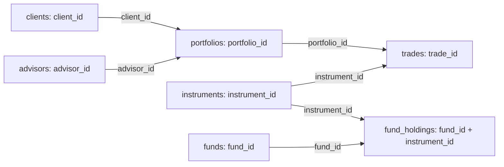

<!-- CG context: reviewed adaptation; frozen challenge source remains archived -->
### Atlas business brief

Atlas is a fictional advisory business. Its advisors want to review client accounts that have trading activity and explain the quantities, trading values and transaction charges shown in the report. Your team creates the data product that supports those conversations. This gives the exercise a clear business setting while keeping it separate from Capital Group's internal organisation and investment systems.

The source name `portfolio_id` means **client account** in this exercise. A client can have several accounts, and each account records a client key and an advisor key. The advisor is the person responsible for the client relationship. This is a different responsibility from a portfolio manager selecting investments for a fund or managing a portion of a portfolio. Keep the source identifiers beside the names so a reader can follow the actual relationships.

The core question is: **Which accounts have qualifying trades in the supplied period, what net quantities do those trades produce, and what transaction charges did they incur?** The advanced reports group the account results by advisor and region. They practise aggregation, ranking and reconciliation. A real comparison of managed wealth would also require complete account balances and conversion to a common currency; Atlas does not supply those inputs.

The trades run from 3 June 2024 to 29 May 2026 UTC. The reference calculations use all qualifying trades in that period. For each instrument, the model picks the newest execution across the participating accounts, ordering by `ts` and then `trade_id`, and uses its price as an estimate for valuation. That is the latest price observed in these trades, rather than an independently supplied daily market price. There is no separate reporting-date cutoff. Record this time basis in the contract; a report for a chosen historical date would need a cutoff rule and newly checked results.

The quantity calculation adds buys and subtracts sells. It tells us the net quantity represented by the supplied trades. We do not know what was held at the start, and the data does not include other changes such as transfers or corporate actions. Cash balances and movements are also absent. A sale usually produces cash, but this report has no cash ledger in which to record it. For the same reason, a negative net quantity does not prove that the account has an authorised short position: it could reflect securities acquired before the supplied period.

A security purchase or sale is an execution inside an account. It is different from a client depositing or withdrawing money, and from a subscription or redemption in a fund. Those other events, lot-level cost basis and account ownership of fund shares are not supplied. Keep the report's claims within what these trades can establish.

Phase 1 supplies dimensions, latest-price and position stages while teams author the valid-trade fact and account summary. Discuss two candidate outputs during the separately allocated 30–60 minute discovery exercise, then implement the single finite Phase 1 core. Phase 2 reporting is separately timed. Save the four-section discovery worksheet, mapping, chosen key trace, assumptions and run evidence in `evidence.md`; save the agreed population/measure promises in `contract.md`, both beside the copied project. The current entry point is `mise run challenge:v2:prepare capstone phase-one-certified` from the training project root; the copy is `.local/challenges-v2/capstone/phase-one-certified`.

#### What each source provides

The seven CSV files each provide a different part of the story. The table shows what one row represents, which keys connect it to other files and what information it can supply. The producer column names responsibilities to assign in the exercise, rather than real CG departments. A file is the delivery artifact; a person or team must answer questions about its contents. Raw reference files contain deliberate defects, so use the supplied cleaning rules before counting entities or relying on a key.

| File | Rows and keys | Connections and information | Units, time and limits | Responsible role |
|---|---|---|---|---|
| `advisors.csv` | Advisor; `advisor_id` | Name and region for the account's advisor key | Reference attributes, not investment-manager assignments | Client-relationship reference owner |
| `clients.csv` | Client; `client_id` | Name, segment and domicile for the account's client key | No account cash or fund subscriptions | Client reference owner |
| `portfolios.csv` | Account; `portfolio_id` | `client_id`, `advisor_id`, strategy and inception date | Inception is not a supplied opening balance; conformed population 2,500 | Account reference owner |
| `instruments.csv` | Instrument; `instrument_id` | Ticker, name, asset class, sector and currency metadata | No independent price or dated valuation feed | Instrument reference owner |
| `trades.csv` | Execution; `trade_id` | `portfolio_id`, `instrument_id`, `ts`, side, quantity, price, fee, venue and currency | `ts` is epoch seconds; `qty` is a raw magnitude; qualifying quantities are positive; `price_cents / 100`; `fee_bps / 10000`; valid sides B/S | Trading-event source owner |
| `funds.csv` | Illustrative fund reference; `fund_id` | Name and style referenced by fund weights | No outstanding shares, liabilities or NAV | Fund reference owner |
| `fund_holdings.csv` | Fund/instrument weight reference; candidate pair `fund_id`, `instrument_id` | Fund and instrument keys, `weight_pct` | Percentage reference weights, with no holdings date, quantities or valuation; target versus actual is not established | Fund-weight reference owner |

The weights file associates funds with instruments and percentages. It does not tell us when those weights were observed, how many units were held or whether the percentages are targets. It also has no account key. The account-report core therefore uses the relevant trade and reference files without trying to connect every supplied dataset.


<!-- caption: "Atlas supplied key relationships, subject to conformance and uniqueness checks. There is no account-to-fund ownership edge; arrows show reference-key relationships, not money movement." -->

For an actual trace, raw trade `1` refers to account `2385` and instrument `794`; account `2385` supplies client `808` and advisor `51`. Follow those separate keys into the conformed dimensions and retain them in the output. Joining advisor `51` through client `808` as though their integer IDs were the same relationship loses or misattributes accounts.

Reject the proposed ownership path **account → trades → instrument → fund weights → fund**. It finds instruments shared with a reference fund; it does not prove that the account owns fund shares. A security can occur in many funds, so this join can repeat account values before a sum. Fund-share ownership would need a separately specified instrument mapping or account/fund-position bridge and quantity semantics. Every AI-generated diagram edge must cite a supplied key, a declared assumption or an unresolved question.

#### Reading the report

The SQL keeps its existing field names so the supplied models and checks continue to work. Use the explanations below when presenting the results. Money is calculated in the supplied currency units without conversion. Check the currency on the trade and instrument before interpreting an amount; grouping records by account does not make unlike currencies comparable.

| Compatible identifier | Consumer label and definition | Grain, population and check |
|---|---|---|
| `net_qty` | Net trade-derived quantity: buys minus sells | Account/instrument with qualifying activity; may be negative or zero; opening quantity unknown |
| `market_value` | Estimated trade-derived position value: net quantity × latest qualifying execution-price proxy | Account/instrument; proxy scope/window above; zero/negative results are not automatically invalid |
| `aum`, `book_aum` | Estimated trade-derived position value, or advisor aggregate of that value | Active accounts only, then advisor; sum once per declared grain; no complete AUM or cross-currency wealth claim |
| `positions` | Instrument groups with qualifying activity | Includes zero-net groups; an open-holding count needs a separate rule |
| `trades` | Qualifying execution count | Count valid trade IDs; not orders, fund subscriptions or external cash movements |
| `fees_paid`, `fees_generated` | Transaction charges paid by participating accounts | Execution quantity × execution price × fee basis points / 10,000; not advisor revenue or management fees |
| `net_flow` | Net traded value: purchase value minus sale value | Account activity in supplied window; not external cash flow or cash balance |
| `rpt_portfolio_performance` | Account trading activity and transaction-cost summary | Does not calculate investment return or remaining-lot gains; blended fee rate is fees / gross traded value × 10,000, null when denominator is zero |

Check the report itself as well as its inputs. An earlier trade check cannot tell you whether a later join duplicates rows, assigns the wrong advisor or loses an eligible account. Check required keys, the accounts included, amounts and what each count means. Phase 1 preserves 10,000 raw trades, 9,880 valid trades, 3,717 account/instrument activity groups and 1,028 active account summaries. The 1,472 conformed accounts without qualifying trades are expected exclusions, not missing account identifiers. Upstream eligibility does not prove that a later join, group or descriptive label is correct.

#### From a source field to a report field

For this example, the trading-event source owner supplies executions through `trades.csv`. The creator cleans and transforms those records into the account summary. An advisor uses the report, and a business owner agrees what it should mean and which examples will establish that it is correct. A platform operator supports the environment in which it runs. One person can hold several responsibilities, but the file itself cannot explain a source problem or approve a change.

A data dictionary explains what fields mean. A source-to-target mapping shows where an output field comes from and how it is calculated, including any joins and unit conversions. The examples below show the distinction. Complete four to six fields for your chosen core using the same pattern.

| Target | Meaning | Source fields | Keys | Rule | Units and time | Check |
|---|---|---|---|---|---|---|
| `advisor_name` | Client-relationship advisor label | `portfolios.advisor_id`; `advisors.name` | Account key first; then `advisor_id` | Supplied conformance and descriptive lookup | Reference label; preserve IDs | Unique advisor dimension; no key loss or multiplication |
| Trade `fee` | Transaction charge on a qualifying execution | `trades.qty`, `price_cents`, `fee_bps` | No enrichment join needed | `qty × (price_cents / 100) × (fee_bps / 10000)` | Nominal execution-currency units at `ts` | Manual execution calculation; valid IDs retained; fee uses execution price |
| Report `aum` | Estimated trade-derived account position value | Prepared positions `market_value` | `portfolio_id`; enrich via separate client/advisor keys | Sum once per account | Nominal proxy value over supplied window | Exact active key set and independent per-account values; no invented fund join |

For trade `1`, `145 × 102.81 = 14,907.45` nominal USD execution value; at 29 basis points the charge is `43.231605` before any separately declared rounding. Its execution value is not the current value of account `2385`. Record an unresolved quotation or rounding assumption instead of silently adding a business rule.

# Instructor: capstone phase-two-proficient

The following reasoning is generated from the canonical learner phase. Runnable reference files are in `solution/`; learner setup and task prose remain authoritative in `challenges/v2/capstone/phase-two-proficient/README.md`. Use the complete updated instructor training workspace for runtime commands. Current local checks do not establish fresh connected reconstruction or human acceptance.

## Reference and starter commands

From the updated training project root, use the version-explicit interface. Verification preserves source bytes and runs reference work in a temporary owned copy. Airflow needs fresh scheduled/API/warehouse evidence from the owned stage.

```bash
mise run challenge:v2:verify-starter capstone phase-two-proficient --mode offline
mise run challenge:v2:verify-solution capstone phase-two-proficient --mode offline
```

Supporting or blocked output is not connected completion. Actual learner explanations and intended negative drills need review alongside business behavior.

## Phase-owned reasoning


Read these explanations after attempting the checks.

### Reasoning: Build a trading-activity and cost report

<a id="capstone-p2-01-reasoning"></a>

<details>
<summary>Reasoning for capstone-p2-01: Weighted rate and investment performance are different measures</summary>

Bought/sold values need portfolio-level aggregation before joining summary. Realized fee basis points divide total fees by total traded volume and scale by ten thousand; an average raw rate would answer another question. The zero case is explicitly null-safe. Net traded value and nominal current estimated position value have different meanings, and the fixture does not establish flow-adjusted return or FX-normalized valuation. Independent per-portfolio values protect these distinctions.

Learner task: `capstone-p2-01` in `challenges/v2/capstone/phase-two-proficient/README.md`.

</details>

### Reasoning: Rank advisor books with explicit ties

<a id="capstone-p2-02-reasoning"></a>

<details>
<summary>Reasoning for capstone-p2-02: Tie meaning is part of the consumer contract</summary>

Dense rank groups equal book values and advances by distinct values, while stable display ordering may add an advisor-ID tie-break. The leaderboard retains participating advisor keys, region and independently reconciled totals. Names are descriptive attributes. The explicit tie example tests the rule even if the supplied fixture lacks ties. Its book comparison remains a nominal teaching aggregate, not FX-normalized investment advice.

Learner task: `capstone-p2-02` in `challenges/v2/capstone/phase-two-proficient/README.md`.

</details>

### Reasoning: Build the regional rollup from its declared dependency

<a id="capstone-p2-03-reasoning"></a>

<details>
<summary>Reasoning for capstone-p2-03: The regional dependency and aggregation grain stay explicit</summary>

The report aggregates the leaderboard's advisor-grain rows, retaining region membership and measure meanings. The trading-activity and cost report is another consumer view, not a hidden prerequisite. Independent source-derived region membership protects against a shared upstream mapping error. Advisor count, portfolio count and monetary totals are separate obligations, and the resulting native-unit sums retain their teaching limitation.

Learner task: `capstone-p2-03` in `challenges/v2/capstone/phase-two-proficient/README.md`.

</details>

### Reasoning: Reconcile independently and reject a defect

<a id="capstone-p2-04-reasoning"></a>

<details>
<summary>Reasoning for capstone-p2-04: A useful negative case fails on the predicted business difference</summary>

The omission drill removes a known nonempty advisor contribution while leaving raw baseline inputs intact. A meaningful reconciliation detects the affected region's membership/count/value difference independently. Restoring the predicate repairs that cause. Shared filtered outputs or looser tolerance could conceal the loss, and an unrelated nonzero command would not establish the drill. Retain baseline, failure and repaired evidence as separate observed states.

Learner task: `capstone-p2-04` in `challenges/v2/capstone/phase-two-proficient/README.md`.

</details>

### Reasoning: Present a fixed completed core and select stretch

<a id="capstone-p2-05-reasoning"></a>

<details>
<summary>Reasoning for capstone-p2-05: Completeness means the declared core, not every optional extension</summary>

The advanced core connects three explicit report grains with independent population/value evidence and a meaningful regional omission repair. Tie and zero cases demonstrate semantics even when absent from the main fixture. The team discloses supplied baseline and nominal-money limits, then selects optional depth with separate prerequisites and timing. A local authored candidate does not establish connected orchestration or human presentation acceptance, and it does not imply production publication.

Learner task: `capstone-p2-05` in `challenges/v2/capstone/phase-two-proficient/README.md`.

</details>
